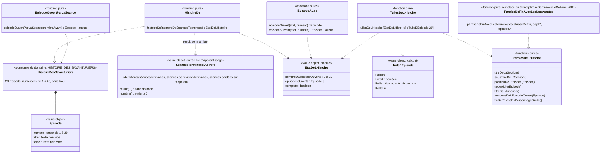

# Modèle du domaine : issue #33, Épisodes de l'histoire, un épisode s'ouvre à chaque séance

> Cadrage anticipé (décision 0020, point 6). Rien n'est codé avant le merge des dépendances : #27 (test de départ), #28 (séances de révision), #30 (série, lecture des séances terminées), #65 (écran « Mes médailles ») et, en pratique, #32 (cabane, PR #88), qui ouvre la zone « nouveautés » de l'écran de fin et compose déjà la phrase de fin du personnage guide.
> **Modèle validé par le PO le 2026-10-25** : « 33. reco OK » (annonce du responsable, https://github.com/SBA-dev/github-move/issues/33#issuecomment-6400998421). Les questions 33.1 à 33.27 sont devenues la section « Décisions » : toutes les recommandations sont retenues, et les textes d'interface qui étaient « à valider » sont validés. Le code commence après le merge de #30 (et de #32).

## Contexte

Bounded context de la story : **Motivation**, avec une lecture seule dans **Apprentissage** (séances terminées et séances de révision terminées du profil).

Pourquoi Motivation :
- l'épisode est une récompense : la context map dit « Motivation décide seule des récompenses (série, badges, cabane, épisodes) ; une récompense ne modifie jamais une note » ;
- il ne fait que **compter** des séances déjà terminées : Apprentissage les enregistre (#24, #28), Motivation ne les modifie pas et ne lit ni étoile, ni erreur, ni leçon ;
- il s'affiche à trois endroits que Motivation compose déjà : la section `histoire` de « Mes médailles » (#65, réservée en deuxième place), la zone « nouveautés » de l'écran de fin (#32) et la phrase de fin du personnage guide (`parolesDeFinDeSeance`, #24, complétée par `phraseDeFinAvecLaCabane`, #32).

**Modèle retenu (décision 33.8) : les épisodes ouverts ne sont pas enregistrés, ils se recalculent.** Le nombre d'épisodes ouverts dépend seulement du nombre de séances terminées du profil ; or une séance terminée enregistrée ne disparaît jamais (seulement avec le profil). Donc le nombre ne baisse jamais, donc aucun épisode ne se referme, sans rien stocker. C'est le choix de #25 (parcours), #65 (records), #32 (cabane, décision 32.20) et #30 (série, décision 30.5 a : « pas de journal propre à Motivation ») : une **vue calculée** par des fonctions pures de `@domain/motivation`, à partir de ce que le front lit déjà sous RLS. Motivation **ne s'abonne pas** à `SeanceTerminee`. L'issue proposait un compte « en base » : il y est déjà, sous la forme des séances terminées d'Apprentissage.

### Sources lues, sans rien écrire

| Source | Contexte | Ce qui est lu | Mécanisme |
|---|---|---|---|
| Séances terminées du profil en cours | Apprentissage (#24) | l'**identifiant** de chaque séance terminée (séance complète, d'un exercice, de fluence seule : `etoiles` peut être absent) | Lecture du front sous RLS (`seances_terminees`, policy de lecture par un parent rattaché), la même que #29 et #30 (à partager) |
| Séances de révision terminées du profil en cours | Apprentissage (#28) | l'identifiant de chaque séance de révision terminée | Lecture du front sous RLS (`seances_de_revision_terminees`, #28). 28.16 : « Séance » inclut la séance de révision |
| Séances gardées sur l'appareil | Apprentissage (#24, #28) | l'identifiant de chaque envoi en attente | Mémoire du front (`useRenvoiDesSeancesGardees`), comme #30 : une séance finie hors ligne compte tout de suite |
| Profil en cours | Famille | identifiant, univers, réglage **Tout lire à voix haute** | Customer/Supplier existant (#11, #12), comme #65 et #32 |
| Univers et personnage guide | Motivation (#6) | `universDe(cle)` : image, nom, caractère de la voix | Interne |
| Lecture à voix haute | Voix (#7) | port `LecteurAVoixHaute` (rappel à chaque mot pour le surlignage, fin de lecture, arrêt) | Appel depuis le front (décision 0007) |

Pourquoi l'**identifiant** et pas un simple nombre : une séance gardée sur l'appareil peut être déjà arrivée au serveur sans être encore retirée de l'appareil (envoi réussi, réponse perdue). L'union par identifiant la compte une seule fois, comme l'enregistrement idempotent de #24. Le nombre de séances d'un profil reste petit (quelques centaines par an).

Non lus, volontairement :
- **Résultat du test de départ** (#27) : le test de départ n'est pas une séance, Motivation ignore `TestDeDepartTermine` (27.4). Rien à exclure : il n'est ni dans `seances_terminees`, ni dans `seances_de_revision_terminees`.
- **Étoiles, meilleures étoiles, leçons** : un épisode s'ouvre quelles que soient les étoiles (legacy ; question 33.7).
- **Jour des séances** (30.6) : inutile si la règle est « une séance, un épisode » (33.1). Il deviendrait nécessaire si le PO choisit « un jour de séance, un épisode » : on lirait alors les `JoursDeSeance` de #30.

### Comportement du legacy (`app/app.js`), source des règles et non modèle

- `EPISODES` (l. 1767) : 20 couples `[titre, texte]`. Titres exacts, dans l'ordre :
  1. « La carte froissée »
  2. « Le premier indice »
  3. « Le pont des lettres »
  4. « Pipo le hérisson »
  5. « La forêt qui chuchote »
  6. « Le moulin des nombres »
  7. « Une plume dans le vent »
  8. « La pluie de verbes »
  9. « Le village des sons »
  10. « La nuit des lucioles »
  11. « Le géant endormi »
  12. « La boutique du renard »
  13. « Le pied de la montagne »
  14. « L'automne en couleurs »
  15. « La grotte de l'écho »
  16. « L'horloge de glace »
  17. « La tempête de neige »
  18. « Le dernier escalier »
  19. « L'Étoile du savoir »
  20. « Le retour des Savanturiers »

  Les 20 textes sont à reprendre **mot pour mot** depuis `app/app.js` (l. 1768 à 1787), sauf décision contraire du PO (33.24). Personnages : Noisette, Pipo le hérisson, Céleste l'hirondelle, Monsieur Renard, un géant, le maire du village.
- `episodesOpen()` (l. 1789) = `min(20, jours_<id>.sessions)` : nombre total de séances. `Days.addSession()` (l. 1918) est appelé à chaque écran de fin **sauf le test de départ** : leçon complète, un seul jeu, fluence seule, leçon rejouée, révision, mots de la semaine, quelles que soient les étoiles. Une séance quittée avant l'écran de fin ne compte pas.
- `showTrophees` (l. 630) : section « L'histoire des Savanturiers », sous-titre « Un nouvel épisode s'ouvre à chaque leçon terminée. », 20 tuiles : numéro, puis le titre (ouverte, bouton) ou « À découvrir » (fermée, bouton désactivé). Section toujours affichée.
- Écran de fin (l. 1895, 1937) : `before.eps` lu avant l'enregistrement, `after.eps` après ; si `after > before`, encart « Nouvel épisode ! », titre de l'épisode `after.eps`, bouton « Lire l'épisode » (retour : accueil). La phrase du personnage guide se termine par « Un nouvel épisode de l'histoire t'attend ! », **avant** la fin de phrase de la cabane (ordre du legacy : épisode, cabane, badge). Rien au test de départ.
- `showEpisode(i)` (l. 1961) : titre, « Épisode `<i>` sur 20 », image de **Noisette** (`WORLDS.animaux`) quel que soit l'univers, texte lu dès l'ouverture avec surlignage des mots (`speakHighlight`, vitesse 0,92) avec la voix du personnage guide du profil (`styleNow()`) ; bouton « Réécouter » ; « Fermer le livre » ; « Épisode suivant » si l'épisode suivant est ouvert ; pas de « précédent ». Seul le texte est lu, pas le titre.

### Ce que montre la cible

- L'écran de fin retient la séance tout de suite et l'envoie en arrière-plan : une lecture des séances faite pendant l'écran de fin peut déjà l'inclure ou pas, selon l'envoi. Comme pour la cabane (#32), le nombre « avant » se lit donc **au lancement de la séance** (33.9).
- Une séance de fluence seule est enregistrée (`etoiles` vide, #20, Q69), mais l'écran de fin n'appelle pas `parolesDeFinDeSeance` : le personnage guide a déjà dit les paroles de fin de fluence (`onDireLaFin(undefined, …)`). La phrase « Un nouvel épisode… » n'a donc pas de place toute faite (33.12).
- La séance de révision a sa propre fin (#28) : la zone « nouveautés » n'y existe pas encore (33.12).
- Voix (#7) : rythme normal 1, rythme lent 0,65 ; pas de rythme 0,92 (33.15).

## Termes

| Terme | Statut | Remarque |
|---|---|---|
| Épisode | au glossaire, **redéfini** (décisions 33.1, 33.2, 33.27) | L'ancienne ligne (« chapitre de l'histoire de l'univers », « s'ouvre à chaque jour de séance ») contredisait le legacy. Nouvelle définition : une des 20 parties de l'histoire des Savanturiers ; un épisode s'ouvre à chaque séance terminée, dans l'ordre, quel que soit l'univers. Synonyme interdit « chapitre » gardé ; « histoire » reste interdit **pour un seul épisode** |
| Histoire des Savanturiers | **validé** (33.27) | La suite des 20 épisodes, la même pour tous les profils (33.2). Interface : titre de la section « L'histoire des Savanturiers » (33.6). « Histoire » désigne l'ensemble ; il reste interdit pour **un** épisode |
| Épisode ouvert | **validé** (33.27) | Épisode dont le numéro est inférieur ou égal au nombre de séances terminées du profil (33.1). Il ne se referme jamais. Contraire : épisode fermé (interface : « À découvrir »). Verbe : « s'ouvre » (legacy), jamais « se débloque » |
| Nombre de séances terminées | **nom de calcul**, hors glossaire (33.27) | Séances terminées et séances de révision terminées du profil, comptées une fois chacune (identifiant). Ce n'est **pas** un score ni une note, et pas le **nombre de séances** du résultat de la leçon (#24, Décision n°27), qui compte les séances d'une seule leçon |
| Épisode ouvert par la séance | **nom de calcul**, hors glossaire (33.27) | L'épisode qui s'ouvre parce que la séance qui vient de finir est terminée (numéro = nombre avant + 1), annoncé à l'écran de fin |
| Séance terminée, Séance de révision | au glossaire (#24, #28) | Les deux ouvrent un épisode (33.7, comme la série : 30.4, 28.16) |
| Jour de séance | au glossaire (validé, Apprentissage) | Sa définition dit « sert à la série et aux épisodes » : à corriger, 33.1 retenant « chaque séance » (les épisodes ne lisent pas le jour) |
| Test de départ | au glossaire (validé) | N'est pas une séance : n'ouvre aucun épisode (27.4) |
| Étoile du savoir | **conflit n°1** du glossaire, **tranché** (33.4) | Nom d'un objet de l'histoire (titre de l'épisode 19, textes 1, 19). **Pas un terme du domaine**, comme « l'étoile magique » de la cabane (32.6) ; il ne compte dans aucun total (33.4) |
| « Leçon terminée » (sous-titre du legacy) | **tranché** (33.6) | Synonyme interdit de **Leçon réussie**. Sous-titre retenu : « Un nouvel épisode s'ouvre à chaque séance terminée. » |
| « Mes trophées » | **tranché** (65.1) | L'écran s'appelle « Mes médailles » ; « trophée » reste interdit |
| Écran des récompenses de l'enfant, Section de l'écran | au glossaire, `(à valider)` (#65) | La section `histoire` existe dans l'ordre des sections (cabane, histoire, badges, records) |
| Zone « nouveautés » de l'écran de fin | mot d'interface (#24, #32) | #33 y ajoute l'encart « Nouvel épisode ! » |
| « Nouvel épisode ! », « Lire l'épisode », « À découvrir », « Épisode `<i>` sur 20 », « Fermer le livre », « Épisode suivant », « Réécouter » | mots d'interface (legacy) | Hors glossaire. « Livre » n'est pas un terme du domaine |
| Tuile d'épisode | mot d'interface | Type `TuileDEpisode` du domaine, pas un terme du glossaire (comme « Pastille de la cabane », #32) |
| chapitre, niveau, débloquer, leçon terminée | **interdits** | « Niveau » est réservé au Catalogue (CP à CM2) |

## Modèle

Pas d'agrégat : aucune commande d'écriture, aucun état gardé, aucun invariant d'écriture. Des **value objects**, une **constante du domaine** et des **fonctions pures** dans `motivation/domain/`.



Les noms de code sont des noms de travail ; 33.1, 33.2 et 33.6 sont tranchés (voir « Décisions »).

### Value objects et constante

| Élément | Règles de validité |
|---|---|
| `Episode` | `numero` entier de 1 à 20 ; `titre` et `texte` non vides, tels qu'ils seront affichés et lus. |
| `HISTOIRE_DES_SAVANTURIERS` | les 20 épisodes du legacy, dans l'ordre, numéros 1 à 20 sans trou ni doublon, titres tous différents. Constante vérifiée par les tests. Où vivent les textes : 33.5. |
| `SeancesTermineesDuProfil` | forme propre à Motivation : un ensemble d'identifiants de séance, sans doublon (Motivation n'importe ni `SeanceTerminee` ni `SeanceDeRevisionTerminee`). `reunir(lues, revisionsLues, gardees)` fait l'union dans le domaine, pas dans React. Peut partager son code avec `JoursDeSeance` de #30 si les deux lisent les mêmes séances (à voir au moment du code). |
| `EtatDeLHistoire` | `nombreDEpisodesOuverts` = min(20, nombre de séances terminées) ; `episodesOuverts` = les épisodes 1 à ce nombre, dans l'ordre ; `complete` ⇔ 20 épisodes ouverts. |
| `TuileDEpisode` | une par épisode, dans l'ordre ; `ouvert` ⇔ numéro ≤ nombre d'épisodes ouverts ; `libelle` = titre si ouvert, sinon « À découvrir » ; `libelleLu` = forme lue par le lecteur d'écran (33.21). |

### Erreurs métier

| Erreur | Quand |
|---|---|
| `NombreDeSeancesInvalide` | `histoireDe` ou `episodeOuvertParLaSeance` reçoit un nombre négatif, non entier ou infini. |
| `EpisodeInconnu` | un numéro hors de 1 à 20. |
| `EpisodeNonOuvert` | on demande à lire un épisode fermé (`episodeOuvert`). L'écran ne le propose jamais : c'est une garde, pas un message à l'enfant. |

### Fonctions pures

1. `histoireDe(nombre)` : `EtatDeLHistoire`. Exemples : 0 → aucun épisode ouvert ; 1 → « La carte froissée » ; 20 → complète ; 35 → complète, 20 ouverts.
2. `episodeOuvertParLaSeance(nombreAvant)` : si `nombreAvant` < 20, l'épisode n° `nombreAvant + 1` ; sinon aucun. Exemples : 0 → « La carte froissée » ; 18 → « L'Étoile du savoir » ; 19 → « Le retour des Savanturiers » ; 20 → aucun. `nombreAvant` est le nombre de séances terminées **lu au lancement** de la séance (33.9) ; inconnu → aucune annonce.
3. `episodeOuvert(etat, numero)` et `episodeSuivant(etat, numero)` : l'épisode à lire ; le suivant seulement s'il est ouvert (« Épisode suivant » n'apparaît que dans ce cas) ; aucun après le 20.
4. `tuilesDeLHistoire(etat)` : les 20 tuiles, dans l'ordre.
5. Paroles (`paroles-de-l-histoire.ts`), textes du legacy sauf mention :
   - `titreDeLaSection()` : « L'histoire des Savanturiers » (33.6) ;
   - `sousTitreDeLaSection()` : « Un nouvel épisode s'ouvre à chaque séance terminée. » (décision 33.6 ; le sous-titre du legacy, « … à chaque leçon terminée. », est abandonné) ;
   - `positionDeLEpisode(episode)` : « Épisode `<i>` sur 20 » ;
   - `texteALire(episode)` : ce que lit la voix à l'ouverture et avec « Réécouter » : le titre, puis le texte (décision 33.16) ;
   - `titreDeLAnnonce()` : « Nouvel épisode ! » ; `annonceDeLEpisodeOuvert(episode)` : son titre ;
   - `finDePhraseDuPersonnageGuide()` : « Un nouvel épisode de l'histoire t'attend ! » ;
   - `phraseDeFinAvecLesNouveautes(phraseDeFin, { objet, episode })` : la phrase de fin, puis les fins de phrase des nouveautés dans un ordre fixe (33.13). Remplace la composition `phraseDeFinAvecLaCabane` de #32 ou l'appelle : composition dans le domaine, jamais dans React (comme 32.12).

### Épisode ouvert à la fin de la séance, sans rien écrire en base

Comme la cabane (#32) : le nombre « avant » ne peut pas être relu après la séance. Le front lit `SeancesTermineesDuProfil` **au lancement de la séance**, avec un délai maximal (5 s chez #32), et l'écran de fin passe son nombre à `episodeOuvertParLaSeance`. Lecture impossible, trop lente ou sans réseau → aucune annonce (jamais d'annonce d'un épisode déjà ouvert). La séance en cours n'est jamais dans ce nombre : elle n'existe ni en base, ni sur l'appareil, au lancement.

Ce calcul ne donne au front aucun pouvoir : il n'écrit rien. Une séance refusée par le serveur (`SeanceIncoherente`) peut au pire faire annoncer un épisode qui sera fermé après un rechargement (même compromis que 30.13 et Q78) (33.23).

### Section « histoire » de l'écran « Mes médailles » (#65)

- `sectionsDeLEcran({ pastilles, cabane, histoire })` : `histoire` est un `EtatDeLHistoire` ou `undefined` (nombre inconnu). Section disponible dès que `histoire` est défini, même à 0 épisode ouvert (33.21) ; elle reste **deuxième**, entre la cabane et les badges (ordre de #65, inchangé).
- `parolesDuGuideALOuverture` : un épisode ouvert compte comme « quelque chose à montrer » (33.22).
- `parolesALOuverture({ toutLire, … })` : avec « tout lire », après la cabane, le titre de la section puis son sous-titre ; les 20 tuiles ne sont pas lues (33.22, comme 32.10).
- Une tuile ouverte ouvre l'écran de l'épisode ; « Fermer le livre » ramène à « Mes médailles ».

### Écran d'un épisode

- Composé par le front avec les fonctions ci-dessus : titre (`h1`), position (« Épisode `<i>` sur 20 »), personnage guide et voix (33.2), texte surligné mot à mot pendant la lecture (`LecteurAVoixHaute`, `onMot`), boutons « Réécouter », « Fermer le livre » et « Épisode suivant » (si ouvert) ; pas d'« Épisode précédent » (décision 33.17).
- Lecture automatique à l'ouverture (33.15), arrêtée en quittant l'écran ou en passant à l'épisode suivant ; Muet respecté.

### Commandes et lectures

| Commande ou lecture | Effet | Erreurs métier | Où |
|---|---|---|---|
| Lecture des séances terminées du profil en cours | Identifiants des séances terminées et des séances de révision terminées, sous RLS, réunis avec les séances gardées sur l'appareil ; `undefined` en cas d'échec ; au lancement d'une séance, délai maximal | aucune (échec : `undefined`) | front, JWT du parent (lecture à partager avec #29 et #30) |
| `histoireDe`, `episodeOuvertParLaSeance`, `episodeOuvert`, `episodeSuivant`, `tuilesDeLHistoire`, paroles | Calcul pur | `NombreDeSeancesInvalide`, `EpisodeInconnu`, `EpisodeNonOuvert` | navigateur |
| Lire un épisode | Navigation et lecture à voix haute (port `LecteurAVoixHaute`) | aucune | front |

Aucune commande d'écriture. `TerminerLaSeance` (#24) et `TerminerLaSeanceDeRevision` (#28) restent les seules écritures qui font avancer l'histoire.

### Migration et Edge Function

- **Pas de migration** (décision 33.8) : `seances_terminees` et `seances_de_revision_terminees` contiennent tout ce qui est compté ; policies de lecture, cascade avec le profil et export existent (#24, #28). La colonne de jour de 30.6 n'est pas nécessaire ici (décision 33.1 : chaque séance terminée).
- **Pas d'Edge Function** : lecture directe sous RLS (décisions 0013 et 0016).
- Une histoire qui dépendrait d'autre chose que du nombre de séances (épisodes choisis, histoire par univers changée en cours de route, nouvelle histoire après la 20e séance avec reprise à 1) demanderait un état enregistré (33.2, 33.3).

## Invariants

L'état étant calculé, ce sont des **règles du calcul**, couvertes par les tests des fonctions pures :

1. Le nombre d'épisodes ouverts est min(20, nombre de séances terminées du profil) (décision 33.1).
2. Une séance terminée compte **une seule fois**, même renvoyée ou gardée sur l'appareil puis envoyée (identifiant).
3. Comptent : toute séance terminée et toute séance de révision terminée ; ne comptent pas : le test de départ (27.4), une séance quittée avant la fin (33.7).
4. Les épisodes s'ouvrent **dans l'ordre**, de 1 à 20, et un épisode ouvert ne se referme jamais (les séances terminées ne disparaissent pas), même en changeant d'univers.
5. Une séance ouvre **au plus un** épisode ; l'écran de fin n'annonce que l'épisode ouvert par **cette** séance, et seulement si le nombre d'avant a été lu.
6. Après 20 séances, aucune séance n'ouvre d'épisode (33.3).
7. « Épisode suivant » n'est proposé que si l'épisode suivant est ouvert.
8. L'histoire ne dépend ni des étoiles, ni de l'heure, ni de la date, ni du temps passé : aucun épisode n'est limité dans la journée (pas de temps d'écran, décision 0005).
9. Motivation ne modifie jamais une séance, une étoile ni un résultat, et n'écrit rien.
10. L'histoire ne montre que les séances du profil en cours (même entre deux enfants d'un même parent).
11. Les mêmes séances donnent toujours les mêmes épisodes ouverts (calcul déterministe).

## Événements

Aucun nouvel événement, aucun abonnement (33.8). `SeanceTerminee` (#24) et `SeanceDeRevisionTerminee` (#28) restent publiés par Apprentissage et ne sont pas consommés ici : l'histoire se recalcule à la lecture. `TestDeDepartTermine` est ignoré (27.4). Pas d'`EpisodeOuvert` : rien n'y réagirait.

## Relations avec les autres contextes

| Amont | Aval | Relation | Mécanisme |
|---|---|---|---|
| Apprentissage | Motivation (histoire) | Lecture seule, calcul dans le domaine | Le front lit les identifiants des séances terminées et des séances de révision terminées du profil en cours sous RLS, les réunit avec les séances gardées sur l'appareil et passe le résultat à `@domain/motivation` sous une forme propre. Même lecture que la série (#30) |
| Apprentissage (écran de fin) | Motivation (histoire) | Appel depuis le front | L'écran de fin passe le nombre de séances d'avant (lu au lancement) ; Motivation rend l'épisode ouvert, l'annonce et la phrase de fin complétée, que le front affiche dans la zone « nouveautés » et fait dire au personnage guide |
| Motivation | Voix | Appel (#7) | Lecture du texte d'un épisode par `LecteurAVoixHaute`, avec le caractère de la voix fourni par Motivation (33.2) |
| Famille | Motivation | Customer/Supplier existant (#6, #12) | Univers et réglage Tout lire du profil en cours |
| Famille | Motivation | Contrat de données personnelles (#14) | Rien de nouveau (décision 33.8) |

## Partage avec le front

- Dans `@domain/motivation` (`index.ts`, ajouts seulement) : `HISTOIRE_DES_SAVANTURIERS`, les types `Episode`, `EtatDeLHistoire`, `SeancesTermineesDuProfil`, `TuileDEpisode`, les fonctions `histoireDe`, `episodeOuvertParLaSeance`, `episodeOuvert`, `episodeSuivant`, `tuilesDeLHistoire`, les paroles de l'histoire, `phraseDeFinAvecLesNouveautes` et les erreurs. `sectionsDeLEcran` et `parolesALOuverture` (#65, #32) reçoivent `histoire`.
- **Hors ligne** : le calcul et les 20 textes (si 33.5 retient le domaine) sont dans le navigateur ; une séance finie hors ligne compte tout de suite (séance gardée sur l'appareil). Ce qui manque sans réseau, c'est le nombre de séances du serveur (33.10 ; copie sur l'appareil : #44).
- React affiche les tuiles, l'écran de l'épisode, l'encart ; aucun calcul de numéro, de minimum, d'ordre des nouveautés ni de composition de phrase dans un composant.
- Accessibilité (front) : section en `h2` sous « Mes médailles », tuiles en liste de boutons de 44 px, tuile fermée annoncée avec son numéro ; écran de l'épisode à 360 px sans défilement horizontal, mode dys (police, espacement) sur le texte, surlignage visible aussi en mode dys ; encart annoncé (`role="status"`) ; animation de l'encart supprimée avec `prefers-reduced-motion` (33.26) ; tout se fait au clavier.

## Données d'enfants

**Aucune donnée personnelle nouvelle** (décision 33.8) : rien n'est enregistré (ni nombre de séances, ni épisodes ouverts). L'histoire lit les séances terminées et les séances de révision terminées déjà gardées par Apprentissage, sous RLS, supprimées en cascade avec le profil et incluses dans l'export (#14). Les textes des épisodes sont du contenu, pas des données d'enfant. Rien n'est gardé sur l'appareil au-delà de ce que font déjà #24 et #28, rien n'est envoyé à l'IA. Les épisodes n'apparaissent pas dans l'Espace parent (33.25).

## Où vivent les textes des 20 épisodes (question 33.5)

| Option | Pour | Contre |
|---|---|---|
| (a) **Domaine Motivation** : constante `HISTOIRE_DES_SAVANTURIERS` dans `motivation/domain/histoire.ts` | Hors ligne sans rien charger ; même place que les objets de la cabane (`PALIERS_DE_LA_CABANE`) et les paroles du personnage guide ; la règle « 20 épisodes » et les textes restent ensemble, vérifiés par `deno test` ; ~4 Ko | Changer un texte demande une PR de code ; une seconde histoire ou une histoire par univers grossirait le domaine |
| (b) **Contenu** : textes dans `scripts/` (Python), publiés en JSON à côté de `bibliotheque.json`, lus par un mapper | Le contenu reste au pipeline ; MP3 de la voix neuronale générés au même endroit que ceux des leçons | Nouveau format publié (doc, test pytest, test de schéma, mapper, cache hors ligne de la PWA) pour 20 textes fixes ; pas de citation des programmes à vérifier |

**Décision 33.5 : (a)**, tant qu'il n'y a qu'une histoire. Passer à (b) le jour où le PO veut plusieurs histoires (33.2 c, 33.3) : ce sera alors un changement du contrat de contenu, avec sa propre story.

## Emplacement

```
supabase/functions/_shared/motivation/domain/
  histoire.ts                            # Episode, HISTOIRE_DES_SAVANTURIERS (20 titres et textes),
                                         # EtatDeLHistoire, histoireDe, episodeOuvertParLaSeance,
                                         # episodeOuvert, episodeSuivant,
                                         # NombreDeSeancesInvalide, EpisodeInconnu, EpisodeNonOuvert
  seances-terminees-du-profil.ts         # SeancesTermineesDuProfil (union par identifiant) ; à rapprocher de JoursDeSeance (#30)
  tuiles-de-l-histoire.ts                # TuileDEpisode, tuilesDeLHistoire
  paroles-de-l-histoire.ts               # titres, sous-titre, position, texte à lire, annonce, fin de phrase
  paroles-de-fin-avec-les-nouveautes.ts  # phraseDeFinAvecLesNouveautes (ou extension de paroles-de-la-cabane.ts, #32)
  sections-de-l-ecran.ts                 # (#65, #32, modifié) section « histoire »
  paroles-de-l-ecran-des-medailles.ts    # (#65, #32, modifié) lecture de la section avec « tout lire »
  index.ts                               # ajouts seulement
  *_test.ts
src/medailles/
  SectionDeLHistoire.tsx, useHistoire.ts
src/histoire/
  EcranDeLEpisode.tsx                    # titre, position, personnage guide, texte surligné, boutons
src/seance/fin-de-seance/
  seances-terminees-du-profil-supabase.ts  # identifiants sous RLS (à partager avec #29 et #30)
  EcranDeFin.tsx                         # encart « Nouvel épisode ! » (zone « nouveautés »)
src/seance/EcranDeSeance.tsx, useDeroulementDeSeance.ts   # nombre d'avant lu au lancement ; phrase de fin complétée
src/navigation.ts                        # écran de l'épisode (ajout)
```

Pas de migration, pas d'Edge Function, rien dans `apprentissage/` (décisions 33.1 et 33.8).

## Remarques (pas des questions au PO)

- **Dépendance pratique à #32** (PR #88, pas encore mergée) : #33 réutilise la zone « nouveautés », la lecture « avant » au lancement et `phraseDeFinAvecLaCabane`. #33 doit partir de `main` après le merge de #32, sinon il faudra recréer ces points d'accroche.
- **Lecture partagée avec #29 et #30** : les trois stories lisent les mêmes séances terminées. Une seule lecture côté front (identifiant, jour, leçon) évite trois requêtes ; à organiser par la première story livrée.
- **Ligne Jour de séance du glossaire** : elle dit « sert à la série et aux épisodes ». 33.1 retenant « chaque séance », il faut retirer « et aux épisodes » (modification d'une ligne existante : à faire hors vague, ou par le responsable).
- **Accompagnement (lot 6)** : mots de la semaine et leçons personnelles compteront dès qu'ils publieront une séance terminée (comme 30.4).

## Décisions

Décisions du PO du 2026-10-25 : « 33. reco OK » (annonce du responsable, https://github.com/SBA-dev/github-move/issues/33#issuecomment-6400998421). Toutes les recommandations ci-dessous sont **retenues** ; les textes « à valider » sont validés tels qu'écrits. Les questions 33.1 à 33.6 reprennent celles de l'issue (1 à 6), les suivantes viennent du modèle et des cas limites ; 33.28 à 33.31 sont dans `acceptance.md`. Déjà tranché, et repris sans question : le test de départ n'ouvre rien (27.4) ; la séance de révision est une séance (28.16) ; l'écran s'appelle « Mes médailles », la section `histoire` y est deuxième (65.1, #65) ; « Mes médailles » suit l'univers du profil (65.5) ; la cabane reste celle de Noisette (32.1).

**33.1. Règle d'ouverture** (question 1 de l'issue). Un épisode s'ouvre-t-il (a) à chaque séance terminée (code du legacy, titre de l'issue), (b) à chaque leçon réussie (sous-titre du legacy), ou (c) à chaque jour de séance (glossaire) ? Exemple : Léa fait 3 séances lundi ; (a) ouvre les épisodes 1 à 3, (c) seulement le 1.
- **Retenu (reco OK) : (a), chaque séance terminée**, comme le code et le titre de l'issue ; l'issue écrit aussi « aucun épisode n'est limité dans la journée », ce qu'interdirait (c). Le sous-titre et la définition d'Épisode au glossaire s'alignent (33.6). Conséquence assumée : un enfant peut ouvrir les 20 épisodes en un après-midi en enchaînant des séances d'un exercice.

**33.2. L'histoire suit-elle l'univers ?** (question 2 de l'issue). (a) Histoire de Noisette pour tous, image et voix de Noisette ; (b) comme le legacy : image de Noisette, voix du personnage guide du profil (un enfant de l'univers Pompiers voit Noisette et entend Capitaine Sam) ; (c) une histoire par univers (6 histoires, textes à fournir, pas à inventer) ; (d) l'histoire reste celle de Noisette, **racontée par le personnage guide du profil** (son image et sa voix : Capitaine Sam lit l'histoire de Noisette).
- **Retenu (reco OK) : (d)**. Cohérent avec 32.1 (le contenu reste celui de Noisette) et 65.5 (l'écran suit l'univers) ; corrige l'écart image/voix du legacy ; aucun texte à écrire. Dans l'univers Animaux, Noisette lit sa propre histoire, déjà écrite à la troisième personne.

**33.3. Après l'épisode 20** (question 3 de l'issue).
- **Retenu (reco OK) : rien de nouveau dans #33** : les 20 tuiles restent ouvertes, l'écran de fin n'annonce plus rien, sans message. Une seconde histoire serait une story à part, avec ses textes fournis par le PO (et alors 33.5 b). Le texte de l'épisode 20 garde « Mais chut… une nouvelle carte vient d'arriver. » (contenu du legacy).

**33.4. « L'Étoile du savoir »** (question 4 de l'issue, conflit n°1 du glossaire).
- **Retenu (reco OK)** : ce n'est pas un terme du domaine, c'est un objet de l'histoire (comme « l'étoile magique », 32.6) ; il ne compte dans aucun total d'étoiles, n'entre ni dans le code du domaine (hors texte) ni dans les scénarios comme terme. Le conflit n°1 est tranché.

**33.5. Où vivent les textes des épisodes** (question 5 de l'issue).
- **Retenu (reco OK) : dans le domaine Motivation** (constante `HISTOIRE_DES_SAVANTURIERS`), voir le tableau « Où vivent les textes ». Passage au contenu (`scripts/`, JSON) seulement avec plusieurs histoires.

**33.6. Titres et sous-titre de la section** (question 6 de l'issue ; l'onglet est déjà « Mes médailles », 65.1).
- **Retenu (reco OK)** : garder « L'histoire des Savanturiers » (aucun conflit une fois **Histoire des Savanturiers** au glossaire) ; remplacer le sous-titre « Un nouvel épisode s'ouvre à chaque leçon terminée. » (« leçon terminée » est un synonyme interdit de Leçon réussie) par, selon 33.1 (a), « Un nouvel épisode s'ouvre à chaque séance terminée. ». Après l'épisode 20, même sous-titre.

**33.7. Ce qui ouvre un épisode.** Séance complète ; séance d'un exercice, fluence seule comprise ; leçon rejouée ; classes d'avant ou au-dessus ; 1, 2 ou 3 étoiles ; séance de révision ; plus tard mots de la semaine et leçons personnelles.
- **Retenu (reco OK) : oui à tout**, comme le legacy et la série (30.4, 28.16). Non : test de départ (27.4), séance quittée avant la fin.

**33.8. Rien d'enregistré pour les épisodes.** L'issue proposait un compte en base et une réaction à `SeanceTerminee`.
- **Retenu (reco OK) : oui, rien d'enregistré** : le nombre d'épisodes ouverts se recalcule à partir des séances terminées et des séances de révision terminées déjà enregistrées par Apprentissage, plus les séances gardées sur l'appareil ; pas de table, pas d'abonnement, pas de donnée d'enfant nouvelle (comme 30.5 a et 32.20).

**33.9. Nombre « avant » lu au lancement de la séance.** Comme la cabane (#32), l'écran de fin a besoin du nombre de séances d'avant la séance.
- **Retenu (reco OK) : oui**, lu au lancement, 5 s au plus ; sans lui (sans réseau, échec, trop lent), **aucune annonce**, sans message, pour ne jamais annoncer un épisode déjà ouvert. L'épisode reste visible ensuite dans « Mes médailles ».

**33.10. Sans réseau.** (a) Séance lancée en ligne, finie hors ligne : le nombre d'avant est connu, l'épisode est annoncé. (b) Séance lancée hors ligne : pas d'annonce (33.9). (c) « Mes médailles » sans réseau : nombre du serveur inconnu.
- **Retenu (reco OK)** : (a) annonce, (b) pas d'annonce, (c) section « histoire » absente, sans message d'erreur (comme 32.13), jusqu'à la copie sur l'appareil de #44 ; si le nombre a été lu plus tôt pendant l'utilisation, la section reste, séances gardées sur l'appareil comprises (comme 30.9).

**33.11. Plusieurs séances d'un coup.** Léa finit trois séances hors ligne, envoyées ensemble au retour du réseau ; ou elle joue sur deux appareils en même temps.
- **Retenu (reco OK)** : chaque écran de fin annonce au plus l'épisode ouvert par sa séance (numéro d'avant + 1, lu au lancement) ; les épisodes ouverts par des séances non annoncées se découvrent dans « Mes médailles ». Si deux appareils annoncent le même numéro, c'est accepté (aucune correction, aucun message).

**33.12. Fins de séance sans phrase de fin habituelle.** Une séance de fluence seule ne dit pas `parolesDeFinDeSeance` (le personnage guide a déjà dit les paroles de fin de fluence) ; la séance de révision a sa propre fin (#28).
- **Retenu (reco OK)** : l'encart « Nouvel épisode ! » s'affiche aussi après une fluence seule et après une séance de révision ; « Un nouvel épisode de l'histoire t'attend ! » est ajouté à la fin des paroles de fin de fluence et de la phrase de fin de la séance de révision.

**33.13. Ordre avec la cabane, dans la zone « nouveautés » et dans la phrase du personnage guide.** Le legacy met l'épisode avant la cabane ; « Mes médailles » met la cabane avant l'histoire.
- **Retenu (reco OK)** : un seul ordre partout, celui de « Mes médailles » : cabane, puis épisode (puis badge, #31). Phrase : « `<phrase de fin>` Noisette a reçu une lanterne pour sa cabane. Un nouvel épisode de l'histoire t'attend ! » ; l'invitation à lire vient en dernier, juste avant le bouton « Lire l'épisode ». Composition dans le domaine.

**33.14. L'encart est-il lu avec « tout lire à voix haute » ?**
- **Retenu (reco OK) : non**, comme 32.23 : seule la phrase du personnage guide est dite ; l'encart est annoncé aux lecteurs d'écran.

**33.15. Lecture de l'épisode à l'ouverture.** Le legacy lit toujours le texte, même sans « tout lire », à la vitesse 0,92.
- **Retenu (reco OK)** : lecture **automatique à l'ouverture, avec ou sans « tout lire »** (c'est une histoire à écouter, pour des enfants qui ne lisent pas encore), mots surlignés ; Muet respecté (pas de lecture, le texte reste affiché) ; lecture arrêtée en quittant l'écran ; « Réécouter » relit depuis le début. Rythme : le rythme normal du personnage guide (pas de rythme 0,92 propre aux épisodes).

**33.16. Que lit la voix ?** Le legacy lit le texte seul.
- **Retenu (reco OK)** : le titre, puis le texte (« La carte froissée. Un matin, Noisette… ») ; le surlignage porte sur le texte. « Épisode 1 sur 20 » n'est pas lu.

**33.17. « Épisode précédent ».** Le legacy n'en a pas.
- **Retenu (reco OK) : non**, comme le legacy : tous les épisodes ouverts sont dans la section ; « Fermer le livre » y ramène.

**33.18. « Épisode suivant » depuis l'écran de fin.** Après « Lire l'épisode », l'épisode qui vient de s'ouvrir est le dernier ouvert : pas d'« Épisode suivant ».
- **Retenu (reco OK)** : d'accord, conséquence de la règle (invariant 7) ; aucun bouton vers un épisode fermé.

**33.19. Profil préparé** (porte de test, décision 0021 ; pas de profil réel au serveur).
- **Retenu (reco OK)** : comme 32.22, l'histoire compte les séances terminées pendant l'utilisation et gardées sur l'appareil (lecture du serveur vide, pas en échec) ; l'écran de fin annonce l'épisode. Indispensable aux scénarios E2E.

**33.20. « Fermer le livre » après « Lire l'épisode » depuis l'écran de fin.**
- **Retenu (reco OK)** : retour à l'accueil de l'enfant, comme le legacy (l'écran de fin n'est pas rejoué ; « Leçon suivante » reste dans « Mon parcours »). Depuis « Mes médailles », retour à « Mes médailles ».

**33.21. La section et ses tuiles.**
- **Retenu (reco OK)** : section toujours affichée quand le nombre est connu, même à 0 (20 tuiles « À découvrir »), comme 32.8 ; tuile fermée non activable, lue « Épisode 5, à découvrir » par le lecteur d'écran ; tuile ouverte lue « Épisode 1 : La carte froissée ».

**33.22. « Mes médailles » à l'ouverture.**
- **Retenu (reco OK)** : (a) un épisode ouvert compte pour « Regarde tout ce que tu as gagné ! » (décision 32.9) ; (b) avec « tout lire », après la cabane : « L'histoire des Savanturiers » puis le sous-titre, sans les 20 tuiles (comme 32.10) ; sans « tout lire », un bouton « Écouter » sur la section lit les mêmes phrases.

**33.23. Séance refusée par le serveur.**
- **Retenu (reco OK)** : comme 30.13, elle compte pendant l'utilisation (épisode annoncé) ; après un rechargement, seules comptent les séances connues du serveur et celles encore gardées sur l'appareil : l'épisode peut redevenir « À découvrir », sans message. Cas rare (séance incohérente).

**33.24. Textes du legacy à revoir ?** (contenu, pas le modèle)
- Épisode 20 : « Et toi, tu es devenu un vrai Savanturier ! » est au masculin, lu aussi à une fille.
- Épisode 2 : « Elle vient justement de réussir une leçon avec toi ! » est faux si la deuxième séance était une séance de révision ou une fluence seule (pas une leçon réussie).
- **Retenu (reco OK)** : reprendre les 20 textes mot pour mot, sauf l'épisode 20, réécrit sous une forme épicène (texte validé : « Et toi, tu fais maintenant partie des Savanturiers ! ») ; l'épisode 2 reste tel quel (approximation acceptable dans une histoire).

**33.25. Épisodes dans l'Espace parent.**
- **Retenu (reco OK) : non dans #33** (comme 32.24) ; le suivi (#34) dira s'il montre le nombre de séances.

**33.26. Animation.**
- **Retenu (reco OK)** : courte, sur l'encart de l'écran de fin seulement, supprimée avec les mouvements réduits (comme 32.17) ; aucune animation sur les tuiles ni sur l'écran de l'épisode, hormis le surlignage.

**33.27. Termes.** « Histoire des Savanturiers », « Épisode ouvert » : termes du domaine ; « Nombre de séances terminées » et « Épisode ouvert par la séance » : simples calculs ?
- **Retenu (reco OK)** : **Histoire des Savanturiers** et **Épisode ouvert** entrent au glossaire ; les deux autres restent des noms de calcul, retirés du glossaire à la validation. « Histoire » reste interdit pour désigner **un** épisode. La ligne **Épisode** est redéfinie : « Une des 20 parties de l'histoire des Savanturiers ; un épisode s'ouvre à chaque séance terminée, dans l'ordre » (selon 33.1 et 33.2).
