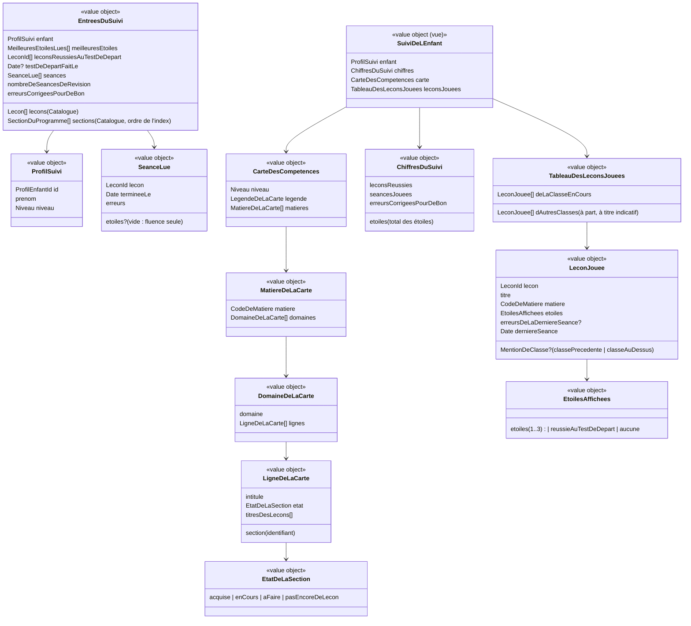

# Modèle du domaine : issue #34, Suivi et carte des compétences

> **Validé par le PO le 2026-10-25 (17:30 UTC), avec 3 changements** (34.4, 34.8, 34.11) : voir « Décisions du PO (25/10) » juste en dessous. Toutes les autres questions (34.1 à 34.28, dont 34.23 à 34.28 dans `acceptance.md`) suivent la recommandation. Le modèle ci-dessous intègre ces décisions. Décisions antérieures, à respecter (commentaire [Responsable] du 2026-10-25 sur l'issue) : #13 (second parent) et #14 (export et suppression) sont **sorties de la beta**. #34 ne dépend plus de #13 : tout ce qui touche au second parent (« les deux parents voient le même suivi ») est reporté dans #13. Ce qui touche à l'export ou à la suppression est reporté dans #14. Dépendances : #25 (mergée), #27 (mergée), #28 (PR #85, pas encore mergée).

## Décisions du PO (25/10)

Source : commentaire [Responsable] « VALIDÉ avec 3 changements » de l'issue #34 (2026-10-25, 17:30 UTC). Réponses du PO, mot pour mot :

> « 34.4 ca donne le niveau de l'enfant mais le test de niveau ne regroupe pas l'ensemble des exercices de la lecon.
> 34.8 : une vue par enfant le parent selectionne l'enfant
> 34.11 : on analyse le niveau de l'enfant de son année en cours. ce qui a reussi dans les classes passées est juste à titre indicatif. »

Questions de précision, réponses « 1 oui, 2b, 3 oui + a » : (1) les autres questions gardent la reco ; (2) 34.4 → **b** ; (3) 34.11 → oui, et **a** (leçons des classes passées affichées à part, avec la mention « classe précédente »).

| Question | Décision | Règles et fonctions concernées |
|---|---|---|
| **34.4** | Une section dont la seule leçon jouée est réussie au test de départ reste **« à faire »**. Le test de départ ne pose qu'une question d'une leçon : il ne fait pas travailler la section. | Règle 7 (état de la section) : seule une **séance terminée** met une section « en cours ». `carteDesCompetences` ne lit plus les leçons réussies au test de départ. Celles-ci restent comptées dans les leçons réussies (34.3) et affichées dans le tableau (34.14) |
| **34.8** | **Une vue par enfant** : le parent choisit l'enfant dont il voit le suivi. Plus de liste de tous les enfants l'un sous l'autre. | Nouvelle fonction `enfantSuivi(profilsRattaches, choix)` (règle 12) ; `suivisDesEnfants` est abandonnée. Le front lit seulement les données de l'enfant suivi. Terme **Enfant suivi** |
| **34.11** | Les chiffres du suivi ne comptent que la **classe en cours** de l'enfant (son niveau actuel). Les leçons des classes passées sont « à titre indicatif » : dans le tableau des leçons jouées, elles sont **à part**, avec la mention **« classe précédente »**. | Règles 2 à 4 : `chiffresDuSuivi` ne garde que les leçons du niveau du profil. Règles 9 à 11 : `leconsJouees` rend deux listes, celle de la classe en cours et celle des autres classes (`TableauDesLeconsJouees`) |
| **34.29** | « 34.29 reco » (commentaire [Responsable] du 2026-10-25, 17:41 UTC). Une séance terminée d'une leçon qui n'est plus dans la bibliothèque **ne compte plus** dans « séances jouées » : la leçon est ignorée partout. Corrige la seconde moitié de la recommandation 34.13. | Règle 4 et I2 : une séance terminée ne compte que si sa leçon est connue du Catalogue et de la classe en cours. `suiviDeLEnfant` écarte les leçons inconnues **et leurs séances** avant tout calcul (34.13) |

### Interprétations (tranchées par le modeleur, au plus simple, dans l'esprit des réponses)

Aucune question nouvelle : chaque point a une lecture simple. Elles sont à relire par le PO à la démonstration, sans bloquer.

- **I1. Classe en cours** = le **niveau actuel du profil enfant** (Famille). Une leçon est « de la classe en cours » si son `niveau` est celui du profil. L'application ne connaît pas d'année scolaire : après un changement de niveau, les chiffres suivent aussitôt le nouveau niveau, et rien n'est daté.
- **I2. Séances de révision dans « séances jouées »** : **comptées toutes**, sans filtre de classe. Une séance de révision n'a pas de leçon, donc pas de classe, et elle est jouée maintenant (34.5 gardée). Les séances terminées, elles, ne comptent que si leur leçon est connue du Catalogue et de la classe en cours, fluence seule comprise ; la séance d'une leçon retirée de la bibliothèque ne compte pas (décision 34.29).
- **I3. Erreurs corrigées pour de bon** : **non filtrées par classe**. Le compteur de la file de révision est un total par profil, sans détail par leçon (décision 28.20) ; on n'ajoute aucune donnée pour le découper.
- **I4. Leçons d'une classe au-dessus** (enfant redescendu de classe) : elles vont **dans la même zone à part** que les classes passées, mais avec la mention **« classe au-dessus »** (« classe précédente » serait faux). Elles ne comptent pas dans les chiffres non plus. C'est le cas rare de **Leçon réussie d'une classe au-dessus** (#25).
- **I5. Mention « classe précédente »** pour **toute** leçon d'un niveau inférieur, même deux classes avant (une leçon de CP pour un enfant de CE2). C'est la **Leçon des classes d'avant** du glossaire ; « classe précédente » est la mention d'interface choisie par le PO.
- **I6. Ordre dans le tableau** : d'abord les leçons de la classe en cours, puis la zone à part. Dans chaque zone, la dernière séance la plus récente d'abord, puis le titre.
- **I7. « Pas encore de leçon jouée. »** s'affiche quand **la classe en cours** n'a aucune leçon jouée. La zone à part s'affiche en dessous si elle n'est pas vide, sinon elle est absente.
- **I8. Enfant choisi à l'ouverture** : le **premier profil rattaché dans l'ordre de création**. Le choix n'est pas mémorisé, comme les blocs repliés (34.26). Un choix qui ne désigne pas un profil rattaché (profil supprimé, identifiant d'un autre parent) retombe sur le premier profil.
- **I9. Le choix de l'enfant est toujours affiché**, même avec un seul profil (le profil est alors déjà choisi) : aucun cas particulier. Chaque choix porte « `<prénom>` · `<niveau>` », comme l'ancien titre du bloc.
- **I10. Enfant suivi et profil en cours sont distincts** : choisir un enfant dans le suivi ne change pas le **profil en cours** (« Qui joue ? »).
- **I11. La carte ne change pas avec 34.11** : elle ne montrait déjà que les sections du niveau actuel. Une section garde toutes ses leçons rattachées, quel que soit leur niveau (34.9 gardée).

## Contexte

Bounded context : **Accompagnement**. C'est la **première story** de ce contexte : le dossier `supabase/functions/_shared/accompagnement/` n'existe pas encore.

Pourquoi Accompagnement :
- la context map lui donne déjà « Suivi, rapport de la semaine, carte des compétences » ;
- le suivi est une **vue du parent** : il ne joue rien, ne note rien, ne modifie aucune étoile. Il lit des faits d'Apprentissage et les met en regard des sections du programme (Catalogue) ;
- Apprentissage garde seul ses règles (étoiles, leçon réussie, leçon acquise, file de révision). Accompagnement ne recalcule jamais une étoile : il les lit.

Le suivi est un **calcul pur**, fait à l'affichage dans le navigateur, comme le parcours (#25), « Toutes les leçons » (#26) et l'écran des récompenses de l'enfant (#65). **Aucune nouvelle donnée** n'est enregistrée : pas de table, pas de migration, pas d'Edge Function (recommandation 34.19).

### Sources lues, sans rien écrire

| Source | Contexte | Ce qui est lu | Mécanisme |
|---|---|---|---|
| Profils enfants du parent | Famille | identifiant, prénom, niveau, date de création (ordre d'affichage) | Lecture déjà faite par l'espace parent (`useProfilsDuParent`, #11), sous RLS (`profils_enfants`, policy de lecture par rattachement) |
| Meilleures étoiles | Apprentissage (#24) | `resultats_des_lecons` : `lecon`, `meilleures_etoiles` | Lecture du front sous RLS (`resultats_des_lecons_lecture_par_ses_parents`), comme le parcours (#25) |
| Leçons réussies au test de départ | Apprentissage (#27) | `resultats_des_tests_de_depart` : `fait_le`, `lecons_reussies` | Lecture sous RLS (`resultats_des_tests_de_depart_lecture_par_ses_parents`), comme le parcours (#27) |
| Séances terminées | Apprentissage (#24, #20) | `seances_terminees` : `lecon`, `termine_le`, `erreurs`, `etoiles` (vide pour une séance de fluence seule) | Lecture sous RLS (`seances_terminees_lecture_par_ses_parents`). Jamais `questions_des_seances` ni `par_type` (ils serviront au rapport de la semaine, #35) |
| Séances de révision terminées | Apprentissage (#28) | `seances_de_revision_terminees` : leur nombre seulement | Lecture sous RLS (`seances_de_revision_terminees_lecture_par_ses_parents`), **après le merge de #28** |
| Erreurs corrigées pour de bon | Apprentissage (#28) | `files_de_revision.erreurs_corrigees_pour_de_bon` (0 sans file) | Lecture sous RLS (`files_de_revision_lecture_par_ses_parents`), donnée gardée pour le suivi (décision 28.20) |
| Leçons de la bibliothèque | Catalogue pédagogique | `Lecon` : `id`, `titre`, `matiere`, `niveau`, `programme.section` | Published Language `@domain/catalogue` ; le front charge déjà toute la bibliothèque (`chargerToutesLesLecons`) |
| Sections du programme | Catalogue pédagogique | `programmes-index.json` : `id`, `matiere`, `domaine`, `section`, `niveaux`, et l'ordre de l'index | Published Language `@domain/catalogue` (`lireSectionDuProgramme`, #16), **à étendre** avec `matiere` (additif) |
| Seuils « réussie » et « acquise » | Apprentissage | règle de `ResultatDeLaLecon` (1 étoile, 2 étoiles) et 27.1 (réussie au test de départ, jamais acquise) | Published Language `@domain/apprentissage` : la règle n'est pas recopiée (34.19) |

Ce qui ne vient **pas** d'Apprentissage : le nombre de fois ratée (`questions_retenues`) n'est pas lu (34.16).

### Ce que la story ne fait pas

- **Second parent** : le scénario « le second parent rattaché voit le même suivi » part dans #13. Rien à modéliser ici : la lecture sous RLS repose sur le rattachement, le second parent verra le même suivi dès qu'il sera rattaché.
- **Export et suppression** (#14) : le suivi ne garde rien. Il n'y a rien à exporter ni à supprimer de plus.
- **Rapport de la semaine** (bilan des 7 derniers jours et conseils) : #35, après la beta (34.15).
- **Enregistrements de lecture** : #38 ajoute leur bloc (34.17).
- **Leçons personnelles** : #39 (lot 6, story à part). #34 ne compte que la bibliothèque ; le calcul reçoit une liste de leçons, #39 y ajoutera les siennes (34.6). Rien n'est inventé ici sur leur forme.
- **Mots de la semaine** (#37, après la beta) : leurs séances viendront s'ajouter aux séances jouées (34.5).
- **Hors ligne** : le suivi demande le réseau (34.21).

### Comportement actuel (`app/app.js`), source des règles

- `adultSuivi` (l. 2019) : un bloc par profil, dans l'ordre de création, titre « `<prénom>` · `<niveau>` ». Sans profil : « Aucun profil pour l'instant. Crée-en un dans l'onglet Profils. »
- Quatre chiffres (l. 2026-2031) :
  - « leçons réussies » : progressions **hors test de départ** (`!p.test`) avec au moins une étoile, toutes classes et leçons personnelles confondues ;
  - « étoiles » : somme des meilleures étoiles de ces progressions ;
  - « séances jouées » : compteur `jours_<enfant>.sessions`, incrémenté à chaque fin de séance (révisions et mots de la semaine compris, pas le test de départ) ;
  - « erreurs corrigées pour de bon » : `revoir_<enfant>.acquis`.
- Puis le bilan des 7 derniers jours (#35), la carte (`skillMap`), les enregistrements (#38), le tableau.
- `skillMap` (l. 2084) : sections de `programmes-index.json` qui couvrent le niveau de l'enfant ; leçons de la section **quel que soit leur niveau** (`programme.section === s.id`), bibliothèque et leçons personnelles. État : aucune leçon → « pas encore de leçon » ; **une** progression avec `test` ou au moins 2 étoiles → « acquis » ; une progression → « en cours » ; sinon « à faire ». Regroupement par matière puis par domaine, dans l'ordre de l'index. Ligne : `<section> — <titres des leçons>`.
- Tableau « Toutes les leçons jouées » (l. 2068) : progressions triées par dernière mise à jour décroissante ; colonnes « Leçon », « Matière », « Étoiles » (`★` répétées, « acquise au test », ou « – »), « Erreurs (dernière fois) » (erreurs de la dernière séance), « Dernière séance » (date `fr-FR`). Sans progression : « Pas encore de leçon jouée. »
- Dans le legacy, une leçon réussie au test de départ perd son drapeau `test` dès qu'une séance la joue (l. 1913).

### Écarts voulus avec le legacy, déjà tranchés ailleurs

- **27.1** : une leçon réussie au test de départ est **réussie**, sans étoile, **jamais acquise**. Le tableau dit donc « réussie au test de départ » (plus « acquise au test »), et elle ne rend pas sa section acquise (34.4).
- **28.2** : une séance de révision ne donne pas d'étoile.
- **#20** : une séance de fluence seule ne donne pas d'étoile (`etoiles` vide) ; elle ne crée pas de résultat de la leçon.

## Termes

| Terme | Statut | Remarque |
|---|---|---|
| Suivi | au glossaire `(à valider)`, **précisé** (validé, 34.22) | Vue calculée à l'affichage, sans donnée propre, pour l'enfant suivi : chiffres du suivi, carte des compétences, leçons jouées ; plus tard les enregistrements de lecture (#38). Ligne existante non modifiée ; précision ajoutée en ligne nouvelle |
| Enfant suivi | **nouveau, validé avec 34.8** | Profil enfant rattaché que le parent a choisi dans le suivi ; le premier dans l'ordre de création à l'ouverture (I8). Ne pas confondre avec le **Profil en cours** (I10) |
| Chiffres du suivi | **validé** (34.22), précisé par 34.11 | Les quatre nombres en tête du suivi, sur la **classe en cours** seulement : leçons réussies, total des étoiles, séances jouées, erreurs corrigées pour de bon (ce dernier sans filtre, I3). « KPI », « indicateurs », « statistiques » interdits |
| Total des étoiles | **validé** (34.22), précisé par 34.11 | Dans le suivi : somme des meilleures étoiles des leçons de la classe en cours. La cabane (#32) fixera sa propre règle |
| Séances jouées | **validé** (34.22), précisé par 34.11 | Séances terminées des leçons de la classe en cours, plus toutes les séances de révision terminées (I2). Le test de départ n'en est pas une |
| Leçon jouée | **validé** (34.22) | Leçon qui a au moins une séance terminée, ou qui est réussie au test de départ (34.12, 34.14). Pour la carte, seule une séance terminée compte (34.4). Le mot « jouée » de la définition de **Séance** désigne le geste ; pas de conflit de sens |
| Erreurs de la dernière séance | **validé** (34.22) | Nombre d'erreurs de la séance terminée la plus récente d'une leçon. Interface : « Erreurs (dernière fois) » (34.7) |
| Dernière séance | **validé** (34.22) | Date de la séance terminée la plus récente d'une leçon, ou date du dernier test de départ pour une leçon seulement réussie au test de départ (34.14) |
| Carte des compétences | au glossaire `(à valider)`, **conflit n°10 tranché** (34.1) | Par section du programme, avec 4 états. La nouvelle définition est la ligne « Carte des compétences, définition de #34 » du glossaire |
| Ligne de la carte | **validé** (34.22) | Une section du programme du niveau de l'enfant, son état et les titres de ses leçons |
| État de la section | **validé** (34.22), précisé par 34.4 | `acquise` (une leçon acquise), `en cours` (une leçon avec une séance terminée), `à faire` (sinon, même si une leçon est réussie au test de départ), `pas encore de leçon` |
| Leçon des classes d'avant, Leçon réussie d'une classe au-dessus | au glossaire (Apprentissage) | Repris pour la zone à part du tableau. Mentions d'interface : « classe précédente » (décision 34.11), « classe au-dessus » (I4) |
| Légende de la carte | mot d'interface proposé | Nombre de lignes dans chaque état ; hors glossaire |
| Section du programme | au glossaire (Catalogue) | Inchangé. Ses champs `domaine` et `matiere` servent au regroupement |
| Compétence | au glossaire (Catalogue) | Inchangé : nom du badge (#31). La carte étant par section (34.1), « compétence » ne désigne pas une ligne de la carte |
| Leçon réussie, Leçon acquise, Leçon réussie au test de départ, Meilleures étoiles | au glossaire (Apprentissage) | Repris tels quels |
| Erreur corrigée pour de bon, Séance de révision, File de révision | glossaire de #28 (branche de #28) | Repris tels quels |
| Enfant | **à éviter** | Le domaine dit **Profil enfant** ; « enfant » reste un mot de phrase (« le suivi de l'enfant ») comme dans le reste du glossaire |
| « acquis » (au masculin), « acquise au test » | mots du legacy, **abandonnés** (34.2, 27.1) | |

## Modèle

Pas d'agrégat : le suivi **n'écrit rien** et ne protège aucun invariant de cohérence entre plusieurs écritures. C'est un **modèle de lecture** : des value objects immuables, produits par des fonctions pures de `@domain/accompagnement`.

Les entrées sont des formes propres à Accompagnement (comme #65 avec les records de fluence) : Accompagnement n'importe **aucun agrégat** d'Apprentissage (`ResultatDeLaLecon`, `FileDeRevision`). Il n'importe que des fonctions et types publiés : `Lecon`, `SectionDuProgramme`, `Niveau`, `toutesLesMatieres` (`@domain/catalogue`) et les seuils réussie / acquise (`@domain/apprentissage`, 34.19).



### Services de domaine (fonctions pures)

| Fonction | Entrée | Sortie | Règles |
|---|---|---|---|
| `suiviDeLEnfant(entrees)` | `EntreesDuSuivi` | `SuiviDeLEnfant` | assemble les trois suivantes ; les leçons inconnues du Catalogue et leurs séances sont écartées d'abord (34.13, 34.29) |
| `chiffresDuSuivi(entrees)` | idem | `ChiffresDuSuivi` | règles 2 à 5 des invariants, classe en cours seulement (34.11) |
| `carteDesCompetences(entrees)` | idem | `CarteDesCompetences` | règles 6 à 8 |
| `leconsJouees(entrees)` | idem | `TableauDesLeconsJouees` | règles 9 à 11 : classe en cours d'abord, autres classes à part avec leur mention (34.11, I4 à I7) |
| `enfantSuivi(profilsRattaches, choix?)` | profils rattachés (Famille, ordre de création) et identifiant choisi par le parent | `ProfilSuivi` ou rien (aucun profil) | le profil choisi s'il est rattaché, sinon le premier dans l'ordre de création (34.8, I8, règle 12) |

### État d'une leçon pour le suivi (calcul interne)

Pour chaque leçon connue du Catalogue, Accompagnement déduit, avec les seuils publiés par Apprentissage :
- **acquise** : meilleures étoiles ≥ 2 ;
- **réussie** : meilleures étoiles ≥ 1, ou réussie au test de départ ;
- **jouée** : au moins une séance terminée (une séance de fluence seule suffit), ou réussie au test de départ ; c'est ce qui met la leçon dans le tableau ;
- **travaillée en séance** : au moins une séance terminée ; c'est ce qui met sa section « en cours » (34.4) ;
- sinon **pas jouée** ;
- **de la classe en cours** : son `niveau` est celui du profil ; sinon elle est **d'une classe précédente** (niveau inférieur) ou **d'une classe au-dessus** (niveau supérieur, `Niveau#estAuDessusDe`).

### Lecture et contrôle d'accès (couche application du front)

| Commande ou lecture | Effet | Erreurs métier | Où |
|---|---|---|---|
| Lecture `ProfilsDuParent` (#11) | profils rattachés, ordre de création | aucune | front, JWT du parent, RLS |
| `ChoisirLEnfantSuivi(choix)` | calcule `enfantSuivi` ; le front relit alors les données de ce seul profil | aucune | navigateur, pas mémorisé (I8) |
| Lecture `DonneesDuSuivi(enfantSuivi)` | pour l'enfant suivi seulement : meilleures étoiles, résultat du test de départ, séances terminées (leçon, date, erreurs, étoiles), nombre de séances de révision terminées, erreurs corrigées pour de bon | `SuiviIndisponible` (réseau, 34.21) | front, port `LectureDuSuivi`, adaptateur Supabase sous RLS |
| `ConsulterLeSuivi` | lit les profils, choisit l'enfant suivi (`enfantSuivi`), lit ses données, puis calcule `suiviDeLEnfant` avec le Catalogue | `SuiviIndisponible` | front (`src/suivi/`) |

Le contrôle d'accès tient en deux couches, comme partout (context map, « Accès ») :
- **RLS** : chaque table lue a une policy de lecture fondée sur `private.est_rattache_au_profil`. Un parent qui demande les données d'un profil auquel il n'est pas rattaché, même avec son identifiant, ne reçoit **rien** ;
- **domaine** : `enfantSuivi` ne retient qu'un profil rattaché fourni par Famille ; un identifiant étranger retombe sur le premier profil rattaché (I8). `suiviDeLEnfant` ne reçoit que les données de ce profil.

Il n'y a pas de commande : rien ne peut être écrit par le suivi.

### Erreurs métier

`SuiviIndisponible` (lecture impossible, sans réseau ou serveur indisponible ; nom à confirmer au TDD). Aucune autre : une donnée incohérente (leçon inconnue, profil absent) est **ignorée**, pas signalée.

## Invariants

Ce sont les règles du calcul ; elles valent dans le navigateur, seul endroit où il tourne.

1. Le suivi **ne modifie rien** et ne recalcule **aucune étoile** : il lit les meilleures étoiles d'Apprentissage. Deux calculs sur les mêmes entrées donnent le même suivi.
2. **Leçons réussies** = nombre de leçons connues du Catalogue **de la classe en cours** (34.11, I1) avec des meilleures étoiles ≥ 1 **ou** réussies au test de départ (34.3), chaque leçon comptée une fois.
3. **Étoiles** (total des étoiles) = somme des meilleures étoiles des leçons de la classe en cours. Une leçon réussie au test de départ seulement n'ajoute aucune étoile (27.1).
4. **Séances jouées** = nombre de séances terminées (complètes, d'un exercice, de fluence seule) **dont la leçon est connue du Catalogue et de la classe en cours** (une leçon retirée de la bibliothèque est ignorée avec ses séances, 34.29) + nombre de **toutes** les séances de révision terminées (34.5, I2). Le test de départ n'en est pas une.
5. **Erreurs corrigées pour de bon** = compteur de la file de révision du profil, sans filtre de classe (I3) ; 0 s'il n'y a pas de file. Il ne baisse jamais (invariant 8 de #28).
6. La carte montre **chaque section du programme qui couvre le niveau de l'enfant**, une fois, dans l'ordre de l'index, regroupée par matière (ordre de `toutesLesMatieres`) puis par domaine (ordre d'apparition dans l'index).
7. **État de la section**, d'après toutes les leçons connues rattachées à cette section (`programme.section`), quel que soit leur niveau (34.9) :
   - aucune leçon rattachée → **pas encore de leçon** ;
   - au moins une leçon **acquise** → **acquise** (34.10) ;
   - sinon, au moins une leçon avec une **séance terminée** (fluence seule comprise, 34.12) → **en cours** ;
   - sinon → **à faire**, même si une de ses leçons est réussie au test de départ (décision 34.4).
8. La légende compte les lignes de chaque état ; leur somme est le nombre de sections du niveau.
9. Une **leçon jouée** apparaît une fois dans le tableau, avec sa matière et son titre (Catalogue) : dans la liste de la **classe en cours** si son niveau est celui du profil, sinon dans la **zone à part**, avec la mention « classe précédente » (niveau inférieur, 34.11, I5) ou « classe au-dessus » (niveau supérieur, I4).
10. **Étoiles affichées** : les meilleures étoiles si la leçon en a ; sinon « réussie au test de départ » si elle l'est ; sinon aucune (« – », séance de fluence seule). Les étoiles l'emportent toujours sur le test de départ (34.14).
11. **Erreurs de la dernière séance** et **dernière séance** viennent de la séance terminée la plus récente de la leçon ; pour une leçon seulement réussie au test de départ, pas d'erreurs (« – ») et la date du dernier test de départ. Chaque liste est triée par dernière séance, la plus récente d'abord, puis par titre ; la classe en cours vient d'abord (I6).
12. Un parent ne voit le suivi **que d'un profil enfant auquel il est rattaché**, choisi par lui ; à l'ouverture, le premier dans l'ordre de création (34.8, I8 ; RLS et domaine).
13. Sans leçon jouée de la classe en cours : « Pas encore de leçon jouée. » et chiffres à 0, sauf les séances de révision et les erreurs corrigées pour de bon, qui ne dépendent pas de la classe (I2, I3). La zone à part s'affiche en dessous si elle a des leçons (I7). La carte s'affiche toujours.

## Événements

**Aucun événement émis, aucun consommé** (recommandation 34.19).

Les événements déjà publiés et destinés à Accompagnement (`SeanceTerminee` #24, `LeconAcquise` #24, `TestDeDepartTermine` #27, `SeanceDeRevisionTerminee` et `ErreursCorrigeesPourDeBon` #28) ne sont **pas écoutés** par #34 : leurs données sont déjà en base, lisibles sous RLS. Ils restent disponibles pour #35 (rapport de la semaine) si une projection devient utile.

## Partage avec le front

Tout le calcul est dans `accompagnement/domain/`, exporté par `index.ts` pour l'alias `@domain/accompagnement` (l'alias générique existe déjà dans `vite.config.ts` et `tsconfig.json`) :
- `enfantSuivi`, `suiviDeLEnfant`, `chiffresDuSuivi`, `carteDesCompetences`, `leconsJouees` ;
- les types `EntreesDuSuivi`, `ProfilSuivi`, `SeanceLue`, `SuiviDeLEnfant`, `ChiffresDuSuivi`, `CarteDesCompetences`, `LigneDeLaCarte`, `EtatDeLaSection`, `TableauDesLeconsJouees`, `LeconJouee`, `EtoilesAffichees`, `MentionDeClasse` ;
- l'erreur `SuiviIndisponible`.

React n'affiche que le résultat : libellés des états, « ★ » répétées, date `fr-FR`, blocs repliés. Aucune règle dans les composants.

**Hors ligne** : rien à faire hors ligne. L'espace parent demande déjà la connexion du parent ; le suivi demande le réseau (34.21). Le calcul étant pur, il pourra tourner sur une copie locale quand #44 en fournira une.

Côté serveur : **rien** (pas d'Edge Function, 34.19).

## Base de données

**Aucune table, aucune migration, aucune policy nouvelle.** Toutes les tables lues ont déjà une policy de lecture par rattachement et le droit `select` pour `authenticated` :

| Table | Story | Policy de lecture existante |
|---|---|---|
| `profils_enfants` | #11 | `profils_enfants_lecture_par_ses_parents` |
| `resultats_des_lecons` | #24 | `resultats_des_lecons_lecture_par_ses_parents` |
| `seances_terminees` | #24 | `seances_terminees_lecture_par_ses_parents` |
| `resultats_des_tests_de_depart` | #27 | `resultats_des_tests_de_depart_lecture_par_ses_parents` |
| `seances_de_revision_terminees` | #28 (PR #85) | `seances_de_revision_terminees_lecture_par_ses_parents` |
| `files_de_revision` | #28 (PR #85) | `files_de_revision_lecture_par_ses_parents` |

Colonnes lues au plus juste (minimisation) : jamais `questions_des_seances`, `par_type`, `choix`, `questions_retenues`.

Volume : un enfant actif peut avoir quelques centaines de séances terminées. Pour la beta, le front lit leurs colonnes `lecon`, `termine_le`, `erreurs`, `etoiles`. Si la lecture devient lente, une vue SQL agrégée (dernière séance et nombre par leçon) en `security_invoker` garderait la RLS ; ce serait une story technique, sans changement du modèle.

## Données d'enfants (RGPD)

- **Aucune donnée personnelle nouvelle** : le suivi ne stocke rien, ni en base ni sur l'appareil (pas de cache du suivi dans la beta).
- Rien n'est envoyé à l'IA.
- Lecture seulement des données déjà déclarées pour le suivi parental (#24, #27, décision 28.20).
- Rien à ajouter à l'export ni à la suppression (#14).

## Emplacement

```
supabase/functions/_shared/accompagnement/          # nouveau contexte
  domain/
    entrees-du-suivi.ts           # EntreesDuSuivi, ProfilSuivi, SeanceLue, MeilleuresEtoilesLues
    etat-de-la-lecon.ts           # acquise / réussie / jouée, à partir des seuils publiés par Apprentissage
    chiffres-du-suivi.ts          # chiffresDuSuivi
    carte-des-competences.ts      # carteDesCompetences, LigneDeLaCarte, EtatDeLaSection, légende
    lecons-jouees.ts              # leconsJouees, TableauDesLeconsJouees, LeconJouee, EtoilesAffichees, MentionDeClasse
    suivi-de-l-enfant.ts          # suiviDeLEnfant
    enfant-suivi.ts               # enfantSuivi (choix du parent, premier profil par défaut)
    erreurs.ts                    # SuiviIndisponible
    index.ts                      # exports pour @domain/accompagnement
    *_test.ts
  application/
    ports/lecture-du-suivi.ts     # port LectureDuSuivi (données d'Apprentissage des profils donnés)
  test_utils/
    lecture-du-suivi-en-memoire.ts
supabase/functions/_shared/catalogue/domain/
  lire-section-du-programme.ts    # modifié : ajoute `matiere` (et garde l'ordre de l'index) — additif
supabase/functions/_shared/apprentissage/domain/
  (seuils de leçon réussie / acquise publiés par index.ts, sans changer ResultatDeLaLecon) — 34.19
src/suivi/
  lecture-du-suivi-supabase.ts    # adaptateur sous RLS (JWT du parent), colonnes au plus juste
  SuiviDeLEspaceParent.tsx        # section « Suivi » de l'espace parent (34.18), avec le choix de l'enfant (34.8)
  CarteDesCompetences.tsx, LeconsJouees.tsx
src/seance/bibliotheque.ts        # modifié : charger toutes les sections du programme
```

Aucun fichier sous `supabase/migrations/` ni `supabase/functions/<nom>/`.

## Questions ouvertes

**Toutes tranchées** (PO, 2026-10-25, 17:30 UTC ; 34.29 à 17:41 UTC). Les recommandations sont retenues, sauf 34.4, 34.8 et 34.11 : voir « Décisions du PO (25/10) » et les interprétations I1 à I11. Les questions 34.23 à 34.28 sont dans `acceptance.md`. Aucune question nouvelle. Texte d'origine gardé ci-dessous.

Les questions 34.1 à 34.7 reprennent celles de l'issue, dans l'ordre. Les suivantes viennent du passage à la cible et des stories livrées. Chaque recommandation vise à finir la beta vite, sans perdre ce que voient les parents aujourd'hui.

**34.1. Carte par section du programme, ou par compétence ?** Le glossaire définit la carte par **compétence** (à faire, en cours, acquise). Le legacy la construit par **section du programme**, avec un quatrième état « pas encore de leçon ».
- **Recommandation** : **par section du programme**, avec les 4 états. Les sections viennent des programmes officiels et couvrent tout le niveau, même ce qui n'a pas encore de leçon : c'est ce qui dit au parent « où il en est ». La compétence reste le nom du badge (#31). Au glossaire : redéfinir « Carte des compétences » (proposition ajoutée en ligne nouvelle, conflit n°10), ajouter « Ligne de la carte » et « État de la section ».

**34.2. Libellé de l'état : « acquis » ou « acquise » ?**
- **Recommandation** : **« acquise »**, accordé à « section » et identique au terme **Leçon acquise** (même seuil de 2 étoiles). Légende : « acquise (n) · en cours (n) · à faire (n) · pas encore de leçon (n) ».

**34.3. Les leçons réussies au test de départ comptent-elles dans « leçons réussies » ?** Le legacy les exclut ; le glossaire (réponse 27.1) les dit **réussies**.
- **Recommandation** : **oui, les compter**. Le chiffre dit alors la même chose que le parcours de l'enfant (une leçon cochée par le test de départ y est réussie). Elles n'ajoutent aucune étoile. Exemple : Léa a 3 leçons réussies au test de départ et 2 leçons à 1 et 2 étoiles → « 5 leçons réussies », « 3 étoiles ».

**34.4. Une section dont la seule leçon jouée est réussie au test de départ : « acquise » ou « en cours » ?** Le legacy dit « acquis » ; la réponse 27.1 dit qu'une leçon réussie au test de départ n'est **jamais acquise**.
- **Recommandation** : **« en cours »**, pour rester cohérent avec 27.1 (ni compétence, ni badge). Elle passe « acquise » dès qu'une séance lui donne 2 étoiles.
- **Tranchée autrement** (PO) : **(b) « à faire »**. « Le test de niveau ne regroupe pas l'ensemble des exercices de la leçon. » Seule une séance terminée met une section « en cours ».

**34.5. « Séances jouées » : que compte-t-on ?** Le legacy compte toutes les séances, révisions et mots de la semaine compris, pas le test de départ.
- **Recommandation** : **les séances terminées** (complètes, d'un exercice, de fluence seule) **et les séances de révision terminées** ; pas le test de départ. Les séances des mots de la semaine s'y ajouteront avec #37. Une séance quittée en cours ne compte pas (elle n'est pas enregistrée).

**34.6. Leçons personnelles dans la carte : une leçon personnelle à 2 étoiles rend-elle « acquise » sa section ?**
- **Recommandation** : **oui**, comme le legacy, si elle est rattachée à une section du programme : c'est le même format de leçon. Mais **#34 ne les compte pas** : le calcul reçoit une liste de leçons, et #39 y ajoutera les leçons personnelles de la famille (chiffres, carte et tableau). Rien de spécial à coder dans #34.

**34.7. Garder la colonne « Erreurs (dernière fois) » ?**
- **Recommandation** : **oui**. La donnée existe déjà (`seances_terminees.erreurs`) : c'est le nombre d'erreurs de la séance terminée la plus récente de la leçon. « – » pour une leçon seulement réussie au test de départ.

**34.8. Une vue par enfant, ou tous les enfants l'un sous l'autre ?**
- **Recommandation** : **tous l'un sous l'autre**, dans l'ordre de création, comme le legacy. Une famille a 1 à 3 enfants, la carte et le tableau sont repliés : pas de sélecteur à construire pour la beta.
- **Tranchée autrement** (PO) : **une vue par enfant**, « le parent sélectionne l'enfant ». Premier profil à l'ouverture, choix non mémorisé (I8, I9).

**34.9. Une section qui couvre deux niveaux (6 sections, CM1 et CM2) : compte-t-on ses leçons des deux niveaux ?** Exemple : Tom, en CM1, a acquis une leçon de CM2 rattachée à une section « CM1, CM2 ».
- **Recommandation** : **oui, toutes les leçons rattachées à la section, quel que soit leur niveau**, comme le legacy. La règle reste simple et la section est la même.

**34.10. Une seule leçon acquise suffit-elle pour que la section soit « acquise » ?** Exemple : une section a 4 leçons, Léa en a acquis 1 et n'a pas joué les 3 autres.
- **Recommandation** : **oui**, comme le legacy et la piste de critère de l'issue (« une leçon à 2 étoiles rend sa section acquise »). L'autre choix (« toutes les leçons acquises ») est aussi simple à coder, mais change ce que les parents voient aujourd'hui ; à reprendre après la beta avec les retours des familles.

**34.11. Les leçons des autres classes (classes d'avant, classe au-dessus) comptent-elles dans les chiffres et le tableau ?**
- **Recommandation** : **oui, toutes les leçons jouées**, quel que soit leur niveau, comme le legacy. La carte, elle, ne montre que les sections du niveau actuel de l'enfant.
- **Tranchée autrement** (PO) : « on analyse le niveau de l'enfant de son année en cours ; ce qui a réussi dans les classes passées est juste à titre indicatif ». Les chiffres ne comptent que la classe en cours ; dans le tableau, les leçons des classes passées sont à part, avec la mention « classe précédente » (I1 à I7).

**34.12. Une leçon jouée seulement en fluence seule (aucune étoile) : apparaît-elle ?**
- **Recommandation** : **oui** dans le tableau, avec « – » en étoiles et ses erreurs ; sa section passe « en cours » ; elle ne compte pas dans « leçons réussies » (pas d'étoile).

**34.13. Une leçon retirée de la bibliothèque, mais avec des étoiles enregistrées.**
- **Recommandation** : **ignorée partout dans le suivi** (chiffres, carte, tableau), sans message, comme une question introuvable en révision (28.15). Les chiffres restent cohérents avec le tableau. Ses séances comptent quand même dans « séances jouées » (elles ont eu lieu).
- **Corrigée par 34.29** (PO, « 34.29 reco ») : ses séances **ne comptent plus** dans « séances jouées » ; la leçon est ignorée partout, séances comprises.

**34.14. Leçon réussie au test de départ dans le tableau : libellé et date.**
- **Recommandation** : libellé **« réussie au test de départ »** (27.1, au lieu de « acquise au test »), date du **dernier test de départ**. Dès qu'une séance lui donne des étoiles, ce sont ses étoiles et la date de cette séance qui s'affichent.

**34.15. Le bilan des 7 derniers jours (rapport de la semaine) est-il hors de #34 ?**
- **Recommandation** : **oui**, il reste dans #35 (après la beta). Dans #34, rien entre les chiffres et la carte.

**34.16. Montrer le nombre de fois ratée (#28) dans le suivi ?**
- **Recommandation** : **non** dans #34. Il sert au conseil « Certaines erreurs reviennent souvent » du rapport de la semaine (#35), comme dans le legacy.

**34.17. Place du bloc « Enregistrements de lecture » (#38).**
- **Recommandation** : **entre la carte et le tableau**, comme le legacy ; #38 l'ajoute. Ordre fixé par #34 : titre, chiffres, carte, (enregistrements, #38), tableau.

**34.18. Où est le suivi dans l'espace parent ?** L'espace parent cible n'a pas d'onglets : il empile des parties (« Profils »…). Le legacy ouvre l'onglet « Suivi » à l'entrée.
- **Recommandation** : une partie **« Suivi » en tête de l'espace parent**, avant « Profils », sans onglets pour la beta. Sans profil : « Aucun profil pour l'instant. Crée-en un dans la partie Profils. » (texte à valider).

**34.19. Lecture sous RLS plutôt qu'événements et projection ; règles reprises d'Apprentissage.**
- (a) Le front lit les tables d'Apprentissage sous RLS et calcule le suivi avec `@domain/accompagnement` ; aucune table, aucune Edge Function. Les seuils réussie / acquise sont importés de `@domain/apprentissage` (Published Language), pas recopiés.
- (b) Accompagnement écoute `SeanceTerminee`, `TestDeDepartTermine`, `ErreursCorrigeesPourDeBon` et tient sa propre projection (nouvelle table, à exporter et supprimer avec #14).
- **Recommandation** : **(a)**. Toutes les données utiles sont déjà en base, sous RLS par rattachement ; c'est le chemin de #25, #26 et #65. Aucune nouvelle donnée d'enfant, rien pour #14, rien à resynchroniser. La relation « événements » Apprentissage → Accompagnement de la context map reste pour #35 si besoin ; une relation « lecture sous RLS (#34) » est ajoutée.

**34.20. Les leçons et sections du Catalogue : Accompagnement peut-il demander au Catalogue d'ajouter la matière à `SectionDuProgramme` ?**
- **Recommandation** : **oui**, changement additif du Published Language (`lireSectionDuProgramme` lit déjà `domaine`, `section`, `niveaux` ; `matiere` existe dans `programmes-index.json`). Pas de changement du format des leçons ni du pipeline.

**34.21. Le suivi sans réseau.**
- **Recommandation** : il **demande le réseau** dans la beta. Sans réseau : un message à la place du suivi, par exemple « Le suivi a besoin d'Internet. Réessaie dans un instant. » (texte à valider). La copie locale arrive avec #44.

**34.22. Termes.** (Tranchée : recommandation retenue ; les termes sont validés, avec les définitions précisées par 34.4 et 34.11.) Valider : **Chiffres du suivi**, **Total des étoiles**, **Séances jouées**, **Leçon jouée**, **Erreurs de la dernière séance**, **Dernière séance**, **Ligne de la carte**, **État de la section**, et la nouvelle définition de **Carte des compétences** (conflit n°10).
- **Recommandation** : **oui**. « Toutes les leçons jouées », « Erreurs (dernière fois) » et la légende restent des mots d'interface.

Remarques pour les autres stories (pas des questions au PO) :
- **#32** : le « Total des étoiles » du suivi ne compte que la classe en cours (34.11) : la cabane fixe sa propre règle.
- **#13** : reprendre le scénario `@acces` « le second parent rattaché voit le même suivi que le premier » ; aucun code de plus dans #34.
- **#14** : rien à ajouter à l'export ni à la suppression pour #34.
- **#28** : #34 lit `files_de_revision` et `seances_de_revision_terminees` ; #34 ne peut être mergée qu'après #85.
- **#35** : bilan des 7 derniers jours, conseils, nombre de fois ratée ≥ 3 ; pourra écouter les événements ou lire `par_type` sous RLS.
- **#38** : bloc des enregistrements entre la carte et le tableau (34.17).
- **#39** : ajouter les leçons personnelles de la famille aux entrées du suivi (34.6).
- **#44** : copie locale des données du suivi, si un jour il doit s'afficher hors ligne.
