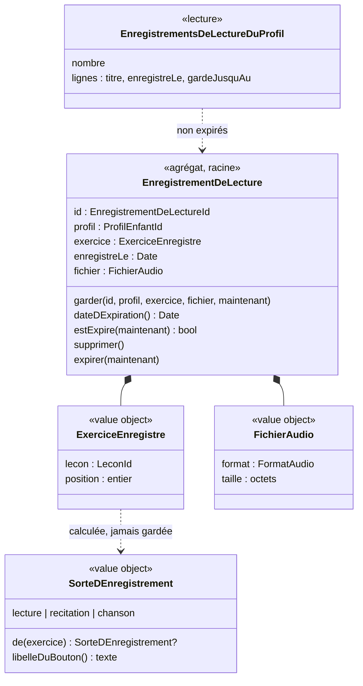

# Modèle du domaine : issue #38, Enregistrements de lecture

## Contexte

**Bounded context retenu : Accompagnement** (existant, dossier à créer : `supabase/functions/_shared/accompagnement/`). C'est la première story qui y met du code.

Justification :
- L'enregistrement de lecture sert au **suivi parental** (le parent écoute les progrès de lecture à voix haute) : c'est la responsabilité d'Accompagnement (context map, glossaire, ligne « Enregistrement de lecture »).
- Il **n'est pas noté** et ne change ni les étoiles ni la séance : il n'appartient pas à Apprentissage, qui ne fait que **proposer le moment** de s'enregistrer pendant les exercices `lecture` (#17) et `memoriser` (#22).
- Motivation n'y réagit pas : pas de badge, pas de série, pas d'épisode.

Contextes voisins et communication :

| Contexte | Rôle dans #38 | Mécanisme |
|---|---|---|
| Apprentissage | Pendant la séance, l'exercice `lecture` (après « J'ai écouté » proposé) et l'exercice `memoriser` (au moment « À toi ! ») affichent le bouton d'enregistrement | **Appel** depuis le front : l'écran de l'exercice utilise `@domain/accompagnement` (sorte d'enregistrement, libellé, durée maximale), puis appelle la commande `GarderLEnregistrementDeLecture` (Edge Function). Pas d'événement : rien ne dépend de la séance |
| Catalogue pédagogique | Titre de la leçon, type de l'exercice, poésie ou chanson (`Poesie.estUneChanson`, #22) | **Published Language** (`Lecon`, `@domain/catalogue`) ; côté serveur, port `LeconsDuCatalogue` d'Accompagnement pour vérifier que l'exercice est bien un `lecture` ou un `memoriser` |
| Famille | Rattachement du parent au profil enfant | **Customer/Supplier** : port `RattachementsDuParent` (lecture sous RLS avec le JWT de l'appelant), comme Apprentissage (#24) |
| Accompagnement (#34, suivi) | Le bloc « Lectures et récitations enregistrées » s'affiche dans le suivi | Même contexte : lecture `EnregistrementsDeLectureDuProfil` |
| Famille (#14, hors beta) | Suppression et export du profil | **Hors périmètre, reporté dans #14** (décision du PO du 2026-10-25) : adaptateur `DonneesPersonnellesDuProfil` d'Accompagnement (effacer les fichiers, exporter la liste) |
| Supabase Storage | Garde les fichiers audio | **ACL** : port `RangementDesEnregistrements` (infrastructure), seul à connaître le bucket et les chemins |

### Comportement actuel (`app/app.js`)

- `recordButton(label)` (l. 1158) : `<input type="file" accept="audio/*" capture>` ouvre l'enregistreur de l'appareil ; un lecteur audio (`URL.createObjectURL`), un petit son, puis l'envoi par la capacité `assets` et un document `enreg_<enfant>_<horodatage>` (`enfant`, `lecon`, `titre`, `asset`, `url`, `date`).
- Lecture (l. 1439) : « Je la lis à voix haute et je m'enregistre », **avant** « J'ai écouté ». Mémoriser (l. 1490) : « Je récite et je m'enregistre » ou « Je chante et je m'enregistre », avant « Je suis prêt ».
- Suivi (l. 2056) : bloc replié, plus récent d'abord, 30 au plus, « `<titre ou « Enregistrement »>` · `<date fr-FR>` », lecteur `preload=none`, « Supprimer » puis « Confirmer » ; l'échec de suppression du fichier est ignoré.
- Défauts (issue) : aucune expiration ; fichiers non effacés avec le profil ; fichier orphelin si sa suppression échoue ; au-delà de 30, invisibles et non supprimables. Constat en plus : le `titre` de la leçon est recopié dans le document (donnée inutile, il se relit dans le Catalogue).

### Décisions du PO à respecter (commentaire [Responsable] du 2026-10-25)

- #13 et #14 sont sortis de la beta. #38 n'en dépend plus.
- **Export et suppression des enregistrements avec le profil : hors périmètre, reportés dans #14.**
- **L'expiration automatique à 30 jours (fichier et ligne) reste dans #38.**
- Pendant la beta, la suppression de tout un profil à la demande d'un parent (droit RGPD) se fait **à la main**.
- La suppression d'**un** enregistrement par le parent, dans le suivi, **reste dans #38**.
- Dépendances : #22 (mergée), #17 (livrée), #34 (suivi, cadrée en parallèle).

## Termes

| Terme | Statut | Remarque |
|---|---|---|
| Enregistrement de lecture | **existant** (à valider), contexte Accompagnement | La définition dit « lit à voix haute » : elle ne couvre pas la récitation ni le chant (#22). Élargissement proposé (question 38.20). Jamais « voix » (décision n°14 du glossaire), ni « audio », ni « fichier » dans le domaine |
| Sorte d'enregistrement | **nouveau** (à valider) | `lecture` (exercice `lecture`), `recitation` (exercice `memoriser`, poésie), `chanson` (exercice `memoriser`, chanson ou comptine selon `Poesie.estUneChanson`). **Calculée**, jamais gardée. Donne le libellé du bouton |
| Expiration d'un enregistrement de lecture | **nouveau** (à valider) | Effacement automatique du fichier et de ses informations, 30 jours après l'enregistrement. L'interface dit « gardé jusqu'au … » |
| Date d'expiration | **nouveau** (à valider) | Date de l'enregistrement + 30 jours |
| Durée maximale d'un enregistrement | **nouveau** (à valider) | Au-delà, l'enregistrement s'arrête tout seul (question 38.3) |
| Garder un enregistrement de lecture | **nouveau** (à valider), commande | L'enregistrement fait sur l'appareil est envoyé au serveur, qui le garde pour les parents. Interface : « Ton enregistrement est gardé » |
| Lecture à voix haute | **conflit** | Terme existant du contexte **Voix** : c'est le **personnage guide** qui lit. Pour l'enfant, on ne dit jamais « lecture à voix haute » dans le domaine : on dit **enregistrement de lecture**. « Je la lis à voix haute » reste un texte d'écran |
| Réécouter / « Écoute-toi ! » | mot d'interface | L'enfant écoute l'enregistrement qu'il vient de faire, sur l'appareil seulement |
| Suivi | existant (à valider) | Le bloc « Lectures et récitations enregistrées (n) » est un titre d'écran du suivi (#34) |
| Poésie, Chanson, Vers | existants (validés, #22) | Repris tels quels |
| Récitation | **conflit à surveiller** | Synonyme interdit de **Poésie** (glossaire). Ici, `recitation` désigne une **sorte d'enregistrement**, jamais le texte. Si le PO préfère, la sorte peut s'appeler `poesie` (question 38.20) |

## Modèle

### Agrégat `EnregistrementDeLecture` (racine)

Petit agrégat : un enregistrement ne dépend d'aucun autre. Il référence le profil, la leçon et l'exercice **par identifiant**.

| Élément | Nature | Règles de validité |
|---|---|---|
| `id` : `EnregistrementDeLectureId` | value object | Identifiant tiré par l'appareil avant l'envoi (UUID) : un renvoi après une coupure ne crée pas de doublon (idempotence, comme la séance, décision 0013) |
| `profil` : `ProfilEnfantId` | référence (Famille) | Le parent appelant y est rattaché |
| `exercice` : `ExerciceEnregistre` | value object | `lecon` (identifiant non vide, 100 caractères au plus) + `position` de l'exercice dans la leçon (entier ≥ 0, même repère que `ChoixDeSeance.unExercice`). Le serveur vérifie que cet exercice est un `lecture` ou un `memoriser` |
| `enregistreLe` : date | value object | Fixée **par le serveur** à la réception (jamais par l'appareil) |
| `fichier` : `FichierAudio` | value object | Format dans la liste fermée (question 38.11) ; taille > 0 et ≤ taille maximale (question 38.3). La durée maximale est appliquée par l'appareil (arrêt automatique) ; le serveur ne vérifie que la taille et le format |

Comportements :
- `EnregistrementDeLecture.garder(id, profil, exercice, fichier, maintenant)` → émet `EnregistrementDeLectureGarde`.
- `dateDExpiration()` = `enregistreLe` + 30 jours.
- `estExpire(maintenant)` = `maintenant ≥ dateDExpiration()`.
- `supprimer()` → émet `EnregistrementDeLectureSupprime`.
- `expirer(maintenant)` → refusé s'il n'est pas expiré ; émet `EnregistrementDeLectureExpire`.

Le contenu audio n'entre pas dans le domaine : l'agrégat porte seulement la **description** du fichier (format, taille) ; les octets passent par le port `RangementDesEnregistrements`.

### Value objects calculés (navigateur et serveur)

| Value object | Règle |
|---|---|
| `SorteDEnregistrement` | `lecture` pour l'exercice `lecture` ; pour `memoriser` : `chanson` si `Poesie.estUneChanson()`, sinon `recitation`. Tout autre type : pas d'enregistrement |
| `LibelleDuBoutonDEnregistrement` | `lecture` → « Je la lis à voix haute et je m'enregistre » ; `recitation` → « Je récite et je m'enregistre » ; `chanson` → « Je chante et je m'enregistre » (textes du legacy) |
| `DureeDeConservation` | 30 jours (règle `CLAUDE.md`), constante du domaine |
| `DureeMaximaleDUnEnregistrement` | valeur de la question 38.3 |
| `MessageApresLEnregistrement` | `garde` → « Bravo ! Ton enregistrement est gardé : tes parents pourront l'écouter. » ; `pasGarde` (sans réseau, échec) → « Écoute-toi ! (L'enregistrement n'a pas pu être gardé.) » (question 38.10) |

### Lecture (read model) pour le suivi

`EnregistrementsDeLectureDuProfil(profil, maintenant)` → `nombre` (tous les non expirés) et `lignes[]` triées du plus récent au plus ancien : `id`, `titreDeLaLecon` (lu dans le Catalogue au moment de l'affichage, « Enregistrement » si la leçon n'existe plus), `enregistreLe`, `gardeJusquAu`. Les expirés n'y figurent jamais, même si la tâche planifiée n'est pas encore passée.

### Commandes (cas d'usage, un fichier chacun)

| Commande | Qui | Ce qu'elle fait |
|---|---|---|
| `GarderLEnregistrementDeLecture` | front de la séance, JWT du parent connecté sur l'appareil | Vérifie le rattachement (JWT, RLS), relit la leçon (exercice `lecture` ou `memoriser`), valide le fichier, range le fichier, puis enregistre l'agrégat (écriture `service_role`, décision 0016). Idempotente par `id` |
| `SupprimerLEnregistrementDeLecture` | parent, depuis le suivi (#34) | Vérifie le rattachement, efface **d'abord le fichier**, puis l'agrégat. Si le fichier ne peut pas être effacé : rien n'est supprimé, erreur (corrige le défaut du legacy) |
| `EffacerLesEnregistrementsExpires` | tâche planifiée (question 38.12) | Pour chaque enregistrement expiré : efface le fichier puis l'agrégat. Efface aussi les **fichiers sans enregistrement** (orphelins) de plus d'une heure (question 38.14) |

### Ports (couche `application/`, sauf mention)

| Port | Rôle | Adaptateur |
|---|---|---|
| `EnregistrementsDeLecture` (repository) | lire, ajouter (idempotent), retirer, lister les expirés | Supabase (`service_role` pour écrire, après la vérification) |
| `RangementDesEnregistrements` | ranger, effacer, lister les fichiers orphelins ou anciens | Supabase Storage, bucket privé |
| `RattachementsDuParent` | le parent appelant est-il rattaché au profil ? | Supabase, JWT de l'appelant (RLS) |
| `LeconsDuCatalogue` | type de l'exercice à une position d'une leçon | lecture de la bibliothèque (comme Apprentissage) |
| `Horloge` | `maintenant` | horloge du serveur ; fausse horloge dans les tests |
| `Enregistreur` (déclaré dans `domain/`, décision 0007) | démarrer, arrêter, arrêt automatique à la durée maximale ; « l'appareil sait-il enregistrer ? » | navigateur : `MediaRecorder` (question 38.1) ; faux enregistreur dans les tests |

### Erreurs métier

| Erreur | Quand |
|---|---|
| `ParentNonRattache` | le parent n'est pas rattaché au profil (même nom que Famille ; Accompagnement déclare la sienne) |
| `ExerciceSansEnregistrement` | la leçon n'existe pas, ou l'exercice à cette position n'est ni `lecture` ni `memoriser` |
| `FormatAudioRefuse` | format hors de la liste |
| `EnregistrementVide` | fichier de taille nulle |
| `EnregistrementTropLourd` | taille au-delà du maximum |
| `EnregistrementDeLectureIntrouvable` | suppression d'un enregistrement inexistant, expiré, ou d'un profil non rattaché (même erreur dans les trois cas : on ne révèle rien) |
| `SuppressionDuFichierImpossible` | le fichier n'a pas pu être effacé : l'enregistrement reste, le parent peut réessayer |
| `EnregistrementPasEncoreExpire` | garde-fou de `expirer` |

### Diagramme



## Invariants

1. Un enregistrement de lecture appartient à **un seul** profil enfant ; seul un parent **rattaché** à ce profil le garde, le liste, l'écoute ou le supprime.
2. Il ne se fait que pendant un exercice `lecture` ou `memoriser` d'une leçon du Catalogue ; le serveur le vérifie.
3. On ne garde **que** : le fichier, la leçon, la position de l'exercice, la date d'enregistrement (minimisation). Ni titre, ni prénom, ni durée, ni sorte, ni appareil.
4. La date d'enregistrement est celle du serveur. La **date d'expiration** est cette date + 30 jours.
5. Un enregistrement expiré **n'est plus ni listé ni écoutable** dès sa date d'expiration (filtre de lecture et règle d'accès au fichier), puis il est **effacé** (fichier et informations) par la tâche planifiée au plus tard une heure après.
6. Le fichier est effacé **avant** les informations qui le décrivent : jamais un fichier sans enregistrement visible par le parent (s'il en reste un, la tâche planifiée l'efface).
7. Un même `id` ne crée qu'un seul enregistrement (renvoi idempotent).
8. L'enregistrement **n'est pas noté** : il ne change ni les étoiles, ni la séance, ni le résultat de la leçon, ni la Motivation. Le refus ou l'échec de l'enregistrement **ne bloque jamais** l'exercice.
9. L'enfant n'écoute que **celui qu'il vient de faire**, sur l'appareil ; il ne relit jamais un enregistrement gardé.
10. Rien n'est envoyé à l'IA.

## Événements

Faits du domaine, retenus par l'agrégat. **Aucun abonné dans #38** (le suivi relit, Motivation n'écoute pas).

| Événement | Données | Usage |
|---|---|---|
| `EnregistrementDeLectureGarde` | id, profil, lecon, position, enregistreLe | journal sans donnée d'enfant ; futur rapport de la semaine (#35), à décider par elle |
| `EnregistrementDeLectureSupprime` | id, profil | aucun |
| `EnregistrementDeLectureExpire` | id, profil | aucun (compte des effacements dans le journal de la tâche, sans donnée d'enfant) |

## Partage avec le front

Dans `@domain/accompagnement` (TypeScript pur, importé par le front) :
- `SorteDEnregistrement` et son libellé ;
- `DureeMaximaleDUnEnregistrement`, `FichierAudio` (vérification du format et de la taille **avant** l'envoi) ;
- `MessageApresLEnregistrement` ;
- `DureeDeConservation`, `dateDExpiration`, et le tri et le filtre des lignes du suivi (`EnregistrementsDeLectureDuProfil` à partir des lignes lues sous RLS) ;
- l'interface du port `Enregistreur` (décision 0007), dont l'adaptateur `MediaRecorder` est dans `src/`.

Hors ligne : l'enfant peut s'enregistrer et se réécouter sans réseau (tout est dans le navigateur) ; l'envoi, lui, demande le réseau (question 38.7). Le serveur reste la source de vérité : il revérifie le rattachement, l'exercice, le format et la taille, et fixe la date.

## Données d'enfants (RGPD)

**Donnée personnelle nouvelle et sensible : l'enregistrement de la voix de l'enfant.**

| Règle de `CLAUDE.md` | Application dans #38 |
|---|---|
| Hébergement UE | Supabase Storage du projet `eu-west-1` ; aucun autre service |
| Expiration à 30 jours | Invariants 4 et 5 ; tâche planifiée ; règle d'accès au fichier qui refuse déjà les fichiers de plus de 30 jours |
| Minimisation | Invariant 3 ; chemin du fichier sans prénom (`<profil>/<id>.<extension>`) ; pas de titre recopié ; journal sans identifiant d'enfant ni contenu |
| Export et suppression du profil | **Hors périmètre, reporté dans #14.** Pendant la beta, la suppression à la main d'un profil doit inclure son dossier de fichiers ; la tâche planifiée efface de toute façon les fichiers orphelins (question 38.14) |
| Rien à l'IA | Invariant 10 |
| Seul le parent a un compte | Le JWT est celui du parent connecté sur l'appareil où l'enfant joue ; aucun identifiant propre à l'enfant |
| Pas de `service_role` côté client | Écritures par Edge Function seulement (décision 0016) ; le front ne fait que lire sous RLS et demander une URL signée avec le JWT du parent |
| Pas de traceur | Aucun service tiers d'enregistrement ou de conversion audio |

Question ouverte RGPD : l'accord du parent avant de garder (question 38.2).

## Stockage prévu (indicatif, pour l'`implementer`)

Table `public.enregistrements_de_lecture` :
- `id uuid primary key` (tiré par l'appareil), `profil uuid not null references profils_enfants on delete cascade`, `lecon text` (1 à 100 caractères), `exercice smallint ≥ 0`, `format text`, `enregistre_le timestamptz not null default now()` ;
- RLS activée ; policy `select` pour `authenticated` : `private.est_rattache_au_profil(profil) and enregistre_le > now() - interval '30 days'` ;
- `revoke all` à `anon` et `authenticated` sauf `select` ; `insert`, `delete` à `service_role` seulement (décision 0016) ;
- la cascade avec le profil efface les lignes ; les fichiers relèvent de #14 et de la tâche (question 38.14).

Bucket Storage `enregistrements-de-lecture` :
- **privé**, limite de taille (question 38.3) et liste fermée de types (question 38.11) déclarées sur le bucket ;
- chemin `<profil>/<id>.<extension>` ;
- policy `select` sur `storage.objects` pour `authenticated` : bon bucket, `private.est_rattache_au_profil(<premier dossier>)` (conversion en UUID protégée), objet de moins de 30 jours ;
- **aucune** policy `insert`, `update`, `delete` pour `anon` ni `authenticated` : seules les Edge Functions écrivent et effacent, avec `service_role` ;
- écoute par **URL signée** demandée au moment où le parent appuie sur « Écouter », valable 5 minutes, créée avec le JWT du parent (la policy `select` s'applique).

Edge Functions :
- `garder-l-enregistrement-de-lecture` (corps multipart : `id`, `profil`, `lecon`, `exercice`, fichier) ;
- `supprimer-l-enregistrement-de-lecture` (`id`) ;
- `effacer-les-enregistrements-expires` (appelée par la tâche planifiée seulement, avec un secret partagé lu dans `Deno.env` ; refuse tout autre appel).

Tâche planifiée : `pg_cron` (déjà utilisé par #72 pour les essais de réinitialisation) appelle toutes les heures l'Edge Function par `pg_net` (question 38.12). Une fonction SQL ne suffit pas : effacer une ligne de `storage.objects` ne supprime pas le fichier, il faut passer par l'API de Storage.

## Emplacement

```
supabase/functions/_shared/accompagnement/
  domain/
    index.ts                                  # export pour @domain/accompagnement (alias à ajouter dans vite.config.ts et tsconfig.json)
    enregistrement-de-lecture.ts              # agrégat
    enregistrement-de-lecture-id.ts
    exercice-enregistre.ts
    fichier-audio.ts                          # format, taille, FormatAudio
    sorte-d-enregistrement.ts                 # sorte + libellé du bouton
    duree-de-conservation.ts                  # 30 jours, dateDExpiration
    duree-maximale-d-un-enregistrement.ts
    message-apres-l-enregistrement.ts
    enregistrements-de-lecture-du-profil.ts   # lecture du suivi : filtre, tri, nombre
    enregistreur.ts                           # interface du port navigateur (décision 0007)
    evenements.ts
    erreurs.ts
  application/
    garder-l-enregistrement-de-lecture.ts
    supprimer-l-enregistrement-de-lecture.ts
    effacer-les-enregistrements-expires.ts
    ports/
      enregistrements-de-lecture.ts
      rangement-des-enregistrements.ts
      rattachements-du-parent.ts
      lecons-du-catalogue.ts
      horloge.ts
  infrastructure/
    enregistrements-de-lecture-supabase.ts
    rangement-des-enregistrements-storage.ts
    rattachements-du-parent-supabase.ts
    lecons-du-catalogue-bibliotheque.ts
  test_utils/
    faux-enregistrements-de-lecture.ts
    faux-rangement-des-enregistrements.ts
    faux-rattachements-du-parent.ts
    fausses-lecons-du-catalogue.ts
    fausse-horloge.ts
    faux-enregistreur.ts
supabase/functions/garder-l-enregistrement-de-lecture/index.ts
supabase/functions/supprimer-l-enregistrement-de-lecture/index.ts
supabase/functions/effacer-les-enregistrements-expires/index.ts
supabase/migrations/<horodatage>_enregistrements_de_lecture.sql   # table, bucket, policies, pg_cron + pg_net
src/…                                          # bouton d'enregistrement (exercices lecture et memoriser), adaptateur MediaRecorder, bloc du suivi (#34)
```

## Questions ouvertes

Recommandations orientées « finir la beta vite » et minimisation. Chaque question se répond par oui ou non (ou par le choix d'une option).

### Questions de l'issue

**38.1 Enregistreur.** Enregistrer **dans la page** (`MediaRecorder`), avec un bouton « Arrêter » et un arrêt automatique à la durée maximale, plutôt qu'ouvrir l'enregistreur de l'appareil (`<input capture>`) ?
Recommandation : **oui, `MediaRecorder`**. Sur ordinateur, `<input capture>` ouvre un sélecteur de fichiers : l'enfant pourrait envoyer n'importe quel fichier (musique, autre voix), sans limite de durée. `MediaRecorder` marche sur Chrome, Android et Safari récents, donne la même expérience sur tablette et ordinateur, et se teste avec le faux micro de Chromium (Playwright). Si l'appareil ne sait pas enregistrer, ou si le micro est refusé, le bouton n'apparaît pas (questions 38.10 et 38.17).

**38.2 Accord du parent.** Faut-il un réglage (« Garder les enregistrements de lecture ») avant que les enregistrements soient gardés ?
Recommandation : **non pour la beta** : le parent connecté sur l'appareil est le seul titulaire du compte, il est informé dans le suivi (durée de conservation, question 38.8) et peut supprimer chaque enregistrement. Le réglage (désactivé par défaut) est noté comme **dette à reprendre avant la mise en ligne (#45)**. Si le PO veut l'accord dès la beta : réglage dans Famille (#12), lu par le serveur, et sans accord le bouton permet seulement de se réécouter.

**38.3 Durée et taille maximales.** a) Arrêt automatique à **3 minutes** ? b) Taille refusée au-delà de **5 Mo** ? c) Pas de plafond en nombre d'enregistrements par jour ?
Recommandation : **oui aux trois**. Les poésies de la bibliothèque ont 4 à 8 vers et les textes de lecture sont courts ; 3 minutes en Opus à environ 32 kbit/s font moins de 1 Mo, 5 Mo laisse de la marge pour l'AAC de Safari. L'expiration à 30 jours borne déjà le volume ; un plafond en nombre pourra venir si la beta montre un abus.

**38.4 Garder plus de 30 jours.** Le parent peut-il garder un enregistrement plus longtemps sur le serveur ?
Recommandation : **non**, ni prolongation ni bouton « Télécharger » dans la beta (minimisation ; le lecteur du navigateur permet parfois de télécharger, on ne l'empêche pas et on ne l'ajoute pas).

**38.5 Export.** **Hors périmètre, reporté dans #14** (décision du PO du 2026-10-25). Pour #14, recommandation à reprendre là-bas : l'export liste les enregistrements (leçon, date, date d'expiration) et contient les fichiers eux-mêmes (portabilité).

**38.6 Nombre affiché.** Afficher **tous** les enregistrements non expirés, du plus récent au plus ancien, sans pagination, le nombre entre parenthèses comptant exactement les lignes affichées ?
Recommandation : **oui**. L'expiration borne la liste (30 jours) ; cela corrige le défaut du legacy (au-delà de 30, ni visibles ni supprimables).

**38.7 Sans réseau.** Pendant la beta, sans réseau (ou si l'envoi échoue), l'enregistrement **n'est pas gardé sur l'appareil** en attendant : l'enfant se réécoute, puis voit « Écoute-toi ! (L'enregistrement n'a pas pu être gardé.) » ?
Recommandation : **oui**. Garder la voix d'un enfant dans l'appareil (souvent partagé) sans date d'effacement est contraire à la minimisation ; l'attente du réseau relève de #44 (hors ligne et synchronisation), qui devra alors fixer l'expiration sur l'appareil.

### Questions de #38

**38.8 Information sur l'expiration.** Chaque ligne du suivi dit « `<titre>` · `<date>` · gardé jusqu'au `<date d'expiration>` », et une phrase sous le titre du bloc dit « Les enregistrements sont effacés au bout de 30 jours. » ?
Recommandation : **oui aux deux** (l'issue demande que le parent soit informé ; la phrase explique aussi pourquoi un enregistrement disparaît).

**38.9 L'enfant et ses enregistrements.** a) L'enfant ne supprime rien et ne revoit jamais un enregistrement gardé ? b) S'il s'enregistre plusieurs fois dans le même exercice, chaque enregistrement est gardé (comme le legacy) ?
Recommandation : **oui à a** (l'accès aux enregistrements gardés est réservé au parent). **Oui à b** pour la beta (le plus simple, le parent supprime ce qu'il ne veut pas) ; option plus minimale si le PO la préfère : le nouvel enregistrement **remplace** le précédent du même exercice dans la même séance.

**38.10 Messages de l'enfant.** Garder les deux textes du legacy : « Bravo ! Ton enregistrement est gardé : tes parents pourront l'écouter. » (gardé) et « Écoute-toi ! (L'enregistrement n'a pas pu être gardé.) » (sans réseau ou échec) ? Le message « Cet enregistrement n'est pas gardé sur cet appareil » (sans compte) disparaît, la connexion du parent étant obligatoire.
Recommandation : **oui**. Les messages ne sont jamais punitifs et l'exercice continue toujours.

**38.11 Format audio.** Accepter les formats que produit `MediaRecorder` (`audio/webm` Opus sur Chrome et Android, `audio/mp4` AAC sur Safari, `audio/ogg`), **sans conversion** sur le serveur ?
Recommandation : **oui**. Pas de service de conversion (rien à héberger, rien de plus à protéger) ; tous les navigateurs du parent récents lisent ces formats.

**38.12 Tâche planifiée.** `pg_cron` (déjà en place avec #72) appelle **toutes les heures**, par `pg_net`, l'Edge Function `effacer-les-enregistrements-expires` protégée par un secret ; en attendant son passage, l'enregistrement expiré est déjà caché et inécoutable (invariant 5) ?
Recommandation : **oui**. Une fonction SQL seule n'efface pas le fichier ; une Edge Function planifiée de Supabase repose de toute façon sur `pg_cron` et `pg_net`. Une fois par jour suffirait, une fois par heure rend le critère « n'existe plus » vrai à une heure près.

**38.13 Révisions et test de départ.** Le bouton d'enregistrement n'apparaît **que** dans une séance de leçon, aux exercices `lecture` et `memoriser` joués en entier ; jamais dans une révision (#28) ni dans le test de départ (#27) ?
Recommandation : **oui** (une révision rejoue des questions isolées, sans le moment « écoute puis lis »).

**38.14 Fichiers orphelins.** La tâche planifiée efface aussi tout fichier du bucket **sans enregistrement** correspondant, vieux de plus d'une heure (profil supprimé en cascade par la décision 0014, suppression à la main pendant la beta, ligne effacée sans son fichier) ?
Recommandation : **oui**. C'est le filet qui garantit qu'aucune voix d'enfant ne reste sans responsable, en attendant l'adaptateur de #14.

**38.15 Suppression par le parent.** Garder dans #38 la suppression d'un enregistrement depuis le suivi, en deux appuis (« Supprimer » devient « Confirmer »), avec le fichier effacé d'abord ; si le fichier ne peut pas être effacé, rien n'est supprimé et le parent lit « L'enregistrement n'a pas pu être supprimé. Réessaie. » ?
Recommandation : **oui**. Aucune raison de la reporter : c'est la seule façon pour le parent de retirer un enregistrement avant 30 jours pendant la beta (droit d'effacement, sans attendre #14).

**38.16 Ligne du suivi.** La ligne montre le **titre de la leçon** (relu dans le Catalogue, jamais gardé), ou « Enregistrement » si la leçon n'existe plus ; sans la sorte (« Lecture », « Récitation ») ni le titre de la poésie ?
Recommandation : **oui** (parité avec le legacy, et rien de plus à garder).

**38.17 Retour de la phrase « Tu peux t'enregistrer ».** Avec #38, « À toi ! `<Redis | Chante>` tout le texte, tranquillement. Tu peux t'enregistrer pour te réécouter. Quand c'est bon, on joue ! » (#22, Q81) et le bouton « Je la lis à voix haute et je m'enregistre » (#17) reviennent, **seulement si l'appareil sait enregistrer** (sinon la phrase et le bouton restent absents) ?
Recommandation : **oui** (règle de Q81 : on ne mentionne pas ce que l'enfant ne peut pas faire). Le refus du micro par l'enfant ou le parent, découvert au premier appui, donne : « Le micro n'est pas disponible. Tu peux lire à voix haute sans t'enregistrer. » (texte à valider).

**38.18 Continuer pendant un enregistrement.** Si l'enfant appuie sur « J'ai écouté » ou « Je suis prêt » pendant qu'il s'enregistre, l'enregistrement s'arrête et il est gardé comme s'il avait appuyé sur « Arrêter » ?
Recommandation : **oui** (l'enfant n'est jamais bloqué ; rien n'est perdu).

**38.19 Leçons hors du Catalogue.** Un enregistrement fait pendant une leçon qui n'est pas dans la bibliothèque (leçon personnelle, hors beta) est refusé par le serveur (`ExerciceSansEnregistrement`), l'enfant lit le message « pas pu être gardé » ?
Recommandation : **oui pour la beta** ; la story des leçons personnelles étendra le port `LeconsDuCatalogue`.

**38.20 Glossaire.** a) La définition d'**Enregistrement de lecture** devient « Audio de l'enfant qui lit, récite ou chante à voix haute pendant un exercice `lecture` ou `memoriser`, écoutable par un parent rattaché. Il expire au bout de 30 jours. » ? b) La sorte d'un enregistrement s'appelle `lecture`, `recitation`, `chanson` (« récitation » reste interdit pour désigner le texte, qui est une **Poésie**) ?
Recommandation : **oui aux deux**.

### Notes pour l'équipe (pas des questions au PO)

- E2E : `MediaRecorder` se teste avec les options de Chromium `--use-fake-device-for-media-stream` et `--use-fake-ui-for-media-stream` (configuration du projet Playwright `telephone`) ; vérifier qu'elles ne changent pas les autres scénarios.
- E2E de l'expiration : il faut un enregistrement « vieux de 31 jours ». Le step le crée avec `service_role` côté Node (comme `features/steps/profil-reel.ts`), puis appelle l'Edge Function de la tâche avec le secret ; aucune porte de test dans l'application (décision 0021).
- `@acces` : un parent non rattaché ne liste rien, n'obtient pas d'URL signée, ne supprime pas (même erreur que « introuvable »).
- #34 : le bloc « Lectures et récitations enregistrées (n) » a sa place dans l'écran du suivi ; #38 fournit la lecture `EnregistrementsDeLectureDuProfil`. Si #34 n'est pas mergée quand #38 commence son code, #38 attend (graphe).
- Procédure manuelle de la beta (suppression d'un profil à la demande) : effacer aussi le dossier `<profil>/` du bucket ; à écrire dans le runbook de la beta par le responsable.

## Ajouts proposés au glossaire et à la context map

Ajouts seulement, aucune modification de l'existant (la modification de la ligne « Enregistrement de lecture » est la question 38.20).

### `docs/domain/glossaire.md`, section « Accompagnement » (en fin de tableau)

```
| Sorte d'enregistrement (à valider) | Ce que l'enfant enregistre : `lecture` (exercice `lecture`), `recitation` (exercice `memoriser`, poésie) ou `chanson` (exercice `memoriser`, chanson ou comptine). Calculée à partir de l'exercice, jamais gardée ; elle donne le libellé du bouton (« Je la lis à voix haute et je m'enregistre », « Je récite et je m'enregistre », « Je chante et je m'enregistre ») (#38). | Accompagnement | type d'enregistrement, voix |
| Expiration d'un enregistrement de lecture (à valider) | Effacement automatique du fichier et de ses informations 30 jours après l'enregistrement, par une tâche planifiée du serveur ; dès sa date d'expiration, l'enregistrement n'est plus ni listé ni écoutable. L'interface dit « gardé jusqu'au … » (#38). | Accompagnement | purge, archivage, nettoyage |
| Date d'expiration (à valider) | Date de l'enregistrement (fixée par le serveur) plus 30 jours (#38). | Accompagnement | date limite, date de péremption |
| Durée maximale d'un enregistrement (à valider) | Durée au-delà de laquelle l'enregistrement de lecture s'arrête tout seul (3 minutes proposées, #38). | Accompagnement | temps d'écran, limite de temps |
| Garder un enregistrement de lecture (à valider) | Envoyer au serveur l'enregistrement que l'enfant vient de faire, pour que ses parents puissent l'écouter. Code : `GarderLEnregistrementDeLecture`. L'interface dit « Ton enregistrement est gardé » (#38). | Accompagnement | sauvegarder, téléverser, uploader |
```

### `docs/domain/glossaire.md`, section « Conflits à trancher » (reportés sous les numéros 9 et 10, le n°8 étant pris par #34)

```
9. **« Lecture à voix haute »** (#38) : terme de **Voix** (le personnage guide lit). Proposition : ce que fait l'enfant est un **Enregistrement de lecture** ; « Je la lis à voix haute » reste un texte d'écran.
10. **« Récitation »** (#38) : synonyme interdit de **Poésie** pour le texte ; proposé comme valeur de la **Sorte d'enregistrement** (`recitation`) seulement (question 38.20).
```

### `docs/domain/context-map.md`, tableau des systèmes externes (à la suite)

```
| Supabase Storage | Garde les fichiers des enregistrements de lecture (bucket privé `enregistrements-de-lecture`, région UE), lus par URL signée courte (#38) |
| Planificateur `pg_cron` et `pg_net` | Déclenche toutes les heures l'effacement des enregistrements de lecture expirés (Edge Function protégée par un secret, #38) |
```

### `docs/domain/context-map.md`, tableau des relations (à la suite)

```
| Apprentissage | Accompagnement | Appel (story #38) | Pendant une séance de leçon, les exercices `lecture` et `memoriser` proposent de s'enregistrer : le front utilise `@domain/accompagnement` (sorte d'enregistrement, libellé, durée maximale, port `Enregistreur`) puis appelle l'Edge Function `garder-l-enregistrement-de-lecture`. Aucun événement : l'enregistrement de lecture n'est pas noté et ne change rien à la séance |
| Catalogue pédagogique | Accompagnement | Published Language et Customer/Supplier (story #38) | Accompagnement importe `Lecon` et `Poesie.estUneChanson` (`@domain/catalogue`) pour la sorte d'enregistrement ; côté serveur, port `LeconsDuCatalogue` d'Accompagnement pour vérifier que l'exercice est un `lecture` ou un `memoriser`, et titre de la leçon relu à l'affichage du suivi |
| Famille | Accompagnement | Customer/Supplier (story #38) | Port `RattachementsDuParent` d'Accompagnement, lu avec le JWT de l'appelant (RLS) : seul un parent rattaché garde, liste, écoute ou supprime un enregistrement de lecture |
| Supabase Storage | Accompagnement | Anti-Corruption Layer (story #38) | Port `RangementDesEnregistrements` : ranger, effacer, lister les fichiers orphelins ; écritures et effacements par Edge Function avec `service_role` après vérification (décision 0016), lecture par URL signée créée avec le JWT du parent |
```

### `docs/domain/context-map.md`, flowchart (lignes à ajouter dans le bloc Mermaid)

```
  Apprentissage -- "appel : garder un enregistrement de lecture (#38)" --> Accompagnement
  Catalogue -- "Published Language (Lecon, Poesie, #38)" --> Accompagnement
  Famille -- "Customer/Supplier (rattachement, #38)" --> Accompagnement
  Storage[Supabase Storage] -- "ACL (#38)" --> Accompagnement
```
