# Modèle du domaine : issue #39, Leçons personnelles (générateurs locaux)

> **Cadrage validé par le PO le 2026-10-25** (annonce du responsable sur l'issue #39, 17:44 UTC : « 39. reco OK sauf 39.13 oui on conserve le texte »). Toutes les recommandations #39.1 à #39.21 sont retenues, **sauf #39.13 : le texte du parent est conservé** avec la leçon personnelle. #39.12 est confirmée (réponse « A » sur la contradiction avec #31 : la leçon personnelle reste sans badge, #31 retirera les badges des leçons personnelles).
> Décisions déjà prises (rappel, non re-questionnées) : #14 et #13 sortent de la beta (pendant la beta, un enfant n'a qu'un parent ; l'export et la suppression des leçons personnelles avec le profil vont dans #14, la suppression des données d'un profil se fait à la main sur demande écrite du parent) ; aucun verrou dans le parcours (25.1 b) ; « Toutes les leçons » et les classes d'avant sont livrés (#26).
> Glossaire et context map : termes et relations **ajoutés** après la validation (ajouts seulement, règle de la vague). La réécriture de l'ancienne ligne « Leçon personnelle » du glossaire (#39.21) est **à faire hors vague** : en attendant, la ligne « Leçon personnelle (beta, #39) » ajoutée en fin de section Accompagnement fait foi.

## Contexte

**Accompagnement** (nouveau dossier `supabase/functions/_shared/accompagnement/`, premier code de ce contexte). La leçon personnelle lui appartient déjà (glossaire, Décision n°5 ; context map, Décisions). Justification : c'est un outil du parent pour accompagner ce que l'enfant fait en classe, comme les devoirs ; ni le Catalogue (contenu officiel, en lecture seule, produit par le pipeline) ni Apprentissage (jouer, noter) ne doivent savoir comment un parent fabrique une leçon.

| Relation | Type | Mécanisme |
|---|---|---|
| Catalogue → Accompagnement | **Published Language** (`@domain/catalogue`) | Accompagnement produit une leçon **au format** `docs/format-lecons.md` et la valide avec `lireLecon` (Catalogue). Il lit l'index des programmes avec `lireSectionDuProgramme`, **étendu** de deux champs déjà présents dans `programmes-index.json` : `matiere` et `extrait` (ajout dans `catalogue/domain/`, sans rien casser). Il importe `Niveau`, `Matiere`, `toutesLesMatieres`, `libelleDuType`. |
| Accompagnement → Apprentissage | **Customer/Supplier** (existant dans la context map) | Lecture : les leçons personnelles **du profil en cours** sont lues par le front sous RLS, passées par `lireLecon` (une leçon illisible est écartée, comme pour la bibliothèque), puis données à Apprentissage à part de la bibliothèque (`EntreesDuParcours.leconsPersonnelles`). Apprentissage les joue avec la même `Seance`, sans savoir comment elles ont été faites. |
| Accompagnement → Apprentissage (serveur) | Port d'Apprentissage | `TerminerLaSeance` relit la leçon pour revalider la séance (#24). Aujourd'hui son port `LeconsDuCatalogue` ne lit que `bibliotheque.json` : **une séance d'une leçon personnelle serait refusée** (`LeconIntrouvable`). Il faut un adaptateur qui cherche aussi dans les leçons personnelles du profil de la séance (voir « Emplacement »). |
| Famille → Accompagnement | Customer/Supplier | Lecture : les profils enfants rattachés au parent (prénom, niveau) pour choisir l'enfant et proposer sa classe. Rattachement vérifié par la fonction SQL existante `private.est_rattache_au_profil`. |
| Accompagnement → Motivation | aucune nouvelle | Une séance d'une leçon personnelle émet `SeanceTerminee` comme les autres (#39.12). |
| API Claude | **hors périmètre** | Stories 06b (#40) et 06c (#41). Aucun envoi à un service externe ici. |

Comportement actuel (`app/app.js`), source des règles et non modèle : `adultCreer` (l. 2289), `renderPreview` (l. 2348), `candidateSections` (l. 2374), `detectShape` (l. 2391), `verbGroup` (l. 2510), `presentPremierGroupe`, `misspell` (l. 2522), `generateLocally` (l. 2536), `adultLecons` (l. 2173), étiquette « Pour toi » (`lessonCard`, l. 518 ; `showMap`, l. 755).

**Hors périmètre** : création par l'IA (#40) et par photo (#41) ; export et suppression des leçons personnelles avec le profil (#14 : en attendant, la cascade en base les supprime avec le profil, et l'export manuel) ; devoir « leçon à faire » qui cite une leçon personnelle (#36) ; audio d'une poésie personnelle (#42) ; hors ligne au lancement (#44) ; modification d'une leçon (#39.6).

## Termes

| Terme | Statut | Remarque |
|---|---|---|
| Leçon personnelle | au glossaire `(à valider)`, **définition en conflit** (tranché : nouvelle définition ci-dessous, ajoutée au glossaire en ligne « Leçon personnelle (beta, #39) ») | Le glossaire dit « avec l'aide de l'IA » et « visible que dans sa famille ». Ici : faite **sans IA** par les générateurs locaux, et (reco #39.1) pour **un profil enfant**. Nouvelle définition proposée ci-dessous. |
| Leçon, Matière, Niveau, Section du programme, Citation, Étape de leçon, Exercice, Consigne, Ordre | au glossaire (Catalogue) | Repris tels quels. **Citation** reste « mot pour mot » (#39.2). |
| Parent, Profil enfant, Rattachement, Espace parent | au glossaire (Famille) | Repris. |
| Leçon des classes d'avant, Prochaine leçon, Parcours, Place | au glossaire (Apprentissage) | Une leçon personnelle n'en relève pas (reco #39.3). |
| Texte du parent | **nouveau**, validé | Texte collé par le parent pour créer une leçon personnelle. 3 à 3000 caractères (#39.14). **Conservé** avec la leçon personnelle (#39.13, réponse du PO). Synonymes interdits : texte source, prompt, saisie. |
| Forme du texte | **nouveau**, validé | Ce que l'application reconnaît dans le texte du parent : **liste de mots**, **liste de verbes**, **poésie**, **texte documentaire**, **texte sur un métier**. Code : `listeDeMots`, `listeDeVerbes`, `poesie`, `texteDocumentaire`, `texteSurUnMetier`. |
| Liste de mots, Liste de verbes, Poésie, Texte documentaire, Texte sur un métier | **nouveaux**, validés | Les cinq formes du texte. **Conflit évité** : le legacy dit `dictee` pour la forme et `dictee` pour le type d'exercice, et `prose` pour ce que `docs/format-lecons.md` appelle « texte documentaire ». On garde `dictee` pour le type d'exercice seulement. |
| Générateur local | **nouveau**, validé | Règle du domaine qui prépare une leçon personnelle à partir d'une forme du texte, sans IA. Un par forme. Synonymes interdits : template, IA locale. |
| Leçon préparée | **nouveau**, validé | Leçon personnelle calculée dans le navigateur et montrée au parent avant l'enregistrement ; elle n'existe pas encore pour l'enfant. Synonymes interdits : brouillon. |
| Aperçu de la leçon | mot d'interface | Ce que voit le parent : titre, « CE1 · Français · préparée sans IA », section du programme, citation, étapes, exercices. |
| Section retenue | **nouveau**, validé | La section du programme choisie par le domaine pour une leçon préparée (la mieux notée). Pas un nouveau concept du Catalogue : c'est une **Section du programme**. |
| Groupe du verbe | **nouveau**, validé, **conflit possible** | 1er, 2e ou 3e groupe d'un verbe. « Groupe » seul désigne déjà la maison de l'exercice `classer` (Décision n°24) : on dit toujours **Groupe du verbe**. |
| « Pour toi » | mot d'interface | Étiquette d'une leçon personnelle chez l'enfant. |
| « Mes leçons », « Créer une leçon » | mots d'interface | Onglets de l'espace parent. |
| « Je choisis » | **mot du legacy à retirer** | L'écran s'appelle « Toutes les leçons » (#26). |
| Préparée sans IA | mot d'interface | Mention de l'aperçu. Le domaine ne garde pas cette information (#40 dira s'il faut la garder). |

Définition retenue pour **Leçon personnelle** (validée, #39.1 et #39.13) : « Leçon créée par un parent pour **un** profil enfant auquel il est rattaché, à partir du texte du parent, qu'elle conserve (plus tard : avec l'IA, ou d'une photo). Elle respecte le format des leçons, se rattache à une section du programme avec une citation mot pour mot, et n'est visible que des parents rattachés à cet enfant et de cet enfant. Elle ne se modifie pas. » Synonymes interdits : leçon custom, leçon adulte, leçon perso.

## Modèle

Un seul agrégat, petit : **`LeconPersonnelle`**. Tout le reste est fait de fonctions pures (préparation dans le navigateur, revalidation sur le serveur) et de value objects.

```mermaid
classDiagram
  class PreparationDUneLecon {
    <<service de domaine pur, navigateur et serveur>>
    preparerUneLeconPersonnelle(DemandeDeLeconPersonnelle, SectionDuProgramme[]) LeconPreparee
  }
  class DemandeDeLeconPersonnelle {
    <<value object>>
    TexteDuParent texte
    Niveau niveau
    Matiere? matiere
  }
  class TexteDuParent {
    <<value object>>
    valeur (3 à 3000 caractères, espaces autour retirés)
    elements() : morceaux coupés sur retour à la ligne , ;
    lignes()
    phrases()
  }
  class FormeDuTexte {
    <<value object>>
    listeDeMots | listeDeVerbes | poesie | texteDocumentaire | texteSurUnMetier
    reconnaitreLaForme(TexteDuParent) FormeDuTexte
  }
  class ChoixDeLaSection {
    <<service de domaine pur>>
    sectionRetenue(TexteDuParent, FormeDuTexte, Niveau, Matiere, SectionDuProgramme[]) SectionDuProgramme
    citationDeLaSection(SectionDuProgramme, motsCles) Citation
  }
  class GenerateursLocaux {
    <<services de domaine purs, un par forme>>
    leconDeMots(elements) ContenuDeLecon
    leconDeVerbes(elements) ContenuDeLecon
    leconDePoesie(lignes) ContenuDeLecon
    leconDeTexte(phrases) ContenuDeLecon
  }
  class GroupeDuVerbe {
    <<value object>>
    premier | deuxieme | troisieme
    groupeDuVerbe(infinitif) GroupeDuVerbe
  }
  class LeconPreparee {
    <<value object>>
    Lecon lecon (format docs/format-lecons.md, sans identifiant définitif)
    FormeDuTexte forme
    SectionDuProgramme section
    ecartes (mots écartés, montrés dans l'aperçu)
  }
  class EcritureDuFormat {
    <<service de domaine pur>>
    leconEnBrut(Lecon, id) : leçon au format, inverse de lireLecon
  }
  class LeconPersonnelle {
    <<agrégat racine>>
    LeconPersonnelleId id
    ProfilEnfantId profil
    TexteDuParent texte
    Lecon lecon
    Date creeeLe
    creer(id, profil, TexteDuParent, LeconPreparee, maintenant)$
    supprimer()
  }
  class LeconPersonnelleId {
    <<value object>>
    "perso-" + identifiant unique
  }
  PreparationDUneLecon ..> DemandeDeLeconPersonnelle
  PreparationDUneLecon ..> FormeDuTexte
  PreparationDUneLecon ..> ChoixDeLaSection
  PreparationDUneLecon ..> GenerateursLocaux
  GenerateursLocaux ..> GroupeDuVerbe
  PreparationDUneLecon ..> LeconPreparee
  DemandeDeLeconPersonnelle *-- TexteDuParent
  LeconPersonnelle ..> EcritureDuFormat
  LeconPersonnelle ..> LeconPreparee : créée à partir de
  LeconPersonnelle *-- LeconPersonnelleId
  LeconPersonnelle *-- TexteDuParent
```



### Value objects

- **`TexteDuParent`** : texte, espaces autour retirés. Moins de 3 caractères → `TexteTropCourt` (« Colle d'abord un texte. »). Plus de 3000 → `TexteTropLong` (#39.14). `elements()` : morceaux coupés sur retour à la ligne, `,` et `;`, vides retirés ; `lignes()` ; `phrases()` (coupées après `.`, `!`, `?`). La comparaison se fait sur le texte **normalisé** (minuscules, sans accents, apostrophes unifiées), comme le `norm` du legacy.
- **`reconnaitreLaForme`** (règles du legacy `detectShape`, renommées) :
  1. `texteSurUnMetier` : le texte normalisé contient pompier, policier, policiere, medecin, infirmier, boulanger, metier ou travaille, **et** plus de 25 mots ;
  2. sinon, si au moins 3 éléments et plus de 80 % d'éléments courts (3 mots au plus) : `listeDeVerbes` si plus de 70 % des courts sont un seul mot fini par `er`, `ir`, `re` ou `oir`, sinon `listeDeMots` ;
  3. sinon `poesie` : au moins 3 lignes, toutes de 12 mots au plus ;
  4. sinon `texteDocumentaire`.
- **`groupeDuVerbe(infinitif)`** (legacy `verbGroup`, **corrigé** selon #39.4) : `aller` → 3e ; fin en `er` → 1er ; fin en `oir` → 3e (corrige `voir`, `avoir`, `savoir`, `vouloir`, `pouvoir`, `devoir`) ; fin en `ir` hors de la liste des 20 verbes du 3e groupe (venir, tenir, partir… bouillir) → 2e ; sinon 3e.
- **`LeconPersonnelleId`** : `perso-` suivi d'un identifiant donné par le port `GenerateurId` (jamais tiré au hasard dans le domaine). Le préfixe ne peut pas rencontrer un identifiant de la bibliothèque et tient dans les 100 caractères de `seances_terminees.lecon`.
- **`LeconPreparee`** : la leçon au format, la forme, la section retenue, et `ecartes` : les mots écartés (non dictables, #39.11), que l'aperçu montre. Elle est **déterministe** : même demande et même index des programmes, même leçon (sauf l'identifiant).

### Services de domaine purs

**`ChoixDeLaSection`** (legacy `candidateSections`, une seule section gardée) :
- candidates : les sections de la **matière de la leçon** (#39.10) qui **couvrent le niveau** ; aucune → `AucuneSectionDuProgramme` (« Aucune section du programme pour cette classe et cette matière. ») ;
- score (legacy) : un point par mot de plus de 3 lettres du texte présent dans « section + domaine + extrait », plus les mots indices de la forme (liste de mots : dictee encoder orthographe mots ; poésie : poeme poesie dire memorise oraliser ; liste de verbes : verbe conjug groupe terminaison radical infinitif ; texte documentaire : comprendre texte lire ; texte sur un métier : service public metiers pompiers police), plus 8 (section « dictée », « dire pour être compris » ou « poésie », « orthographe grammaticale » selon la forme). Le bonus de 10 points du legacy pour une section d'EMC (texte sur un métier) n'existe pas : depuis #39.10 la section est toujours de la matière de la leçon, il ne départagerait rien ;
- la meilleure gagne ; à égalité, la première dans l'ordre de l'index (déterministe).

**`citationDeLaSection`** (#39.2, même méthode que `citation()` de `scripts/build_bibliotheque.py`, portée en TypeScript) : l'extrait de la section est découpé en phrases (mêmes séparateurs), on garde celles de 25 à 450 caractères, puis la phrase qui contient le plus de mots-clés (mots du texte et indices de la forme), lisible de préférence (fonction `propre`), la plus proche de 120 caractères. Si aucune phrase ne contient de mot-clé, la phrase lisible la plus proche de 120 caractères. La citation est **toujours** un passage de l'extrait, recopié tel quel : `citationVerifiee` disparaît. Si l'extrait n'a aucune phrase de 25 à 450 caractères : `AucuneCitationDansLaSection` (« Aucune phrase lisible dans cette section du programme. ») ; cela n'arrive pas avec l'index réel.

**`GenerateursLocaux`** (legacy `generateLocally`, corrections #39.4, #39.5, #39.8, #39.9, #39.15) :

| Forme | Titre | Étape de leçon | Exercices |
|---|---|---|---|
| Liste de mots | « Dictée : chaton, maison, poisson… » (« … » seulement s'il y a plus de 3 mots) ; si aucun mot n'est dictable, le titre reprend les éléments du texte (comme le legacy), il n'est jamais vide | « Pour écrire un mot, je le dis lentement et j'écoute chaque son. Attention aux lettres muettes ! » | `dictee` « J'écris les mots » : 10 mots dictables au plus (#39.11). **Plus de** `bulles` « Le mot bien écrit » (#39.4). |
| Liste de verbes | « Les verbes : chanter, finir, prendre… » (« … » seulement s'il y en a plus de 3) | « Premier groupe : les verbes en e - r. Deuxième groupe… Troisième groupe : tous les autres. » (exemples chanter, finir, prendre) | `classer` « Chaque verbe dans sa maison » (12 verbes au plus, en minuscules, 1er / 2e / 3e groupe) ; `conjugaison` « Le verbe chanter » au présent, sur le premier verbe régulier du 1er groupe (#39.9) ; « j' » devant une voyelle ou un h muet (#39.4). |
| Poésie | « Poésie : <1er vers sans ponctuation finale> » | « Pour apprendre un texte par cœur, on l'écoute vers par vers, puis on le redit sans regarder. » | `memoriser` (16 vers au plus). |
| Texte documentaire, texte sur un métier | « Lecture : <40 premiers caractères>… » (« … » seulement si coupé) | « Écoute bien le texte. Ensuite, retrouve les mots qui manquent et remets les phrases dans l'ordre. » | `trous` « Les mots envolés » (4 premiers mots distincts de 6 lettres ou plus, dans les 5 premières phrases ; 5e et 6e en distracteurs), produit seulement si chaque trou a deux choix ; **toutes** les occurrences d'un mot caché deviennent des trous ; les mots sont comparés tels quels (« Abeilles » et « abeilles » sont deux mots) ; un crochet du texte du parent ne crée jamais de trou ; `ordre` « Dans l'ordre » (5 phrases, s'il y en a au moins 3) (#39.5). |
| Aucun exercice possible | inchangé | inchangée | `memoriser` « Mon texte » (12 lignes ou phrases), s'il y en a au moins 2 ; sinon `LeconImpossibleAPreparer` (« Ce texte ne permet pas de préparer une leçon. ») |

Un générateur ne produit jamais un exercice que `lireLecon` refuserait (trou sans deux choix, moins de deux éléments, plus de 20 étiquettes…).

Matière de la leçon : celle choisie par le parent ; sinon (#39.10) `emc` pour un texte sur un métier quand une section d'EMC couvre la classe, sinon `francais`. Niveau : la classe choisie (proposée : celle de l'enfant, #39.1). `ordre` : valeur fixe hors de la bibliothèque, sans effet (#39.3). Pas de `competence` (donc pas de badge), pas de `guide`.

**`validerLaLeconPersonnelle`** (avant tout enregistrement, dans `LeconPersonnelle.creer`) : la leçon passe `lireLecon` du Catalogue (types connus, réponses parmi les choix, trous à deux choix, nombre d'étiquettes…) **et** les règles propres :
- la section existe dans l'index, couvre le niveau de la leçon et est de sa matière ;
- la citation figure mot pour mot dans l'extrait de la section ;
- chaque mot dicté est dictable : lettres sur le clavier de l'enfant, 18 lettres au plus (règles de `build_bibliotheque.py`, absentes de `lireLecon` ; #39.11) ;
- au moins un exercice.

### Agrégat `LeconPersonnelle`

- Racine : `LeconPersonnelle` (id, profil, **texte du parent**, leçon au format, date de création). Elle référence le profil **par identifiant**.
- Le **texte du parent** est un attribut de l'agrégat (#39.13, réponse du PO) : value object `TexteDuParent`, 3 à 3000 caractères (#39.14), espaces autour retirés. Il sert à recréer ou vérifier la leçon et au suivi parental ; il n'est jamais montré à l'enfant.
- Créée seulement à partir d'une `LeconPreparee` **revalidée**, préparée à partir de ce même texte ; jamais modifiée ensuite, ni la leçon ni le texte (#39.6) ; supprimée en entier, texte compris.
- Ne contient pas l'auteur (un seul parent pendant la beta ; les deux parents rattachés ont les mêmes droits).

### Commandes

| Commande | Où | Effet |
|---|---|---|
| `PreparerUneLeconPersonnelle` (texte, niveau, matière?) | navigateur, fonction pure de `@domain/accompagnement` | Rend la `LeconPreparee` pour l'aperçu, ou une erreur métier. Rien n'est écrit. Marche hors ligne. |
| `CreerUneLeconPersonnelle` (profil, texte, niveau, matière?) | Edge Function `creer-une-lecon-personnelle`, JWT du parent | Vérifie le rattachement, **refait la préparation** avec le même domaine (le serveur ne fait pas confiance à une leçon envoyée toute faite), crée l'agrégat avec le texte du parent, l'enregistre. Émet `LeconPersonnelleCreee`. |
| `SupprimerUneLeconPersonnelle` (leçon) | Edge Function `supprimer-une-lecon-personnelle`, JWT du parent | Vérifie le rattachement au profil de la leçon, la supprime avec son texte du parent. Émet `LeconPersonnelleSupprimee`. Résultats et séances déjà enregistrés : #39.7. |
| Lire « Mes leçons » | front, sous RLS | Leçons personnelles de tous les enfants rattachés au parent : titre, « CE1 · Français · Dictée », prénom de l'enfant (#39.1). |
| Lire les leçons de l'enfant | front, sous RLS | Leçons personnelles du profil en cours, données à Apprentissage (`EntreesDuParcours.leconsPersonnelles`). |

### Erreurs métier (Accompagnement)

`TexteTropCourt`, `TexteTropLong`, `AucuneSectionDuProgramme`, `AucuneCitationDansLaSection` (l'extrait de la section retenue n'a aucune phrase citable de 25 à 450 caractères ; n'arrive pas avec l'index réel), `LeconImpossibleAPreparer`, `LeconPersonnelleInvalide` (la leçon ne respecte pas le format ou les règles propres ; ne doit jamais arriver avec les générateurs locaux, prévue pour #40), `LeconPersonnelleIntrouvable`, `ParentNonRattache` (même nom qu'Apprentissage, déclaré dans Accompagnement).

### Côté Apprentissage (lecture seule, ajouts)

- `EntreesDuParcours.leconsPersonnelles?: readonly Lecon[]` (facultatif, rien ne change pour #25, #26, #27 sans elles).
- `parcoursDeLaMatiere` les **ignore** (reco #39.3) : ni place, ni compteur, ni prochaine leçon, ni leçon suivante, ni leçons des classes d'avant ; elles n'empêchent pas une **Matière réussie**.
- `toutesLesLecons` ajoute une partie **`pourToi`**, en tête, avant les leçons de la classe : les leçons personnelles du profil, quel que soit leur niveau, la plus récente d'abord, chacune avec son état hors du parcours (`reussie`, `aDecouvrir`) ; les filtres Matière et Niveau s'y appliquent ; elles comptent dans le nombre de leçons montrées.
- `planDuTestDeDepart` ne les lit pas (il reçoit la bibliothèque seule).
- Serveur : `TerminerLaSeance` doit retrouver la leçon d'une séance personnelle **du même profil** (sinon `LeconIntrouvable`). Proposition : un adaptateur `LeconsDuCatalogueEtPersonnelles` (infrastructure d'Apprentissage) qui cherche dans la bibliothèque, puis, pour un identifiant `perso-…`, lit la leçon personnelle avec le JWT de l'appelant (RLS) et vérifie que son profil est celui de la séance. Port `LeconsDuCatalogue.parId(id)` à élargir en `parId(id, profil)` ou nouveau port `LeconsPersonnellesDuProfil` (choix laissé au TDD, sans effet métier).

## Invariants

De l'agrégat `LeconPersonnelle` :
1. Une leçon personnelle est **valide** au moment de sa création : `lireLecon` l'accepte et les règles propres sont respectées (section existante, de sa matière, couvrant son niveau ; citation mot pour mot dans l'extrait ; mots dictés dictables ; au moins un exercice).
2. Elle appartient à **un seul profil enfant**, auquel le parent qui la crée ou la supprime est rattaché.
3. Son identifiant commence par `perso-` et ne peut pas être celui d'une leçon de la bibliothèque.
4. Elle ne change plus après sa création, ni sa leçon ni son texte du parent (#39.6) ; elle est supprimée en entier, texte compris.
5. Elle conserve le texte du parent dont sa leçon a été préparée (3 à 3000 caractères, #39.13, #39.14) : à sa création, la leçon est celle que la préparation donne à partir de ce texte, de son niveau et de sa matière. Elle ne contient aucune autre donnée sur l'enfant que l'identifiant de son profil.

Des services purs (tests unitaires) :
6. Même demande et même index des programmes : même forme, même section, même citation, même leçon.
7. La citation est toujours un passage de l'extrait de la section retenue, recopié tel quel.
8. Un générateur ne produit que des exercices valides ; s'il n'en produit aucun, la leçon est « Mon texte » ou la préparation échoue (`LeconImpossibleAPreparer`).

Côté enfant :
9. Un enfant ne voit que **ses** leçons personnelles (et un parent, que celles des enfants auxquels il est rattaché).
10. Une leçon personnelle n'est jamais la prochaine leçon, n'a pas de place dans le parcours et n'a pas de leçon suivante ; elle ne change aucune étoile d'une autre leçon.

## Événements

| Événement | Données | Qui écoute |
|---|---|---|
| `LeconPersonnelleCreee` | leçon, profil, matière, niveau, créée le | Personne dans la beta (Accompagnement : #36 devoirs, #34 suivi plus tard). |
| `LeconPersonnelleSupprimee` | leçon, profil, supprimée le | Personne dans la beta (reco #39.7). Plus tard : #36 (devoir qui la cite), #42 (audio), #28 (révisions) si nécessaire. |

Les séances d'une leçon personnelle émettent `SeanceTerminee` (et `LeconReussie`, `LeconAcquise` selon les étoiles) comme les autres ; sans `competence`, aucun badge (#39.12).

## Partage avec le front

`@domain/accompagnement` (nouveau `accompagnement/domain/index.ts`, alias à ajouter dans `vite.config.ts` et `tsconfig.json`) exporte : `preparerUneLeconPersonnelle`, `TexteDuParent`, `reconnaitreLaForme`, `groupeDuVerbe` (pour les tests), les types `DemandeDeLeconPersonnelle`, `LeconPreparee` (avec `ecartes`), et les erreurs. **Tout l'aperçu se calcule dans le navigateur, hors ligne** ; l'enregistrement, lui, demande le réseau (Edge Function). React n'a aucune règle : il affiche l'aperçu, les messages, et la liste de « Mes leçons ».

`@domain/apprentissage` : `EntreesDuParcours.leconsPersonnelles`, partie `pourToi` de `ToutesLesLecons` (étiquette « Pour toi », lue « Pour toi : Dictée : chaton, maison, poisson…, CP, Français : à découvrir »).

`@domain/catalogue` : `SectionDuProgramme` gagne `matiere` et `extrait` (lecture seule de champs existants).

## Données d'enfants (RGPD)

- **Nouvelles données liées à un enfant** : la leçon personnelle et le **texte du parent** qu'elle conserve (#39.13), rattachés à un profil. Ils peuvent contenir un prénom ou une information privée si le parent l'a collée : ce sont des données de l'enfant.
- Minimisation : le texte du parent est gardé parce qu'il sert à **recréer ou vérifier la leçon** et au **suivi parental** (décision du PO, #39.13) ; il est limité à 3000 caractères (#39.14), lu seulement par les parents rattachés (même RLS que la leçon), jamais montré à l'enfant, jamais envoyé à un service externe ni à l'IA dans cette story. Pas d'auteur.
- Suppression : le texte **part avec la leçon** (même enregistrement) quand le parent la supprime, et avec le profil enfant (**cascade**, clé étrangère `on delete cascade`, comme toutes les tables d'un profil) : la suppression manuelle d'un profil pendant la beta l'emporte sans geste en plus. Export : reporté dans #14 (la table, texte compris, est à ajouter à son contrat de données personnelles).
- Hébergement UE (base existante), aucun service tiers.

## Table et RLS envisagées (migration additive)

Base partagée : une seule migration, qui **ajoute** une table et ne touche à rien d'existant. Le texte du parent est une colonne de cette table (#39.13) : même RLS par rattachement, supprimé avec la leçon et avec le profil.

```sql
-- Story #39 : leçons personnelles (Accompagnement).
create table public.lecons_personnelles (
  id text primary key check (id ~ '^perso-[0-9a-f-]{36}$'),
  profil uuid not null references public.profils_enfants (id) on delete cascade,
  texte_du_parent text not null check (char_length(texte_du_parent) between 3 and 3000),  -- #39.13, #39.14
  lecon jsonb not null check (lecon ->> 'id' = id and octet_length(lecon::text) <= 60000),
  cree_le timestamptz not null default now()
);
create index lecons_personnelles_profil_idx on public.lecons_personnelles (profil, cree_le);

revoke all on public.lecons_personnelles from anon, authenticated;
grant select, insert, delete on public.lecons_personnelles to authenticated;   -- aucun update (#39.6)
alter table public.lecons_personnelles enable row level security;

create policy lecons_personnelles_lecture_par_ses_parents on public.lecons_personnelles
  for select to authenticated using (private.est_rattache_au_profil(profil));
create policy lecons_personnelles_creation_par_ses_parents on public.lecons_personnelles
  for insert to authenticated with check (private.est_rattache_au_profil(profil));
create policy lecons_personnelles_suppression_par_ses_parents on public.lecons_personnelles
  for delete to authenticated using (private.est_rattache_au_profil(profil));
```

Écritures par les deux Edge Functions **avec le JWT du parent** (règle de `CLAUDE.md`, pas de `service_role`, décision 0024). Un parent pourrait insérer directement une leçon mal formée pour **son propre** enfant : le dégât reste chez lui, et les lecteurs l'écartent (`lireLecon`). Voir #39.16. Le serveur de `terminer-la-seance` lit cette table avec le JWT de l'appelant ; il n'y écrit jamais.

## Emplacement

```
supabase/functions/_shared/accompagnement/
  domain/
    texte-du-parent.ts                  # TexteDuParent, normalisation, éléments, lignes, phrases
    forme-du-texte.ts                   # reconnaitreLaForme
    choix-de-la-section.ts              # sectionRetenue, mots indices, scores
    citation-de-la-section.ts           # citationDeLaSection (méthode de build_bibliotheque.py)
    groupe-du-verbe.ts                  # GroupeDuVerbe, groupeDuVerbe
    present-du-premier-groupe.ts        # formes du présent, « j' », -ger, -cer, verbe régulier
    generateurs-locaux.ts               # un générateur par forme
    preparer-une-lecon-personnelle.ts   # PreparationDUneLecon -> LeconPreparee
    valider-la-lecon-personnelle.ts     # lireLecon + règles propres
    lecon-en-brut.ts                    # leconEnBrut : écriture du format (inverse de lireLecon)
    lecon-personnelle.ts                # agrégat, LeconPersonnelleId, événements
    erreurs.ts
    generateur-id.ts                    # port (interface) déclaré dans domain, comme Apprentissage
    index.ts                            # @domain/accompagnement
  application/
    ports/lecons-personnelles.ts        # LeconsPersonnelles : enregistrer, parId, supprimer
    ports/rattachements-du-parent.ts
    ports/sections-du-programme.ts      # toutes() : index des programmes
    creer-une-lecon-personnelle.ts
    supprimer-une-lecon-personnelle.ts
  infrastructure/
    lecons-personnelles-supabase.ts     # mapper (texte du parent, leçon jsonb) <-> agrégat
    sections-du-programme-json.ts       # app/programmes-index.json importé (comme bibliotheque.json)
    rattachements-du-parent-supabase.ts
    http-accompagnement.ts              # lecture et validation du corps (profil, texte, niveau, matière)
  test_utils/
    lecons-personnelles-en-memoire.ts, sections-de-test.ts
supabase/functions/creer-une-lecon-personnelle/index.ts
supabase/functions/supprimer-une-lecon-personnelle/index.ts
supabase/migrations/<horodatage>_lecons_personnelles.sql

# Ajouts dans d'autres contextes (fichiers partagés, ajouts seulement)
supabase/functions/_shared/catalogue/domain/lire-section-du-programme.ts   # + matiere, extrait
supabase/functions/_shared/apprentissage/domain/parcours.ts                # EntreesDuParcours.leconsPersonnelles
supabase/functions/_shared/apprentissage/domain/toutes-les-lecons.ts       # partie pourToi
supabase/functions/_shared/apprentissage/infrastructure/lecons-du-catalogue-et-personnelles.ts
supabase/functions/terminer-la-seance/index.ts                             # adaptateur ci-dessus
src/famille/ (espace parent : onglets « Créer une leçon », « Mes leçons »), src/toutes-les-lecons/ (« Pour toi »)
docs/format-lecons.md                                                      # section « Création à partir d'un texte » (#39.2, #39.5)
vite.config.ts, tsconfig.json                                              # alias @domain/accompagnement
```

Risque de conflit avec les stories parallèles : `toutes-les-lecons.ts` et `parcours.ts` (#29 lit le parcours), `terminer-la-seance/index.ts` (#28 révisions). Changements additifs et facultatifs seulement ; aucun agrégat de #28, #29, #32 n'est touché.

## Points d'attention

- **Lisibilité de la citation (pour le PO, plus tard)** : sur l'index réel, la citation retenue est parfois peu lisible (ex. « celle des autres et progresser dans la production de »), parce que « contient un mot-clé » passe avant « propre » (lisible), dans le même ordre que `citation()` de `scripts/build_bibliotheque.py` (#39.2). Changer cet ordre est une règle métier : question à poser au PO, rien n'est changé dans cette story.

## Termes ajoutés au glossaire (ajouts seulement, 2026-10-25)

Ajoutés en fin de section Accompagnement (Catalogue pour Groupe du verbe), décision n°38 du glossaire. La ligne « Leçon personnelle (beta, #39) » porte la définition retenue ; la réécriture de l'ancienne ligne « Leçon personnelle » est à faire **hors vague** (#39.21).

Accompagnement : **Texte du parent**, **Forme du texte**, **Liste de mots**, **Liste de verbes**, **Poésie** (forme), **Texte documentaire**, **Texte sur un métier**, **Générateur local**, **Leçon préparée**, **Section retenue** ; nouvelle définition de **Leçon personnelle**. Catalogue : **Groupe du verbe** (jamais « groupe » seul pour un verbe). Mots d'interface (hors glossaire) : « Pour toi », « Mes leçons », « Créer une leçon », « préparée sans IA », aperçu ; « Je choisis » abandonné.

Context map (ajouts, 2026-10-25) : ligne Catalogue → Accompagnement (Published Language : `Lecon`, `lireLecon`, `SectionDuProgramme` étendue) ; précision de la ligne Accompagnement → Apprentissage (leçons personnelles du profil en cours, lues sous RLS ; revalidation des séances par l'adaptateur `LeconsDuCatalogueEtPersonnelles`) ; la ligne « API Claude → Accompagnement » reste pour #40.

## Questions ouvertes

**Toutes tranchées par le PO le 2026-10-25** (annonce du responsable sur l'issue #39, 17:44 UTC : « 39. reco OK sauf 39.13 oui on conserve le texte »). Les questions #39.17 à #39.21 sont dans `docs/stories/39/acceptance.md` : recommandations retenues.

- **#39.1 (issue 1) La leçon personnelle appartient-elle à la famille ou à un profil enfant ?**
  **Recommandation : à un profil enfant.** Le parent choisit l'enfant dans le formulaire (un seul enfant rattaché : choisi d'office), et la classe proposée est **celle de cet enfant** (modifiable). Raisons : « la famille » n'existe pas dans le modèle (deux parents n'ont pas forcément les mêmes enfants, décision n°3 du lot 2) et il faudrait l'inventer ; le rattachement au profil réutilise tel quel `private.est_rattache_au_profil` et la cascade avec le profil (RGPD réglé sans #14) ; cela corrige le défaut « la classe proposée est toujours CP » ; « Pour toi » devient vrai (la leçon est pour cet enfant). Coût : pour deux enfants, le parent crée deux fois la leçon (un texte collé, deux clics). « Mes leçons » montre le prénom de l'enfant sur chaque carte. D'accord ?
  **Tranchée le 2026-10-25** : recommandation retenue (un profil enfant).

- **#39.2 (issue 2) Quelle citation pour une leçon locale ?**
  **Recommandation : la phrase de l'extrait de la section retenue, choisie par la même méthode que `scripts/build_bibliotheque.py`** (phrase qui contient le plus de mots du texte et d'indices de la forme, lisible, proche de 120 caractères ; à défaut, la phrase lisible la plus proche de 120 caractères). Elle est recopiée telle quelle : la règle « mot pour mot » est respectée, la mention « Citation non retrouvée mot pour mot » disparaît de l'aperçu (la piste de critère « L'aperçu signale une citation non vérifiée » tombe) et `citationVerifiee` n'existe plus. `docs/format-lecons.md` est mis à jour. D'accord ?
  **Tranchée le 2026-10-25** : recommandation retenue.

- **#39.3 (issue 3) Où placer la leçon dans le parcours ?**
  Il n'y a plus de verrou (25.1 b) : elle s'ouvre toujours. Reste sa place. Avec `ordre` ≥ 1000 elle irait en fin de parcours, compterait dans « 3 / 12 », ne serait jamais la prochaine leçon avant la fin, et fermerait la classe au-dessus (#26, matière réussie).
  **Recommandation : hors du parcours.** Elle n'apparaît **pas** dans « Mon parcours » (ni place, ni compteur, ni prochaine leçon, ni leçon suivante) ; elle apparaît **en tête de « Toutes les leçons »**, dans une partie « Pour toi », la plus récente d'abord, quel que soit son niveau, avec son état (« À découvrir » ou ses étoiles). Le message après l'enregistrement devient « La leçon apparaît maintenant dans « Toutes les leçons » de <prénom>, avec « Pour toi ». » #29 (« Aujourd'hui ») et #36 (devoir « leçon à faire ») pourront la mettre en avant. D'accord, ou faut-il aussi un bloc « Pour toi » en tête de sa matière dans « Mon parcours » ?
  **Tranchée le 2026-10-25** : recommandation retenue (hors du parcours, « Pour toi » en tête de « Toutes les leçons »).

- **#39.4 (issue 4) Corrige-t-on les générateurs ?**
  **Recommandation : oui, les trois**, puisque rien n'est encore enregistré dans la cible (aucune leçon existante ne change) :
  (a) verbes en `-oir` au 3e groupe (`voir`, `avoir`, `savoir`, `vouloir`, `pouvoir`, `devoir`) ;
  (b) « j' » devant une voyelle ou un h muet, « je » devant un h aspiré d'une courte liste (hurler, huer, hacher, hisser, hausser, heurter, hanter, harceler, hocher, hululer, hâter, hennir) : « j'habite », « je hurle » ;
  (c) la liste de mots ne produit plus l'exercice `bulles` « Le mot bien écrit », qui montre les mots dictés (contre `docs/format-lecons.md`) : la leçon a la seule dictée. D'accord pour les trois ?
  **Tranchée le 2026-10-25** : recommandation retenue (a, b et c).

- **#39.5 (issue 5) Texte documentaire : code (trous et ordre) ou doc (lecture et trous) ?**
  **Recommandation : suivre le code (trous et ordre) et corriger `docs/format-lecons.md`.** Un exercice `lecture` demande des questions à choix que les générateurs locaux ne savent pas écrire sans IA ; « remettre les phrases dans l'ordre » se fait sans risque d'erreur. La lecture avec questions viendra avec l'IA (#40). D'accord ?
  **Tranchée le 2026-10-25** : recommandation retenue.

- **#39.6 (issue 6) Le parent peut-il modifier la leçon avant ou après l'enregistrement ?**
  **Recommandation : non, ni avant ni après.** Avant : il corrige son texte (ou la classe, la matière) et touche à nouveau « Créer la leçon » ; l'aperçu se refait. Après : il supprime la leçon et la recrée. Pas de droit de modification en base. D'accord ?
  **Tranchée le 2026-10-25** : recommandation retenue (ni avant ni après).

- **#39.7 (issue 7) Que deviennent progrès, devoirs et audio d'une leçon supprimée ?**
  Devoirs (#36) et audio (#42) n'existent pas encore dans la cible.
  **Recommandation : dans la beta, rien d'autre n'est effacé** : les étoiles et les séances déjà enregistrées restent, invisibles (tous les écrans partent des leçons qui existent) et partent avec le profil (cascade). Elles ne contiennent ni le texte ni la leçon. L'événement `LeconPersonnelleSupprimee` est émis pour que #36 et #42 nettoient leurs propres données quand ils seront livrés. D'accord, ou faut-il effacer aussi les étoiles et séances de cette leçon (une écriture dans Apprentissage, par le serveur seul, décision 0016) ?
  **Tranchée le 2026-10-25** : recommandation retenue (rien d'autre n'est effacé dans la beta).

- **#39.8 (issue 8) Les types cochés sont ignorés pour une poésie. On garde ?**
  Sur 14 types proposés, les générateurs locaux n'en savent faire que 6, et selon la forme ; cocher « Calcul » pour une liste de mots ne fait rien.
  **Recommandation : retirer le choix des types d'exercices de cette story.** La forme du texte décide des exercices ; l'aperçu les montre. Le choix reviendra avec l'IA (#40), qui sait faire les 14 types. La question de la poésie tombe. D'accord ?
  **Tranchée le 2026-10-25** : recommandation retenue (pas de choix des types d'exercices).

- **#39.9 (nouvelle) Quel verbe conjuguer ?** Le legacy conjugue le premier verbe du 1er groupe avec la règle régulière : « appeler » donne « j'appele », « acheter » « j'achete », « payer » « je paye/paie » sans choix, « lever » « je leve ».
  **Recommandation : conjuguer le premier verbe du 1er groupe régulier** (ni `-yer`, ni `-eler`, ni `-eter`, ni `e` ou `é` + consonne(s) + `er` comme lever, céder ; `-ger` et `-cer` restent gérés) ; s'il n'y en a pas, pas d'exercice de conjugaison (le classement reste). Exemple : « appeler, chanter, finir » conjugue « chanter ». D'accord ?
  **Tranchée le 2026-10-25** : recommandation retenue.

- **#39.10 (nouvelle) Texte sur un métier hors CE2 : quelle matière ?** L'index n'a qu'une section d'EMC, au CE2. Le legacy donnait une leçon d'EMC rattachée à une section de français au CP (matière et section incohérentes).
  **Recommandation** : la section est toujours de la matière de la leçon. Sans matière choisie, un texte sur un métier donne une leçon d'**EMC si une section d'EMC couvre la classe** (CE2 aujourd'hui), sinon de **français** (texte documentaire). Si le parent choisit une matière sans section pour la classe (ex. EMC au CP), le message « Aucune section du programme pour cette classe et cette matière. » s'affiche et rien n'est préparé. La piste de critère devient « … au CE2, sans matière choisie, donne une leçon d'EMC ». D'accord ?
  **Tranchée le 2026-10-25** : recommandation retenue.

- **#39.11 (nouvelle) Mots qu'on ne peut pas dicter.** Le build refuse un mot dicté de plus de 18 lettres ou avec une lettre absente du clavier de l'enfant (chiffre, `ñ`…) ; `lireLecon` ne le vérifie pas.
  **Recommandation** : la liste de mots écarte ces mots et l'aperçu le dit (« 1 mot ne peut pas être dicté : 2024. ») ; s'il ne reste aucun mot, la préparation retombe sur « Mon texte » ou échoue (règle des générateurs). D'accord ?
  **Tranchée le 2026-10-25** : recommandation retenue.

- **#39.12 (nouvelle) Une séance d'une leçon personnelle compte-t-elle comme les autres ?**
  **Recommandation : oui** pour les étoiles, la série, la cabane et le suivi (même `SeanceTerminee`, revalidée par le serveur) ; **pas de badge**, car la leçon n'a pas de `competence` ; jamais dans le test de départ. Les questions ratées vont dans les révisions comme les autres (à confirmer par #28, sans changement de son agrégat). D'accord ?
  **Tranchée le 2026-10-25** : recommandation retenue, confirmée : compte comme les autres, sans badge (réponse « A » sur la contradiction avec #31 : #31 retirera les badges des leçons personnelles).

- **#39.13 (nouvelle) Garde-t-on le texte du parent ?** L'issue le traite comme une donnée de la famille à exporter et supprimer.
  **Recommandation : non.** Seule la leçon est gardée (elle contient déjà les mots, vers ou phrases utiles) ; le texte transite vers l'Edge Function, qui refait la préparation, et n'est écrit nulle part (minimisation RGPD, rien à exporter en plus). D'accord ?
  **Tranchée le 2026-10-25** : **recommandation non retenue : oui, on conserve le texte du parent** avec la leçon personnelle (attribut de l'agrégat, colonne de la même table sous la même RLS, supprimé avec la leçon et avec le profil, export dans #14).

- **#39.14 (nouvelle) Longueur du texte du parent ?** Le legacy n'avait pas de limite (6000 caractères envoyés à l'IA).
  **Recommandation : 3000 caractères au plus**, avec « Ton texte est trop long : 3000 caractères au plus. » Une poésie de 16 vers ou une page de cahier tiennent largement ; seuls 16 vers, 12 verbes, 10 mots ou 8 phrases servent. D'accord, ou une autre limite ?
  **Tranchée le 2026-10-25** : recommandation retenue (3000 caractères au plus).

- **#39.15 (nouvelle) Points de suspension des titres.** Le legacy ajoute « … » même quand rien n'est coupé (« Les verbes : chanter, finir, prendre… » pour trois verbes ; « Lecture : … » pour une phrase courte).
  **Recommandation** : « … » seulement s'il y a plus de 3 mots ou verbes, ou si le titre de lecture est coupé à 40 caractères. D'accord ?
  **Tranchée le 2026-10-25** : recommandation retenue.

- **#39.16 (nouvelle, architecture) Écriture avec le JWT du parent ou par le serveur seul ?** Avec le JWT (règle de `CLAUDE.md`), la RLS donne au parent le droit d'insérer : il pourrait écrire directement une leçon mal formée pour **son** enfant, sans passer par la revalidation (le dégât reste chez lui, et les lecteurs l'écartent). Le serveur seul (`service_role`, comme 0016) l'empêcherait mais ajoute une exception de plus.
  **Recommandation : JWT du parent + RLS**, avec les contraintes de la table (préfixe de l'identifiant, taille, identifiant cohérent) et sans droit de modification. Une décision d'architecture courte serait utile : **aucun numéro n'est réservé**, au responsable d'en attribuer un s'il le juge nécessaire. D'accord ?
  **Tranchée le 2026-10-25** : recommandation retenue (JWT du parent + RLS) ; décision d'architecture 0024.
