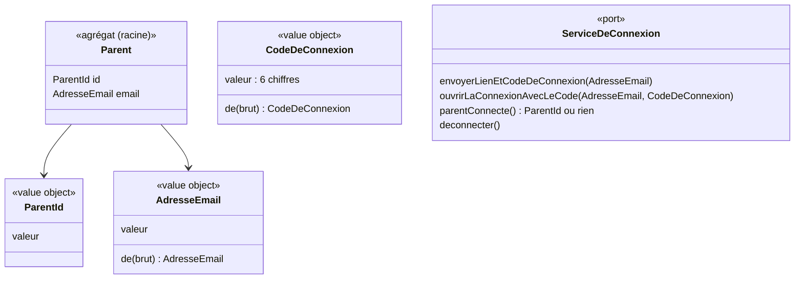
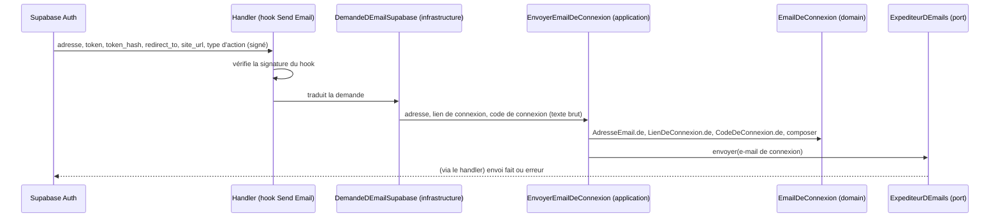
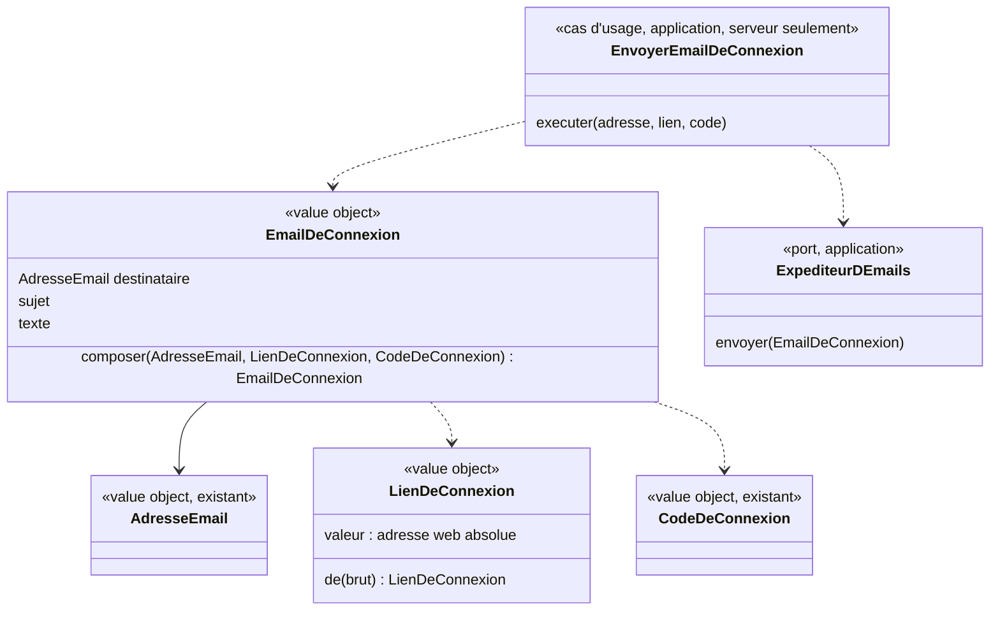

# Modèle du domaine : issue #5, Connexion du parent par lien magique

## Contexte

**Famille** (contexte existant). Le parent est le seul adulte qui a un compte (glossaire, décision n°2). La connexion sert à reconnaître ce parent, pour lui donner accès plus tard aux profils enfants auxquels il est rattaché (lot 2).

Peu de règles métier dans cette story : l'envoi du lien et du code, leur vérification, leur durée de validité et le maintien de la connexion sont assurés par **Supabase Auth**. On le traite comme un **système externe**, derrière un port. Le domaine se limite à :
- l'adresse e-mail du parent et sa validité ;
- la forme du code de connexion (6 chiffres) ;
- l'identité du parent connecté (`ParentId`), qui servira de référence aux rattachements du lot 2 ;
- les erreurs métier nommées que l'interface présente au parent.

Relation : Supabase Auth → Famille, **Anti-Corruption Layer** (décidée). Les erreurs et l'utilisateur de Supabase sont traduits en erreurs métier et en `ParentId` par un adaptateur d'infrastructure. Le reste du domaine ne voit jamais l'objet utilisateur de Supabase.

Note d'infrastructure : `supabase/config.toml` règle déjà `otp_length = 6` et `otp_expiry = 3600` (1 heure), ce qui correspond aux décisions n°6 et n°7.

### Comportement actuel (`app/`, `Store.init()`)

- Aucun écran de connexion : l'application prend l'identité du compte claude.ai (capacités `user` et `db`).
- Avec une identité, les données vont dans un espace privé propre à ce compte, retrouvé sur tous les appareils (« mode cloud »). Sans identité, ou si la capacité échoue, tout reste dans le navigateur (« mode local »).
- À la première connexion, si l'espace du compte est vide et que l'appareil contient des données, elles sont recopiées dans le compte.
- Si une sauvegarde en ligne échoue (hors quota plein), l'application repasse en mode local pour la suite et prévient : « Sauvegarde en ligne impossible : la progression est gardée sur cet appareil. »
- L'accueil et l'espace parent indiquent où sont enregistrées les données (compte ou appareil).
- Il n'y a pas de déconnexion.

La cible change ces points (issue, décisions de démarrage n°5 et n°7, décisions du lot 1) : connexion obligatoire, lien de connexion et code de connexion, déconnexion depuis l'espace parent, pas de « mode local » sans connexion, pas de reprise des données.

## Termes

| Terme | Statut | Remarque |
|---|---|---|
| Parent | au glossaire (confirmé) | Seul rôle adulte. |
| Connexion du parent | **nouveau** (à valider) | État d'un appareil sur lequel un parent est reconnu. Elle reste ouverte jusqu'à la déconnexion. Obligatoire pour utiliser l'application. |
| Lien de connexion | **nouveau** (à valider) | Lien envoyé par e-mail, valable 1 heure, à usage unique. L'issue dit « lien magique ». |
| Code de connexion | **nouveau** (à valider) | Code de 6 chiffres, dans le même e-mail que le lien de connexion. Le parent le saisit sur l'appareil qui a fait la demande. Même durée (1 heure) et même usage unique que le lien. |
| Déconnexion | **nouveau** (à valider) | Fin de la connexion du parent sur un appareil, faite depuis l'espace parent. Plus aucune donnée de la famille n'y reste visible. |
| Appareil | **nouveau** (à valider) | Tablette, téléphone ou ordinateur où l'application est ouverte. Sert aussi aux stories #6 et #7 (« mémorisé sur l'appareil »). |
| Compte | conflit **résolu** | Dans le domaine on dit « Parent » et « Connexion du parent ». L'interface peut dire « ton compte » (proposition appliquée, voir Décisions). |
| Session | conflit **résolu** | « session » reste un synonyme interdit de **Séance**. On dit « la connexion reste ouverte ». |
| Lien magique | conflit **résolu** | **Lien de connexion** dans le domaine, « lien magique » possible dans l'interface. |
| E-mail de connexion | **nouveau** (à valider, question n°15) | E-mail que reçoit le parent : sujet et texte en français, avec le lien de connexion et le code de connexion. Composé par le domaine Famille (décision 0011). La décision 0011 et le journal disent « courriel de connexion » : **conflit** avec le glossaire, qui dit « e-mail ». |
| Code | **attention** | « code » seul est interdit : il désigne aussi le contrôle parental ou l'invitation dans d'autres sens. On dit toujours **code de connexion**. |

## Modèle



### Agrégat `Parent` (minimal dans cette story)

- Racine : `Parent`, identifié par `ParentId` (l'identifiant fourni par le service de connexion, traduit par l'ACL).
- Contient son `AdresseEmail`.
- Dans cette story, l'agrégat ne protège aucun invariant propre au-delà de la validité de ses value objects. Les rattachements aux profils enfants (lot 2) ne sont **pas** dans cet agrégat : ce sont des agrégats à part qui référencent `ParentId` et `ProfilEnfantId` par identifiant.
- Une adresse jamais vue crée un nouveau parent à sa première connexion (inscription et connexion confondues, voir Décisions).
- Le lien et le code de connexion ne sont **pas** dans l'agrégat : ils sont émis et vérifiés par Supabase Auth. Le domaine ne les conserve jamais.
- Question ouverte n°1 : faut-il un agrégat `Parent` dans cette story, ou suffit-il d'un `ParentId` tant que rien d'autre n'est stocké sur le parent ?

### Value objects

| Value object | Règle de validité |
|---|---|
| `AdresseEmail` | Une seule `@`, une partie avant et un domaine avec un point, sans espace. Espaces au début et à la fin ignorés. Comparée sans tenir compte des majuscules. Sinon : erreur `AdresseEmailInvalide`. Règle validée par les 7 exemples du plan de la règle 2 des scénarios (vide, sans @, rien avant le @, pas de domaine, domaine sans point, deux @, espace). |
| `CodeDeConnexion` | Exactement 6 chiffres. Sinon : erreur `CodeDeConnexionMalForme`, sans appel au service de connexion. Le traitement des espaces saisis entre les chiffres est la question ouverte n°2. |
| `ParentId` | Identifiant opaque, non vide. |

### Port `ServiceDeConnexion` (dans `domain/`, arbitrage du journal, 20:28)

`ServiceDeConnexion` : envoyer à une adresse l'e-mail qui contient le lien et le code de connexion, ouvrir la connexion avec un code, dire quel parent est connecté sur cet appareil, déconnecter. Adaptateur : Supabase Auth (`infrastructure/`), qui traduit ses erreurs en erreurs métier.

### Commandes (cas d'usage)

| Commande | Effet | Erreurs métier |
|---|---|---|
| `DemanderLienDeConnexion(email)` | Valide l'adresse, puis demande l'envoi d'un e-mail qui contient un lien de connexion et un code de connexion. | `AdresseEmailInvalide` |
| `OuvrirLaConnexion(lien)` | Le parent suit le lien et arrive connecté, dans l'espace parent. Réalisé par Supabase Auth côté front, le domaine ne voit que le résultat. | `LienDeConnexionInvalide` |
| `OuvrirLaConnexionAvecLeCode(email, code)` | Sur l'appareil qui a fait la demande, le parent saisit le code de connexion reçu et arrive connecté, dans l'espace parent. | `CodeDeConnexionMalForme`, `CodeDeConnexionInvalide` |
| `SeDeconnecter` | Depuis l'espace parent seulement : ferme la connexion du parent sur cet appareil et efface de l'appareil les données de la famille. Les autres appareils restent connectés. | (aucune) |

### Erreurs métier

- `AdresseEmailInvalide`
- `LienDeConnexionInvalide` : lien expiré **ou** déjà utilisé. Un seul message pour les deux (décision n°6), qui propose d'en demander un nouveau.
- `CodeDeConnexionMalForme` : la saisie n'a pas 6 chiffres. Refusée avant tout appel.
- `CodeDeConnexionInvalide` : code expiré, déjà utilisé ou qui ne correspond pas. Qu'il y ait un seul message pour ces trois cas est la question ouverte n°3.
- `LienDeConnexionMalForme` (nouveau, e-mail de connexion) : le lien reçu de Supabase pour l'e-mail n'est pas une adresse web absolue. Aucun e-mail ne part.
- `EnvoiDeLEmailImpossible` (nouveau, e-mail de connexion) : l'expéditeur n'a pas pu envoyer l'e-mail de connexion. Levée par un adaptateur du port `ExpediteurDEmails`.

## Invariants

1. On ne peut pas utiliser l'application sans connexion du parent : sans elle, seul l'écran de connexion est montré (décision n°5).
2. Une adresse e-mail mal formée n'est jamais envoyée au service de connexion. Un code de connexion qui n'a pas 6 chiffres non plus.
3. Seul un parent a un compte : aucune connexion n'existe pour un profil enfant (CLAUDE.md, RGPD).
4. Un lien de connexion et un code de connexion valent **1 heure** et servent **une seule fois** (règle assurée par Supabase Auth, décisions n°6 et n°7).
5. Le code de connexion se saisit sur l'appareil qui a fait la demande.
6. La connexion reste ouverte sur l'appareil jusqu'à la déconnexion (l'enfant n'a rien à ressaisir). Un parent peut être connecté sur plusieurs appareils à la fois.
7. La déconnexion ne se fait que depuis l'espace parent (protégé par le contrôle parental au lot 2) et ne ferme que l'appareil où elle est faite.
8. Après la déconnexion, aucune donnée de la famille ne reste visible sur l'appareil. Le sort des résultats faits hors ligne et pas encore synchronisés est la question ouverte n°4.

## Événements

Aucun événement de domaine n'est nécessaire dans cette story : aucun autre contexte ne réagit à la connexion.
Si un contexte devait réagir plus tard (par exemple Famille à la première connexion d'un parent invité, lot 2), on pourra ajouter `ParentConnecte` (à valider).

## Partage avec le front

- `AdresseEmail` et `CodeDeConnexion` sont du TypeScript pur sous `famille/domain/`, importés par le front via `@domain/famille`, pour refuser une adresse ou un code mal formés avant tout envoi. La demande de lien et la vérification du code exigent le réseau.
- Le reste relève de l'infrastructure : SDK Supabase Auth côté front (envoi de l'e-mail, lecture du lien au retour, vérification du code, maintien de la connexion, déconnexion) et effacement des données locales (IndexedDB) à la déconnexion.

## Données personnelles

- Nouvelle donnée personnelle : l'**adresse e-mail du parent** (donnée d'un adulte, pas d'un enfant). Stockée par Supabase Auth, hébergé dans l'UE. Elle doit figurer dans l'export et la suppression des données (lot 2).
- Le code de connexion n'est jamais conservé par l'application.
- Aucune donnée nouvelle sur l'enfant.

## E-mail de connexion (décision 0011)

Depuis la décision 0011, le contenu de l'e-mail que reçoit le parent n'est plus un modèle réglé dans le tableau de bord de Supabase : c'est du **code métier** du contexte Famille. Supabase Auth émet toujours le lien et le code et vérifie toujours leur durée et leur usage unique ; il confie seulement l'envoi à une Edge Function (hook « Send Email »).

### Nom proposé : **E-mail de connexion** (à valider, question n°15)

- Le glossaire dit « e-mail » partout (« envoyé par e-mail », « adresse e-mail », « Profil enfant… ni e-mail »). « Courriel », employé par la décision 0011 et le journal, en serait un synonyme : il est proposé comme **synonyme interdit** dans le domaine, le code et les scénarios. Le scénario existant dit déjà « reçoit un e-mail contenant un lien de connexion et un code de connexion ».
- Dans le code : `EmailDeConnexion`.
- Ce n'est pas un nouvel agrégat : l'e-mail de connexion n'a pas d'identité ni de cycle de vie, il est composé puis confié à l'expéditeur. Le domaine ne le conserve jamais (la boîte de test est un adaptateur, pas un état du domaine).

### Flux



### Modèle



#### Value objects

| Value object | Règle de validité |
|---|---|
| `LienDeConnexion` (nouveau) | Adresse web absolue (`http` ou `https`), non vide, sans espace. Gardée **telle quelle** : le domaine ne la recompose pas, ne retire pas l'adresse de retour (`redirect_to`). Sinon : erreur `LienDeConnexionMalForme`. Le domaine ne sait pas comment Supabase fabrique le lien : c'est l'ACL qui l'assemble. |
| `CodeDeConnexion` (existant) | Réutilisé tel quel : le jeton reçu de Supabase passe par `CodeDeConnexion.de`. Un jeton qui n'a pas 6 chiffres (réglage `otp_length` faux) lève `CodeDeConnexionMalForme` et **aucun** e-mail ne part. |
| `AdresseEmail` (existant) | Réutilisé tel quel pour le destinataire. |
| `EmailDeConnexion` (nouveau) | Construit **seulement** par `composer(adresse, lien, code)`. Destinataire = l'adresse du parent. Sujet et texte en français, non vides. Le texte contient le lien de connexion inchangé et le code de connexion en 6 chiffres à la suite. Texte exact : questions n°14 et n°16. |

#### Port : `ExpediteurDEmails` (couche `application/`)

- Une seule opération : `envoyer(email: EmailDeConnexion)`. Elle réussit ou lève `EnvoiDeLEmailImpossible`.
- Nom choisi pour pouvoir servir plus tard à d'autres e-mails du contexte Famille (invitation du second parent, lot 2) ; dans cette story il n'accepte qu'un `EmailDeConnexion`.
- Adaptateurs (décision 0011, choisis par une variable d'environnement de la fonction) :
  - `ExpediteurBoiteDeTest` (projet de développement) : range l'e-mail dans la boîte de test, protégée par la RLS sans policy ; seuls les tests la lisent ;
  - `ExpediteurFournisseurEuropeen` (production, #45).
- Fake : `test_utils/expediteur-d-emails-en-memoire.ts`, qui garde les e-mails envoyés et peut simuler un échec.

#### Cas d'usage : `EnvoyerEmailDeConnexion` (commande)

| Commande | Effet | Erreurs |
|---|---|---|
| `EnvoyerEmailDeConnexion(adresse, lien, code)` | Valide l'adresse, le lien et le code, compose l'e-mail de connexion par le domaine, le confie à l'expéditeur. | `AdresseEmailInvalide`, `LienDeConnexionMalForme`, `CodeDeConnexionMalForme`, `EnvoiDeLEmailImpossible` |

Ces erreurs ne sont **pas** vues par le parent comme les autres : elles signalent une demande de Supabase anormale ou un envoi raté. Le handler répond une erreur à Supabase Auth, qui la renvoie au front lors de `DemanderLienDeConnexion`. Le message alors montré au parent est la question n°22.

#### ACL du hook (infrastructure, `DemandeDEmailSupabase`)

Elle traduit la demande de Supabase, sans qu'aucun de ses noms (`token_hash`, `email_action_type`…) n'entre dans le domaine :
- **lien** : assemblé à partir de l'adresse du service d'Auth du projet, de `token_hash`, du type d'action et de `redirect_to` (encodé), pour que le parent revienne, après vérification, sur l'adresse de retour demandée par l'appareil. Attention : `site_url` du hook est l'adresse de l'application, pas celle du service qui vérifie le lien ;
- **code** : `token` ;
- **adresse** : l'adresse du parent dans la demande.

Types d'action : une adresse déjà connue arrive en `magiclink`, une adresse jamais vue (inscription et connexion confondues, décision M8) en `signup`. Les deux donnent **le même** e-mail de connexion (question n°21). Les autres types (`recovery`, `invite`, `email_change`, `reauthentication`) ne servent pas dans Savanturier : ils sont refusés par l'ACL, sans envoi (erreur d'infrastructure, pas du domaine).

### Invariants de l'e-mail de connexion

9. Le texte de l'e-mail de connexion contient **le lien de connexion et le code de connexion** de la même demande.
10. Le code de connexion y apparaît en **6 chiffres à la suite** (même forme que celle que le parent saisit, tant que la question n°2 n'est pas tranchée).
11. Le lien de connexion y apparaît **inchangé** : il ramène le parent, après vérification par Supabase Auth, sur l'adresse de retour (`redirect_to`) demandée par l'appareil.
12. Un e-mail de connexion n'est composé que si l'adresse, le lien et le code sont tous valides. Sinon **rien n'est envoyé**.
13. **RGPD** : l'e-mail de connexion n'utilise que l'adresse du parent, le lien et le code. Aucune donnée d'enfant (prénom, niveau…), aucune autre donnée du parent. Garanti par la signature de `composer`, qui ne reçoit rien d'autre ; à vérifier en review.
14. Le texte est **en français** (la langue du parent est un réglage du profil enfant, qui n'existe pas encore pour le parent seul : question n°1).
15. La boîte de test ne reçoit jamais l'e-mail d'un vrai parent : en production, l'adaptateur est le fournisseur (décision 0011). Une protection de plus dans l'adaptateur est la question n°23.

### Où vit chaque élément, et pourquoi

| Élément | Couche | Raison |
|---|---|---|
| `LienDeConnexion`, `EmailDeConnexion`, `LienDeConnexionMalForme` | `domain/` | TypeScript pur, sans dépendance : ce sont des règles métier (contenu et invariants de l'e-mail). Testés par `Deno.test`. |
| `ExpediteurDEmails` | `application/ports/` | Seul le cas d'usage serveur l'utilise. Contrairement à `ServiceDeConnexion` (appelé depuis le navigateur, donc dans `domain/` par l'arbitrage du journal), le front n'en a pas besoin. |
| `EnvoyerEmailDeConnexion` | `application/` | Il ne tourne **que côté serveur** : c'est Supabase Auth qui l'appelle, par le hook, au moment d'émettre le lien et le code. Le navigateur ne voit jamais le code ni le lien avant le parent (sinon le code ne prouverait plus que le parent lit sa boîte e-mail). Rien à faire hors ligne : l'envoi exige le réseau. Les trois autres cas d'usage de #5 sont dans `domain/` parce qu'ils tournent dans le navigateur ; celui-ci suit la règle par défaut de `CLAUDE.md`. |
| `EmailDeConnexion` hors de `index.ts` | `domain/` | Le front n'a pas à l'importer : ne pas l'exporter par `@domain/famille` évite de mettre le texte de l'e-mail dans le paquet du navigateur. |
| `DemandeDEmailSupabase`, adaptateurs d'expéditeur | `infrastructure/` | Connaissent les noms de Supabase, la table de la boîte de test, le fournisseur. |
| Vérification de la signature du hook | handler | Sécurité de l'entrée, avant tout cas d'usage (`CLAUDE.md`). |

### Événements

Aucun. Envoyer l'e-mail de connexion n'intéresse aucun autre contexte. Un événement `EmailDeConnexionEnvoye` ne serait utile que pour un journal d'envoi, que rien ne demande.

### Données personnelles

- Aucune donnée nouvelle : l'adresse du parent est déjà connue de Supabase Auth.
- Le lien et le code passent par la fonction sans être conservés par le domaine. La boîte de test les conserve (adresses fictives seulement) : sa durée de conservation est la question n°24.
- Le fournisseur européen (#45) sera un sous-traitant au sens du RGPD : à documenter avec son choix.

### Comportements unitaires à tester (TDD, dans cet ordre)

Value objects (`supabase/functions/_shared/famille/domain/`) :

1. `LienDeConnexion.de` accepte une adresse web absolue et la garde telle quelle, adresse de retour comprise (`domain/lien-de-connexion_test.ts`).
2. `LienDeConnexion.de` refuse un lien vide, avec un espace, ou qui n'est pas une adresse web absolue : `LienDeConnexionMalForme` (`domain/lien-de-connexion_test.ts`).
3. `EmailDeConnexion.composer` adresse l'e-mail au parent : destinataire = l'adresse reçue (`domain/email-de-connexion_test.ts`).
4. Le sujet est non vide et en français (texte provisoire tant que la question n°16 n'est pas tranchée) (`domain/email-de-connexion_test.ts`).
5. Le texte contient le lien de connexion inchangé, adresse de retour comprise (`domain/email-de-connexion_test.ts`).
6. Le texte contient le code de connexion en 6 chiffres à la suite (`domain/email-de-connexion_test.ts`).
7. Deux e-mails composés avec deux codes différents ne contiennent chacun que leur propre code (pas de texte figé) (`domain/email-de-connexion_test.ts`).
8. (après la question n°17) Le texte dit que le lien et le code valent 1 heure et servent une seule fois (`domain/email-de-connexion_test.ts`).

Cas d'usage (`supabase/functions/_shared/famille/application/`, avec `test_utils/expediteur-d-emails-en-memoire.ts`) :

9. `EnvoyerEmailDeConnexion` confie à l'expéditeur un seul e-mail de connexion, composé pour l'adresse, le lien et le code reçus (`application/envoyer-email-de-connexion_test.ts`).
10. Une adresse mal formée lève `AdresseEmailInvalide` et rien n'est envoyé (`application/envoyer-email-de-connexion_test.ts`).
11. Un code qui n'a pas 6 chiffres lève `CodeDeConnexionMalForme` et rien n'est envoyé (`application/envoyer-email-de-connexion_test.ts`).
12. Un lien mal formé lève `LienDeConnexionMalForme` et rien n'est envoyé (`application/envoyer-email-de-connexion_test.ts`).
13. Un échec de l'expéditeur remonte en `EnvoiDeLEmailImpossible` (`application/envoyer-email-de-connexion_test.ts`).

ACL (`infrastructure/`, aussi en `Deno.test`, sans réseau) :

14. La demande de Supabase est traduite en adresse, code (`token`) et lien assemblé avec `token_hash`, le type d'action et `redirect_to` encodé (`infrastructure/demande-d-email-supabase_test.ts`).
15. Les types `magiclink` et `signup` sont acceptés ; tout autre type est refusé sans envoi (`infrastructure/demande-d-email-supabase_test.ts`).

Hors tests unitaires : la vérification de la signature (handler) et l'adaptateur boîte de test (il faut la base) sont couverts par le scénario « Paul demande un lien de connexion et le reçoit par e-mail avec un code de connexion ».

## Emplacement

Arbitrage du journal (20:28, même règle que la décision 0008) : le port `ServiceDeConnexion` et les trois cas d'usage qui tournent dans le navigateur sont dans `domain/`, importables par `@domain/famille`. Le cas d'usage de l'e-mail de connexion, lui, ne tourne que côté serveur : il va dans `application/` (voir « E-mail de connexion »).

```
supabase/functions/_shared/famille/
  domain/
    adresse-email.ts                    # value object AdresseEmail (fait)
    code-de-connexion.ts                # value object CodeDeConnexion, 6 chiffres (fait)
    parent-id.ts                        # identifiant typé ParentId (fait)
    parent.ts                           # agrégat Parent (si la question ouverte n°1 le demande)
    erreurs.ts                          # AdresseEmailInvalide, LienDeConnexionInvalide, CodeDeConnexionMalForme,
                                        # CodeDeConnexionInvalide ; + LienDeConnexionMalForme
    service-de-connexion.ts             # port ServiceDeConnexion (fait)
    demander-lien-de-connexion.ts       # cas d'usage, navigateur (fait)
    ouvrir-la-connexion-avec-le-code.ts # cas d'usage, navigateur (fait)
    se-deconnecter.ts                   # cas d'usage, navigateur (fait)
    lien-de-connexion.ts                # NOUVEAU : value object LienDeConnexion
    email-de-connexion.ts               # NOUVEAU : value object EmailDeConnexion (composition du sujet et du texte)
    index.ts                            # exporte le domaine pour @domain/famille (l'e-mail de connexion n'y est pas exporté)
  application/
    ports/expediteur-d-emails.ts        # NOUVEAU : port ExpediteurDEmails
    envoyer-email-de-connexion.ts       # NOUVEAU : cas d'usage serveur EnvoyerEmailDeConnexion
  infrastructure/
    service-de-connexion-supabase.ts    # ACL Supabase Auth → erreurs métier, ParentId
    demande-d-email-supabase.ts         # NOUVEAU : ACL du hook « Send Email » → adresse, lien, code
    expediteur-boite-de-test.ts         # NOUVEAU : adaptateur boîte de test (projet de développement)
    expediteur-fournisseur-europeen.ts  # plus tard (#45)
  test_utils/
    service-de-connexion-en-memoire.ts
    donnees-de-l-appareil-en-memoire.ts
    expediteur-d-emails-en-memoire.ts   # NOUVEAU : fake du port ExpediteurDEmails
supabase/functions/envoyer-email-de-connexion/index.ts   # handler du hook : signature, ACL, cas d'usage, réponse
```

## Décisions

Validation n°1 du lot 1 par le PO, le 2026-10-22 (`docs/stories/lot-1-decisions.md`). « Tranchée » = réponse explicite du PO ; « proposition appliquée » = question de détail qui suit la proposition déjà faite (règle générale de la validation).

Numéros d'origine : « M » = ancienne liste du modèle, « A » = `docs/stories/5/acceptance.md`.

| Question | Réponse | Source |
|---|---|---|
| M1 / A1. Utiliser l'application sans être connecté ? | **Non**. La connexion est obligatoire. | Tranchée, décision n°5 |
| M2 / A2. L'écran de connexion est-il le premier écran ? | **Oui**. « Qui joue ? » arrive au lot 2 ; en attendant, les tests partent de profils enfants préparés. | Tranchée, décision n°2 |
| M3 / A3. Durée du lien de connexion | **1 heure**, usage unique. | Tranchée, décision n°6 |
| M6 / A6. Un ou deux messages pour un lien expiré ou déjà utilisé ? | **Un seul** message : une seule erreur `LienDeConnexionInvalide`. | Tranchée, décision n°6 |
| A11. Écran après la connexion | **L'espace parent**. | Tranchée, décision n°2 |
| A12. Lien ouvert sur un autre appareil | L'e-mail contient aussi un **code de connexion à 6 chiffres**, à saisir sur l'appareil qui a fait la demande. Même durée et même usage unique que le lien. | Tranchée, décision n°7 |
| A16. Qui peut se déconnecter | La déconnexion se fait **seulement depuis l'espace parent**, protégé par le contrôle parental (lot 2). | Tranchée, décision n°8 |
| M5 / A5. Règle de validité de l'adresse | Les 7 exemples du plan de la règle 2. | Proposition appliquée (scénarios) |
| M8 / A8. Une adresse jamais vue crée-t-elle un nouveau parent ? | **Oui** : inscription et connexion confondues. | Proposition appliquée (scénario `@a-valider`) |
| A14. Confirmation d'envoi neutre | **Sans objet**, puisque toute adresse devient un parent (M8). | Conséquence de M8 (`acceptance.md`) |
| A15. Plusieurs appareils | **Oui**, un parent peut être connecté sur plusieurs appareils ; la déconnexion ne ferme que l'appareil où elle est faite. | Proposition appliquée (scénarios `@a-valider`) |
| M9. Le mot « compte » | Interdit dans le domaine (« Parent », « Connexion du parent ») ; l'interface peut dire « ton compte ». | Proposition appliquée (modèle, glossaire) |

## Questions ouvertes

Aucune n'est bloquante pour la story : chacune touche un détail d'interface ou une story suivante.

1. (ancienne M7) Faut-il conserver quelque chose sur le parent en plus de son identité et de son e-mail dans cette story (prénom, langue du parent…) ? (oui / non ; la langue du parent est aujourd'hui un réglage du profil enfant). Sans effet sur les scénarios.
2. (nouvelle) Code de connexion saisi avec des espaces (« 123 456 ») : l'accepte-t-on comme « 123456 » ? (oui / non)
3. (nouvelle) Un seul message pour un code de connexion **faux**, **expiré** ou **déjà utilisé**, comme pour le lien (« Ce code ne marche plus, demande-en un nouveau ») ? (un / plusieurs). Supabase Auth ne distingue pas ces cas.
4. (nouvelle) Lien et code du **même e-mail** : quand le parent s'est connecté avec l'un, l'autre est-il aussi épuisé ? (oui / non). Supabase Auth fait ainsi par défaut.
5. (nouvelle) **Lien suivi sur un autre appareil** (Paul demande sur la tablette, touche le lien sur son téléphone) : le téléphone est-il connecté (oui), ou le parent voit-il seulement un message l'invitant à saisir le code sur la tablette (non) ?
6. (nouvelle) **Nombre d'essais** du code de connexion : faut-il limiter les essais faux (par exemple 5), puis demander un nouvel e-mail ? (oui / non ; sinon, Supabase applique seulement sa limite de demandes)
7. (ancienne M4) Si le parent se déconnecte alors que des séances faites hors ligne ne sont pas encore synchronisées, faut-il le prévenir et lui proposer d'attendre la synchronisation ? (oui / non). À trancher avant la synchronisation (lot 7).
8. (ancienne M10) Le message de l'accueil (« Les profils et la progression sont enregistrés dans ton compte : tu les retrouves sur tous tes appareils. ») est-il repris tel quel ? (oui / non). Sa variante « sur cet appareil » disparaît, puisque la connexion est obligatoire.
9. (ancienne A13) **Deux demandes de suite** : le premier lien et le premier code restent-ils valables jusqu'à leur expiration ? (oui / non) Que voit le parent s'il redemande trop vite (Supabase limite à une demande par minute) ?
10. (ancienne A15, suite) Faut-il aussi « se déconnecter de tous les appareils » (par exemple après la perte d'un téléphone) ? (oui / non ; si oui, plutôt au lot 2 avec l'espace parent)
11. (ancienne A16, suite) La déconnexion demande-t-elle une confirmation (« Veux-tu vraiment te déconnecter ? ») ? (oui / non)
12. (ancienne A17) **Durée de la connexion** : reste-t-elle ouverte sans limite tant que l'appareil sert (oui), ou se ferme-t-elle après une longue période sans utilisation, par exemple plusieurs semaines (non) ?
13. (ancienne A18) Le scénario « Un parent connecté ne voit jamais les profils enfants d'une autre famille » reste-t-il dans #5, exécuté au lot 2 (oui), ou passe-t-il dans la story de rattachement (non) ?
14. (ancienne A19) **Textes exacts** vus par le parent : confirmation d'envoi, adresse refusée, lien qui ne marche plus, code refusé. Les scénarios ne décrivent que le sens. (donner les textes, par exemple)
15. (nouvelle, e-mail de connexion) **Nom** : on dit « **e-mail de connexion** » partout (domaine, code, scénarios, interface), et « courriel » devient un mot interdit, alors que la décision 0011 dit « courriel de connexion » ? (oui / non)
16. (nouvelle, suite de la n°14) **Texte exact de l'e-mail de connexion**. Proposition à corriger : sujet « Ta connexion à Savanturier » ; texte « Bonjour, pour te connecter à Savanturier, touche ce lien : <lien>. Tu peux aussi saisir ce code de connexion sur l'appareil où tu l'as demandé : 123456. » (donner le texte, par exemple)
17. (nouvelle) L'e-mail dit-il que le lien et le code valent **1 heure** et servent **une seule fois** ? (oui / non)
18. (nouvelle) L'e-mail ajoute-t-il « Si tu n'as rien demandé, tu peux ignorer cet e-mail. » ? (oui / non)
19. (nouvelle) **Texte seul**, ou aussi une version mise en forme (bouton pour le lien, logo, couleurs de Savanturier) ? (texte seul / mis en forme)
20. (nouvelle, liée à la n°2) Le code s'affiche-t-il **« 123456 »** (à la suite, comme on le saisit) plutôt que « 123 456 » ? (oui / non). Le modèle suppose « à la suite » tant que la n°2 n'est pas tranchée.
21. (nouvelle) Une **adresse jamais vue** (nouveau parent) reçoit-elle **exactement le même** e-mail qu'un parent déjà connu ? (oui / non ; sinon, donner le texte de bienvenue)
22. (nouvelle) Si l'e-mail **ne peut pas partir** (fournisseur en panne), que voit le parent après avoir demandé son lien ? (donner le texte, par exemple « L'e-mail n'a pas pu partir, réessaie dans un moment. »)
23. (nouvelle, RGPD) La boîte de test doit-elle **refuser toute adresse qui ne finit pas par `@exemple.test`**, en plus du choix de l'adaptateur par variable d'environnement ? (oui / non)
24. (nouvelle, RGPD) Combien de temps la boîte de test garde-t-elle un e-mail ? (par exemple : 1 jour, ou vidée par chaque test)
25. (nouvelle, pour #45) **Expéditeur affiché** : nom et adresse (par exemple « Savanturier <connexion@savanturier.fr> ») ? (donner un exemple)
