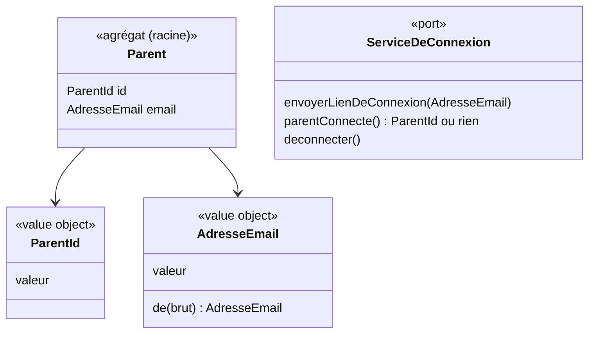

# Modèle du domaine : issue #5, Connexion du parent par lien magique

## Contexte

**Famille** (contexte existant). Le parent est le seul adulte qui a un compte (glossaire, décision n°2). La connexion sert à reconnaître ce parent, pour lui donner accès plus tard aux profils enfants auxquels il est rattaché (lot 2).

Peu de règles métier dans cette story : l'envoi du lien, sa vérification, sa durée de validité et le maintien de la connexion sont assurés par **Supabase Auth**. On le traite comme un **système externe**, derrière un port. Le domaine se limite à :
- l'adresse e-mail du parent et sa validité ;
- l'identité du parent connecté (`ParentId`), qui servira de référence aux rattachements du lot 2 ;
- les erreurs métier nommées que l'interface présente au parent.

Relation : Supabase Auth → Famille, **Anti-Corruption Layer**. Les erreurs et l'utilisateur de Supabase sont traduits en erreurs métier et en `ParentId` par un adaptateur d'infrastructure. Le reste du domaine ne voit jamais l'objet utilisateur de Supabase.

### Comportement actuel (`app/`, `Store.init()`)

- Aucun écran de connexion : l'application prend l'identité du compte claude.ai (capacités `user` et `db`).
- Avec une identité, les données vont dans un espace privé propre à ce compte, retrouvé sur tous les appareils (« mode cloud »). Sans identité, ou si la capacité échoue, tout reste dans le navigateur (« mode local »).
- À la première connexion, si l'espace du compte est vide et que l'appareil contient des données, elles sont recopiées dans le compte.
- Si une sauvegarde en ligne échoue (hors quota plein), l'application repasse en mode local pour la suite et prévient : « Sauvegarde en ligne impossible : la progression est gardée sur cet appareil. »
- L'accueil et l'espace parent indiquent où sont enregistrées les données (compte ou appareil).
- Il n'y a pas de déconnexion.

La cible change ces points (issue, décisions n°5 et n°7) : lien magique, déconnexion, pas de reprise des données. Le fonctionnement sans compte est une question ouverte.

## Termes

| Terme | Statut | Remarque |
|---|---|---|
| Parent | au glossaire (confirmé) | Seul rôle adulte. |
| Connexion du parent | **nouveau** (à valider) | État d'un appareil sur lequel un parent est reconnu. Elle reste ouverte jusqu'à la déconnexion. |
| Lien de connexion | **nouveau** (à valider) | Lien à usage unique envoyé par e-mail. L'issue dit « lien magique ». |
| Déconnexion | **nouveau** (à valider) | Fin de la connexion du parent sur un appareil. Plus aucune donnée de la famille n'y reste visible. |
| Appareil | **nouveau** (à valider) | Tablette, téléphone ou ordinateur où l'application est ouverte. Sert aussi aux stories #6 et #7 (« mémorisé sur l'appareil »). |
| Compte | **en conflit** | « compte » est un synonyme interdit de **Parent** dans le glossaire. Le legacy dit « ton compte ». Il faut décider si « compte » reste interdit dans le domaine (on dit alors « Parent » et « Connexion du parent ») ou s'il désigne seulement l'identité de connexion. |
| Session | **en conflit** | L'issue dit « la session reste ouverte ». « session » est un synonyme interdit de **Séance**. Proposition : dire « la connexion reste ouverte ». |
| Lien magique | **en conflit** (léger) | « lien » est un synonyme interdit de **Rattachement**. Proposition : **Lien de connexion** dans le domaine, « lien magique » éventuellement dans l'interface. |

## Modèle



### Agrégat `Parent` (minimal dans cette story)

- Racine : `Parent`, identifié par `ParentId` (l'identifiant fourni par le service de connexion, traduit par l'ACL).
- Contient son `AdresseEmail`.
- Dans cette story, l'agrégat ne protège aucun invariant propre au-delà de la validité de ses value objects. Les rattachements aux profils enfants (lot 2) ne sont **pas** dans cet agrégat : ce sont des agrégats à part qui référencent `ParentId` et `ProfilEnfantId` par identifiant.
- Question ouverte n°7 : faut-il seulement un agrégat `Parent` dans cette story, ou suffit-il d'un `ParentId` tant que rien d'autre n'est stocké sur le parent ?

### Value objects

| Value object | Règle de validité |
|---|---|
| `AdresseEmail` | Une seule `@`, une partie avant et un domaine avec un point, sans espace. Espaces au début et à la fin ignorés. Comparée sans tenir compte des majuscules. Sinon : erreur `AdresseEmailInvalide`. La règle exacte est à confirmer (question n°5). |
| `ParentId` | Identifiant opaque, non vide. |

### Port (couche `application/`)

`ServiceDeConnexion` : envoyer un lien de connexion à une adresse, dire quel parent est connecté sur cet appareil, déconnecter. Adaptateur : Supabase Auth (`infrastructure/`), qui traduit ses erreurs en erreurs métier.

### Commandes (cas d'usage)

| Commande | Effet | Erreurs métier |
|---|---|---|
| `DemanderLienDeConnexion(email)` | Valide l'adresse, puis demande l'envoi d'un lien de connexion. | `AdresseEmailInvalide` |
| `OuvrirLaConnexion(lien)` | Le parent suit le lien et arrive connecté. Réalisé par Supabase Auth côté front, le domaine ne voit que le résultat. | `LienDeConnexionExpire`, `LienDeConnexionDejaUtilise` |
| `SeDeconnecter` | Ferme la connexion du parent sur l'appareil et efface de l'appareil les données de la famille. | (aucune) |

### Erreurs métier

- `AdresseEmailInvalide`
- `LienDeConnexionExpire` (l'interface propose d'en demander un nouveau)
- `LienDeConnexionDejaUtilise` (idem)
- La distinction entre les deux dépend de ce que Supabase Auth renvoie : si l'ACL ne peut pas les distinguer, une seule erreur `LienDeConnexionInvalide` suffit (question n°6).

## Invariants

1. Une adresse e-mail mal formée n'est jamais envoyée au service de connexion.
2. Seul un parent a un compte : aucune connexion n'existe pour un profil enfant (CLAUDE.md, RGPD).
3. Un lien de connexion sert une seule fois et expire (règle assurée par Supabase Auth, durée à décider : question n°3).
4. La connexion reste ouverte sur l'appareil jusqu'à la déconnexion (l'enfant n'a rien à ressaisir).
5. Après la déconnexion, aucune donnée de la famille ne reste visible sur l'appareil. Le sort des résultats faits hors ligne et pas encore synchronisés est une question ouverte (n°4).

## Événements

Aucun événement de domaine n'est nécessaire dans cette story : aucun autre contexte ne réagit à la connexion.
Si un contexte devait réagir plus tard (par exemple Famille à la première connexion d'un parent invité, lot 2), on pourra ajouter `ParentConnecte` (à valider).

## Partage avec le front

- `AdresseEmail` est du TypeScript pur sous `famille/domain/` et peut être importée par le front via `@domain/famille`, pour refuser une adresse mal formée avant tout envoi (fonctionne hors ligne, mais la demande de lien elle-même exige le réseau).
- Le reste relève de l'infrastructure : SDK Supabase Auth côté front (envoi du lien, lecture du lien au retour, maintien de la connexion, déconnexion) et effacement des données locales (IndexedDB) à la déconnexion.

## Données personnelles

- Nouvelle donnée personnelle : l'**adresse e-mail du parent** (donnée d'un adulte, pas d'un enfant). Stockée par Supabase Auth, hébergé dans l'UE. Elle doit figurer dans l'export et la suppression des données (lot 2).
- Aucune donnée nouvelle sur l'enfant.

## Emplacement

```
supabase/functions/_shared/famille/
  domain/
    adresse-email.ts          # value object AdresseEmail
    parent-id.ts              # identifiant typé ParentId
    parent.ts                 # agrégat Parent (si question n°7 = oui)
    erreurs.ts                # AdresseEmailInvalide, LienDeConnexionExpire, LienDeConnexionDejaUtilise
    index.ts                  # exporte le domaine pour @domain/famille
  application/
    ports/service-de-connexion.ts
    demander-lien-de-connexion.ts
    se-deconnecter.ts
  infrastructure/
    service-de-connexion-supabase.ts   # ACL Supabase Auth → erreurs métier, ParentId
  test_utils/
    service-de-connexion-en-memoire.ts
```

## Questions ouvertes

1. Peut-on encore utiliser l'application **sans être connecté** (tout gardé sur l'appareil), comme aujourd'hui ? (oui / non)
2. L'écran de connexion est-il le **premier écran** de l'application, avant « Qui joue aujourd'hui ? » ? (oui / non ; si non, d'où le parent se connecte-t-il ?)
3. Combien de temps un lien de connexion reste-t-il valable ? (Supabase : 1 h par défaut. Garder 1 h : oui / non)
4. Si le parent se déconnecte alors que des séances faites hors ligne ne sont pas encore synchronisées, faut-il **le prévenir et lui proposer d'attendre la synchronisation** avant d'effacer l'appareil ? (oui / non)
5. Règle de validité de l'adresse : suffit-il de vérifier la forme « quelque chose @ domaine.extension », sans espace ? (oui / non ; sinon, un exemple d'adresse à refuser)
6. Faut-il deux messages différents pour un lien **expiré** et un lien **déjà utilisé**, ou un seul message (« Ce lien ne marche plus, demande-en un nouveau ») suffit-il ? (deux / un)
7. Faut-il conserver quelque chose sur le parent en plus de son identité et de son e-mail dans cette story (prénom, langue du parent…) ? (oui / non ; la langue du parent est aujourd'hui un réglage du profil enfant)
8. Une adresse e-mail jamais vue crée-t-elle automatiquement un nouveau parent au premier lien (inscription et connexion confondues) ? (oui / non)
9. Le mot **« compte »** reste-t-il interdit dans le domaine (on dit « Parent » et « Connexion du parent »), l'interface pouvant dire « ton compte » ? (oui / non)
10. Le message de l'accueil (« Les profils et la progression sont enregistrés dans ton compte : tu les retrouves sur tous tes appareils. ») est-il repris tel quel dans la cible ? (oui / non)
