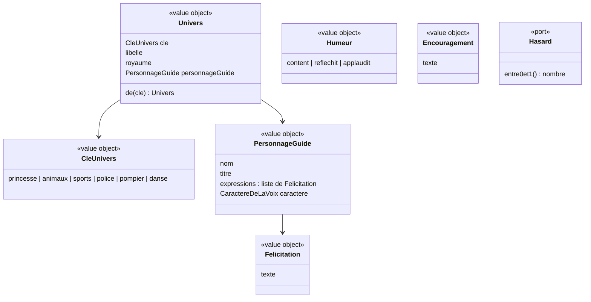

# Modèle du domaine : issue #6, Design, univers et personnage guide

## Contexte

**Motivation** (contexte existant). Le glossaire y place déjà **Univers** et **Personnage guide**. L'univers ne change que l'habillage, jamais le contenu ni les règles : c'est cohérent avec un contexte qui ne modifie jamais une note.

Relations :
- **Famille → Motivation** : le profil enfant garde la **clé** de l'univers choisi (le choix est dans le lot 2). Motivation fournit le catalogue des univers et retrouve un univers à partir de sa clé. Référence par identifiant (la clé), jamais par objet.
- **Motivation → Apprentissage** (nouvelle relation proposée) : pendant une séance, l'écran fait parler le personnage guide (félicitation après une bonne réponse, encouragement après une erreur). Apprentissage décide si la réponse est juste. Motivation fournit seulement les mots et l'humeur. Mécanisme : appel en lecture au domaine de Motivation, depuis le front.
- **Motivation → Voix** (story #7) : le personnage guide donne son **caractère de la voix**.

Ce qui n'est **pas** du domaine : paysage (ciel, collines, arbres, soleil), couleurs, dessin du personnage guide, animations, en-tête. C'est de la présentation dans `src/`, rangée par clé d'univers.

### Comportement actuel (`app/`)

- `WORLDS` : 6 univers, avec libellé, royaume, nom et titre du personnage guide, apparence (dessin), fond.
- `PALETTES` : ciel, lointain, collines, arbres, soleil, couleur principale et couleur foncée de chaque univers.
- Univers inconnu ou absent du profil : `animaux` (Noisette) (`setChild`, `worldKey`).
- Humeurs : `happy` (par défaut), `think` (la tête penche, après une erreur), `cheer` (il saute trois fois, après une bonne réponse, au lancement des exercices, à l'écran de fin).
- Félicitation (`praise()`) : 35 % du temps une expression du personnage guide (`VOICE_STYLE.cri`), sinon une félicitation commune (`PRAISE`). Avec 3 étoiles, l'écran de fin commence toujours par une expression du personnage guide.
- Encouragement (`oops()`) : tiré dans `OOPS`, suivi le plus souvent d'une aide propre à la question.
- Animations réduites si `prefers-reduced-motion` (`REDUCED`).

## Termes

| Terme | Statut | Remarque |
|---|---|---|
| Univers | au glossaire (confirmé) | Clés : `princesse`, `animaux`, `sports`, `police`, `pompier`, `danse`. |
| Personnage guide | au glossaire (confirmé) | Le code legacy dit `guide` seul (`W.guide`) : à ne pas reprendre. |
| Royaume | **nouveau** (à valider) | Lieu de l'univers où vit le personnage guide (« la Forêt des Savanturiers »). |
| Titre du personnage guide | **nouveau** (à valider) | Qualité qui suit le nom (« l'écureuil savant »). |
| Humeur du personnage guide | **nouveau** (à valider) | `content`, `reflechit`, `applaudit`. |
| Félicitation | **nouveau** (à valider) | Phrase qui salue une bonne réponse. Commune ou propre au personnage guide. |
| Expression du personnage guide | **nouveau** (à valider) | Félicitation propre à un personnage guide (« Youpi ! »). Le legacy dit `cri`. |
| Encouragement | **nouveau** (à valider) | Phrase dite après une erreur, jamais punitive (« Pas grave, on réessaie ! »). |
| Paysage | **nouveau** (à valider), hors domaine | Décor de fond propre à l'univers. Présentation seulement. |
| « thème », « monde » | **en conflit** | Synonymes interdits de Univers, mais le legacy dit `WORLDS` et l'issue « Monde vivant » (nom du style graphique). On garde « Monde vivant » comme nom du design, pas comme terme du domaine. |

## Modèle



Il n'y a **pas d'agrégat** dans cette story : aucun état ne change, rien n'est enregistré. Les univers forment un **catalogue fixe** de value objects, écrit dans le domaine (6 entrées). Le choix de l'univers d'un enfant appartient au profil enfant (Famille, lot 2).

`CaractereDeLaVoix` est décrit dans le modèle de la story #7.

### Value objects et règles

| Élément | Règle |
|---|---|
| `CleUnivers` | Une des 6 clés. Une clé inconnue ou absente donne `animaux` (comportement actuel, pas d'erreur). |
| `Univers` | Libellé, royaume et personnage guide fixés par le tableau de l'issue #6. Retrouvé par sa clé. |
| `PersonnageGuide` | Nom, titre, 3 expressions (tableau `VOICE_STYLE.cri`), caractère de la voix. |
| `Humeur` | Trois valeurs. `content` par défaut. |
| `Felicitation` | Texte non vide. Les 8 félicitations communes sont celles de `PRAISE`. |
| `Encouragement` | Texte non vide. Les 5 encouragements sont ceux de `OOPS`. Jamais punitif (CLAUDE.md). |

### Fonctions du domaine (pures)

| Fonction | Règle tirée du legacy |
|---|---|
| `universDe(cle)` | Clé inconnue → `animaux`. |
| `feliciter(personnageGuide, hasard)` | Avec une probabilité de 0,35, une expression du personnage guide ; sinon une félicitation commune. Chaque tirage est uniforme dans sa liste. |
| `encourager(hasard)` | Un encouragement tiré uniformément. |
| `humeurApresReponse(juste)` | Réponse juste → `applaudit`, réponse fausse → `reflechit` (question n°4 : est-ce une règle ?). |

Le hasard passe par le port `Hasard` (décision 0003) pour que les tests restent déterministes.

### Commandes, événements, erreurs

- Aucune commande, aucun événement de domaine dans cette story.
- Aucune erreur métier : une clé inconnue retombe sur `animaux`.

## Invariants

1. Il y a exactement 6 univers, chacun avec un seul personnage guide.
2. L'univers ne change que l'habillage : ni les consignes, ni les exercices, ni la correction, ni les étoiles. Les couleurs des colonnes de calcul (C vert, D rose, U bleu) sont les mêmes dans tous les univers.
3. Un profil sans univers connu joue dans `animaux`, avec Noisette.
4. Une félicitation est soit une expression du personnage guide en cours, soit une félicitation commune, jamais l'expression d'un autre personnage guide.
5. Un encouragement n'est jamais punitif.

## Partage avec le front

Tout le domaine de cette story sert au front, y compris hors ligne : catalogue des univers, `universDe`, `feliciter`, `encourager`, humeurs. Il est exposé par `@domain/motivation`.

Reste dans `src/` (présentation, aucune règle) : paysage et couleurs (`PALETTES`), dessin du personnage guide et de ses trois humeurs, animations Motion (réduites avec `prefers-reduced-motion`), en-tête (logo, prénom et niveau de l'enfant, Son/Muet, Retour, espace parent).

## Données d'enfants

Aucune donnée nouvelle. L'en-tête affiche le prénom et le niveau du profil enfant, déjà prévus par le glossaire.

## Emplacement

```
supabase/functions/_shared/motivation/
  domain/
    univers.ts                 # CleUnivers, Univers, catalogue des 6 univers, universDe
    personnage-guide.ts        # PersonnageGuide
    humeur.ts                  # Humeur, humeurApresReponse (si question n°4 = oui)
    paroles.ts                 # Felicitation, Encouragement, feliciter, encourager
    hasard.ts                  # interface Hasard (si le port est défini dans le domaine, voir question n°7)
    index.ts                   # exporte le domaine pour @domain/motivation
  test_utils/
    hasard-fixe.ts
src/
  univers/                     # paysages, couleurs, dessins des personnages guides (présentation)
```

## Questions ouvertes

1. Où se trouve la maquette de l'option 1 à reproduire ? (`prototype/` contient `addition-en-colonnes.html` et `royaume-des-additions.html` : est-ce l'une d'elles ? oui / non)
2. Le personnage guide reste-t-il dessiné en SVG (oui), ou passe-t-on à Rive/Lottie (non) ?
3. Un profil dont l'univers est inconnu joue-t-il toujours dans `animaux`, sans prévenir le parent ? (oui / non)
4. Le personnage guide doit-il **toujours** applaudir après une bonne réponse et réfléchir après une erreur ? Aujourd'hui, dans l'exercice « classer », il ne félicite qu'une bonne réponse sur deux. (toujours / comme aujourd'hui)
5. Garde-t-on la proportion actuelle : un peu plus d'une félicitation sur trois (35 %) est une expression du personnage guide ? (oui / non ; sinon, quelle proportion ?)
6. Les listes de félicitations communes (`PRAISE`), d'encouragements (`OOPS`) et d'expressions de chaque personnage guide sont-elles reprises **mot pour mot** ? (oui / non)
7. L'interface `Hasard` peut-elle être déclarée dans `domain/` pour que le front l'utilise (le front n'importe pas `application/`) ? (oui / non ; choix d'architecture, une décision à ajouter dans `docs/decisions/` si oui)
8. Le **royaume** et le **titre** du personnage guide sont-ils des termes à garder dans le glossaire (oui), ou seulement des textes d'affichage (non) ?
9. Est-il juste de ranger « faire parler le personnage guide pendant une séance » dans Motivation, Apprentissage ne fournissant que « réponse juste / fausse » ? (oui / non)
