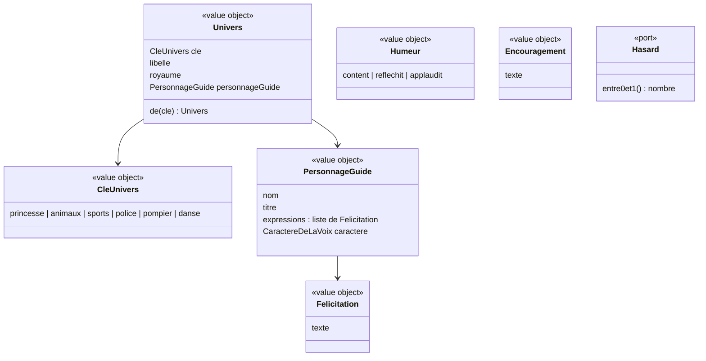

# Modèle du domaine : issue #6, Design, univers et personnage guide

## Contexte

**Motivation** (contexte existant). Le glossaire y place déjà **Univers** et **Personnage guide**. L'univers ne change que l'habillage, jamais le contenu ni les règles : c'est cohérent avec un contexte qui ne modifie jamais une note.

Relations :
- **Famille → Motivation** : le profil enfant garde la **clé** de l'univers choisi (le choix est dans le lot 2). Motivation fournit le catalogue des univers et retrouve un univers à partir de sa clé. Référence par identifiant (la clé), jamais par objet.
- **Motivation → Apprentissage** (relation retenue, voir Décisions) : pendant une séance, l'écran fait parler le personnage guide (félicitation après une bonne réponse, encouragement après une erreur). Apprentissage décide si la réponse est juste. Motivation fournit seulement les mots et l'humeur. Mécanisme : appel en lecture au domaine de Motivation, depuis le front.
- **Motivation → Voix** (story #7, sous-domaine décidé, décision 0007) : le personnage guide donne son **caractère de la voix**.

Ce qui n'est **pas** du domaine : paysage (ciel, collines, arbres, soleil), couleurs, dessin du personnage guide, animations, en-tête. C'est de la présentation dans `src/`, rangée par clé d'univers.

Référence visuelle et animation (décision n°9) : l'artifact « Savanturier Web animé », démo de l'option 1 de la décision 0001 (https://claude.ai/artifact/GQyTR5c5mY33qo4pv3KVEe). Le personnage guide reste **dessiné en SVG et animé avec Motion** (respiration, clignement, saut de joie, tête penchée).

Vérification au lot 1 (décision n°1) : une **page de démonstration réservée aux tests** montre une consigne, les humeurs du personnage guide, ses félicitations et ses encouragements. Elle est retirée au lot 3, quand les exercices la remplacent. Elle n'est pas un concept du domaine.

### Comportement actuel (`app/`)

- `WORLDS` : 6 univers, avec libellé, royaume, nom et titre du personnage guide, apparence (dessin), fond.
- `PALETTES` : ciel, lointain, collines, arbres, soleil, couleur principale et couleur foncée de chaque univers.
- Univers inconnu ou absent du profil : `animaux` (Noisette) (`setChild`, `worldKey`).
- Humeurs : `happy` (par défaut), `think` (la tête penche, après une erreur), `cheer` (il saute trois fois, après une bonne réponse, au lancement des exercices, à l'écran de fin).
- Félicitation (`praise()`) : 35 % du temps une expression du personnage guide (`VOICE_STYLE.cri`), sinon une félicitation commune (`PRAISE`). Avec 3 étoiles, l'écran de fin commence toujours par une expression du personnage guide.
- Encouragement (`oops()`) : tiré dans `OOPS`, suivi le plus souvent d'une aide propre à la question.
- Animations réduites si `prefers-reduced-motion` (`REDUCED`).

## Termes

| Terme | Statut | Remarque |
|---|---|---|
| Univers | au glossaire (confirmé) | Clés : `princesse`, `animaux`, `sports`, `police`, `pompier`, `danse`. |
| Personnage guide | au glossaire (confirmé) | Le code legacy dit `guide` seul (`W.guide`) : à ne pas reprendre. |
| Royaume | **nouveau** (à valider) | Lieu de l'univers où vit le personnage guide (« la Forêt des Savanturiers »). |
| Titre du personnage guide | **nouveau** (à valider) | Qualité qui suit le nom (« l'écureuil savant »). Ajouté au glossaire. |
| Humeur du personnage guide | **nouveau** (à valider) | `content`, `reflechit`, `applaudit`. |
| Félicitation | **nouveau** (à valider) | Phrase qui salue une bonne réponse. Commune ou propre au personnage guide. |
| Expression du personnage guide | **nouveau** (à valider) | Félicitation propre à un personnage guide (« Youpi ! »). Le legacy dit `cri`. |
| Encouragement | **nouveau** (à valider) | Phrase dite après une erreur, jamais punitive (« Pas grave, on réessaie ! »). |
| Paysage | hors domaine | Décor de fond propre à l'univers. Présentation seulement, pas d'entrée au glossaire (voir Décisions). |
| « thème », « monde » | **en conflit** | Synonymes interdits de Univers, mais le legacy dit `WORLDS` et l'issue « Monde vivant » (nom du style graphique). On garde « Monde vivant » comme nom du design, pas comme terme du domaine. |

## Modèle



Il n'y a **pas d'agrégat** dans cette story : aucun état ne change, rien n'est enregistré. Les univers forment un **catalogue fixe** de value objects, écrit dans le domaine (6 entrées). Le choix de l'univers d'un enfant appartient au profil enfant (Famille, lot 2).

`CaractereDeLaVoix` est décrit dans le modèle de la story #7.

### Value objects et règles

| Élément | Règle |
|---|---|
| `CleUnivers` | Une des 6 clés. Une clé inconnue ou absente donne `animaux` (comportement actuel, pas d'erreur). |
| `Univers` | Libellé, royaume et personnage guide fixés par le tableau de l'issue #6. Retrouvé par sa clé. |
| `PersonnageGuide` | Nom, titre, 3 expressions (tableau `VOICE_STYLE.cri`), caractère de la voix. |
| `Humeur` | Trois valeurs. `content` par défaut. |
| `Felicitation` | Texte non vide. Les 8 félicitations communes sont celles de `PRAISE`. |
| `Encouragement` | Texte non vide. Les 5 encouragements sont ceux de `OOPS`. Jamais punitif (CLAUDE.md). |

### Fonctions du domaine (pures)

| Fonction | Règle tirée du legacy |
|---|---|
| `universDe(cle)` | Clé inconnue → `animaux`. |
| `feliciter(personnageGuide, hasard)` | Avec une probabilité de 0,35, une expression du personnage guide ; sinon une félicitation commune. Chaque tirage est uniforme dans sa liste. Textes repris mot pour mot du legacy. |
| `presentationAuRetourDuSon(personnageGuide)` | « Je t'entends ! Je suis <nom du personnage guide>. » (texte du legacy, le personnage guide dit son propre nom). Lu par Voix (story #7). |
| `encourager(hasard)` | Un encouragement tiré uniformément. |
| `humeurApresReponse(juste)` | Réponse juste → `applaudit`, réponse fausse → `reflechit`, **toujours** (écart voulu avec l'exercice « classer » du legacy, voir Décisions). |

Le hasard passe par le port `Hasard` (décision 0003). Son interface est déclarée dans `motivation/domain/` et exportée par `@domain/motivation` (décision 0007) ; l'adaptateur (`Math.random`) vit dans `src/`.

### Commandes, événements, erreurs

- Aucune commande, aucun événement de domaine dans cette story.
- Aucune erreur métier : une clé inconnue retombe sur `animaux`.

## Invariants

1. Il y a exactement 6 univers, chacun avec un seul personnage guide.
2. L'univers ne change que l'habillage : ni les consignes, ni les exercices, ni la correction, ni les étoiles. Les couleurs des colonnes de calcul (C vert, D rose, U bleu) sont les mêmes dans tous les univers.
3. Un profil sans univers connu joue dans `animaux`, avec Noisette.
4. Une félicitation est soit une expression du personnage guide en cours, soit une félicitation commune, jamais l'expression d'un autre personnage guide.
5. Après une bonne réponse le personnage guide applaudit toujours ; après une erreur il réfléchit toujours.
6. Un encouragement n'est jamais punitif.
7. Les félicitations communes, les encouragements et les expressions de chaque personnage guide sont ceux du legacy, mot pour mot.

## Partage avec le front

Tout le domaine de cette story sert au front, y compris hors ligne : catalogue des univers, `universDe`, `feliciter`, `encourager`, humeurs, interface `Hasard`. Il est exposé par `@domain/motivation`.

Reste dans `src/` (présentation, aucune règle) : paysage et couleurs (`PALETTES`), dessin SVG du personnage guide et de ses trois humeurs, animations Motion (avec `prefers-reduced-motion`, il ne saute plus et ne penche plus la tête, mais son visage montre encore l'humeur), page de démonstration du lot 1, en-tête (logo, prénom et niveau de l'enfant, Son/Muet, Retour, espace parent).

## Données d'enfants

Aucune donnée nouvelle. L'en-tête affiche le prénom et le niveau du profil enfant, déjà prévus par le glossaire.

## Emplacement

```
supabase/functions/_shared/motivation/
  domain/
    univers.ts                 # CleUnivers, Univers, catalogue des 6 univers, universDe
    personnage-guide.ts        # PersonnageGuide
    humeur.ts                  # Humeur, humeurApresReponse
    paroles.ts                 # Felicitation, Encouragement, feliciter, encourager
    hasard.ts                  # interface Hasard (décision 0007)
    index.ts                   # exporte le domaine pour @domain/motivation
  test_utils/
    hasard-fixe.ts
src/
  univers/                     # paysages, couleurs, dessins des personnages guides (présentation)
```

## Décisions

Validation n°1 du lot 1 par le PO, le 2026-10-22 (`docs/stories/lot-1-decisions.md`). « Tranchée » = réponse explicite du PO ; « proposition appliquée » = question de détail qui suit la proposition déjà faite (règle générale de la validation).

Numéros d'origine : « M » = ancienne liste du modèle, « A » = `docs/stories/6/acceptance.md`.

| Question | Réponse | Source |
|---|---|---|
| M1. Maquette à reproduire | L'artifact « Savanturier Web animé » (démo de l'option 1 de la décision 0001), pas les fichiers de `prototype/`. | Tranchée, décision n°9 |
| M2. SVG ou Rive/Lottie ? | **SVG animé avec Motion**. Rive pourra venir plus tard, par une nouvelle décision. | Tranchée, décision n°9 |
| M6. Textes repris mot pour mot ? | **Oui** : félicitations communes, encouragements, expressions de chaque personnage guide, présentation au retour du son. | Tranchée, décision n°3 |
| M7. Interface `Hasard` dans `domain/` ? | **Oui**. | Tranchée, décision n°4 et décision 0007 |
| A1. Humeurs et paroles observables au lot 1 | Une **page de démonstration réservée aux tests**, retirée au lot 3. | Tranchée, décision n°1 |
| A2. Entrée dans l'univers au lot 1 | Profils enfants **préparés pour les tests** ; « Qui joue ? » arrive au lot 2. | Tranchée, décision n°2 |
| A6. Présentation au retour du son | **Oui**, avec le nom du personnage guide en cours (« Je suis Capitaine Sam. »). | Tranchée, décision n°3 |
| M3. Univers inconnu | `animaux` (Noisette), **sans message**. | Proposition appliquée (scénario `@a-valider`) |
| M4. Toujours applaudir / réfléchir ? | **Toujours**, y compris dans « classer » (écart voulu avec le legacy). | Proposition appliquée (scénarios `@a-valider`) |
| M5. Proportion des expressions | **35 %** des félicitations, comme le legacy. | Proposition appliquée (modèle) |
| M8 / A3 (en partie). Royaume et titre | Gardés comme termes `(à valider)` du glossaire ; le personnage guide se présente avec son titre et son royaume. | Proposition appliquée (modèle, scénario `@a-valider`) |
| M9. Faire parler le personnage guide dans Motivation | **Oui** : Apprentissage fournit seulement « réponse juste / fausse ». Relation ajoutée à la context map. | Proposition appliquée (modèle) |
| A1 (suite). Couleurs des colonnes de calcul | Vérifiées au **lot 3**, avec l'addition posée (la page de démonstration ne montre pas de calcul). | Proposition appliquée (`acceptance.md`, option a) |
| A5. Mouvements réduits | Le visage change encore (sourit, réfléchit) : seul signe de l'humeur. | Proposition appliquée (scénarios `@a-valider`) |
| A8 (en partie). « paysage », « couleur principale », « en-tête », « mouvements réduits » | Termes d'interface, **hors glossaire**. | Proposition appliquée (modèle : présentation hors domaine) |

## Questions ouvertes

Aucune n'est bloquante pour la story.

1. (ancienne A3, suite) **Où et avec quels mots** le personnage guide se présente-t-il avec son titre et son royaume ? Le legacy ne l'affiche nulle part. Proposition de texte à valider par un exemple : « Je suis Noisette, l'écureuil savant de la Forêt des Savanturiers. », sur la page de démonstration au lot 1, puis à l'accueil.
2. (ancienne A4) **Accueil sans profil enfant** : comme le legacy, l'accueil repasse-t-il dans l'univers « Animaux de la forêt » même si l'enfant jouait dans un autre univers ? (oui / non ; sinon, l'accueil garde l'univers du dernier enfant). À trancher avec « Qui joue ? » (lot 2).
3. (ancienne A7) **Retour dans l'en-tête** : sur quels écrans du lot 1 apparaît-il ? (par exemple : partout sauf l'accueil et l'écran de connexion)
4. (ancienne A8, suite) « **accueil** » : est-ce l'écran « Aujourd'hui » du lot 4 ? (même question que la n°7 de la story #8)
5. (ancienne A8, suite) « **colonnes de calcul** » (centaines, dizaines, unités) : faut-il un terme du glossaire ? (oui / non ; à trancher au lot 3)
