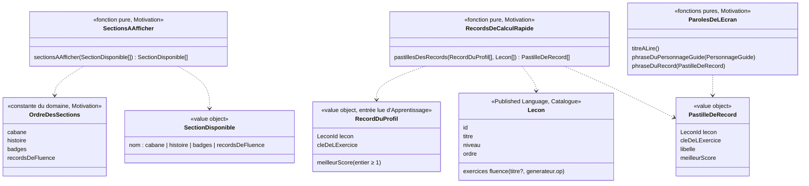

# Modèle du domaine : issue #65, Écran « Mes trophées » (nom à valider)

> Le nom de l'écran n'est pas tranché (question n°1) : « trophée » est un synonyme interdit de **Badge**. Dans ce document, l'écran s'appelle « l'écran des récompenses de l'enfant » ou « l'écran » ; aucun nom de code n'est figé avant la réponse du PO.

## Contexte

Bounded context de la story : **Motivation** (écran de l'enfant), avec une lecture seule dans **Apprentissage** (records de fluence) et dans le **Catalogue pédagogique** (titres des leçons et des exercices).

Pourquoi Motivation :
- l'écran réunit ce que l'enfant a gagné : cabane (#32), histoire et épisodes (#33), badges (#31). Ces trois sections sont des récompenses de Motivation (context map : « Motivation décide seule des récompenses ») ;
- la section des records ne fait qu'**afficher** un fait d'Apprentissage (`RecordDeFluence`, #20). Elle ne le calcule pas, ne le modifie pas, n'en déduit aucune note : c'est exactement la règle de Motivation, « contexte à part, qui ne modifie jamais une note » ;
- l'habillage (paysage, personnage guide, voix) vient déjà de Motivation (#6, `src/univers/`, `@domain/motivation`).

Sources lues par l'écran, sans rien écrire :

| Source | Contexte | Ce qui est lu | Mécanisme |
|---|---|---|---|
| Records de fluence du profil en cours | Apprentissage | `records_de_fluence` (#20) : `lecon`, `exercice`, `meilleur_score`, pour un seul `profil` | Lecture du front sous RLS (policy `records_de_fluence_lecture_par_ses_parents`), comme `resultats_des_lecons` pour le parcours (#25) et le record affiché au début d'une fluence (`lecture-du-record-supabase.ts`, #20) |
| Leçons de la bibliothèque | Catalogue pédagogique | `Lecon` : `id`, `titre`, `niveau`, `ordre`, exercices `fluence` (`titre?`, `generateur.op`) | Published Language `@domain/catalogue` ; le front charge déjà toute la bibliothèque (`chargerToutesLesLecons`) |
| Profil en cours | Famille | identifiant, prénom, univers, réglage **Tout lire à voix haute** | Customer/Supplier existant (#11, #12) : le front passe les valeurs |
| Univers et personnage guide | Motivation | `universDe(cle)`, `PersonnageGuide` | Interne à Motivation (#6) |

Hors de cette story (points d'accroche seulement, voir « Sections de l'écran ») : le contenu de « La cabane de Noisette » (#32), de « L'histoire des Savanturiers » (#33), de « Mes badges » (#31), et le dock de « Aujourd'hui » (#29).

### Comportement actuel (`app/app.js`), source des règles

- `showTrophees` (l. 622) : quatre sections dans l'ordre cabane, histoire, badges, records. La section des records n'apparaît que si le profil a au moins un record (`Object.keys(rec).length`).
- Une pastille par record : `<titre de la leçon> : <valeur>`, repli sur la partie après « : » de la clé si la leçon est introuvable (`lessonById(lid)?.titre || nm`). Ordre des pastilles : celui des clés dans le document de records (ordre d'enregistrement), sans règle métier.
- Clé d'un record (`Records`, l. 1049 ; fluence l. 1520) : `<id de la leçon>:<titre de l'exercice, sinon op>`.
- Pas de titre de page, pas de personnage guide, rien n'est lu à voix haute, même avec « Tout lire ».

### Ce que montrent le code de #20 et la bibliothèque (vérifié)

- **Clé `exercice`** de `records_de_fluence` : `ExerciceChronometre.nom` = `exercice.titre ?? exercice.generateur.op` (`apprentissage/domain/exercice-chronometre.ts`, l. 44), comme le legacy. C'est donc **le titre de l'exercice**, ou son signe s'il n'a pas de titre.
- `titre` est facultatif pour un exercice dans le Catalogue (`ExerciceFluence.titre?`), mais le pipeline le donne toujours (`fluence(titre, …)`, `scripts/build_bibliotheque.py`, l. 229). `docs/format-lecons.md` ne liste pas `titre` dans les données d'une fluence (champ commun à tous les exercices).
- `app/bibliotheque.json` : **14 exercices de fluence, dans 14 leçons de maths différentes** (CP à CM2). **Aucune leçon n'a deux exercices de fluence.** Les 14 ont un `titre`, tous de la forme « Calcul rapide : … », et les 14 titres sont **tous différents** (ex. « Calcul rapide : tables de 3 et 4 », leçon « Les tables de 3 et de 4 »).
- Le défaut « deux pastilles au même libellé » du legacy est donc **théorique aujourd'hui** ; il deviendrait réel avec une seconde fluence dans une leçon (ou une leçon personnelle, lot 6). Le libellé par le titre de l'exercice le prévient.

## Termes

| Terme | Statut | Remarque |
|---|---|---|
| « Mes trophées » | **conflit** (glossaire : « trophée » est un synonyme interdit de **Badge**) | Nom de l'écran et de l'onglet du dock à trancher (question n°1). Ni le code, ni les scénarios ne l'emploient avant la réponse. |
| Écran des récompenses de l'enfant (nom à valider) | **nouveau**, `(à valider)` | L'écran lui-même : sections dans un ordre fixe. Terme du domaine ou simple titre d'écran : question n°1. |
| Section de l'écran (à valider) | **nouveau**, `(à valider)` | Une des quatre parties de l'écran : cabane, histoire, badges, records de fluence. Mot d'interface probable ; ajouté pour fixer l'ordre. |
| Record de fluence | au glossaire (#20) | Meilleur score d'un enfant à un exercice de fluence d'une leçon. L'écran l'affiche sans le modifier. « Record » seul : interface. |
| Score de fluence | au glossaire (#20) | La valeur d'une pastille est un score de fluence (nombre de calculs réussis). |
| Records de calcul rapide (à valider) | **nouveau**, `(à valider)` | Section qui montre les records de fluence du profil en cours, un par exercice de fluence. Interface : « Mes records de calcul rapide ». |
| Pastille de record (à valider) | **nouveau**, `(à valider)` | Libellé de l'exercice et meilleur score, pour un record de fluence. Probablement mot d'interface (comme « carte », « bulle ») : à classer avec la question n°1. |
| Fluence / « Calcul rapide » | au glossaire (#20) | « Calcul rapide » est le mot d'interface de la fluence. |
| Badge, Cabane, Épisode | au glossaire, `(à valider)` | Seulement nommés comme sections ; leurs règles restent dans #31, #32, #33. |
| Personnage guide, Univers | au glossaire (#6) | Question n°5 : l'écran suit l'univers du profil. |
| Tout lire à voix haute | au glossaire, `(à valider)` (#12) | Sa portée sur cet écran est la question n°12. |
| « Mes réussites » | **conflit potentiel** | Proposé dans l'issue ; « réussie » est réservé à la **Leçon réussie** (1 étoile). |
| « Ma collection » | **conflit** | Proposé dans l'issue ; « collection » est un synonyme interdit de **Cabane**. |
| « Mes trésors » | sans conflit | Proposé dans l'issue. Seul voisinage : l'objet « une boîte à trésor » de la cabane (#32), qui n'est pas un terme du domaine. |
| Dock | mot d'interface (#29) | Hors glossaire. |

## Modèle

L'écran **n'est pas un agrégat** : aucune commande, aucune écriture, aucun invariant d'écriture. C'est une **vue calculée** (read model) par des fonctions pures de `motivation/domain/`, recalculée à chaque ouverture. Les records restent l'agrégat `RecordDeFluence` d'Apprentissage (#20), mis à jour seulement par `TerminerLaSeance`.



Les noms ci-dessus sont des propositions de travail. Ceux qui dépendent du nom de l'écran attendent la question n°1.

### Sections de l'écran (point d'accroche)

- `OrdreDesSections` : cabane, histoire, badges, records de fluence. C'est **la seule règle** que #65 pose pour les trois sections de #31, #32 et #33.
- « Une section dont la story n'est pas livrée ne s'affiche pas » n'est **pas une règle d'exécution** : #65 ne livre que la section des records. Chaque story (#31, #32, #33) ajoute sa section à la liste des sections disponibles quand elle est livrée, et `sectionsAAfficher` les range dans l'ordre. Pas de drapeau de fonctionnalité, pas de section vide « bientôt ».
- Une section disponible peut être absente selon ses propres règles : la section des records est absente quand le profil n'a aucun record. Celles de #31 à #33 décident des leurs (le legacy affiche toujours les badges, avec un état vide).

### Records de calcul rapide

`pastillesDesRecords(records, lecons)` :
1. une pastille par record du profil en cours (couple leçon, clé de l'exercice) ; aucun record → aucune pastille → section absente ;
2. `meilleurScore` : la valeur lue, telle quelle (le domaine de #20 garantit ≥ 1). L'écran ne le recalcule jamais ;
3. `libelle` : règle à trancher (question n°3) ; proposition : le titre de l'exercice de fluence retrouvé dans la leçon (la clé **est** ce titre), repli sur le titre de la leçon si l'exercice n'a pas de titre (clé = signe) ;
4. record dont la leçon ou l'exercice n'existe plus dans la bibliothèque : question n°9 ;
5. ordre des pastilles : question n°8 ;
6. records de toutes les classes, quel que soit le niveau actuel du profil : question n°10.

La fonction ne connaît ni le profil, ni la base : elle reçoit des valeurs. `RecordDuProfil` est une forme propre à Motivation (lecon, clé de l'exercice, meilleur score) : Motivation n'importe pas l'agrégat `RecordDeFluence` d'Apprentissage.

### Paroles de l'écran

Textes composés par Motivation (comme `paroles.ts`, `paroles-de-fluence.ts`) et lus par le port `LecteurAVoixHaute` (Voix, #7) : titre de l'écran, phrase du personnage guide (questions n°2 et n°5), phrase d'une pastille (question n°11). Aucun texte n'est inventé : tous sont à fournir ou valider par le PO. Quand sont-ils lus : question n°12.

### Commandes et lectures

| Commande ou lecture | Effet | Erreurs métier | Où |
|---|---|---|---|
| Lecture des records de fluence du profil en cours | Tous les records du profil (`profil = <profil en cours>`), en une lecture, sous RLS, après les envois de séance en cours (`attendreLesEnvoisEnCours`, comme #20 et #25). Lecture impossible, sans réseau ou profil de démonstration : aucun record (section absente, question n°14). | aucune | front, client Supabase avec le JWT du parent |
| `sectionsAAfficher`, `pastillesDesRecords`, paroles de l'écran | Calcul pur | aucune | navigateur |
| Ouvrir l'écran | Navigation (bouton sur l'accueil de l'enfant tant que le dock de #29 n'est pas livré, question n°6) | aucune | front |

Aucune commande d'écriture, aucun événement, aucune erreur métier nouvelle.

### Migration et Edge Function

- **Pas de migration.** `records_de_fluence (profil, lecon, exercice, meilleur_score)` contient tout ce que l'écran affiche ; la policy de lecture par un parent rattaché existe déjà ; la cascade avec le profil aussi.
- **Pas d'Edge Function.** Les lectures se font directement depuis le front sous RLS (décisions 0013 et 0016 : les écritures d'Apprentissage passent par `terminer-la-seance`, les lectures sont directes), comme `src/parcours/useLecturesDuParcours.ts` (#25) et `src/seance/exercices/fluence/lecture-du-record-supabase.ts` (#20).
- **Accès (`@acces`)** : la RLS limite aux profils rattachés au parent connecté ; elle ne distingue pas deux enfants d'un même parent sur le même appareil. C'est le **filtre sur le profil en cours** dans la lecture qui garantit qu'un enfant ne voit jamais les records d'un autre profil (invariant n°4, à couvrir par un scénario avec deux enfants du même parent).

## Invariants

L'écran étant calculé, ce sont des **règles du calcul**, à couvrir par les tests des fonctions pures :

1. Les sections affichées suivent toujours l'ordre cabane, histoire, badges, records de fluence, quelles que soient celles qui sont livrées.
2. La section des records de fluence n'apparaît que si le profil en cours a au moins un record.
3. Une pastille par record ; sa valeur est le meilleur score enregistré, jamais recalculé ni modifié.
4. L'écran ne montre que les données du profil en cours (même entre deux enfants d'un même parent).
5. Deux exercices de fluence différents d'une même leçon ont deux pastilles aux libellés différents (dès que leurs titres diffèrent ; voir la remarque sur les clés).
6. L'écran n'écrit rien : ni record, ni étoile, ni récompense.
7. Les mêmes entrées donnent toujours les mêmes sections et les mêmes pastilles (calcul déterministe).

## Événements

Aucun nouvel événement. L'écran ne réagit à aucun événement : il relit à l'ouverture. `NouveauRecordDeFluence` (#20) reste sans abonné ici.

## Partage avec le front

- Dans `@domain/motivation` (`index.ts`) : `sectionsAAfficher`, l'ordre des sections, `pastillesDesRecords`, les types `RecordDuProfil`, `PastilleDeRecord`, et les paroles de l'écran. React affiche et ne calcule rien (pas de tri, pas de libellé composé dans un composant).
- Le front fournit : les leçons (`chargerToutesLesLecons`), les records lus sous RLS (nouvel adaptateur de lecture), l'univers et le réglage Tout lire du profil en cours.
- Hors ligne : l'écran s'affiche avec ses sections calculables sans réseau ; les records du serveur, eux, demandent le réseau (question n°14 ; copie sur l'appareil : #44).
- Accessibilité (front) : titre de page en `h1`, sections en `h2` dans l'ordre du domaine, pastilles en liste, cibles de 44 px, clavier, 360 px sans défilement horizontal, `prefers-reduced-motion`, mode dys.

## Données d'enfants

Aucune nouvelle donnée personnelle : l'écran lit les records de fluence déjà enregistrés par #20 (cascade avec le profil en place). Leur export relève de #14 (non livré à ce jour : aucune fonction d'export dans la cible) ; `records_de_fluence` fait partie du contrat de données personnelles (context map). Rien n'est gardé sur l'appareil, rien n'est envoyé à l'IA.

## Emplacement

```
supabase/functions/_shared/motivation/domain/
  sections-de-l-ecran.ts          # ordre des sections, sectionsAAfficher (nom du fichier à revoir après la question n°1)
  records-de-calcul-rapide.ts     # RecordDuProfil, PastilleDeRecord, pastillesDesRecords
  paroles-de-l-ecran.ts           # titre, phrase du personnage guide, phrase d'une pastille (textes validés par le PO)
  index.ts                        # exporte les nouveautés (ajouts seulement)
src/<nom-de-l-ecran>/             # écran, section des records, lecture des records
  lecture-des-records-du-profil-supabase.ts   # tous les records du profil en cours, sous RLS
src/navigation.ts                 # un écran de plus (ajout seulement)
src/famille/AccueilDeLEnfant.tsx  # un bouton d'accès de plus (ajout seulement, fichier partagé avec #27)
```

Pas de migration, pas d'Edge Function, pas de port ni d'adaptateur côté serveur, rien dans `apprentissage/`.

## Remarques (pas des questions au PO)

- **Clé d'un record (#20)** : deux exercices de fluence **sans titre** et de même signe dans une même leçon auraient la même clé, donc un seul record partagé. Aucune leçon n'est dans ce cas ; la question se posera avec les leçons personnelles (lot 6) ou une seconde fluence. Le pipeline pourrait refuser deux exercices de fluence de même titre dans une leçon (test pytest), à décider avec le contenu.
- **Changement de titre d'un exercice** dans `scripts/lecons/` : la clé change, l'ancien record devient orphelin et un nouveau record repart de zéro. Même famille de cas que la question n°9.
- **Contenu** : la leçon « Les tables de 2 et de 5 » (`ma-ce1-tables-2-5`) a pour fluence « Calcul rapide : tables de 2 à 5 ». Le libellé de la pastille le rendra visible ; à vérifier par la session principale (contenu), hors story.
- Le choix de calculer les pastilles dans Motivation plutôt que dans Apprentissage est un choix d'architecture (pas une question au PO) : Motivation compose l'écran et lit le Catalogue comme les autres contextes ; Apprentissage garde seul la règle du record.

## Questions ouvertes

Les questions n°1 à n°5 sont celles de l'issue ; les suivantes sont nées du modèle.

1. **Nom de l'écran et de son onglet.** « Trophée » est un synonyme interdit de Badge. Pistes de l'issue : « Mes trésors », « Ma collection », « Mes réussites ». **Recommandation** : « Mes trésors ». « Ma collection » heurte le glossaire (« collection » est un synonyme interdit de Cabane) ; « Mes réussites » brouille **Leçon réussie** (1 étoile), alors que l'écran montre des badges (2 étoiles) et des records. « Trésors » n'entre en conflit avec aucun terme. Le nom reste un titre d'écran (mot d'interface) ; le glossaire garde une ligne `(à valider)` jusqu'à la réponse. D'accord ?
2. **Le personnage guide accueille-t-il l'enfant sur cet écran (une phrase lue) ?** **Recommandation** : oui, comme l'accueil de l'enfant et la page de la leçon : le personnage guide du profil, une phrase courte à l'ouverture. Texte à fournir par le PO (exemple à valider : « Regarde tout ce que tu as gagné ! »). D'accord, et avec quel texte ?
3. **Libellé d'une pastille : nom de l'exercice seul, ou « `<leçon>` · `<exercice>` » ?** Vérifié : aucune leçon n'a deux fluences, les 14 titres d'exercice sont différents et commencent tous par « Calcul rapide : ». **Recommandation** : le titre de l'exercice seul, tel quel (« Calcul rapide : tables de 3 et 4 »), la valeur à part (« 12 ») ; repli sur le titre de la leçon si l'exercice n'a pas de titre. Il distingue deux fluences d'une même leçon et reste unique dans la bibliothèque. Retirer le préfixe « Calcul rapide : » (déjà dans le titre de la section) serait plus court mais manipulerait le texte du contenu : non recommandé. D'accord ?
4. **Sous 520 px, garder les libellés du dock (sur deux lignes) plutôt que les seules icônes ?** **Recommandation** : question à porter par #29 (le dock n'existe pas dans la cible) ; avis : oui, libellés toujours visibles. Dans #65, le bouton d'accès a toujours son texte visible. D'accord pour la renvoyer à #29 ?
5. **L'écran reste-t-il celui de Noisette quel que soit l'univers, ou suit-il le personnage guide de l'univers choisi ?** **Recommandation** : l'écran suit l'univers du profil (paysage, personnage guide, voix), comme tous les écrans depuis #6. Le contenu des sections (« La cabane de Noisette », l'histoire) reste tranché par #32 et #33 (leurs questions n°1 et n°2). D'accord ?
6. **Accès sans dock (#29 non livré).** **Recommandation** : un bouton au nom de l'écran sur l'accueil de l'enfant, sous « Mon parcours » ; « Retour » ramène à l'accueil, comme « Mon parcours » (#25, réponse 25.10). #29 le déplacera dans le dock. D'accord ?
7. **Écran sans aucune section à afficher** (aucun record et #31 à #33 pas encore livrés : le cas de presque tous les enfants au début). **Recommandation** : afficher le titre et une phrase d'état vide du personnage guide (texte à fournir, exemple : « Fais un calcul rapide pour gagner ton premier record ! »), plutôt que cacher le bouton d'accès. D'accord, et avec quel texte ?
8. **Ordre des pastilles.** Le legacy suit l'ordre d'enregistrement (aucune règle). **Recommandation** : l'ordre du parcours : niveau, puis `ordre` de la leçon, puis position de l'exercice dans la leçon. Exemple : « tables de 2 à 5 » (CE1) avant « tables de 3 et 4 » (CE2). D'accord ?
9. **Record dont la leçon ou l'exercice n'existe plus dans la bibliothèque** (leçon retirée, exercice renommé). **Recommandation** : garder la pastille avec la clé enregistrée comme libellé (c'est le titre de l'exercice au moment du record) ; le record ne baisse jamais et ne disparaît pas tant que le profil existe. Ou bien faut-il la cacher ?
10. **Records des leçons d'un autre niveau** (classe d'avant, ou enfant redescendu de classe). **Recommandation** : montrer tous les records du profil, quel que soit son niveau actuel (comme les leçons réussies d'une classe au-dessus restent visibles, #25 N1). D'accord ?
11. **Valeur et phrase lue d'une pastille.** **Recommandation** : à l'écran « 12 » ; à voix haute et au lecteur d'écran « Calcul rapide : tables de 3 et 4 : ton record est de 12 calculs » (« 1 calcul » au singulier, comme #20 décision n°3). D'accord, et avec quelle phrase ?
12. **Que lit-on, et quand ?** Le glossaire dit que **Tout lire à voix haute** ajoute la lecture des choix et d'une salutation ; les consignes sont toujours lues. **Recommandation** : à l'ouverture, toujours la phrase du personnage guide (question n°2) ; avec Tout lire, en plus le titre puis chaque section dans l'ordre (son titre et ses pastilles) ; sans Tout lire, chaque section a un bouton « Écouter » (44 px) pour que tout texte puisse être lu. D'accord ?
13. **Une pastille ouvre-t-elle la leçon pour battre son record ?** Le legacy : non (pastille inerte). **Recommandation** : non dans #65 (garder l'écran simple) ; à reprendre dans une story ultérieure si le PO le souhaite. D'accord ?
14. **Sans réseau, ou avec un record tout juste battu dont la séance n'est pas encore envoyée.** **Recommandation** : attendre les envois de séance en cours avant de lire (comme #20 et #25) ; sans réseau, la section des records n'apparaît pas, sans message d'erreur, jusqu'à la copie sur l'appareil de #44. D'accord ?
