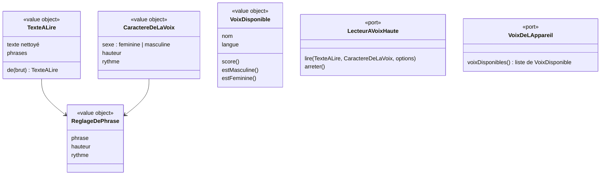

# Modèle du domaine : issue #7, Voix : lecture à voix haute par le personnage guide

## Contexte

La lecture à voix haute ne relève d'aucun des cinq contextes : ce n'est ni une règle d'apprentissage, ni une récompense, ni une donnée de famille. C'est une **capacité commune** utilisée par Apprentissage (consignes, étapes de leçon, dictée, écoute) et par Motivation (le personnage guide parle).

**Décidé** (décision n°4 du lot 1, décision 0007) : un sous-domaine générique **Voix**, dossier `supabase/functions/_shared/voix/`, importé par le front via `@domain/voix`, qui :
- prépare le texte à lire (nettoyage, découpage en phrases) ;
- choisit la voix de l'appareil la plus naturelle (voix automatique) ;
- règle hauteur et rythme selon le **caractère de la voix** du personnage guide ;
- expose un **port** de lecture à voix haute, avec aujourd'hui un seul adaptateur (voix du navigateur), et plus tard les MP3 pré-générés (décision 0004) sans changer les écrans.

Relations :
- **Motivation → Voix** : Customer/Supplier. Motivation définit et fournit le `CaractereDeLaVoix` de chaque personnage guide (voix féminine ou masculine, hauteur, rythme). Voix ne connaît pas les univers.
- **Apprentissage → Voix**, **Motivation → Voix** : appel du port de lecture depuis le front.
- **Synthèse vocale du navigateur → Voix** : Anti-Corruption Layer. Les voix de l'appareil sont traduites en `VoixDisponible` (nom, langue) avant d'entrer dans le domaine.

### Périmètre (décision n°10)

La story garde : la lecture à voix haute, le caractère de la voix, Son/Muet et la voix bloquée.
**Hors périmètre, lot 2** : le choix de la voix par le parent (voix imposée), dans l'espace parent. Il restera mémorisé sur l'appareil, comme aujourd'hui. Il est décrit plus bas (« Hors périmètre : voix imposée, lot 2 ») pour que le modèle de #7 le prépare sans le livrer.
Les effets sonores ne figurent pas dans le périmètre retenu (voir Décisions).

### Comportement actuel (`app/`, « Sons et voix » et `adultVoix`)

Résumé des règles lues dans le code (les nombres sont ceux du legacy) :
- Score d'une voix (`voiceScore`) : langue `fr-FR` 30, autre `fr` 20, autre langue exclue. Bonus selon le nom : « natural/neural/online » +40, « premium » +35, « enhanced/amélior » +30, « google » +20. Malus « compact/espeak/robot » −30. Les voix françaises sont triées par score décroissant.
- Choix de la voix (`voiceFor`) : 1) la voix imposée par le parent, si elle existe encore sur l'appareil ; 2) sinon, une voix du sexe voulu par le personnage guide, reconnue à son prénom (listes `FEMALE`, `MALE`), si son score est à 15 points au plus de la meilleure ; 3) sinon la meilleure voix ; 4) sinon aucune.
- Caractère (`VOICE_STYLE`) :

  | Univers | Sexe de la voix | Hauteur | Rythme |
  |---|---|---|---|
  | princesse (Lumi) | f | 1,25 | 1,0 |
  | animaux (Noisette) | f | 1,45 | 1,08 |
  | sports (Coach Léo) | m | 1,05 | 1,07 |
  | police (Agente Mila) | f | 1,05 | 1,0 |
  | pompier (Capitaine Sam) | m | 0,95 | 1,0 |
  | danse (Lili) | f | 1,2 | 1,02 |

- Voix plus grave : personnage guide masculin et voix choisie non reconnue comme masculine → hauteur −0,25.
- Intonation : phrase finissant par « ! » → hauteur +0,08 ; petite variation au hasard de ±0,03 par phrase. Hauteur bornée entre 0,5 et 2. Rythme = rythme du caractère × rythme demandé, au plus 1,4.
- Nettoyage (`toSpeech`) : balises et entités retirées, `+` lu « plus », `=` lu « égale », deux soulignés ou plus lus comme un silence (« ... »), guillemets « » retirés, espaces réduits.
- Découpage en phrases après `.`, `!`, `?`, `…`, `:`.
- Langue étrangère (anglais) : voix dont la langue commence par le même code à deux lettres ; +10 si le nom contient « natural/neural/online/premium/enhanced/google », +5 si la langue est exactement la même. Caractère fixe (f, hauteur 1,05, rythme 0,95), quel que soit le personnage guide.
- Une nouvelle lecture coupe la lecture en cours. Changer d'écran coupe la voix.
- Muet : rien n'est lu. Le choix Son/Muet est mémorisé sur l'appareil, son activé par défaut. En réactivant le son : « Je t'entends ! Je suis <nom du personnage guide en cours>. »
- Voix bloquée (erreur autre qu'une interruption) : un seul message par ouverture de l'application, « La voix de <personnage guide> est bloquée par ce navigateur. Touche « Réécouter » pour réessayer, ou lis avec un adulte. »
- Espace parent, onglet « Voix » : « Automatique (recommandé) » ou une voix imposée parmi les voix françaises de l'appareil, mémorisée sur l'appareil. Mention « très naturelle » pour un score d'au moins 60. Bouton « Écouter » : « Coucou ! Je suis <personnage guide>. On apprend en s'amusant ? Youpi ! ». Conseils d'installation (iPad, Android, ordinateur).
- Déverrouillage audio au premier toucher, effets sonores (`sfx`) : purement techniques.

## Termes

| Terme | Statut | Remarque |
|---|---|---|
| Personnage guide | au glossaire (confirmé) | |
| Lecture à voix haute | **nouveau** (à valider) | Le personnage guide lit un texte, phrase par phrase, en surlignant le mot lu. |
| Caractère de la voix | **nouveau** (à valider) | Sexe de la voix, hauteur et rythme propres à un personnage guide. Contexte Motivation. |
| Voix imposée | **nouveau** (à valider), hors périmètre (lot 2) | Voix de l'appareil choisie par le parent à la place du choix automatique. |
| Voix automatique | **nouveau** (à valider) | Choix par défaut : la voix française la plus naturelle de l'appareil, adaptée au personnage guide. Seul choix possible dans cette story. |
| Voix bloquée | **nouveau** (à valider) | Le navigateur refuse de lire alors qu'il sait lire à voix haute. L'enfant est prévenu une fois, sans être bloqué. |
| Consigne | format des leçons (champ `consigne`) | Texte qui dit à l'enfant ce qu'il doit faire. Ajoutée au glossaire comme terme du format (confirmé). |
| Muet | **nouveau** (à valider) | Réglage de l'appareil qui coupe la voix et les effets sonores. Contraire : « Son ». |
| Appareil | **nouveau** (à valider) | Voir story #5. |
| Tout lire à voix haute | déjà dans « Réglages » (à valider) | Lot 2, hors de cette story. |
| Voix | conflit **résolu** | « voix » désigne la voix de synthèse ; l'audio de l'enfant reste « enregistrement de lecture » (proposition appliquée). |
| Sexe de la voix | **résolu** | Le legacy dit `sexe: 'f' / 'm'`. On dit « voix féminine / voix masculine » (proposition appliquée). |

## Modèle



Il n'y a **pas d'agrégat** : rien n'est enregistré côté serveur. Son/Muet est mémorisé sur l'appareil. `ChoixDeVoix` (voix imposée) est hors périmètre (lot 2).

### Value objects et règles

| Élément | Règle |
|---|---|
| `TexteALire` | Nettoyage et découpage décrits plus haut. Un texte vide après nettoyage n'est pas lu. |
| `CaractereDeLaVoix` | Sexe de la voix, hauteur, rythme (valeurs du tableau). Défini par Voix, valeurs fournies par le personnage guide (Motivation), décision 0008. |
| `VoixDisponible` | Nom et langue. `score()` selon les règles du legacy ; score négatif = voix non française, exclue. Féminine ou masculine reconnue par le prénom. |
| `ReglageDePhrase` | Hauteur dans [0,5 ; 2], rythme au plus 1,4. |

### Fonctions du domaine (pures)

| Fonction | Règle |
|---|---|
| `voixFrancaisesTriees(voix)` | Garde les voix françaises, triées par score. |
| `choisirVoix(voix, caractere)` | Voix automatique : voix du bon sexe à 15 points au plus de la meilleure ; sinon la meilleure ; sinon aucune. (Au lot 2, un troisième paramètre `ChoixDeVoix` fera passer la voix imposée en premier.) |
| `choisirVoixDeLangue(voix, langue)` | Règle des langues étrangères. Caractère fixe (voix féminine, hauteur 1,05, rythme 0,95), quel que soit le personnage guide. |
| `reglerPhrases(texte, caractere, voix, rythmeDemande, hasard)` | Hauteur de base (−0,25 si voix plus grave nécessaire), +0,08 sur « ! », variation ±0,03, bornes. |

### Ports

- `LecteurAVoixHaute` : lire un texte (avec un rappel à chaque mot prononcé, pour le surlignage, et une fin de lecture), arrêter. Adaptateur aujourd'hui : `speechSynthesis` du navigateur. Plus tard : MP3 du CDN, avec repli sur le navigateur.
- `VoixDeLAppareil` : liste des voix installées (ACL vers `speechSynthesis.getVoices()`).
- `Hasard` : pour la variation d'intonation (décision 0003).

Les interfaces de ces trois ports sont déclarées dans `domain/` et exportées par `index.ts` (décision 0007). `Hasard` est celle de `@domain/motivation` ou une copie propre à Voix : voir question ouverte n°5. Les adaptateurs vivent dans `src/voix/`.

### Commandes, événements, erreurs

- Commandes (front) : `LireAVoixHaute(texte)`, `Reecouter`, `CouperLaVoix`, `PasserEnMuet`, `RemettreLeSon` (le personnage guide en cours dit « Je t'entends ! Je suis <son nom>. »).
- Aucun événement de domaine.
- Erreurs (présentées sans bloquer le jeu) : `VoixBloquee` (le navigateur refuse de lire ; un seul message par ouverture de l'application), `LectureImpossible` (le navigateur ne sait pas lire à voix haute ; aucun message pour l'enfant). Aucune n'empêche de jouer.

## Invariants

1. Un texte lu est d'abord nettoyé : jamais de balise, d'entité ni de symbole `+`, `=`, `___`, « » prononcé tel quel.
2. Une seule lecture à la fois : en commencer une coupe la précédente ; changer d'écran coupe la voix.
3. Une consigne est lue dès qu'elle s'affiche. Le mot surligné est toujours celui qui est prononcé, dans toutes les consignes.
4. En mode Muet, rien n'est lu.
5. La voix suit toujours le personnage guide affiché : Noisette sans univers choisi.
6. Seules les voix françaises sont retenues pour le français.
7. Hauteur toujours dans [0,5 ; 2], rythme au plus 1,4.
8. Sans voix (bloquée ou absente), l'enfant peut quand même jouer. Le message de voix bloquée n'apparaît qu'une fois par ouverture de l'application.

Hors périmètre (lot 2) : la voix imposée par le parent passe avant la voix automatique, tant qu'elle existe sur l'appareil.

## Partage avec le front

Toute la story se passe dans le navigateur, hors ligne compris. Le domaine pur (`TexteALire`, `CaractereDeLaVoix`, score et choix de voix, réglage des phrases) est exposé par `@domain/voix`.

Relève de l'infrastructure, côté front : adaptateur `speechSynthesis` (découpage en énoncés, rappels de mots, délais de sécurité, reprise après pause), déverrouillage audio au premier toucher, mémorisation Son/Muet sur l'appareil, surlignage du mot lu.

Point d'architecture tranché (décision 0007) : les interfaces `LecteurAVoixHaute` et `VoixDeLAppareil` sont déclarées dans `voix/domain/` ; leurs adaptateurs sont dans `src/voix/`.

## Données d'enfants

Aucune donnée nouvelle. Son/Muet (et, au lot 2, la voix imposée) sont des préférences d'appareil, pas des données de l'enfant. Rien de ce que produit l'enfant n'est lu ni envoyé.

## Emplacement

```
supabase/functions/_shared/voix/          # sous-domaine Voix (décision 0007)
  domain/
    texte-a-lire.ts            # nettoyage, découpage en phrases
    voix-disponible.ts         # score, voix féminine / masculine
    choix-de-voix.ts           # voix automatique : choisirVoix, choisirVoixDeLangue (voix imposée au lot 2)
    reglage-de-phrase.ts       # hauteur, rythme, intonation
    lecteur-a-voix-haute.ts    # interface du port LecteurAVoixHaute (décision 0007)
    voix-de-l-appareil.ts      # interface du port VoixDeLAppareil (décision 0007)
    erreurs.ts                 # VoixBloquee, LectureImpossible
    index.ts                   # exporte le domaine pour @domain/voix
  test_utils/
    voix-en-memoire.ts
supabase/functions/_shared/motivation/domain/
  (caractere-de-la-voix.ts est dans voix/domain/, décision 0008)
  personnage-guide.ts          # chaque personnage guide porte son CaractereDeLaVoix (story #6)
src/voix/                      # adaptateurs speechSynthesis et Math.random, déverrouillage audio, mémorisation Son/Muet sur l'appareil
```

## Hors périmètre : voix imposée, lot 2

Décision n°10 : le choix de la voix par le parent sort de la story #7 et arrive au lot 2, avec l'espace parent. Ce qui suit est gardé comme modèle de référence pour cette story future, **sans être livré dans #7** :
- `ChoixDeVoix` (value object, sous-domaine Voix) : `automatique` (défaut) ou `imposee(nom)`. Une voix imposée qui n'existe plus sur l'appareil retombe sur la voix automatique.
- `choisirVoix(voix, caractere, choix)` : la voix imposée, si elle existe encore sur l'appareil, passe avant la voix automatique.
- `estTresNaturelle(voix)` : score d'au moins 60 (mention « très naturelle »).
- Commandes : `ImposerUneVoix(nom)`, `RevenirALaVoixAutomatique`, essai d'une voix (« Coucou ! Je suis <personnage guide>. On apprend en s'amusant ? Youpi ! »).
- Mémorisée **sur l'appareil**, comme aujourd'hui (décision n°10) : elle vaut donc pour tous les profils enfants qui jouent sur cet appareil, et ne change pas les autres appareils.
- Accessible seulement dans l'espace parent ; le bouton Son/Muet, lui, reste à la portée de l'enfant (en-tête, story #6).
- Questions reportées au lot 2 : conseils pour installer des voix plus naturelles (ancienne M13), personnage guide de la phrase d'essai quand plusieurs profils ont des univers différents (ancienne A8), et les scénarios de la règle 6 de `acceptance.md`.

## Décisions

Validation n°1 du lot 1 par le PO, le 2026-10-22 (`docs/stories/lot-1-decisions.md`). « Tranchée » = réponse explicite du PO ; « proposition appliquée » = question de détail qui suit la proposition déjà faite (règle générale de la validation).

Numéros d'origine : « M » = ancienne liste du modèle, « A » = `docs/stories/7/acceptance.md`.

| Question | Réponse | Source |
|---|---|---|
| M1. Sous-domaine Voix à part ? | **Oui** : `supabase/functions/_shared/voix/`. | Tranchée, décision n°4 et décision 0007 |
| M2. Choix de la voix mémorisé sur l'appareil ? | **Oui**, mais ce choix passe au lot 2. | Tranchée, décision n°10 |
| M6. Nom dit en remettant le son | Le **nom du personnage guide en cours** (« Je suis Lumi. »). | Tranchée, décision n°3 |
| M8. Interfaces des ports dans `domain/` ? | **Oui** (`LecteurAVoixHaute`, `VoixDeLAppareil`, `Hasard`). | Tranchée, décision 0007 |
| A3. Ce qui est observable au lot 1 | Une **page de démonstration réservée aux tests**, retirée au lot 3. | Tranchée, décision n°1 |
| A10. Taille de la story | Le choix de la voix par le parent (règle 6) **sort de #7** et passe au lot 2. | Tranchée, décision n°10 |
| M4. Effets sonores dans cette story ? | **Non** : le périmètre retenu pour #7 (lecture à voix haute, caractère de la voix, Son/Muet, voix bloquée) ne les cite pas. | Tranchée par le périmètre de la décision n°10 |
| M3. Où est défini `CaractereDeLaVoix` ? | Dans **Motivation**, qui le fournit ; Voix le lit. | Proposition appliquée (modèle), conforme à la décision 0007 |
| M7. La voix suit toujours le personnage guide affiché ? | **Oui**, Noisette par défaut ; le repli sur Lumi du legacy disparaît. | Proposition appliquée (scénario `@a-valider`) |
| M9. Nombres du legacy (scores, 15 points, −0,25, +0,08, ±0,03, bornes) | **Gardés**. Le seuil « très naturelle » (60) suit la voix imposée au lot 2. | Proposition appliquée (modèle) |
| M10 / A1. Surlignage | Le mot surligné est **toujours celui qui est prononcé**, dans **toutes** les consignes. | Proposition appliquée (scénario `@a-valider`) |
| M11. Anglais à caractère fixe | **Oui** (voix féminine, hauteur 1,05, rythme 0,95). | Proposition appliquée (modèle) |
| M12. Voix bloquée : un message par ouverture | **Oui**. | Proposition appliquée (scénario `@a-valider`) |
| A2. Lecture automatique | Une consigne est **toujours** lue dès qu'elle s'affiche. | Proposition appliquée (scénario) |
| A4. Navigateur qui ne sait pas lire | L'enfant joue **sans message**. | Proposition appliquée (scénario `@a-valider`) |
| A5. Son/Muet à la portée de l'enfant | **Oui** (en-tête de la story #6) ; le choix de la voix part au lot 2. | Proposition appliquée (scénarios #6 et #7) |
| A9 (en partie). « consigne », « voix bloquée » | « Consigne » entre au glossaire comme terme du format des leçons ; « voix bloquée » comme terme `(à valider)` de Voix (erreur `VoixBloquee` du modèle). | Proposition appliquée (modèle, règle du glossaire sur le format) |
| « Voix » et « sexe de la voix » | « voix » = voix de synthèse ; « voix féminine / voix masculine ». | Proposition appliquée (modèle) |
| M13, A6, A8 | Reportées au lot 2 avec la voix imposée. | Conséquence de la décision n°10 |

## Questions ouvertes

Aucune n'est bloquante pour la story.

1. (ancienne M5) Le Muet coupera-t-il aussi les **effets sonores**, comme aujourd'hui ? (oui / non). À trancher avec la story qui introduit les effets sonores (lot 3). Le glossaire le suppose déjà.
2. (ancienne A7) **Aucune voix française sur l'appareil** : faut-il lire quand même avec la voix par défaut du navigateur, souvent à l'accent étranger (comme aujourd'hui), ou se taire comme quand le navigateur ne sait pas lire ? (lire / se taire). Sans effet sur le domaine : `choisirVoix` répond « aucune voix », l'adaptateur applique la réponse.
3. (ancienne A9, suite) « **écran** » (« quitter l'écran coupe la voix ») : le laisse-t-on hors du langage ubiquitaire, comme terme d'interface ? (oui / non)
4. (ancienne A9, suite) « **réécouter** » : terme du glossaire (oui), ou simple libellé de bouton, la commande `Reecouter` restant dans le code (non) ?
5. (nouvelle, technique) L'interface `Hasard` est utilisée par Motivation et par Voix : Voix l'importe-t-elle de `@domain/motivation`, ou déclare-t-elle sa propre interface identique pour ne dépendre de Motivation que par le caractère de la voix ? (choix d'architecture, à trancher par l'implementer ou une décision dans `docs/decisions/`)
