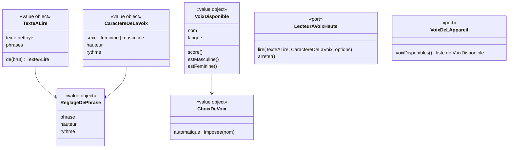

# Modèle du domaine : issue #7, Voix : lecture à voix haute par le personnage guide

## Contexte

La lecture à voix haute ne relève d'aucun des cinq contextes : ce n'est ni une règle d'apprentissage, ni une récompense, ni une donnée de famille. C'est une **capacité commune** utilisée par Apprentissage (consignes, étapes de leçon, dictée, écoute) et par Motivation (le personnage guide parle).

**Proposition** (à valider, question n°1) : un sous-domaine générique **Voix**, dossier `supabase/functions/_shared/voix/`, qui :
- prépare le texte à lire (nettoyage, découpage en phrases) ;
- choisit la voix de l'appareil la plus naturelle ;
- règle hauteur et rythme selon le **caractère de la voix** du personnage guide ;
- expose un **port** de lecture à voix haute, avec aujourd'hui un seul adaptateur (voix du navigateur), et plus tard les MP3 pré-générés (décision 0004) sans changer les écrans.

Relations :
- **Motivation → Voix** : Customer/Supplier. Le personnage guide fournit son `CaractereDeLaVoix` (sexe de la voix, hauteur, rythme). Voix ne connaît pas les univers.
- **Apprentissage → Voix**, **Motivation → Voix** : appel du port de lecture depuis le front.
- **Synthèse vocale du navigateur → Voix** : Anti-Corruption Layer. Les voix de l'appareil sont traduites en `VoixDisponible` (nom, langue) avant d'entrer dans le domaine.

### Comportement actuel (`app/`, « Sons et voix » et `adultVoix`)

Résumé des règles lues dans le code (les nombres sont ceux du legacy) :
- Score d'une voix (`voiceScore`) : langue `fr-FR` 30, autre `fr` 20, autre langue exclue. Bonus selon le nom : « natural/neural/online » +40, « premium » +35, « enhanced/amélior » +30, « google » +20. Malus « compact/espeak/robot » −30. Les voix françaises sont triées par score décroissant.
- Choix de la voix (`voiceFor`) : 1) la voix imposée par le parent, si elle existe encore sur l'appareil ; 2) sinon, une voix du sexe voulu par le personnage guide, reconnue à son prénom (listes `FEMALE`, `MALE`), si son score est à 15 points au plus de la meilleure ; 3) sinon la meilleure voix ; 4) sinon aucune.
- Caractère (`VOICE_STYLE`) :

  | Univers | Sexe de la voix | Hauteur | Rythme |
  |---|---|---|---|
  | princesse (Lumi) | f | 1,25 | 1,0 |
  | animaux (Noisette) | f | 1,45 | 1,08 |
  | sports (Coach Léo) | m | 1,05 | 1,07 |
  | police (Agente Mila) | f | 1,05 | 1,0 |
  | pompier (Capitaine Sam) | m | 0,95 | 1,0 |
  | danse (Lili) | f | 1,2 | 1,02 |

- Voix plus grave : personnage guide masculin et voix choisie non reconnue comme masculine → hauteur −0,25.
- Intonation : phrase finissant par « ! » → hauteur +0,08 ; petite variation au hasard de ±0,03 par phrase. Hauteur bornée entre 0,5 et 2. Rythme = rythme du caractère × rythme demandé, au plus 1,4.
- Nettoyage (`toSpeech`) : balises et entités retirées, `+` lu « plus », `=` lu « égale », deux soulignés ou plus lus comme un silence (« ... »), guillemets « » retirés, espaces réduits.
- Découpage en phrases après `.`, `!`, `?`, `…`, `:`.
- Langue étrangère (anglais) : voix dont la langue commence par le même code à deux lettres ; +10 si le nom contient « natural/neural/online/premium/enhanced/google », +5 si la langue est exactement la même. Caractère fixe (f, hauteur 1,05, rythme 0,95), quel que soit le personnage guide.
- Une nouvelle lecture coupe la lecture en cours. Changer d'écran coupe la voix.
- Muet : rien n'est lu. Le choix Son/Muet est mémorisé sur l'appareil, son activé par défaut. En réactivant le son : « Je t'entends ! Je suis <nom du personnage guide en cours>. »
- Voix bloquée (erreur autre qu'une interruption) : un seul message par ouverture de l'application, « La voix de <personnage guide> est bloquée par ce navigateur. Touche « Réécouter » pour réessayer, ou lis avec un adulte. »
- Espace parent, onglet « Voix » : « Automatique (recommandé) » ou une voix imposée parmi les voix françaises de l'appareil, mémorisée sur l'appareil. Mention « très naturelle » pour un score d'au moins 60. Bouton « Écouter » : « Coucou ! Je suis <personnage guide>. On apprend en s'amusant ? Youpi ! ». Conseils d'installation (iPad, Android, ordinateur).
- Déverrouillage audio au premier toucher, effets sonores (`sfx`) : purement techniques.

## Termes

| Terme | Statut | Remarque |
|---|---|---|
| Personnage guide | au glossaire (confirmé) | |
| Lecture à voix haute | **nouveau** (à valider) | Le personnage guide lit un texte, phrase par phrase, en surlignant le mot lu. |
| Caractère de la voix | **nouveau** (à valider) | Sexe de la voix, hauteur et rythme propres à un personnage guide. Contexte Motivation. |
| Voix imposée | **nouveau** (à valider) | Voix de l'appareil choisie par le parent à la place du choix automatique. |
| Voix automatique | **nouveau** (à valider) | Choix par défaut : la voix française la plus naturelle de l'appareil, adaptée au personnage guide. |
| Muet | **nouveau** (à valider) | Réglage de l'appareil qui coupe la voix et les effets sonores. Contraire : « Son ». |
| Appareil | **nouveau** (à valider) | Voir story #5. |
| Tout lire à voix haute | déjà dans « Réglages » (à valider) | Lot 2, hors de cette story. |
| Voix | **en conflit** | Le glossaire interdit « voix » comme synonyme de **Enregistrement de lecture**. Ici « voix » désigne la voix de synthèse. Proposition : « voix » = voix de synthèse ; l'audio de l'enfant reste « enregistrement de lecture ». |
| Sexe de la voix | **à préciser** | Le legacy dit `sexe: 'f' / 'm'`. Proposition : « voix féminine / voix masculine » pour éviter toute ambiguïté. |

## Modèle



Il n'y a **pas d'agrégat** : rien n'est enregistré côté serveur. Le choix de voix et Son/Muet sont mémorisés sur l'appareil (à confirmer, question n°2).

### Value objects et règles

| Élément | Règle |
|---|---|
| `TexteALire` | Nettoyage et découpage décrits plus haut. Un texte vide après nettoyage n'est pas lu. |
| `CaractereDeLaVoix` | Sexe de la voix, hauteur, rythme (valeurs du tableau). Fourni par le personnage guide (Motivation). |
| `VoixDisponible` | Nom et langue. `score()` selon les règles du legacy ; score négatif = voix non française, exclue. Féminine ou masculine reconnue par le prénom. |
| `ChoixDeVoix` | `automatique` (défaut) ou `imposee(nom)`. Une voix imposée qui n'existe plus sur l'appareil retombe sur le choix automatique. |
| `ReglageDePhrase` | Hauteur dans [0,5 ; 2], rythme au plus 1,4. |

### Fonctions du domaine (pures)

| Fonction | Règle |
|---|---|
| `voixFrancaisesTriees(voix)` | Garde les voix françaises, triées par score. |
| `choisirVoix(voix, caractere, choix)` | Voix imposée si présente ; sinon voix du bon sexe à 15 points au plus de la meilleure ; sinon la meilleure ; sinon aucune. |
| `choisirVoixDeLangue(voix, langue)` | Règle des langues étrangères. |
| `reglerPhrases(texte, caractere, voix, rythmeDemande, hasard)` | Hauteur de base (−0,25 si voix plus grave nécessaire), +0,08 sur « ! », variation ±0,03, bornes. |
| `estTresNaturelle(voix)` | Score d'au moins 60. |

### Ports

- `LecteurAVoixHaute` : lire un texte (avec un rappel à chaque mot prononcé, pour le surlignage, et une fin de lecture), arrêter. Adaptateur aujourd'hui : `speechSynthesis` du navigateur. Plus tard : MP3 du CDN, avec repli sur le navigateur.
- `VoixDeLAppareil` : liste des voix installées (ACL vers `speechSynthesis.getVoices()`).
- `Hasard` : pour la variation d'intonation (décision 0003).

### Commandes, événements, erreurs

- Commandes (front) : `LireAVoixHaute(texte)`, `Reecouter`, `CouperLaVoix`, `PasserEnMuet`, `RemettreLeSon`, `ImposerUneVoix(nom)`, `RevenirALaVoixAutomatique`.
- Aucun événement de domaine.
- Erreurs (présentées sans bloquer le jeu) : `VoixBloquee` (le navigateur refuse de lire), `LectureImpossible` (le navigateur ne sait pas lire à voix haute). Aucune n'empêche de jouer.

## Invariants

1. Un texte lu est d'abord nettoyé : jamais de balise, d'entité ni de symbole `+`, `=`, `___`, « » prononcé tel quel.
2. Une seule lecture à la fois : en commencer une coupe la précédente ; changer d'écran coupe la voix.
3. En mode Muet, rien n'est lu.
4. La voix imposée par le parent passe avant le choix automatique, tant qu'elle existe sur l'appareil.
5. Seules les voix françaises sont proposées pour le français.
6. Hauteur toujours dans [0,5 ; 2], rythme au plus 1,4.
7. Sans voix (bloquée ou absente), l'enfant peut quand même jouer. Le message de voix bloquée n'apparaît qu'une fois.

## Partage avec le front

Toute la story se passe dans le navigateur, hors ligne compris. Le domaine pur (`TexteALire`, `CaractereDeLaVoix`, score et choix de voix, réglage des phrases) est exposé par `@domain/voix`.

Relève de l'infrastructure, côté front : adaptateur `speechSynthesis` (découpage en énoncés, rappels de mots, délais de sécurité, reprise après pause), déverrouillage audio au premier toucher, mémorisation Son/Muet et voix imposée sur l'appareil, effets sonores `AudioContext`, surlignage du mot lu.

Point d'architecture : le front n'importe que `domain/`. Les ports `LecteurAVoixHaute` et `VoixDeLAppareil` sont implémentés dans `src/` : où déclarer leur interface (question n°8) ?

## Données d'enfants

Aucune donnée nouvelle. La voix imposée et Son/Muet sont des préférences d'appareil, pas des données de l'enfant. Rien de ce que produit l'enfant n'est lu ni envoyé.

## Emplacement

```
supabase/functions/_shared/voix/          # proposition : sous-domaine Voix
  domain/
    texte-a-lire.ts            # nettoyage, découpage en phrases
    voix-disponible.ts         # score, voix féminine / masculine
    choix-de-voix.ts           # automatique / imposée, choisirVoix, choisirVoixDeLangue
    reglage-de-phrase.ts       # hauteur, rythme, intonation
    caractere-de-la-voix.ts    # si le type est partagé ici plutôt que dans Motivation (question n°3)
    erreurs.ts                 # VoixBloquee, LectureImpossible
    index.ts                   # exporte le domaine pour @domain/voix
  test_utils/
    voix-en-memoire.ts
supabase/functions/_shared/motivation/domain/
  personnage-guide.ts          # chaque personnage guide porte son CaractereDeLaVoix (story #6)
src/voix/                      # adaptateur speechSynthesis, déverrouillage audio, mémorisation sur l'appareil
```

## Questions ouvertes

1. Crée-t-on un sous-domaine **Voix** à part (`_shared/voix/`), utilisé par Apprentissage et Motivation ? (oui / non ; si non, dans quel contexte la ranger ?)
2. Le choix de la voix reste-t-il mémorisé **sur l'appareil**, comme aujourd'hui, plutôt que dans le profil enfant ? (oui / non)
3. Le type `CaractereDeLaVoix` est-il défini dans Motivation (le personnage guide le possède) et lu par Voix, plutôt que l'inverse ? (oui / non)
4. Les effets sonores (bonne réponse, erreur, étoile…) font-ils partie de cette story ? (oui / non)
5. Le Muet coupe-t-il aussi les effets sonores, comme aujourd'hui ? (oui / non)
6. En réactivant le son, le personnage guide dit-il son propre nom (« Je t'entends ! Je suis Lumi. » dans l'univers princesse), comme le code actuel, plutôt que toujours « Noisette » comme l'écrit l'issue ? (son propre nom / toujours Noisette)
7. Le code actuel prévoit un repli sur le **caractère de Lumi** (`VOICE_STYLE.princesse`) alors que l'univers par défaut est `animaux` (Noisette). Ce repli n'est jamais atteint en pratique. Confirme-t-on que la voix suit **toujours** le personnage guide affiché, donc Noisette par défaut ? (oui / non)
8. Les interfaces des ports utilisés par le front (`LecteurAVoixHaute`, `VoixDeLAppareil`, `Hasard`) peuvent-elles être déclarées dans `domain/`, puisque le front n'importe pas `application/` ? (oui / non ; choix d'architecture à consigner dans `docs/decisions/`)
9. Garde-t-on tous les nombres actuels (scores des voix, écart de 15 points, −0,25, +0,08, ±0,03, bornes 0,5 à 2 et 1,4, seuil « très naturelle » à 60) ? (oui / non)
10. Le surlignage du mot lu se cale aujourd'hui sur le texte nettoyé alors que les mots affichés suivent le texte d'origine : avec un « + » ou des guillemets dans une consigne, le mauvais mot peut être surligné. Faut-il que le mot surligné soit **toujours** celui qui est prononcé ? (oui / non)
11. Pour l'anglais, la voix garde-t-elle un caractère fixe (voix féminine, hauteur 1,05, rythme 0,95) quel que soit le personnage guide ? (oui / non)
12. Le message de voix bloquée n'apparaît-il qu'**une fois par ouverture** de l'application ? (oui / non)
13. Les conseils pour installer des voix plus naturelles (iPad, Android, ordinateur) sont-ils repris tels quels dans l'onglet « Voix » de l'espace parent ? (oui / non)
