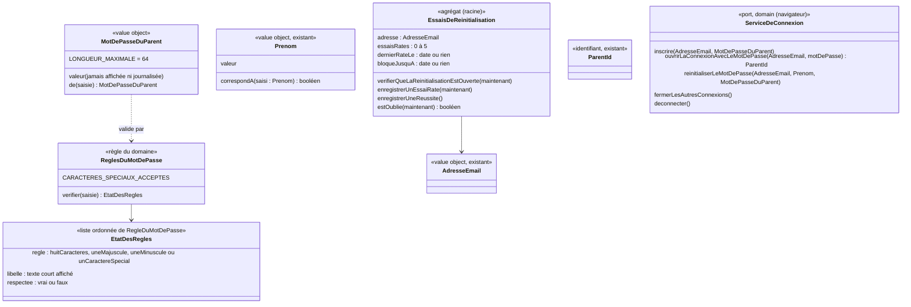

# Modèle du domaine : issue #72, Connexion du parent par adresse e-mail et mot de passe, sans envoi d'e-mail

État : **validé par le PO** le 2026-10-24 (validation n°1, « OK aux propositions » ; voir « Réponses du PO » en fin de document et `docs/stories/72/journal.md`).

## Contexte

**Famille** (contexte existant). La story remplace, **pour la beta**, la connexion par lien de connexion et code de connexion (#5) par une connexion par **mot de passe du parent**. Elle ajoute une **réinitialisation du mot de passe** propre à la beta, qui vérifie le **prénom d'un enfant rattaché** au parent.

Pourquoi Famille :
- le parent, sa connexion, ses profils enfants et ses rattachements sont déjà dans Famille (#5, #11) ;
- la vérification du prénom lit les **rattachements** et le **prénom** des profils enfants, deux notions de Famille ;
- aucun autre contexte ne réagit à la connexion.

Relations (voir `docs/domain/context-map.md`) :
- **Supabase Auth → Famille** : *Anti-Corruption Layer*, déjà décidée par #5. Elle s'élargit :
  - navigateur : le port `ServiceDeConnexion` gagne la connexion par mot de passe, l'appel des deux Edge Functions (inscription, réinitialisation) et la fermeture des autres connexions du parent ;
  - serveur : de nouveaux ports créent le parent et changent son mot de passe par l'**API d'administration** de Supabase Auth.
  - Les erreurs de Supabase (`invalid_credentials`, `email_exists`, `user_already_exists`, `weak_password`…) sont traduites en erreurs métier. Aucun nom de Supabase n'entre dans le domaine.
- **Expéditeur d'e-mails** : n'est plus utilisé dans la beta (réponse n°1 de l'issue). Le code de #5 reste en place, l'écran ne le propose plus.

Ce que le domaine porte :
- les **règles du mot de passe du parent** et sa **longueur maximale**, partagées par le front (liste qui passe au vert) et par le serveur ;
- la **comparaison des prénoms** (sans casse, sans accents, sans espaces autour) ;
- le **compteur d'essais de réinitialisation**, leur **oubli** après 24 heures et le **blocage** d'une heure ;
- les erreurs métier que l'interface présente.

Ce que Supabase Auth garde : le stockage du mot de passe (empreinte), sa vérification à la connexion, le maintien de la connexion, sa propre limite de demandes à la connexion (réponse n°4 de l'issue). Le domaine ne conserve **jamais** un mot de passe.

## Termes

| Terme | Statut | Remarque |
|---|---|---|
| Parent, Connexion du parent, Déconnexion, Profil enfant, Prénom, Rattachement | au glossaire | Inchangés. Le profil enfant reste **sans mot de passe**. |
| Mot de passe du parent | **nouveau, validé** | Secret choisi par le parent, qui ouvre la connexion du parent avec son adresse e-mail. |
| Règles du mot de passe | **nouveau, validé** | Les 4 règles affichées : « 8 caractères », « une majuscule », « une minuscule », « un caractère spécial ». |
| Longueur maximale du mot de passe | **nouveau, validé** | 64 caractères au plus. Règle bloquante, **pas** affichée dans la liste qui passe au vert (voir « Partage avec le front »). |
| Caractère spécial accepté | **nouveau, validé** | Un des 14 caractères `& # { } ( ) [ ] $ € % @ ! ?`. `ù`, les chiffres, `*`, `-`, `_`, `.` n'en sont pas, mais ils sont permis dans le mot de passe. |
| Inscription du parent | **nouveau, validé** | `InscrireLeParent` dans le domaine ; l'interface dit « Créer ton compte » (« compte » reste interdit dans le domaine, décision n°10 du glossaire). |
| Réinitialisation du mot de passe | **nouveau, validé** | Beta seulement, prouvée par l'adresse e-mail et le prénom d'un enfant rattaché. Elle ferme les autres connexions du parent. Retirée par #45. |
| Essai de réinitialisation | **nouveau, validé** | Toujours avec son complément, jamais « essai » seul (« essai » reste interdit pour **Réponse**, décision n°27 du glossaire). |
| Blocage de la réinitialisation | **nouveau, validé** | 5 essais de réinitialisation ratés → 1 heure de blocage. Il ne touche pas la connexion par mot de passe. |
| Mot de passe | conflit **tranché** | Il reste interdit pour désigner un lien de connexion, un code de connexion, le contrôle parental ou un jeton d'invitation ; on dit **Mot de passe du parent** (décision n°33 du glossaire). |
| Compte | conflit **déjà tranché** | Interdit dans le domaine (décision n°10). « Créer ton compte » seulement à l'écran (décision n°34). |
| Lien de connexion, Code de connexion, E-mail de connexion | au glossaire | Conservés dans le domaine, hors beta (scénarios tagués `@hors-beta`). |

## Modèle



### Value objects et règles

Un **caractère** est un caractère Unicode (point de code : `€`, `É` et `ù` comptent pour un), pas une unité de stockage.

| Élément | Règle de validité |
|---|---|
| `ReglesDuMotDePasse.verifier(saisie)` | Fonction pure, appelée à chaque frappe par le front. Rend l'état des 4 règles (`huitCaracteres`, `uneMajuscule`, `uneMinuscule`, `unCaractereSpecial`), dans l'ordre d'affichage, sans jamais lever d'erreur. Une saisie vide rend 4 règles non respectées. La longueur maximale n'en fait pas partie. |
| Règle `huitCaracteres` | Au moins 8 caractères. Libellé : « 8 caractères ». |
| Règle `uneMajuscule` | Au moins une lettre majuscule au sens Unicode (`\p{Lu}`), **majuscules accentuées comprises** (`É`, `À`, `Ç`). Libellé : « une majuscule ». |
| Règle `uneMinuscule` | Au moins une lettre minuscule au sens Unicode (`\p{Ll}`), **accentuées comprises** (`ù`, `é`, `à`, `ç`). Libellé : « une minuscule ». |
| Règle `unCaractereSpecial` | Au moins un des 14 caractères acceptés `& # { } ( ) [ ] $ € % @ ! ?` (constante `CARACTERES_SPECIAUX_ACCEPTES`, publiée pour que l'écran affiche la liste). Libellé : « un caractère spécial ». |
| Autres caractères | Chiffres, `*`, `-`, `_`, `.`, espace et tout autre signe sont **permis** sans compter pour aucune règle. `Abcdef*1!` est accepté (grâce au `!`) ; `Abcdef*1` manque d'un caractère spécial. |
| Longueur maximale | 64 caractères au plus (`MotDePasseDuParent.LONGUEUR_MAXIMALE`). Au-delà, `MotDePasseTropLong`. Supabase Auth refuse, lui, au-delà de **72 octets** : 64 lettres simples passent, mais un mot de passe plus court rempli de `€` (3 octets) ou de lettres accentuées (2 octets) peut le dépasser (25 `€` font 75 octets). Ce refus de Supabase est traduit par l'ACL en `MotDePasseTropLong` (voir Questions ouvertes n°3). |
| `MotDePasseDuParent.de(saisie)` | Construit seulement si les 4 règles sont respectées **et** si la longueur maximale l'est. Sinon : `MotDePasseNonConforme` (porte la liste des règles manquantes) en priorité, puis `MotDePasseTropLong`. La saisie est gardée **telle quelle** : pas de `trim`, les espaces au début et à la fin comptent (`" Abcdefg%"` fait 9 caractères). Le value object ne se montre jamais : pas de texte lisible dans un message d'erreur ni dans un journal. |
| Confirmation | À l'inscription **et** à la réinitialisation, la confirmation doit être identique au mot de passe saisi (comparaison exacte, espaces compris), sinon `ConfirmationDuMotDePasseDifferente`. Vérifiée par le cas d'usage du navigateur, avant tout appel au serveur ; la confirmation n'est pas envoyée au serveur. |
| Mot de passe saisi à la connexion | **Pas** soumis aux règles ni à la longueur maximale (le service de connexion seul dit s'il est juste). Seulement non vide, sinon `MotDePasseObligatoire`, sans appel au service. |
| `Prenom.correspondA(saisi)` (ajout au value object existant) | Vrai si les deux prénoms sont égaux après : espaces autour retirés (déjà fait par `Prenom.de`), accents retirés (décomposition Unicode NFD puis retrait des signes diacritiques), casse ignorée. **Rien d'autre** n'est normalisé : ni les tirets, ni les espaces intérieurs, ni les apostrophes, ni les ligatures. Exemples : « lea », « LÉA », « Léa » et « chloe »/« Chloé » correspondent ; « marie lou » et « marielou » ne correspondent pas à « Marie-Lou » ; « oelia » ne correspond pas à « Œlia » (mais « œlia » oui). La saisie passe par `Prenom.de`, qui la coupe aussi à 20 caractères comme le prénom enregistré. |

### Agrégat `EssaisDeReinitialisation`

- **Racine** : `EssaisDeReinitialisation`, identifié par l'**adresse e-mail** saisie, comparée sans casse (comme `AdresseEmail.estLaMemeQue`). Il existe aussi pour une adresse **inconnue**.
- **Contenu** : le nombre d'essais de réinitialisation ratés (0 à 5), l'instant du **dernier raté** (`dernierRateLe`) et, s'il y a blocage, sa fin (`bloqueJusquA`). **Jamais** le prénom saisi, ni le `ParentId`, ni le mot de passe.
- **Pourquoi un agrégat à part** : son invariant (5 ratés → blocage d'une heure) ne dépend ni du `Parent` ni du `ProfilEnfant`. Il doit aussi exister pour une adresse sans parent. Il ne référence personne.
- **Horloge** : l'instant est passé en paramètre (`maintenant`), comme pour `CreerProfilEnfant.executer(demande, maintenant)`. Le handler fournit l'heure du serveur ; les tests donnent des instants fixes.
- **Oubli des ratés (choix documenté, réponse n°11)** : on retient la règle la plus simple, **24 heures après le dernier raté**. Tant qu'un nouveau raté arrive moins de 24 heures après le précédent, le compteur continue ; dès que 24 heures passent sans raté, il repart de 0. Un seul instant suffit (`dernierRateLe`), pas de liste d'instants. Conséquences, à connaître : 1 raté par jour à 25 heures d'écart ne bloque jamais ; 5 ratés espacés de 23 heures bloquent. Une fenêtre glissante exacte (« 5 ratés dans les dernières 24 heures ») demanderait de garder l'instant de chaque raté : écartée.
- **Méthodes métier** :
  - `verifierQueLaReinitialisationEstOuverte(maintenant)` : lève `TropDEssaisDeReinitialisation` si `maintenant < bloqueJusquA` ; **ne change rien** à l'agrégat (un essai pendant le blocage ne compte pas et ne prolonge pas le blocage) ;
  - `enregistrerUnEssaiRate(maintenant)` : si les ratés précédents sont oubliés (blocage fini, ou 24 heures depuis `dernierRateLe`), repart de 0 ; puis ajoute un raté et pose `dernierRateLe = maintenant` ; au 5ᵉ, pose `bloqueJusquA = maintenant + 1 heure` ;
  - `enregistrerUneReussite()` : remet le compteur à 0 et efface `dernierRateLe` et `bloqueJusquA` ;
  - `estOublie(maintenant)` : vrai si le compteur est à 0, si le blocage est fini, ou si 24 heures sont passées depuis `dernierRateLe`. Le registre efface alors les essais de réinitialisation de l'adresse.
- **Fin du blocage** : à `bloqueJusquA` (1 heure après le 5ᵉ raté), le compteur repart de 0. Un raté à 61 minutes est donc le 1ᵉʳ d'une nouvelle série.
- **Conservation (réponse n°12)** : au plus **24 heures après le dernier essai de réinitialisation enregistré** (le dernier raté, puisqu'un essai pendant le blocage n'est pas enregistré et qu'une réussite remet tout à 0). Effacement plus tôt dès que `estOublie` est vrai (réussite, fin du blocage). Le moment de l'effacement (à chaque enregistrement, ou tâche planifiée) est un choix de l'adaptateur.
- **Concurrence** : deux essais simultanés ne doivent pas compter pour un seul. L'adaptateur enregistre avec un contrôle de version (ou une mise à jour atomique en base) ; ce n'est pas une règle du domaine.

### Commandes (cas d'usage)

Comme pour #5 (arbitrage du journal de #5, 20:28), les cas d'usage qui tournent **dans le navigateur** sont dans `domain/`, importables par `@domain/famille`. Ceux qui ne tournent **que côté serveur** sont dans `application/`. Les deux commandes serveur portent le nom métier (`InscrireLeParent`, `ReinitialiserLeMotDePasse`) ; leurs pendants du navigateur ajoutent « EtSeConnecter ».

Toutes les validations d'entrée (adresse mal formée, prénom vide, règles, longueur, confirmation) ont lieu **avant** le cas d'usage serveur ou à sa toute première étape, **avant** le chargement des essais de réinitialisation : elles ne comptent jamais d'essai de réinitialisation raté (réponse n°9).

| Commande | Où | Effet | Erreurs métier |
|---|---|---|---|
| `InscrireLeParentEtSeConnecter(adresse, motDePasse, confirmation)` | navigateur (`domain/`) | Valide l'adresse, les règles, la longueur et la confirmation ; demande l'inscription au serveur (`ServiceDeConnexion.inscrire`, appel de l'Edge Function) ; puis ouvre la connexion avec ce mot de passe. Le parent arrive dans l'Espace parent, sans e-mail. | `AdresseEmailInvalide`, `MotDePasseNonConforme`, `MotDePasseTropLong`, `ConfirmationDuMotDePasseDifferente`, `AdresseDejaUtilisee`, `ServiceDeConnexionIndisponible` |
| `InscrireLeParent(adresse, motDePasse)` | **serveur seulement** (`application/`, Edge Function `inscrire-le-parent`, `service_role` dans `Deno.env`) | 1. Valide l'entrée par le domaine (adresse, **4 règles et longueur maximale revérifiées**). 2. Crée le parent par l'API d'administration, adresse déjà confirmée, sans aucun e-mail. Les inscriptions directes à Supabase Auth (`signUp` public) sont **fermées**. | `AdresseEmailInvalide`, `MotDePasseNonConforme`, `MotDePasseTropLong`, `AdresseDejaUtilisee` |
| `SeConnecterAvecLeMotDePasse(adresse, motDePasse)` | navigateur (`domain/`) | Valide l'adresse, refuse un mot de passe vide, puis ouvre la connexion du parent (`signInWithPassword`). Le parent peut réessayer sans limite propre à l'application. Le blocage de la réinitialisation ne s'applique pas ici (réponse n°14). | `AdresseEmailInvalide`, `MotDePasseObligatoire`, `AdresseOuMotDePasseIncorrect`, `ServiceDeConnexionIndisponible` |
| `ReinitialiserLeMotDePasseEtSeConnecter(adresse, prenom, nouveauMotDePasse, confirmation)` | navigateur (`domain/`) | **Une seule étape** : le parent saisit l'adresse, le prénom, le nouveau mot de passe et sa confirmation, puis reçoit une seule réponse (aucune réponse intermédiaire ne dit si le prénom correspond). Valide l'adresse, le prénom (non vide), les règles, la longueur et la confirmation ; demande la réinitialisation au serveur ; ouvre la connexion avec le nouveau mot de passe ; puis **ferme les autres connexions** du parent (`fermerLesAutresConnexions`). | `AdresseEmailInvalide`, `PrenomObligatoire`, `MotDePasseNonConforme`, `MotDePasseTropLong`, `ConfirmationDuMotDePasseDifferente`, `InformationsDeReinitialisationIncorrectes`, `TropDEssaisDeReinitialisation`, `ServiceDeConnexionIndisponible` |
| `ReinitialiserLeMotDePasse(adresse, prenom, nouveauMotDePasse, maintenant)` | **serveur seulement** (`application/`, Edge Function `reinitialiser-le-mot-de-passe`, `service_role` dans `Deno.env`) | 1. Valide l'entrée par le domaine (adresse, prénom, **règles et longueur revérifiées**) ; une entrée invalide ne compte aucun raté. 2. Charge les essais de réinitialisation de l'adresse et vérifie qu'il n'y a pas de blocage (sans rien enregistrer s'il y en a un). 3. Cherche le parent de l'adresse, puis les prénoms des enfants qui lui sont rattachés. 4. Si aucun parent, aucun enfant, ou aucun prénom qui correspond : enregistre un essai raté, lève `InformationsDeReinitialisationIncorrectes`. 5. Sinon : change le mot de passe par l'API d'administration, enregistre la réussite (compteur à 0, essais oubliés). | `AdresseEmailInvalide`, `PrenomObligatoire`, `MotDePasseNonConforme`, `MotDePasseTropLong`, `TropDEssaisDeReinitialisation`, `InformationsDeReinitialisationIncorrectes` |
| `SeDeconnecter` | navigateur (`domain/`, existant) | Inchangé : ne ferme que l'appareil. | (aucune) |

Les cas d'usage `DemanderLienDeConnexion`, `OuvrirLaConnexionAvecLeCode` et `EnvoyerEmailDeConnexion` (#5) restent dans le code, sans être proposés par l'écran (scénarios `@hors-beta`).

Ordre imposé dans `ReinitialiserLeMotDePasse` : le **blocage est vérifié avant** toute recherche du parent et des prénoms. Une adresse bloquée ne déclenche aucune lecture des profils enfants.

**Fermeture des autres connexions (réponse n°13)** : après une réinitialisation réussie, seule la connexion ouverte par la réinitialisation reste. Elle est faite par le navigateur, avec le JWT du parent qui vient de se connecter (`signOut` limité aux autres connexions), donc **sans** élargir l'usage de `service_role`. Si cette fermeture échoue, le parent reste connecté sur l'appareil et l'échec est traduit en `ServiceDeConnexionIndisponible` (texte et comportement exacts : scénarios).

### Ports

| Port | Couche | Opérations | Adaptateur |
|---|---|---|---|
| `ServiceDeConnexion` (existant, élargi) | `domain/` (appelé depuis le navigateur) | `inscrire(adresse, motDePasse)` (appel de l'Edge Function) ; `ouvrirLaConnexionAvecLeMotDePasse(adresse, motDePasse) → ParentId` ; `reinitialiserLeMotDePasse(adresse, prenom, motDePasse)` (appel de l'Edge Function) ; `fermerLesAutresConnexions()` ; `deconnecter()` ; les opérations de #5 restent | `src/connexion/service-de-connexion-supabase.ts` (`functions.invoke`, `signInWithPassword`, `signOut` limité aux autres connexions) |
| `InscriptionsDesParents` | `application/ports/` | `inscrire(adresse, motDePasse) → ParentId` ; lève `AdresseDejaUtilisee` | API d'administration de Supabase Auth (création d'un utilisateur, adresse confirmée, aucun e-mail) |
| `RegistreDesEssaisDeReinitialisation` | `application/ports/` | `pourAdresse(adresse) → EssaisDeReinitialisation` (un registre vide si l'adresse n'a jamais été essayée ou si ses essais sont oubliés) ; `enregistrer(essais, maintenant)` (efface si `estOublie(maintenant)`) | table sous RLS sans aucune policy pour `anon` et `authenticated`, lue et écrite avec `service_role` |
| `ParentsDesAdresses` | `application/ports/` | `parentDeLAdresse(adresse) → ParentId ou rien` | API d'administration de Supabase Auth (ou lecture équivalente côté serveur) |
| `PrenomsDesEnfantsRattaches` | `application/ports/` | `duParent(parentId) → Prenom[]` : seulement les prénoms, rien d'autre du profil (minimisation) | lecture des rattachements et des prénoms avec `service_role`, filtrée **par le `ParentId`** trouvé à l'étape 3 |
| `MotsDePasseDesParents` | `application/ports/` | `changer(parentId, motDePasse)` | API d'administration de Supabase Auth (`updateUserById`) |

Pourquoi un port de lecture des prénoms plutôt que `ProfilsEnfants.duParent` : l'appelant n'est pas connecté (pas de JWT, donc pas de RLS), et le cas d'usage n'a besoin que des prénoms. Charger les agrégats `ProfilEnfant` entiers (niveau, réglages, univers) avec `service_role` lirait plus que nécessaire.

### Erreurs métier (dans `domain/erreurs.ts`)

| Erreur | Message proposé | Remarque |
|---|---|---|
| `MotDePasseNonConforme` | « Il manque : une majuscule. » (liste des règles manquantes, avec leurs libellés courts) | Porte `reglesManquantes`. Ne contient jamais la saisie. |
| `MotDePasseTropLong` | « 64 caractères au plus. » | **Nouvelle**. Porte la longueur maximale, jamais la saisie. Texte exact à fixer avec les scénarios. |
| `ConfirmationDuMotDePasseDifferente` | « Les deux mots de passe ne sont pas pareils. » | Inscription et réinitialisation. |
| `MotDePasseObligatoire` | « Écris ton mot de passe. » | Connexion, saisie vide. |
| `AdresseOuMotDePasseIncorrect` | « Adresse e-mail ou mot de passe incorrect. », suivi de « Mot de passe oublié » | Ne dit pas si l'adresse existe. |
| `AdresseDejaUtilisee` | propose de se connecter | Inscription seulement (décidé par l'issue). |
| `InformationsDeReinitialisationIncorrectes` | « Ces informations ne correspondent pas. » | **Une seule erreur** pour : adresse inconnue, parent sans enfant, prénom qui ne correspond pas. Ne dit jamais quel prénom est attendu. |
| `TropDEssaisDeReinitialisation` | « Trop d'essais. Réessaie dans une heure. » | **Texte fixe** (réponse n°15), même s'il reste moins d'une heure, et pour une adresse inconnue. |
| `ServiceDeConnexionIndisponible` | service indisponible, réessayer | Traduite par l'ACL (erreur réseau ou 5xx). Couverte par les tests unitaires de l'ACL, sans scénario E2E (réponse n°21). |

Les erreurs existantes `AdresseEmailInvalide` et `PrenomObligatoire` sont réutilisées.

## Invariants

1. Un mot de passe du parent respecte **les 4 règles** et compte **au plus 64 caractères** ; sinon il n'est jamais transmis à Supabase Auth, ni à l'inscription ni à la réinitialisation.
2. Les règles et la longueur maximale sont **les mêmes** dans le navigateur et sur le serveur : un seul code, dans `famille/domain/`, importé par le front via `@domain/famille`. Le front ne réécrit aucune règle. Le serveur les **revérifie** à l'inscription et à la réinitialisation.
3. Majuscules et minuscules sont celles d'Unicode, accentuées comprises (`É`, `ù`) ; seuls les 14 caractères acceptés comptent comme caractère spécial ; tout autre caractère est permis sans compter.
4. Le mot de passe est gardé **tel quel** (espaces autour compris) et n'est **ni conservé ni journalisé** par l'application : seul Supabase Auth en garde l'empreinte. Aucune erreur métier ne le contient.
5. Le **profil enfant n'a jamais de mot de passe** (RGPD, `CLAUDE.md`).
6. Un parent n'est créé **que** par l'Edge Function d'inscription : les inscriptions directes à Supabase Auth sont fermées.
7. Après **5 essais de réinitialisation ratés** pour une adresse, la réinitialisation est **bloquée 1 heure** à partir du 5ᵉ raté ; pendant le blocage, même un prénom juste est refusé, et un essai ne compte pas et ne prolonge pas le blocage.
8. Le blocage de la réinitialisation **n'empêche pas** la connexion avec le bon mot de passe du parent.
9. Une réinitialisation **réussie** remet le compteur de l'adresse à 0. La fin du blocage le remet aussi à 0. **24 heures sans raté** le remettent aussi à 0.
10. Une entrée invalide (adresse mal formée, prénom vide, mot de passe non conforme ou trop long, confirmation différente) ne compte **jamais** d'essai de réinitialisation raté.
11. Une adresse **inconnue** et un parent **sans aucun profil enfant** donnent le même essai raté et le même message qu'un prénom faux ; le blocage s'applique à eux de la même façon.
12. Un prénom ne vaut que pour **un enfant rattaché à ce parent** : le prénom d'un enfant d'un autre parent ne réinitialise rien (`@acces`). Un second parent (#13) peut utiliser le prénom de tout enfant auquel il est rattaché.
13. La comparaison des prénoms ignore **seulement** la casse, les accents et les espaces autour.
14. Les essais de réinitialisation sont comptés **côté serveur**, ne contiennent **jamais** le prénom saisi, et sont effacés au plus tard **24 heures après le dernier raté**.
15. Après une réinitialisation réussie, **les autres connexions du parent sont fermées** ; seule reste celle de l'appareil qui a réinitialisé.
16. Un parent connecté ne voit que les profils enfants auxquels il est rattaché (inchangé).
17. Aucun e-mail n'est envoyé dans la beta : ni à l'inscription, ni à la connexion, ni à la réinitialisation.

## Événements

Aucun événement de domaine entre contextes : aucun autre contexte ne réagit à l'inscription, à la connexion ni à la réinitialisation.

L'agrégat `EssaisDeReinitialisation` n'a pas besoin de faits publiés. Un fait `MotDePasseReinitialise` ne servirait qu'à un journal de sécurité, que rien ne demande ; s'il venait, il ne porterait que l'adresse et l'instant, jamais le prénom.

## Partage avec le front

Importé par le front via `@domain/famille` (exporté par `famille/domain/index.ts`) :
- `ReglesDuMotDePasse.verifier` et `CARACTERES_SPECIAUX_ACCEPTES` : la liste des 4 règles sous le champ « Mot de passe » ; chaque règle passe au vert quand `verifier(saisie)` la dit respectée. Le front fournit seulement l'affichage (coche, libellés courts, `aria-live` poli) ; il ne teste aucun caractère lui-même ;
- `MotDePasseDuParent` (avec `LONGUEUR_MAXIMALE`), les erreurs métier, `InscrireLeParentEtSeConnecter`, `SeConnecterAvecLeMotDePasse`, `ReinitialiserLeMotDePasseEtSeConnecter`, le port `ServiceDeConnexion` élargi.

**Longueur maximale non affichée dans la liste** (réponse n°3, choix confirmé ici) : la liste ne montre que des exigences à atteindre, qui passent au vert ; une limite haute serait verte dès la première frappe et n'apprendrait rien au parent. Elle n'apparaît que comme message de refus (`MotDePasseTropLong`) quand elle est dépassée. Le champ peut aussi limiter la saisie à 64 caractères, à condition de ne pas couper en silence un mot de passe collé (à voir avec les scénarios).

Pas exporté par `index.ts` : `EssaisDeReinitialisation` (règle du serveur seul, comme `EmailDeConnexion` de #5).

Hors ligne : rien de la story ne fonctionne sans réseau, sauf la liste des règles (calculée dans le navigateur). L'inscription, la connexion et la réinitialisation demandent le réseau.

Écrans : « Se connecter », « Créer ton compte » et « Mot de passe oublié » ne suivent pas le mode dys (réglage d'un profil enfant, aucun profil n'est choisi avant la connexion ; réponse n°22). « Mot de passe oublié » est proposé sur l'écran « Se connecter » et sous le message « Adresse e-mail ou mot de passe incorrect » (réponse n°16).

## Données personnelles

- **Aucune donnée nouvelle sur l'enfant.** Le prénom saisi par le parent n'est ni enregistré, ni journalisé, ni renvoyé dans une réponse ; il n'est comparé qu'en mémoire, dans l'Edge Function.
- **Nouvelle donnée sur un adulte** : l'adresse e-mail saisie pour une réinitialisation, avec un compteur, l'instant du dernier raté et une date de fin de blocage. Elle peut être celle d'une personne qui n'est pas parent (adresse inconnue). Conservation : **24 heures au plus après le dernier raté** (réponse n°12), effacement plus tôt dès que les essais sont oubliés.
- Le mot de passe est une donnée du parent gardée par Supabase Auth (empreinte), hébergé dans l'UE.
- Les lectures des prénoms avec `service_role` sont limitées au parent de l'adresse saisie ; rien n'est envoyé à l'IA.
- Données de test : adresses en `@exemple.test` seulement. La preuve qu'une vraie adresse (Gmail) marche est un test manuel du PO, hors dépôt (réponse n°20).

## Emplacement

```
supabase/functions/_shared/famille/
  domain/
    regles-du-mot-de-passe.ts                       # NOUVEAU : ReglesDuMotDePasse.verifier, EtatDesRegles,
                                                    #   RegleDuMotDePasse, CARACTERES_SPECIAUX_ACCEPTES
    regles-du-mot-de-passe_test.ts                  # (test-writer : É, ù, chiffres, *, espaces, €)
    mot-de-passe-du-parent.ts                       # NOUVEAU : value object MotDePasseDuParent, LONGUEUR_MAXIMALE
    mot-de-passe-du-parent_test.ts                  # (test-writer : 64 / 65 caractères, espaces gardés)
    prenom.ts                                       # MODIFIÉ : Prenom.correspondA
    prenom_test.ts                                  # (test-writer : casse, accents, espaces autour ; tirets et œ non normalisés)
    essais-de-reinitialisation.ts                   # NOUVEAU : agrégat EssaisDeReinitialisation (non exporté par index.ts)
    essais-de-reinitialisation_test.ts              # (test-writer : 5 ratés, 59 / 61 min, essai pendant blocage,
                                                    #   oubli à 24 h, réussite → 0, estOublie)
    inscrire-le-parent-et-se-connecter.ts           # NOUVEAU : cas d'usage, navigateur
    se-connecter-avec-le-mot-de-passe.ts            # NOUVEAU : cas d'usage, navigateur
    reinitialiser-le-mot-de-passe-et-se-connecter.ts # NOUVEAU : cas d'usage, navigateur (confirmation,
                                                    #   fermeture des autres connexions)
    service-de-connexion.ts                         # MODIFIÉ : port élargi
    erreurs.ts                                      # MODIFIÉ : nouvelles erreurs métier
    index.ts                                        # MODIFIÉ : exports pour @domain/famille
  application/
    inscrire-le-parent.ts                           # NOUVEAU : cas d'usage serveur
    reinitialiser-le-mot-de-passe.ts                # NOUVEAU : cas d'usage serveur
    ports/inscriptions-des-parents.ts               # NOUVEAU
    ports/registre-des-essais-de-reinitialisation.ts # NOUVEAU
    ports/parents-des-adresses.ts                   # NOUVEAU
    ports/prenoms-des-enfants-rattaches.ts          # NOUVEAU
    ports/mots-de-passe-des-parents.ts              # NOUVEAU
  infrastructure/
    inscriptions-des-parents-supabase.ts            # NOUVEAU : API d'administration (création, adresse confirmée)
    registre-des-essais-de-reinitialisation-supabase.ts # NOUVEAU : table des essais, service_role, contrôle de version,
                                                    #   effacement des essais oubliés
    parents-des-adresses-supabase.ts                # NOUVEAU : API d'administration de Supabase Auth
    prenoms-des-enfants-rattaches-supabase.ts       # NOUVEAU : prénoms seulement
    mots-de-passe-des-parents-supabase.ts           # NOUVEAU : updateUserById
    http-famille.ts                                 # MODIFIÉ : traduction des nouvelles erreurs en réponses HTTP
  test_utils/
    inscriptions-des-parents-en-memoire.ts          # NOUVEAU
    registre-des-essais-de-reinitialisation-en-memoire.ts # NOUVEAU
    parents-des-adresses-en-memoire.ts              # NOUVEAU
    prenoms-des-enfants-rattaches-en-memoire.ts     # NOUVEAU
    mots-de-passe-des-parents-en-memoire.ts         # NOUVEAU
    service-de-connexion-en-memoire.ts              # MODIFIÉ : inscription, mot de passe, réinitialisation,
                                                    #   fermeture des autres connexions
supabase/functions/inscrire-le-parent/index.ts      # NOUVEAU : handler fin (valide l'entrée, cas d'usage, réponse ;
                                                    #   service_role lu dans Deno.env ; aucun mot de passe dans les journaux)
supabase/functions/reinitialiser-le-mot-de-passe/index.ts # NOUVEAU : handler fin (idem ; aucun prénom
                                                    #   ni mot de passe dans les journaux)
supabase/migrations/<horodatage>_essais_de_reinitialisation.sql # NOUVEAU : table sous RLS, aucune policy
supabase/config.toml                                # MODIFIÉ : inscriptions publiques fermées, confirmations
                                                    #   désactivées, longueur minimale 8
src/connexion/                                      # écrans : champs, liste des règles, « Mot de passe oublié »
```

Décision d'architecture associée : `docs/decisions/0019-connexion-par-mot-de-passe-sans-e-mail-dans-la-beta.md`.

## Réponses du PO

Validation n°1 du 2026-10-24, « OK aux propositions » (numérotation de la validation, voir `docs/stories/72/journal.md`). Les anciennes questions du modèle sont toutes tranchées.

| N° | Réponse | Où elle s'applique |
|---|---|---|
| 1 | Une majuscule accentuée (`É`, `À`, `Ç`) compte comme majuscule (`\p{Lu}`). | règle `uneMajuscule` |
| 2 | Chiffres et `* - _ .` permis, sans compter comme caractère spécial ; seuls les 14 caractères acceptés comptent. | « Autres caractères » |
| 3 | Longueur maximale : 64 caractères, règle bloquante, non affichée dans la liste. | `MotDePasseTropLong`, « Partage avec le front » |
| 4 | Espaces au début ou à la fin gardés tels quels. | `MotDePasseDuParent.de` |
| 5 | Libellés courts : « 8 caractères », « une majuscule », « une minuscule », « un caractère spécial ». | règles |
| 6 | Inscription par une Edge Function qui revérifie les règles et crée le parent par l'API d'administration ; `signUp` public fermé ; le navigateur se connecte ensuite avec `signInWithPassword`. | `InscrireLeParent`, invariant 6, décision 0019 point 3 |
| 7 | La réinitialisation demande la confirmation du nouveau mot de passe. | « Confirmation » |
| 8 | Prénom : seulement casse, accents et espaces autour ; pas de tirets, espaces intérieurs, apostrophes ni ligatures. | `Prenom.correspondA` |
| 9 | Prénom vide ou adresse mal formée refusés avant le cas d'usage, sans compter de raté. | invariant 10 |
| 10 | Un essai pendant le blocage ne prolonge pas le blocage. | `verifierQueLaReinitialisationEstOuverte` |
| 11 | Un essai de réinitialisation raté s'oublie après 24 heures : règle retenue, **24 heures après le dernier raté**. | « Oubli des ratés » |
| 12 | Essais gardés 24 heures après le dernier essai, puis effacés. | « Conservation » |
| 13 | Après une réinitialisation réussie, les autres connexions du parent sont fermées. | invariant 15 |
| 14 | Le blocage de la réinitialisation n'empêche pas la connexion avec le bon mot de passe. | invariant 8 |
| 15 | Message de blocage fixe : « Trop d'essais. Réessaie dans une heure. » | `TropDEssaisDeReinitialisation` |
| 16 | « Mot de passe oublié » sur l'écran de connexion et sous « Adresse e-mail ou mot de passe incorrect ». | « Partage avec le front » |
| 17 | « Inscription du parent » (`InscrireLeParent`) dans le domaine, « Créer ton compte » à l'écran. | glossaire |
| 18 | Toujours « essai de réinitialisation », jamais « essai » seul. | glossaire |
| 19 | Tag `@hors-beta` pour les scénarios de #5 hors beta. | scénarios (po-acceptance) |
| 20 | Tests avec `@exemple.test` seulement ; preuve Gmail manuelle par le PO. | « Données personnelles » |
| 21 | Pas d'E2E « service indisponible ». | `ServiceDeConnexionIndisponible` |
| 22 | Pas de mode dys sur les écrans de connexion. | « Partage avec le front » |

Ancienne question n°9 du modèle (réinitialisation en une ou deux étapes) : les scénarios validés décrivent une **seule étape** ; c'est ce que retient le modèle (aucune réponse intermédiaire ne révèle si le prénom correspond).

## Questions ouvertes

Aucune ne bloque la story.

1. **Limite d'inscriptions** : en passant par l'API d'administration, l'inscription ne profite plus de la limite de demandes de Supabase Auth sur `signUp` ; n'importe qui peut créer autant de parents qu'il veut par l'Edge Function. Faut-il une limite d'inscriptions dans la beta (par exemple 10 inscriptions par heure depuis un même réseau) ? Proposition : non pour la beta (non publique), à décider par #45. (oui / non)
2. **Suppression et export des données d'un parent** (pas encore de story) : les essais de réinitialisation de son adresse sont effacés au plus tard 24 heures après le dernier raté ; faut-il malgré tout les inclure dans l'export et la suppression ? Proposition : non, leur courte durée suffit. (oui / non)
3. **64 caractères et 72 octets** : un mot de passe de moins de 64 caractères peut dépasser la limite de 72 octets de Supabase Auth s'il contient beaucoup de `€` ou de lettres accentuées (exemple : `A退€€€€€€€€€€€€€€€€€€€€€€` passe les règles mais pas Supabase). Proposition : on garde la règle de 64 caractères telle que validée, et ce cas rare reçoit le même message « 64 caractères au plus. » après refus du serveur. Faut-il plutôt que le domaine compte aussi les octets, pour que le refus arrive dès la saisie ? (oui / non)
