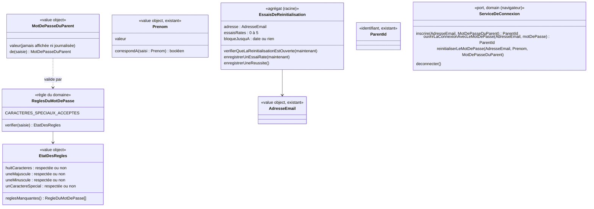

# Modèle du domaine : issue #72, Connexion du parent par adresse e-mail et mot de passe, sans envoi d'e-mail

## Contexte

**Famille** (contexte existant). La story remplace, **pour la beta**, la connexion par lien de connexion et code de connexion (#5) par une connexion par **mot de passe du parent**. Elle ajoute une **réinitialisation du mot de passe** propre à la beta, qui vérifie le **prénom d'un enfant rattaché** au parent.

Pourquoi Famille :
- le parent, sa connexion, ses profils enfants et ses rattachements sont déjà dans Famille (#5, #11) ;
- la vérification du prénom lit les **rattachements** et le **prénom** des profils enfants, deux notions de Famille ;
- aucun autre contexte ne réagit à la connexion.

Relations (voir `docs/domain/context-map.md`) :
- **Supabase Auth → Famille** : *Anti-Corruption Layer*, déjà décidée par #5. Elle s'élargit : le port `ServiceDeConnexion` gagne l'inscription et la connexion par mot de passe ; un nouveau port serveur change le mot de passe par l'API d'administration de Supabase Auth. Les erreurs de Supabase (`invalid_credentials`, `user_already_exists`, `weak_password`…) sont traduites en erreurs métier. Aucun nom de Supabase n'entre dans le domaine.
- **Expéditeur d'e-mails** : n'est plus utilisé dans la beta (réponse n°1 du PO). Le code de #5 reste en place, l'écran ne le propose plus.

Ce que le domaine porte :
- les **règles du mot de passe du parent**, partagées par le front (liste qui passe au vert) et par le serveur ;
- la **comparaison des prénoms** (sans casse, sans accents, sans espaces autour) ;
- le **compteur d'essais de réinitialisation** et le **blocage** d'une heure ;
- les erreurs métier que l'interface présente.

Ce que Supabase Auth garde : le stockage du mot de passe (empreinte), sa vérification à la connexion, le maintien de la connexion, sa propre limite de demandes (réponse n°4 du PO). Le domaine ne conserve **jamais** un mot de passe.

## Termes

| Terme | Statut | Remarque |
|---|---|---|
| Parent, Connexion du parent, Déconnexion, Profil enfant, Prénom, Rattachement | au glossaire | Inchangés. Le profil enfant reste **sans mot de passe**. |
| Mot de passe du parent | **nouveau** (à valider) | Secret choisi par le parent, qui ouvre la connexion du parent avec son adresse e-mail. Jamais « mot de passe » seul pour un enfant. |
| Règles du mot de passe | **nouveau** (à valider) | Les 4 règles : au moins 8 caractères, une majuscule, une minuscule, un caractère spécial accepté. |
| Caractère spécial accepté | **nouveau** (à valider) | Un des 14 caractères `& # { } ( ) [ ] $ € % @ ! ?`. `ù` n'en est pas un. |
| Inscription du parent | **nouveau** (à valider, question n°1) | Arrivée d'un nouveau parent, avec son adresse e-mail et son mot de passe du parent ; il est connecté aussitôt. L'interface dit « Créer ton compte » (« compte » reste interdit dans le domaine, décision n°10 du glossaire). |
| Réinitialisation du mot de passe | **nouveau** (à valider) | Choix d'un nouveau mot de passe du parent quand il l'a oublié. Dans la beta seulement : prouvée par l'adresse e-mail et le prénom d'un enfant rattaché. Retirée par #45 (réinitialisation par e-mail). |
| Essai de réinitialisation | **nouveau** (à valider) | Une demande de réinitialisation du mot de passe pour une adresse. Elle réussit ou elle est **ratée**. **Conflit** : « essai » est un synonyme interdit de **Réponse** (Apprentissage, décision n°27 du glossaire). Proposition : on dit toujours « essai de réinitialisation », jamais « essai » seul. |
| Blocage de la réinitialisation | **nouveau** (à valider) | Après 5 essais de réinitialisation ratés pour une adresse, toute réinitialisation est refusée pendant 1 heure, même avec un prénom juste. |
| Mot de passe | **conflit à corriger** | Aujourd'hui synonyme interdit des lignes « Lien de connexion » et « Code de connexion ». Il reste interdit pour **désigner** un lien ou un code de connexion, mais devient un terme à part : **Mot de passe du parent**. Glossaire ajusté (ajout d'une précision, sans effacer l'histoire). |
| Compte | conflit **déjà tranché** | Interdit dans le domaine (décision n°10). « Création du compte » de l'issue devient **Inscription du parent** dans le domaine (question n°1). |
| Lien de connexion, Code de connexion, E-mail de connexion | au glossaire | Conservés dans le domaine, hors beta (réponse n°1 du PO). |

## Modèle



### Value objects et règles

| Élément | Règle de validité |
|---|---|
| `ReglesDuMotDePasse.verifier(saisie)` | Fonction pure, appelée à chaque frappe par le front. Rend l'état des 4 règles (`huitCaracteres`, `uneMajuscule`, `uneMinuscule`, `unCaractereSpecial`), sans jamais lever d'erreur. Une saisie vide rend 4 règles non respectées. |
| Règle `huitCaracteres` | Au moins 8 caractères. Un caractère est un caractère Unicode (`€` et `ù` comptent pour un), pas une unité de stockage. Longueur maximale : question n°4. |
| Règle `uneMajuscule` | Au moins une lettre majuscule. Les majuscules accentuées (`É`, `À`) : question n°3. |
| Règle `uneMinuscule` | Au moins une lettre minuscule, **accentuées comprises** (`ù`, `é`, `à`, `ç`… : réponse n°8 du PO). |
| Règle `unCaractereSpecial` | Au moins un des 14 caractères acceptés `& # { } ( ) [ ] $ € % @ ! ?` (constante `CARACTERES_SPECIAUX_ACCEPTES`, publiée pour que l'écran affiche la liste). `ù` n'en est pas un. Un autre signe (`*`, `-`, `_`, `.`) ne compte pas : question n°5 pour savoir s'il est permis dans le mot de passe. |
| `EtatDesRegles` | Les 4 règles avec leur état, dans l'ordre d'affichage ; `reglesManquantes()` donne celles qui ne sont pas respectées (pour le message « il manque… »). |
| `MotDePasseDuParent.de(saisie)` | Construit seulement si les 4 règles sont respectées ; sinon `MotDePasseNonConforme`, qui porte la liste des règles manquantes. La saisie est gardée **telle quelle** (pas de `trim`, question n°6). Le value object ne se montre jamais : pas de texte lisible dans un message d'erreur ni dans un journal. |
| Confirmation | À l'inscription, la confirmation doit être identique au mot de passe saisi, sinon `ConfirmationDuMotDePasseDifferente`. Vérifiée par le cas d'usage du navigateur, avant tout appel. Confirmation aussi à la réinitialisation : question n°7. |
| Mot de passe saisi à la connexion | **Pas** soumis aux règles (le service de connexion seul dit s'il est juste). Seulement non vide, sinon `MotDePasseObligatoire`, sans appel au service. |
| `Prenom.correspondA(saisi)` (ajout au value object existant) | Vrai si les deux prénoms sont égaux après : espaces autour retirés (déjà fait par `Prenom.de`), accents retirés (décomposition Unicode puis retrait des signes diacritiques), casse ignorée. « lea », « LÉA » et « Léa » correspondent à « Léa » (réponse n°10 du PO). La saisie passe par `Prenom.de`, qui la coupe aussi à 20 caractères comme le prénom enregistré. Espaces, tirets et apostrophes **à l'intérieur** du prénom, ligatures (`œ`) : question n°8. |

### Agrégat `EssaisDeReinitialisation`

- **Racine** : `EssaisDeReinitialisation`, identifié par l'**adresse e-mail** saisie, comparée sans casse (comme `AdresseEmail.estLaMemeQue`). Il existe aussi pour une adresse **inconnue** (réponse n°11 et garde-fou « aucune fuite »).
- **Contenu** : le nombre d'essais de réinitialisation ratés (0 à 5) et, s'il y a blocage, sa fin (`bloqueJusquA`). **Jamais** le prénom saisi, ni le `ParentId`, ni le mot de passe.
- **Pourquoi un agrégat à part** : son invariant (5 ratés → blocage d'une heure) ne dépend ni du `Parent` ni du `ProfilEnfant`. Il doit aussi exister pour une adresse sans parent. Il ne référence personne.
- **Horloge** : l'instant est passé en paramètre (`maintenant`), comme pour `CreerProfilEnfant.executer(demande, maintenant)`. Le handler fournit l'heure du serveur ; les tests donnent des instants fixes (59 et 61 minutes après le 5ᵉ raté).
- **Méthodes métier** :
  - `verifierQueLaReinitialisationEstOuverte(maintenant)` : lève `TropDEssaisDeReinitialisation` pendant le blocage ; si le blocage est fini, le compteur repart de 0 ;
  - `enregistrerUnEssaiRate(maintenant)` : ajoute un raté ; au 5ᵉ, pose `bloqueJusquA = maintenant + 1 heure` ;
  - `enregistrerUneReussite()` : remet le compteur à 0.
- **Concurrence** : deux essais simultanés ne doivent pas compter pour un seul. L'adaptateur enregistre avec un contrôle de version (ou une mise à jour atomique en base) ; ce n'est pas une règle du domaine.

### Commandes (cas d'usage)

Comme pour #5 (arbitrage du journal de #5, 20:28), les cas d'usage qui tournent **dans le navigateur** sont dans `domain/`, importables par `@domain/famille`. Celui qui ne tourne **que côté serveur** est dans `application/`.

| Commande | Où | Effet | Erreurs métier |
|---|---|---|---|
| `InscrireLeParent(adresse, motDePasse, confirmation)` | navigateur (`domain/`) | Valide l'adresse, les règles et la confirmation, puis demande au service de connexion d'inscrire le parent. Le parent est connecté aussitôt, sans e-mail de confirmation ; l'Espace parent s'ouvre. Le mécanisme côté serveur (vérification des règles par le serveur) est la question n°2. | `AdresseEmailInvalide`, `MotDePasseNonConforme`, `ConfirmationDuMotDePasseDifferente`, `AdresseDejaUtilisee`, `ServiceDeConnexionIndisponible` |
| `SeConnecterAvecLeMotDePasse(adresse, motDePasse)` | navigateur (`domain/`) | Valide l'adresse, refuse un mot de passe vide, puis ouvre la connexion du parent. Le parent peut réessayer sans limite propre à l'application (réponse n°4). | `AdresseEmailInvalide`, `MotDePasseObligatoire`, `AdresseOuMotDePasseIncorrect`, `ServiceDeConnexionIndisponible` |
| `ReinitialiserLeMotDePasseEtSeConnecter(adresse, prenom, nouveauMotDePasse)` | navigateur (`domain/`) | Valide l'adresse, le prénom (non vide) et les règles, demande la réinitialisation au serveur, puis ouvre la connexion avec le nouveau mot de passe. Découpage en une ou deux étapes : question n°9. | `AdresseEmailInvalide`, `PrenomObligatoire` (question n°10), `MotDePasseNonConforme`, `InformationsDeReinitialisationIncorrectes`, `TropDEssaisDeReinitialisation`, `ServiceDeConnexionIndisponible` |
| `ReinitialiserLeMotDePasse(adresse, prenom, nouveauMotDePasse, maintenant)` | **serveur seulement** (`application/`, Edge Function avec `service_role` dans `Deno.env`) | 1. Valide l'entrée par le domaine (adresse, prénom, **règles du mot de passe revérifiées**). 2. Charge les essais de réinitialisation de l'adresse et vérifie qu'il n'y a pas de blocage. 3. Cherche le parent de l'adresse, puis les prénoms des enfants qui lui sont rattachés. 4. Si aucun parent, aucun enfant, ou aucun prénom qui correspond : enregistre un essai raté, lève `InformationsDeReinitialisationIncorrectes`. 5. Sinon : change le mot de passe par l'API d'administration, enregistre la réussite (compteur à 0). | `AdresseEmailInvalide`, `PrenomObligatoire`, `MotDePasseNonConforme`, `TropDEssaisDeReinitialisation`, `InformationsDeReinitialisationIncorrectes` |
| `SeDeconnecter` | navigateur (`domain/`, existant) | Inchangé. | (aucune) |

Les cas d'usage `DemanderLienDeConnexion`, `OuvrirLaConnexionAvecLeCode` et `EnvoyerEmailDeConnexion` (#5) restent dans le code, sans être proposés par l'écran (réponse n°1 du PO).

Ordre imposé dans `ReinitialiserLeMotDePasse` : le **blocage est vérifié avant** toute recherche du parent et des prénoms. Une adresse bloquée ne déclenche aucune lecture des profils enfants.

### Ports

| Port | Couche | Opérations | Adaptateur |
|---|---|---|---|
| `ServiceDeConnexion` (existant, élargi) | `domain/` (appelé depuis le navigateur) | `inscrire(adresse, motDePasse) → ParentId` ; `ouvrirLaConnexionAvecLeMotDePasse(adresse, motDePasse) → ParentId` ; `reinitialiserLeMotDePasse(adresse, prenom, motDePasse)` (appel de l'Edge Function) ; `deconnecter()` ; les opérations de #5 restent | `src/connexion/service-de-connexion-supabase.ts` (`signInWithPassword`, `signUp` ou Edge Function selon la question n°2, `functions.invoke`) |
| `RegistreDesEssaisDeReinitialisation` | `application/ports/` | `pourAdresse(adresse) → EssaisDeReinitialisation` (un registre vide si l'adresse n'a jamais été essayée) ; `enregistrer(essais)` | table sous RLS sans aucune policy pour `anon` et `authenticated`, lue et écrite avec `service_role` |
| `ParentsDesAdresses` | `application/ports/` | `parentDeLAdresse(adresse) → ParentId ou rien` | API d'administration de Supabase Auth (ou lecture équivalente côté serveur) |
| `PrenomsDesEnfantsRattaches` | `application/ports/` | `duParent(parentId) → Prenom[]` : seulement les prénoms, rien d'autre du profil (minimisation) | lecture des rattachements et des prénoms avec `service_role`, filtrée **par le `ParentId`** trouvé à l'étape 3 |
| `MotsDePasseDesParents` | `application/ports/` | `changer(parentId, motDePasse)` | API d'administration de Supabase Auth (`updateUserById`) |

Pourquoi un port de lecture des prénoms plutôt que `ProfilsEnfants.duParent` : l'appelant n'est pas connecté (pas de JWT, donc pas de RLS), et le cas d'usage n'a besoin que des prénoms. Charger les agrégats `ProfilEnfant` entiers (niveau, réglages, univers) avec `service_role` lirait plus que nécessaire.

### Erreurs métier (dans `domain/erreurs.ts`)

| Erreur | Message proposé (sens de l'issue) | Remarque |
|---|---|---|
| `MotDePasseNonConforme` | « Il manque : une majuscule. » (liste des règles manquantes) | Porte `reglesManquantes`. Ne contient jamais la saisie. |
| `ConfirmationDuMotDePasseDifferente` | « Les deux mots de passe ne sont pas pareils. » | Texte exact : à fixer avec les scénarios. |
| `MotDePasseObligatoire` | « Écris ton mot de passe. » | Connexion, saisie vide. |
| `AdresseOuMotDePasseIncorrect` | « Adresse e-mail ou mot de passe incorrect. » | Ne dit pas si l'adresse existe. |
| `AdresseDejaUtilisee` | propose de se connecter | Inscription seulement (décidé par l'issue). |
| `InformationsDeReinitialisationIncorrectes` | « Ces informations ne correspondent pas. » | **Une seule erreur** pour : adresse inconnue, parent sans enfant, prénom qui ne correspond pas. Ne dit jamais quel prénom est attendu. |
| `TropDEssaisDeReinitialisation` | « Trop d'essais. Réessaie dans une heure. » | Même message pour une adresse inconnue. |
| `ServiceDeConnexionIndisponible` | service indisponible, réessayer | Traduite par l'ACL (erreur réseau ou 5xx). Remplace, pour la beta, `EnvoiDuLienImpossible` du front. |

Les erreurs existantes `AdresseEmailInvalide` et `PrenomObligatoire` sont réutilisées.

## Invariants

1. Un mot de passe du parent respecte **les 4 règles** ; un mot de passe qui en manque une n'est jamais transmis à Supabase Auth, ni à l'inscription ni à la réinitialisation.
2. Les règles sont **les mêmes** dans le navigateur et sur le serveur : un seul code, dans `famille/domain/`, importé par le front via `@domain/famille`. Le front ne réécrit aucune règle.
3. `ù` et les lettres accentuées minuscules comptent comme minuscules ; `ù` n'est pas un caractère spécial accepté.
4. Le mot de passe n'est **ni conservé ni journalisé** par l'application : seul Supabase Auth en garde l'empreinte. Aucune erreur métier ne le contient.
5. Le **profil enfant n'a jamais de mot de passe** (RGPD, `CLAUDE.md`).
6. Après **5 essais de réinitialisation ratés** pour une adresse, la réinitialisation est **bloquée 1 heure** à partir du 5ᵉ raté ; pendant le blocage, même un prénom juste est refusé.
7. Une réinitialisation **réussie** remet le compteur de l'adresse à 0. La fin du blocage le remet aussi à 0.
8. Une adresse **inconnue** et un parent **sans aucun profil enfant** donnent le même essai raté et le même message qu'un prénom faux ; le blocage s'applique à eux de la même façon.
9. Un prénom ne vaut que pour **un enfant rattaché à ce parent** : le prénom d'un enfant d'un autre parent ne réinitialise rien (`@acces`). Un second parent (#13) peut utiliser le prénom de tout enfant auquel il est rattaché.
10. La comparaison des prénoms ignore la casse, les accents et les espaces autour.
11. Les essais de réinitialisation sont comptés **côté serveur** et ne contiennent **jamais** le prénom saisi.
12. Un parent connecté ne voit que les profils enfants auxquels il est rattaché (inchangé).
13. Aucun e-mail n'est envoyé dans la beta : ni à l'inscription, ni à la connexion, ni à la réinitialisation.

## Événements

Aucun événement de domaine entre contextes : aucun autre contexte ne réagit à l'inscription, à la connexion ni à la réinitialisation.

L'agrégat `EssaisDeReinitialisation` n'a pas besoin de faits publiés. Un fait `MotDePasseReinitialise` (à valider) ne servirait qu'à un journal de sécurité, que rien ne demande ; s'il venait, il ne porterait que l'adresse et l'instant, jamais le prénom.

## Partage avec le front

Importé par le front via `@domain/famille` (exporté par `famille/domain/index.ts`) :
- `ReglesDuMotDePasse.verifier` et `CARACTERES_SPECIAUX_ACCEPTES` : la liste des règles sous le champ « Mot de passe » ; chaque règle passe au vert quand `verifier(saisie)` la dit respectée. Le front fournit seulement l'affichage (icône ✓, texte, `aria-live` poli) et les libellés ; il ne teste aucun caractère lui-même ;
- `MotDePasseDuParent`, les erreurs métier, `InscrireLeParent`, `SeConnecterAvecLeMotDePasse`, `ReinitialiserLeMotDePasseEtSeConnecter`, le port `ServiceDeConnexion` élargi.

Pas exporté par `index.ts` : `EssaisDeReinitialisation` (règle du serveur seul, comme `EmailDeConnexion` de #5).

Hors ligne : rien de la story ne fonctionne sans réseau, sauf la liste des règles (calculée dans le navigateur). L'inscription, la connexion et la réinitialisation demandent le réseau.

## Données personnelles

- **Aucune donnée nouvelle sur l'enfant.** Le prénom saisi par le parent n'est ni enregistré, ni journalisé, ni renvoyé dans une réponse ; il n'est comparé qu'en mémoire, dans l'Edge Function.
- **Nouvelle donnée sur un adulte** : l'adresse e-mail saisie pour une réinitialisation, avec un compteur et une date de fin de blocage. Elle peut être celle d'une personne qui n'est pas parent (adresse inconnue). Durée de conservation : question n°11. Sort à la suppression des données d'un parent : question n°12.
- Le mot de passe est une donnée du parent gardée par Supabase Auth (empreinte), hébergé dans l'UE.
- Les lectures des prénoms avec `service_role` sont limitées au parent de l'adresse saisie ; rien n'est envoyé à l'IA.

## Emplacement

```
supabase/functions/_shared/famille/
  domain/
    regles-du-mot-de-passe.ts                       # NOUVEAU : ReglesDuMotDePasse.verifier, EtatDesRegles,
                                                    #   RegleDuMotDePasse, CARACTERES_SPECIAUX_ACCEPTES
    regles-du-mot-de-passe_test.ts                  # (test-writer)
    mot-de-passe-du-parent.ts                       # NOUVEAU : value object MotDePasseDuParent
    mot-de-passe-du-parent_test.ts                  # (test-writer)
    prenom.ts                                       # MODIFIÉ : Prenom.correspondA
    prenom_test.ts                                  # (test-writer : « lea » / « Léa », espaces autour, casse)
    essais-de-reinitialisation.ts                   # NOUVEAU : agrégat EssaisDeReinitialisation (non exporté par index.ts)
    essais-de-reinitialisation_test.ts              # (test-writer : 5 ratés, 59 min / 61 min, réussite → 0)
    inscrire-le-parent.ts                           # NOUVEAU : cas d'usage, navigateur
    se-connecter-avec-le-mot-de-passe.ts            # NOUVEAU : cas d'usage, navigateur
    reinitialiser-le-mot-de-passe-et-se-connecter.ts # NOUVEAU : cas d'usage, navigateur
    service-de-connexion.ts                         # MODIFIÉ : port élargi
    erreurs.ts                                      # MODIFIÉ : nouvelles erreurs métier
    index.ts                                        # MODIFIÉ : exports pour @domain/famille
  application/
    reinitialiser-le-mot-de-passe.ts                # NOUVEAU : cas d'usage serveur
    ports/registre-des-essais-de-reinitialisation.ts # NOUVEAU
    ports/parents-des-adresses.ts                   # NOUVEAU
    ports/prenoms-des-enfants-rattaches.ts          # NOUVEAU
    ports/mots-de-passe-des-parents.ts              # NOUVEAU
  infrastructure/
    registre-des-essais-de-reinitialisation-supabase.ts # NOUVEAU : table des essais, service_role, contrôle de version
    parents-des-adresses-supabase.ts                # NOUVEAU : API d'administration de Supabase Auth
    prenoms-des-enfants-rattaches-supabase.ts       # NOUVEAU : prénoms seulement
    mots-de-passe-des-parents-supabase.ts           # NOUVEAU : updateUserById
    http-famille.ts                                 # MODIFIÉ : traduction des nouvelles erreurs en réponses HTTP
  test_utils/
    registre-des-essais-de-reinitialisation-en-memoire.ts # NOUVEAU
    parents-des-adresses-en-memoire.ts              # NOUVEAU
    prenoms-des-enfants-rattaches-en-memoire.ts     # NOUVEAU
    mots-de-passe-des-parents-en-memoire.ts         # NOUVEAU
    service-de-connexion-en-memoire.ts              # MODIFIÉ : inscription, mot de passe, réinitialisation
supabase/functions/reinitialiser-le-mot-de-passe/index.ts # NOUVEAU : handler fin (valide l'entrée, cas d'usage,
                                                    #   réponse ; service_role lu dans Deno.env ; aucun prénom
                                                    #   ni mot de passe dans les journaux)
supabase/functions/inscrire-le-parent/index.ts      # SEULEMENT si la question n°2 retient l'option B
supabase/migrations/<horodatage>_essais_de_reinitialisation.sql # NOUVEAU : table sous RLS, aucune policy
supabase/config.toml                                # MODIFIÉ : confirmations désactivées, longueur minimale 8
src/connexion/                                      # écran : champs, liste des règles, « Mot de passe oublié »
```

Décision d'architecture associée : `docs/decisions/0019-connexion-par-mot-de-passe-sans-e-mail-dans-la-beta.md`.

## Questions ouvertes

Toutes les décisions du PO de l'issue (réponses n°1 à 11) sont reprises. Les questions ci-dessous sont des détails que l'issue ne tranche pas.

1. **Nom dans le domaine** : « compte » étant interdit (décision n°10 du glossaire), on dit **Inscription du parent** (`InscrireLeParent`) dans le domaine, le code et les scénarios, et « Créer ton compte » seulement dans l'interface ? (oui / non ; sinon, donner le terme)
2. **Vérification des règles par le serveur à l'inscription** : l'issue demande `signUp` depuis le navigateur **et** des règles « vérifiées aussi côté serveur ». Supabase Auth ne sait pas exprimer exactement nos règles (sa liste de signes n'a pas `€` et il exige un chiffre). Option A : `signUp` depuis le navigateur, le serveur ne vérifie que la longueur de 8 (réglage de Supabase), les 3 autres règles seulement dans le navigateur. Option B : l'inscription passe par une Edge Function qui vérifie les 4 règles avec le domaine puis crée le parent par l'API d'administration ; les inscriptions directes à Supabase Auth sont fermées. Préférez-vous B ? (oui / non)
3. Une **majuscule accentuée** (`É`, `À`, `Ç`) compte-t-elle comme majuscule ? (oui / non)
4. Faut-il une **longueur maximale** du mot de passe ? Supabase Auth refuse au-delà de 72 octets (environ 72 lettres simples, moins avec `€` ou des accents). Proposition : 64 caractères au plus, avec un message clair. (oui / non, ou donner la limite)
5. Un caractère qui n'est **ni lettre ni caractère spécial accepté** (chiffre, `*`, `-`, `_`, `.`, espace) est-il **permis** dans le mot de passe, sans compter comme caractère spécial ? Exemple : `Abcdef*1!` est-il accepté ? (oui / non)
6. Les **espaces au début ou à la fin** du mot de passe sont-ils gardés tels quels (oui), ou retirés avant de vérifier les règles (non) ? Exemple : `" Abcdefg%"` fait-il 9 caractères ?
7. Le choix du **nouveau mot de passe** (réinitialisation) demande-t-il aussi une **confirmation** (deuxième saisie), comme l'inscription ? (oui / non)
8. **Prénom** : « Marie-Lou » correspond-il à « marie lou » ou « marielou » (tirets, espaces et apostrophes **à l'intérieur** ignorés) ? Et « Chloé » à « chloe », « Œlia » à « oelia » ? (oui / non pour chacun ; proposition : seuls casse, accents et espaces autour sont ignorés, comme dit la réponse n°10)
9. **Étapes de la réinitialisation** : le parent saisit l'adresse et le prénom, et l'application lui dit **tout de suite** si cela correspond avant de lui demander le nouveau mot de passe (oui), ou il saisit les trois puis reçoit une seule réponse (non) ? Si oui, proposition : le prénom est revérifié par le serveur quand le nouveau mot de passe est envoyé, et seule cette dernière vérification remet le compteur à 0.
10. Un **prénom vide** (ou une adresse mal formée) à la réinitialisation est-il refusé par l'écran **sans compter** un essai de réinitialisation raté ? (oui / non)
11. Pendant le **blocage**, un nouvel essai **prolonge-t-il** le blocage d'une heure ? (oui / non ; proposition : non, le blocage finit 1 heure après le 5ᵉ raté)
12. Les essais ratés **s'oublient-ils avec le temps** ? Exemple : 1 raté par jour pendant 5 jours bloque-t-il l'adresse ? (oui / non ; proposition : non, un raté s'oublie après 24 heures sans nouvel essai)
13. **Conservation** des essais de réinitialisation (adresse, compteur, fin du blocage) : sont-ils effacés quand ils ne servent plus (compteur à 0 et blocage fini, ou au bout de 24 heures) ? (oui / non, ou donner la durée)
14. **Suppression des données d'un parent** (pas encore de story) : les essais de réinitialisation de son adresse font-ils partie de ses données à effacer et à exporter ? (oui / non)
15. Le message de blocage dit toujours « Réessaie dans une heure », même s'il ne reste que 10 minutes : on garde ce texte fixe (oui), ou on donne le temps qui reste (non) ?
16. **Conflit de vocabulaire** : « essai » est interdit pour **Réponse** (décision n°27). On dit toujours « **essai de réinitialisation** », jamais « essai » seul, dans le domaine, le code et les scénarios ? (oui / non)
17. Un parent **déjà connecté** sur un autre appareil reste-t-il connecté sur cet appareil après une réinitialisation de son mot de passe (oui), ou tous ses autres appareils sont-ils déconnectés (non) ? Proposition, plus prudente puisque le secret est faible : non.
