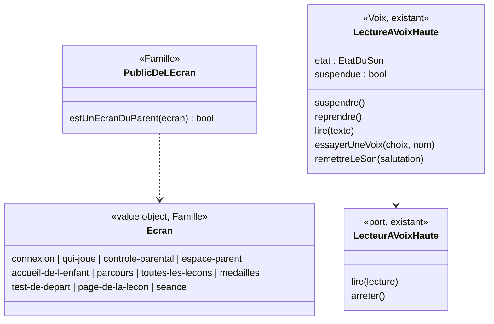

# Modèle du domaine : issue #73, Aucun son pendant la connexion du parent ni dans l'Espace parent

État : **validé par le PO** le 2026-10-25 (« #73 reco OK ») : recommandations retenues pour 73.1 à 73.7 (détail dans `acceptance.md`, section Décisions).

## Contexte

Deux contextes, chacun pour ce qu'il sait :

- **Famille** (existant) décide **à qui s'adresse un écran** : au parent ou à l'enfant. Il connaît déjà la connexion du parent, « Qui joue ? », le contrôle parental, l'Espace parent et le profil en cours. La règle « quels écrans peuvent parler » vit donc dans `famille/domain/`.
- **Voix** (sous-domaine générique, décision 0007) sait **se taire sans changer le choix Son/Muet**. Voix ne connaît ni les univers (décision 0008) ni les écrans : il reçoit seulement l'ordre de suspendre ou de reprendre la voix.

Pourquoi pas tout dans Voix : Voix est utilisé par Apprentissage, Motivation et Accompagnement ; lui apprendre ce qu'est un écran du parent le ferait dépendre de Famille.

Communication : **appel dans le navigateur**. Le front traduit l'écran affiché en `Ecran` (Famille), demande `estUnEcranDuParent(ecran)`, puis appelle `suspendre()` ou `reprendre()` sur la lecture à voix haute (Voix). Aucun événement, aucun appel serveur : tout est hors ligne. Pas de nouvelle relation dans la context map (Famille et Voix ne s'importent pas ; le front les relie, comme pour `CaractereDeLaVoix`).

Arrêt d'une lecture en cours : **pas de nouveau port**. `LectureAVoixHaute` possède déjà le port `LecteurAVoixHaute` (décision 0007) ; suspendre la voix appelle `arreter()`.

### État réel du code (`main`)

| Écran | Lit de lui-même aujourd'hui ? |
|---|---|
| Connexion du parent (`EcranDeConnexion`, sur l'accueil ou sur `/espace-parent`) | Non. Sur l'accueil déconnecté, le personnage guide est seulement dessiné. |
| « Qui joue ? » avec des profils | Non. |
| « Qui joue ? » **sans profil** (`InvitationDuPremierProfil`) | **Oui** : Noisette lit l'invitation à créer le premier profil (nature « invitation »). Seule lecture automatique sur un écran du parent. |
| Contrôle parental (`ControleParental`) | Non. |
| Espace parent (`InvitationAffichee`, `ChoixDeLaVoix`) | Non. Seul son : l'**essai de voix** (bouton « Écouter », l'issue dit « Essayer »), lancé par le parent. |
| Bouton « Son » de l'en-tête, en remettant le son | **Oui, sur tous les écrans** : `basculerLeSon` lit `presentationAuRetourDuSon` (« Je t'entends ! Je suis Lumi. »), y compris dans l'Espace parent. |

Lecture en cours en changeant d'écran : **elle est déjà coupée**, mais par chaque écran de l'enfant séparément, au moment où il disparaît (`faireSilence` ou `abandonner` dans `AccueilDeLEnfant`, `PageDeLaLecon`, `EcranDeSeance`, `DeroulementDuTestDeDepart`, `PropositionDuTestDeDepart`, `FinDuTestDeDepart`, `MesMedailles`). Aucune règle ne la garantit pour un écran du parent : un nouvel écran de l'enfant qui oublierait ce nettoyage parlerait par-dessus l'Espace parent. Le réglage Son/Muet (`savanturier:son`) n'est modifié que par le bouton « Son ».

Vocabulaire des scénarios : « Noisette dit « … » » vérifie la **bulle** ; « entend Noisette dire / lire » vérifie la **voix** (#7, #15). Les scénarios existants qui lisent l'invitation (#11 l. 197, #72 l. 18) vérifient la bulle de l'Espace parent : ils restent vrais. Il faut seulement ajouter « Paul n'entend aucune voix ».

## Termes

| Terme | Statut |
|---|---|
| Écran du parent | **Nouveau** (Famille). L'issue dit « écrans du parent ». |
| Écran de l'enfant | **Nouveau** (Famille). Le glossaire l'emploie déjà sans le définir (« Accueil de l'enfant : écran de l'enfant… »). |
| Voix suspendue | **Nouveau** (Voix). |
| Lecture à voix haute, Essai de voix, Muet, Son, Voix bloquée | Au glossaire (Voix), inchangés. |
| Espace parent, Contrôle parental, Qui joue ?, Accueil de l'enfant, Profil en cours | Au glossaire (Famille), inchangés. |
| Invitation à créer le premier profil | **En conflit** : « Invitation » est réservé au lien d'invitation du second parent (#13). Le code dit déjà `inviterACreerLePremierProfil` et la nature de parole « invitation ». À nommer (question 73.6). |
| « Lecture automatique » (issue : « aucune lecture à voix haute automatique ») | **En conflit** : c'est un synonyme interdit de « Tout lire à voix haute ». On dit « le personnage guide ne lit rien de lui-même ». |
| « Silence », « silencieux » (issue : « reste silencieuse ») | **En conflit** : « silencieux » est un synonyme interdit de Muet. On dit « voix suspendue ». `faireSilence` (code de `usePersonnageQuiParle`) reste un nom technique du front. |
| Connexion du parent (écran « Se connecter ») | Au glossaire (Famille, #5, #72). |

## Modèle

Pas d'agrégat : rien n'est enregistré, la règle est une classification et un état du navigateur.

### Famille : `Ecran` et `estUnEcranDuParent`

- `Ecran` : union fermée des écrans de l'application, en noms du domaine (liste ci-dessus).
- `PUBLIC_DE_L_ECRAN : Record<Ecran, "parent" | "enfant">` : tableau **exhaustif**. Un nouvel écran ne compile pas tant qu'on n'a pas décidé à qui il s'adresse.
- `estUnEcranDuParent(ecran): boolean` : fonction pure, testée en Deno.test.
- Écrans du parent : `connexion`, `qui-joue` (avec ou sans profil, invitation comprise), `controle-parental`, `espace-parent`.
- Le front traduit son lieu en `Ecran` : accueil déconnecté → `connexion` ; accueil connecté → `qui-joue` ; `/espace-parent` déconnecté → `connexion`, question posée → `controle-parental`, ouvert → `espace-parent` ; les autres lieux → écran de l'enfant du même nom. C'est une traduction, pas une règle. Le `estPageDeLEnfant` d'`Application.tsx` peut s'appuyer sur le même tableau (refactor).

### Voix : la voix suspendue

Nouvel état de `LectureAVoixHaute`, **indépendant** de `EtatDuSon` :

| Commande | Effet |
|---|---|
| `SuspendreLaVoix` (`suspendre()`) | Arrête la lecture en cours (`lecteur.arreter()`) ; ensuite `lire` ne lit plus rien. `EtatDuSon` et sa mémoire sur l'appareil ne changent pas. Idempotente. |
| `ReprendreLaVoix` (`reprendre()`) | `lire` lit de nouveau, selon Son/Muet. Ne lit rien d'elle-même. Idempotente. |
| `EssayerUneVoix` (existante) | Lue même voix suspendue (si 73.1 = oui), jamais en Muet (comportement actuel). |
| `RemettreLeSon` (existante) | Voix suspendue : passe à « Son » et le mémorise, sans lire la présentation (si 73.4 = oui). |

Front : un seul point, dans `Application`, applique `suspendre()` / `reprendre()` selon `estUnEcranDuParent`, dans un `useLayoutEffect` : il doit passer **avant** les `useEffect` des écrans (salutation de l'accueil de l'enfant au retour, lecture de l'invitation). `InvitationDuPremierProfil` ne lit plus l'invitation (même affichage que `InvitationAffichee`). Les composants ne décident de rien.

### Erreurs métier

Aucune. Une lecture demandée voix suspendue est ignorée sans erreur, comme en Muet.

## Invariants

1. Sur un écran du parent, le personnage guide ne lit rien de lui-même ; une lecture en cours s'arrête dès l'arrivée sur l'écran.
2. Passer sur un écran du parent, ou en revenir, ne change jamais le choix Son/Muet mémorisé sur l'appareil.
3. Sur un écran de l'enfant, la voix se comporte exactement comme avant #73 (salutation, consignes, « Tout lire à voix haute », « Réécouter »).
4. Tout écran est classé écran du parent ou écran de l'enfant (tableau exhaustif).
5. L'essai de voix reste un geste explicite du parent, jamais déclenché par l'arrivée sur un écran (73.1).
6. L'affichage ne change pas : bulle du personnage guide et zones `role="status"` restent pour les lecteurs d'écran.

## Événements

Aucun événement de domaine : rien n'est enregistré ni partagé avec un autre contexte. Suspendre et reprendre la voix sont des commandes du navigateur.

## Partage avec le front

Tout fonctionne hors ligne et vit dans `domain/` :
- `@domain/famille` : `Ecran`, `estUnEcranDuParent` ;
- `@domain/voix` : `LectureAVoixHaute.suspendre()` / `reprendre()`.

## Données d'enfants

Aucune donnée nouvelle. Rien n'est mémorisé : la voix suspendue dure le temps de l'écran.

## Emplacement

| Fichier | Contenu |
|---|---|
| `supabase/functions/_shared/famille/domain/ecran.ts` | `Ecran`, `PUBLIC_DE_L_ECRAN`, `estUnEcranDuParent` |
| `supabase/functions/_shared/famille/domain/ecran_test.ts` | les quatre écrans du parent, les écrans de l'enfant |
| `supabase/functions/_shared/famille/domain/index.ts` | exports |
| `supabase/functions/_shared/voix/domain/lecture-a-voix-haute.ts` | `suspendre`, `reprendre`, garde dans `lire`, `essayerUneVoix`, `remettreLeSon` |
| `supabase/functions/_shared/voix/domain/voix-suspendue_test.ts` | invariants 1, 2, 5 avec le fake `LecteurAVoixHaute` existant |

Front (hors domaine) : `src/voix/useVoix.ts` (exposer `suspendre` / `reprendre`), `src/Application.tsx` (traduction lieu → `Ecran`, `useLayoutEffect`), `src/famille/InvitationDuPremierProfil.tsx` (ne lit plus).

## Ajouts proposés au glossaire

| Terme | Définition | Contexte | Synonymes interdits |
|---|---|---|---|
| Écran du parent (à valider) | Écran destiné au parent : connexion du parent, « Qui joue ? » (invitation à créer le premier profil comprise), contrôle parental, Espace parent. Le personnage guide n'y lit rien de lui-même ; une lecture en cours s'arrête en y arrivant (#73). | Famille | écran adulte, écran d'administration |
| Écran de l'enfant (à valider) | Écran où joue le profil en cours : accueil de l'enfant, Mon parcours, Toutes les leçons, Mes médailles, test de départ, page de la leçon, séance. La voix s'y comporte selon Son/Muet et les réglages du profil (#73). | Famille | page de jeu, écran joueur |
| Voix suspendue (à valider) | État de la lecture à voix haute sur un écran du parent : le personnage guide ne lit rien de lui-même et la lecture en cours s'arrête ; l'essai de voix reste entendu. Ce n'est pas Muet : le choix Son/Muet de l'appareil ne change pas (#73). | Voix | silence, silencieux, muet, voix coupée, lecture automatique |

## Questions au PO

**73.1** L'essai de voix (bouton « Écouter » du choix de voix, #15) reste-t-il audible dans l'Espace parent ?
Reco : **oui**, c'est un geste explicite du parent, pas une lecture de l'écran. En Muet, il reste inaudible comme aujourd'hui.

**73.2** « Qui joue ? » reste-t-il silencieux lui aussi, avec ou sans profil ?
Reco : **oui**, c'est un écran du parent ; la voix commence à l'accueil de l'enfant, avec « Bonjour <prénom> ! » au choix du profil (réponse M10 de #11, inchangée).

**73.3** Le bouton « Son » de l'en-tête reste-t-il visible sur les écrans du parent ?
Reco : **oui, visible et utilisable** : il règle l'appareil pour l'enfant qui jouera ensuite, et il garde l'en-tête identique partout. Le masquer ferait croire que le son a changé.

**73.4** Sur un écran du parent, remettre le son fait aujourd'hui dire au personnage guide « Je t'entends ! Je suis Lumi. ». Doit-il se taire ?
Reco : **oui**, le son est remis et mémorisé sans rien lire ; la présentation reste sur les écrans de l'enfant (#7).

**73.5** L'écran de connexion affiché sur l'accueil (déconnecté) est-il un écran du parent, même si un enfant le voit en premier en ouvrant l'application ?
Reco : **oui**, aucun profil en cours n'existe avant la connexion ; rien n'y est lu.

**73.6** Comment nommer le message de Noisette « Bonjour ! Pour commencer, crée le profil de l'enfant qui va jouer… », puisque « Invitation » désigne le lien du second parent (#13) ?
Reco : « **Invitation à créer le premier profil** », toujours en entier, jamais « invitation » seule ; à ajouter au glossaire, et la nature de parole `invitation` du code en devient le nom technique.

**73.7** Un écran ajouté plus tard (suivi, rapport de la semaine, devoirs dans l'Espace parent ; écrans de Motivation côté enfant) doit-il être classé explicitement par sa story ?
Reco : **oui** : le tableau exhaustif l'oblige, et chaque story dit si son écran est un écran du parent ou de l'enfant.
