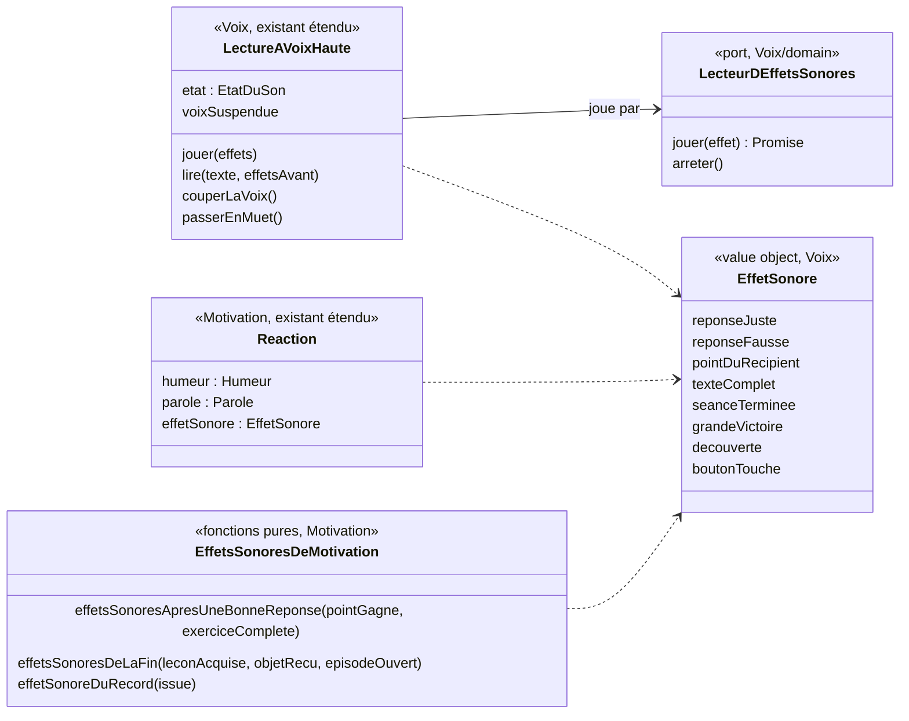

# Modèle du domaine : issue #97, retours animés et sonores pendant la séance

Contexte : **Motivation** (quel effet sonore pour quel fait d'Apprentissage) et **Voix** (sous-domaine générique : jouer un effet sonore, Muet, effet sonore avant la parole). Apprentissage fournit les faits sans changer. Aucun agrégat, aucun événement enregistré, aucune migration, aucune Edge Function, aucune donnée d'enfant nouvelle.

État : **cadrage seulement**. #97 dépend de #96 (PR #124, non mergée) : aucun code avant son merge. Question 1 de l'issue réglée par le PO le 2026-10-25 (8 sons dans `public/sons/`, provenance `docs/sons.md`).

## Contexte

### Ce que le front sait déjà, et d'où il le sait

Tout se passe dans le navigateur, hors ligne compris. Chaque fait dont un retour a besoin est **déjà fourni par un domaine** :

| Événement du catalogue (skill `gamification`, section 3) | D'où le front l'apprend aujourd'hui |
|---|---|
| Réponse juste, réponse fausse | `ResultatDeReponse` (`"juste" \| "fausse" \| "dejaEcartee"`) rendu par `Seance.repondre` / `Seance.taper` (dictée : seulement au mot complet), `SeanceDeRevision.repondre`, `TestDeDepart.repondre` (Apprentissage). Puis `reagirALaReponse(juste)` (Motivation) donne l'**humeur** (`applaudit` / `reflechit`) et la félicitation ou l'encouragement |
| Bonne réponse sans parole | `Seance.paroleDueApresLaDerniereReponse()` = `"applaudir"` (conjugaison) ou `undefined` (classer une fois sur deux) : le front appelle `montrerHumeur` sans rien dire (`useQuestionsAChoix`, `useEtiquettesAPlacer`) |
| Point dans le récipient | `Seance.avancement()` (`Avancement` : questions réussies sur total), lu après chaque réponse (`annoncerLAvancement`). En séance de révision et au **test de départ**, le front compte lui-même les questions réussies (`useDeroulementDuTestDeDepart`, `setQuestionsReussies`) |
| Texte complet | `Seance.texteCompleteParLaDerniereReponse()` (dernier trou d'un texte à trous, dernier mot d'un `memoriser`), puis `direLeTexteComplet` (Motivation) |
| Dernière étiquette d'un `ordre` | **Aucun fait nommé** : le front lit `exercice.estReussi()` après le placement ; la parole due passe de `relance` à `felicitation`. Voisin : `conjugaisonCompleteParLaDerniereReponse()` (« Tu sais conjuguer… ») |
| Séance terminée | `Seance.estFinie()`, puis `SeanceTerminee` (étoiles) à l'écran de fin (`EcranDeFin`, `useSauvegardeDeLaSeance`). Séance de révision : `SeanceDeRevisionTerminee`. Test de départ : `TestDeDepartTermine` (ce n'est pas une séance) |
| Record de fluence | `RecordDeFluence.proposer(score)` rend `IssueDuRecord` (`premierRecord`, `nouveauRecord`, `recordInchange`, `aucunRecord`), à la fin de la fluence (`useFluence`), avant `parolesDeFinDeFluence` |
| Leçon acquise, badge gagné | `leconAcquiseParLaSeance` (Apprentissage) puis `badgeGagneParLaSeance` (Motivation), à l'écran de fin (`NouveautesDeFin.badge`). La leçon acquise elle-même n'est pas dans `NouveautesDeFin` |
| Nouvel objet de la cabane, nouvel épisode | `objetRecuParLaSeance`, `episodeOuvertParLaSeance` (Motivation), à l'écran de fin (`NouveautesDeFin.objet`, `.episode`) |
| Bouton touché (#96) | Aucun fait métier : écoute globale des boutons dans `src/boutons/ressort-des-boutons.ts` (#96, muet) |

Le Muet vit dans **Voix** : `LectureAVoixHaute` garde l'`EtatDuSon` (`"son" \| "muet"`), refuse de lire en Muet ou en voix suspendue (écrans du parent, #73) et arrête la lecture en cours au passage en Muet. Le front le mémorise sur l'appareil (`memoire-du-son.ts`) et déverrouille l'audio au premier toucher (`deverrouillage-audio.ts`, contexte audio déjà prêt pour un fichier).

### Où vit la règle « quel son pour quel événement »

Trois sortes de décisions, trois places :

1. **Quel effet sonore pour quel fait** (réponse juste → « reponse-juste » ; texte complet à la place du son de réponse juste ; à la fin, « grande-victoire » plutôt que « seance-terminee » si la leçon devient acquise ; « decouverte » s'il y a un objet ou un épisode) : c'est une **réaction à un fait d'Apprentissage**, proportionnée à l'importance du fait (« récompense proportionnée », skill section 2). C'est exactement le rôle de **Motivation**, qui décide déjà l'**humeur** du personnage guide (une animation : il saute, il se penche) à partir de « juste / fausse » (`reagirALaReponse`). L'effet sonore se range **à côté de l'humeur**, dans la même réaction. Le laisser dans React ferait écrire à React des priorités et des combinaisons (texte complet contre réponse juste, leçon acquise contre séance terminée, ordre des sons de fin), donc des règles : contraire à « React ne contient aucune règle métier ».
2. **Comment un effet sonore se joue** (rien en Muet ni en voix suspendue ; l'effet avant la parole, jamais par-dessus ; une nouvelle parole ou le silence arrête l'effet ; un effet qui échoue n'empêche jamais la parole) : ce sont les règles du **son de l'application**, aujourd'hui portées par `LectureAVoixHaute` (Voix), qui a déjà l'`EtatDuSon`, la voix suspendue et le port `LecteurAVoixHaute`. Les mettre ailleurs dédoublerait l'état Son/Muet. Voix reste générique : il ne connaît ni séance, ni réponse, ni récompense ; il joue un effet sonore nommé.
3. **Comment le montrer** (rebond, balancement de ±6 px, point qui vole, étincelles, étoiles une à une, confettis, compteur qui défile, durées, ressorts, mouvements réduits, célébration passée d'un toucher, annonce `aria-live` unique) et **quel fichier MP3 pour quel effet** : c'est de l'**affichage** et de l'**infrastructure**, dans `src/`. Le skill le dit : « le domaine dit **ce qui** est arrivé, le front choisit **comment** le montrer ». Même partage que #96 (`transitionVers` est dans `src/transitions/`).

Le **son du bouton touché** n'est pas une réaction à un fait : `src/` le demande directement à Voix (il respecte donc le Muet), sans passer par Motivation.

### Communication entre contextes

- Apprentissage → Motivation : **appel dans le navigateur**, relation existante (« Motivation → Apprentissage, Customer/Supplier : paroles et humeur du personnage guide, #6 ») étendue à l'effet sonore. Motivation reçoit des faits sous une forme propre (booléens, nombres, `IssueDuRecord`), jamais un agrégat d'Apprentissage.
- Voix → Motivation : **Published Language**, comme `CaractereDeLaVoix` (#7, décision 0008) : Voix publie le type `EffetSonore` (la liste fermée des 8 effets choisis par le PO) et le port `LecteurDEffetsSonores` ; Motivation importe le type et choisit l'effet de chaque fait.
- Voix → Apprentissage, Motivation : appel existant, le front passe les effets à `LectureAVoixHaute` avec la parole.
- Fichiers de sons (`public/sons/`, mis en cache par le service worker) → Voix : **ACL** dans `src/voix/` (adaptateur `HTMLAudioElement`), comme la synthèse vocale du navigateur.

## Termes

| Terme | Statut |
|---|---|
| Réponse, Erreur, Avancement de la séance, Texte complet, Parole due, Séance terminée, Fin de la séance, Record de fluence, Leçon acquise, Badge gagné par la séance, Objet de la cabane, Épisode ouvert, Humeur du personnage guide, Félicitation, Encouragement, Relance, Muet, Voix suspendue, Parole entendue, Voix bloquée | existants, réutilisés tels quels |
| **Effet sonore** | nouveau (à valider), contexte Voix : ajouté en fin de section Voix du glossaire |
| **Muet, précisé par #97** | précision (à valider), sans réécrire la ligne **Muet** : le Muet coupe aussi les effets sonores (texte de l'issue, rédigée par le PO) |
| Les 8 valeurs de l'effet sonore (`reponseJuste`, `reponseFausse`, `pointDuRecipient`, `texteComplet`, `seanceTerminee`, `grandeVictoire`, `decouverte`, `boutonTouche`) | noms des fichiers choisis par le PO ; ce sont des valeurs, pas des termes du glossaire |
| « Texte complet, dernière étiquette d'un `ordre` » | **à signaler** : aucun terme ne couvre « la dernière réponse complète l'exercice » pour `ordre`, `classer`, `conjugaison`. Dépend de #97.6 ; si oui, terme proposé **Exercice complété (à valider)**, qui élargirait **Texte complet** sans le remplacer |
| Célébration, retour, juice, confettis, étincelles | **mots d'interface** du skill, pas des termes du domaine : rien n'est ajouté |
| Bouton touché | événement d'interface (#96), pas un terme du domaine |
| Vibration | **à signaler** seulement si #97.3 = oui |

Synonymes à éviter dans le code et les scénarios : « bruitage », « SFX », « jingle » (seul), « sound ». Pour Muet : déjà « silencieux », « mute ».

## Modèle

Aucun agrégat : rien n'est enregistré, rien n'a de cycle de vie à protéger entre deux transactions. Un value object (Voix), des fonctions pures (Motivation), une extension de l'objet de lecture existant (Voix) et un port.

### Voix

- **`EffetSonore`** (value object, à valider) : un des 8 effets sonores de l'application, liste fermée. Une valeur hors de la liste n'existe pas (union de littéraux, pas de chaîne libre). Voix ne sait pas à quel fait il répond.
- **Port `LecteurDEffetsSonores`** (déclaré dans `voix/domain/`, comme `LecteurAVoixHaute`) : `jouer(effet)` se résout à la fin de l'effet, ou tout de suite s'il ne peut pas être joué ; `arreter()` coupe l'effet en cours. L'adaptateur du navigateur et le choix du fichier sont dans `src/voix/`.
- **`LectureAVoixHaute`** reçoit le lecteur d'effets sonores dans ses dépendances et gagne :
  - `jouer(effets)` : joue une suite d'effets sonores sans parole (bonne étiquette sans félicitation, point du récipient, bouton touché) ;
  - une option de `lire(texte, { effetsAvant })` : joue les effets, puis lit la parole.
- Pas d'erreur métier nouvelle : un effet qui ne peut pas être joué (fichier absent, audio refusé) est absorbé, comme `LectureImpossible`.

### Motivation

- **`Reaction`** (existant) reçoit `effetSonore` : `reponseJuste` si juste, `reponseFausse` si fausse (#97.4). `ReactionAJeNeSaisPas` n'en reçoit pas (#97.11).
- **`effetsSonoresApresUneBonneReponse`** : à partir de « un point est entré dans le récipient » et « la réponse complète l'exercice » (texte complet aujourd'hui, élargi selon #97.6), rend la suite ordonnée des effets (#97.5). Le fait « point gagné » se calcule par la comparaison des questions réussies avant et après la réponse (`Avancement` publié par Apprentissage), passée sous forme de nombres.
- **`effetsSonoresDeLaFin`** : à partir de la leçon acquise par la séance, de l'objet de la cabane reçu et de l'épisode ouvert (déjà calculés par `leconAcquiseParLaSeance`, `objetRecuParLaSeance`, `episodeOuvertParLaSeance`), rend au plus deux effets (#97.7, #97.9).
- **`effetSonoreDuRecord`** : `grandeVictoire` pour un record battu (#97.8), aucun sinon.
- Aucun hasard : un fait donne toujours le même effet sonore (le port `Hasard` n'est pas utilisé).

### Apprentissage

Rien ne change si #97.6 = non. Si #97.6 = oui, une lecture de plus sur `Seance` (et `ExerciceJoue`) : « la dernière réponse complète l'exercice », pour les exercices à plusieurs réponses sur le même écran. Elle généralise `texteCompleteParLaDerniereReponse` et `conjugaisonCompleteParLaDerniereReponse` sans les retirer. Aucune règle de correction ne change.

### Commandes et événements

Pas de commande métier ni d'événement de domaine : jouer un son n'est pas un fait métier, rien n'est enregistré ni revalidé par le serveur. Les faits déclencheurs sont ceux qui existent déjà (`ResultatDeReponse`, `Avancement`, `SeanceTerminee`, `SeanceDeRevisionTerminee`, `TestDeDepartTermine`, `IssueDuRecord`, leçon acquise, objet reçu, épisode ouvert).

## Invariants

Règles proposées ; celles qui dépendent d'une question ouverte la citent.

**Voix (`LectureAVoixHaute`)**
1. En **Muet**, aucun effet sonore n'est joué ; passer en Muet arrête l'effet en cours (texte de l'issue).
2. En **voix suspendue** (écrans du parent, #73), aucun effet sonore n'est joué (#97.13).
3. **Un effet sonore et une parole ne se chevauchent jamais** : la parole commence quand les effets demandés avec elle sont finis ; deux effets d'une même suite se jouent l'un après l'autre.
4. Une nouvelle lecture, `couperLaVoix` ou `faireSilence` arrête l'effet sonore en cours, comme la parole (une réponse rapide ne laisse pas deux sons se superposer).
5. Un effet sonore qui ne peut pas être joué **n'empêche jamais la parole**, ne la retarde pas au-delà de sa durée, et ne signale pas la voix bloquée (#97.14).
6. Les effets sonores ne changent pas la **parole entendue** : l'attente avant l'écran suivant (`attenteAvantLEcranSuivant`, #79) reste fondée sur la seule parole.

**Motivation**
7. Une réponse juste a toujours un effet sonore, même quand le personnage guide ne dit rien (`applaudir`, classer une fois sur deux) : jamais de silence après un geste (skill, section 2), hors Muet.
8. Le son d'une réponse fausse est doux et bref, jamais un buzzer (#97.4) ; « Je ne sais pas » n'a pas de son d'erreur (#97.11).
9. Un fait plus grand **remplace** le son du fait plus petit qu'il contient : le texte complet remplace la réponse juste ; la leçon acquise remplace la séance terminée (#97.5, #97.7).
10. Les effets de la fin durent moins de 2 s en tout (`seance-terminee` 1,36 s ou `grande-victoire` 1,20 s, puis `decouverte` 0,47 s) (#97.7).
11. Un effet sonore ne change ni étoile, ni avancement, ni résultat de la leçon, ni record (règle d'or de Motivation).

**Contenu (règle absolue de `CLAUDE.md`)**
12. Aucun effet sonore effrayant, agressif ou moqueur. Les 8 fichiers sont des sons d'interface sans voix ni parole (Kenney, CC0), choisis à l'écoute par le PO ; tout nouveau son suit `docs/sons.md` (licence vérifiée, écoute du PO).

## Événements

Aucun événement de domaine nouveau. Événements et faits existants qui déclenchent un effet sonore :

| Fait existant (contexte) | Effet sonore proposé | Question |
|---|---|---|
| `ResultatDeReponse` = `juste` (Apprentissage) | `reponseJuste` | #97.5 |
| `ResultatDeReponse` = `fausse` | `reponseFausse` | #97.4 |
| `dejaEcartee`, « Je ne sais pas » | aucun | #97.11 |
| Questions réussies : avant < après | `pointDuRecipient` | #97.5, #97.10 |
| `texteCompleteParLaDerniereReponse` (et, si oui, dernière étiquette d'`ordre`, de `classer`, dernière personne de `conjugaison`) | `texteComplet` à la place de `reponseJuste` | #97.5, #97.6 |
| `IssueDuRecord` = `nouveauRecord` (et `premierRecord` ?) | `grandeVictoire`, avant la phrase de fin de la fluence | #97.8 |
| Séance terminée, séance de révision terminée, test de départ terminé | `seanceTerminee`, ou `grandeVictoire` si la leçon devient acquise | #97.7, #97.9 |
| Objet de la cabane reçu, épisode ouvert par la séance | `decouverte`, après le son de fin | #97.7 |
| Bouton touché (interface, #96) | `boutonTouche`, demandé par `src/` | #97.12 |

## Partage avec le front

Tout est dans le navigateur, hors ligne compris : `@domain/voix` exporte `EffetSonore` et le port `LecteurDEffetsSonores` ; `@domain/motivation` exporte les fonctions d'effets sonores et la `Reaction` étendue. Les 8 fichiers sont ajoutés à la coquille du service worker (`public/sw.js`, #8) pour être joués hors ligne.

## Ce qui reste dans `src/` (affichage et infrastructure, sans règle)

- Adaptateur `LecteurDEffetsSonores` du navigateur (`src/voix/`) : un `HTMLAudioElement` par effet, préchargé ; table effet → `/sons/<fichier>.mp3` ; résolution à la fin, à l'erreur ou après une garde de durée ; il passe par le `DeverrouillageAudio` existant (iPhone, iPad).
- `useVoix` expose `jouer` ; `usePersonnageQuiParle.dire` accepte les effets à jouer avant la parole ; `montrerHumeur` s'accompagne de `jouer`.
- Les animations du catalogue (rebond, balancement, point qui vole, étincelles, étoiles une à une, confettis, compteur qui défile), en Motion, sur `transform` et `opacity`, avec les durées et ressorts des jetons de #96, sans modifier `src/univers/jetons.ts`, `src/transitions/`, `src/boutons/ressort-des-boutons.ts` ni `motivation/domain/univers.ts` (couloir de #96).
- Le son du bouton touché : un écouteur à part de `ressort-des-boutons.ts` (même registre `data-registre`, pour se taire dans les écrans du parent), qui demande `boutonTouche` à Voix.
- Mouvements réduits : les étoiles s'affichent sans animation, sans confettis ; une célébration se passe d'un toucher et ne bloque pas le clavier ; « Tu as gagné 3 étoiles » annoncé une seule fois.
- Les animations des personnages guides restent pour #106 ; #97 ne change pas les humeurs.

Remarque pour l'implémentation : au test de départ, le front compte lui-même les questions réussies (`setQuestionsReussies`). Le point gagné doit s'y lire comme ailleurs (questions réussies avant et après), sans ajouter de comptage dans React.

## Données d'enfants

Aucune donnée nouvelle. Le Muet reste une préférence de l'**appareil** (existant). Rien n'est enregistré, rien n'est envoyé au serveur ni à l'IA, aucun service tiers (les sons sont servis par l'application elle-même).

## Emplacement

Après le merge de #96 seulement :

- `supabase/functions/_shared/voix/domain/effet-sonore.ts` : `EffetSonore`
- `supabase/functions/_shared/voix/domain/lecteur-d-effets-sonores.ts` : port `LecteurDEffetsSonores`
- `supabase/functions/_shared/voix/domain/lecture-a-voix-haute.ts` : `jouer`, option `effetsAvant` (existant étendu) ; tests dans `lecture-a-voix-haute_test.ts` ou un nouveau `effets-sonores_test.ts`
- `supabase/functions/_shared/voix/domain/index.ts` : exports
- `supabase/functions/_shared/voix/test_utils/lecteur-d-effets-sonores-en-memoire.ts` : fake du port (il note les effets joués et l'ordre avec les paroles du `lecteur-en-memoire.ts`)
- `supabase/functions/_shared/motivation/domain/effets-sonores.ts` (+ `_test.ts`) : `effetsSonoresApresUneBonneReponse`, `effetsSonoresDeLaFin`, `effetSonoreDuRecord`
- `supabase/functions/_shared/motivation/domain/reaction.ts` : `effetSonore` dans `Reaction` (existant étendu)
- `supabase/functions/_shared/motivation/domain/index.ts` : exports
- Si #97.6 = oui : `supabase/functions/_shared/apprentissage/domain/seance.ts` et `exercice-joue.ts` (lecture « exercice complété »)
- Front : `src/voix/` (adaptateur, `useVoix`), `src/seance/` (déroulement, récipient, fin), `src/revision/`, `src/test-de-depart/`, un écouteur de son des boutons, `public/sw.js`

## Questions ouvertes

**#97.2 Un réglage « effets sonores » séparé de la voix, ou seulement le Muet actuel ?**
Reco : **seulement le Muet**. Un seul geste coupe tout le son, ce qui est simple pour l'enfant ; le glossaire annonçait déjà « Muet coupe la voix (et les effets sonores, à confirmer avec leur story) ». Un réglage à part ajouterait un état à mémoriser et un écran du parent, sans demande. Il pourra venir avec une story si un parent le demande.

**#97.3 Faut-il une vibration (sur téléphone) pour une réponse juste ?**
Reco : **non**. L'iPhone et l'iPad ne la proposent pas dans le navigateur, une tablette ne vibre pas : le retour serait inégal selon l'appareil. Elle doublerait le son sans rien apprendre de plus, et il faudrait décider si le Muet la coupe aussi.

**#97.4 Le son d'une réponse fausse : un son doux, ou aucun son du tout ?**
Reco : **un son doux**, `reponse-fausse.mp3` (0,37 s), déjà choisi à l'écoute par le PO pour cet usage. Le skill demande « jamais de silence après un geste » ; ce son dit « on réessaie » sans punir, et l'encouragement suit.

**#97.5 Après une bonne réponse qui fait gagner un point, l'ordre est-il : son de la réponse juste, puis « pop » du point, puis la félicitation ? Le son du texte complet remplace-t-il celui de la réponse juste ?**
Exemple : dernier trou d'un texte à trous → « texte-complet » (0,55 s), « pop » (0,24 s), puis « Bravo ! Le texte est complet ! ».
Reco : **oui aux deux**. Le premier son part tout de suite (moins de 300 ms), les deux tiennent en moins de 0,8 s, et la parole ne les couvre jamais. Un seul son de réponse évite d'empiler deux sons pour un même geste.

**#97.6 Le son « texte complet » vaut-il aussi pour la dernière étiquette de `classer`, la dernière personne de `conjugaison` et le dernier mot de `memoriser` ?**
Le catalogue cite le texte complet et la dernière étiquette d'un `ordre`. Le domaine compte déjà le dernier mot de `memoriser` comme un texte complet.
Reco : **oui**, pour tous les exercices à plusieurs réponses sur le même écran (texte à trous, `ordre`, `classer`, `conjugaison`, `memoriser`) : l'enfant ressent la même chose, « j'ai fini l'ensemble ». Cela demande une lecture de plus dans Apprentissage (« la dernière réponse complète l'exercice ») et le terme **Exercice complété (à valider)**. Si non : seulement le texte à trous, `memoriser` et `ordre`.

**#97.7 À la fin d'une séance, au plus deux sons avant la parole de fin : « grande-victoire » si la leçon devient acquise (sinon « seance-terminee »), puis « decouverte » s'il y a un nouvel objet de la cabane ou un nouvel épisode ?**
Exemple : séance à 2 étoiles qui rend la leçon acquise et ouvre l'épisode 4 → « grande-victoire », « decouverte », puis la phrase de fin avec les nouveautés.
Reco : **oui**. Moins de 2 s en tout (catalogue : fanfare < 2 s) ; la plus grande réussite s'entend, la découverte aussi ; une leçon acquise sans nouveau badge (compétence déjà gagnée) garde « grande-victoire », car elle est acquise quand même. Une leçon personnelle acquise aussi.

**#97.8 Un record de fluence joue-t-il « grande-victoire », juste avant la phrase de fin de la fluence ? Le premier record (première fluence de l'exercice) compte-t-il ?**
Reco : **oui, et oui pour le premier record** (0 n'est jamais un record) : l'enfant se compare à lui-même, c'est le seul « record » qu'il peut avoir. Le son est joué une fois, à la fin de la fluence, pas de nouveau à l'écran de fin. Le PO a choisi « grande-victoire » pour le record : le « roulement et cymbale » du catalogue est remplacé.

**#97.9 La fin de la séance de révision et la fin du test de départ jouent-elles aussi « seance-terminee » (et « decouverte » si la séance de révision ouvre un épisode) ?**
Reco : **oui**. Le skill demande de récompenser l'effort autant que la réussite. Le test de départ n'est pas une séance (pas d'épisode, pas d'étoile) : il n'a que le son de fin, jamais « grande-victoire » ni « decouverte ».

**#97.10 Pendant le chrono d'une fluence, chaque calcul juste joue-t-il « reponse-juste » et chaque calcul faux « reponse-fausse » ?**
Aujourd'hui, une réponse fausse en fluence « s'efface sans rien dire ».
Reco : **oui, sans « pop »** : le récipient ne se remplit qu'à la fin de la fluence. Un nouveau calcul coupe le son du précédent (invariant 4), pour ne pas gêner un enfant qui répond vite.

**#97.11 « Je ne sais pas » joue-t-il un son ?**
Reco : **non**. Ce n'est pas une réponse fausse mais une demande d'aide ; le personnage guide réfléchit et montre la réponse. Un son d'erreur la ferait vivre comme un échec.

**#97.12 Quels boutons jouent « bouton-touche » ?**
Reco : **les boutons des écrans de l'enfant** (navigation, « Continuer », « Réécouter », touches du clavier de la dictée et du clavier de cristaux), **pas ceux qui donnent une réponse** (choix, bulle, étiquette posée, nombre validé), qui jouent déjà le son de la réponse juste ou fausse. **Aucun dans les écrans du parent** (registre parent de #96, #73). Pas de son au bouton Muet lui-même.

**#97.13 Sur un écran du parent (voix suspendue, #73), aucun effet sonore n'est-il joué ?**
Reco : **oui, aucun**. `features/73-aucun-son-sur-les-ecrans-du-parent.feature` promet « aucun son » ; la voix suspendue coupe donc aussi les effets sonores.

**#97.14 Quand l'appareil ne sait pas lire à voix haute, ou que la voix est bloquée, les effets sonores se jouent-ils quand même ? Et avec mouvements réduits ?**
Reco : **oui dans les trois cas** : seul le Muet (et la voix suspendue) coupe les effets sonores. Un effet qui ne peut pas être joué ne fait pas apparaître le message de voix bloquée, qui parle de la voix du personnage guide. Les mouvements réduits retirent le mouvement, pas le son.
