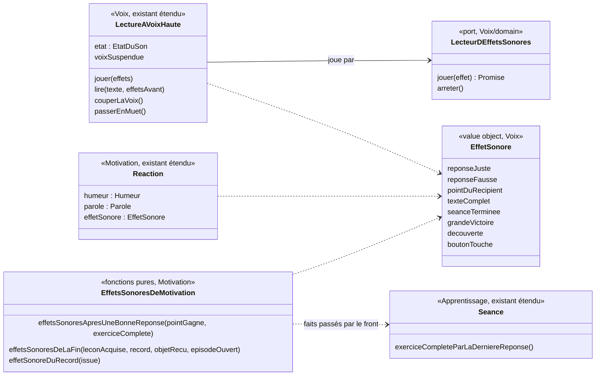

# Modèle du domaine : issue #97, retours animés et sonores pendant la séance

Contexte : **Motivation** (quel effet sonore pour quel fait d'Apprentissage) et **Voix** (sous-domaine générique : jouer un effet sonore, effet sonore avant la parole, rien en voix suspendue). Apprentissage publie une lecture de plus, l'**exercice complété** (décision 97.6), sans changer aucune règle de correction. Aucun agrégat, aucun événement enregistré, aucune migration, aucune Edge Function, aucune donnée d'enfant nouvelle.

État : **cadrage seulement**. #97 dépend de #96 (PR #124, non mergée) : aucun code avant son merge. Question 1 de l'issue réglée par le PO le 2026-10-25 (8 sons dans `public/sons/`, provenance `docs/sons.md`). Questions 97.2 à 97.19 réglées par le PO le 2026-10-28 (section « Réponses du PO ») ; deux écarts à la recommandation (97.2, 97.17) ouvrent les questions 97.20 à 97.24 (section « Questions nouvelles (escalade) »).

## Contexte

### Ce que le front sait déjà, et d'où il le sait

Tout se passe dans le navigateur, hors ligne compris. Chaque fait dont un retour a besoin est **déjà fourni par un domaine**, sauf l'exercice complété (ajouté par #97, décision 97.6) :

| Événement du catalogue (skill `gamification`, section 3) | D'où le front l'apprend aujourd'hui |
|---|---|
| Réponse juste, réponse fausse | `ResultatDeReponse` (`"juste" \| "fausse" \| "dejaEcartee"`) rendu par `Seance.repondre` / `Seance.taper` (dictée : seulement au mot complet), `SeanceDeRevision.repondre`, `TestDeDepart.repondre` (Apprentissage). Puis `reagirALaReponse(juste)` (Motivation) donne l'**humeur** (`applaudit` / `reflechit`) et la félicitation ou l'encouragement |
| Bonne réponse sans parole | `Seance.paroleDueApresLaDerniereReponse()` = `"applaudir"` (conjugaison) ou `undefined` (classer une fois sur deux) : le front appelle `montrerHumeur` sans rien dire (`useQuestionsAChoix`, `useEtiquettesAPlacer`) |
| Point dans le récipient | `Seance.avancement()` (`Avancement` : questions réussies sur total), lu après chaque réponse (`annoncerLAvancement`). En séance de révision et au **test de départ**, le front compte lui-même les questions réussies (`useDeroulementDuTestDeDepart`, `setQuestionsReussies`) |
| Texte complet | `Seance.texteCompleteParLaDerniereReponse()` (dernier trou d'un texte à trous, dernier mot d'un `memoriser`), puis `direLeTexteComplet` (Motivation) |
| Dernière étiquette d'un `ordre`, d'un `classer`, dernière personne d'une `conjugaison` | **Aucun fait nommé aujourd'hui** : le front lit `exercice.estReussi()` après le placement ; voisin : `conjugaisonCompleteParLaDerniereReponse()`. #97 nomme ce fait **exercice complété** (décision 97.6) |
| Séance terminée | `Seance.estFinie()`, puis `SeanceTerminee` (étoiles) à l'écran de fin (`EcranDeFin`, `useSauvegardeDeLaSeance`). Séance de révision : `SeanceDeRevisionTerminee`. Test de départ : `TestDeDepartTermine` (ce n'est pas une séance) |
| Record de fluence | `RecordDeFluence.proposer(score)` rend `IssueDuRecord` (`premierRecord`, `nouveauRecord`, `recordInchange`, `aucunRecord`), à la fin de la fluence (`useFluence`), avant `parolesDeFinDeFluence` |
| Leçon acquise, badge gagné | `leconAcquiseParLaSeance` (Apprentissage) puis `badgeGagneParLaSeance` (Motivation), à l'écran de fin (`NouveautesDeFin.badge`). La leçon acquise elle-même n'est pas dans `NouveautesDeFin` |
| Nouvel objet de la cabane, nouvel épisode | `objetRecuParLaSeance`, `episodeOuvertParLaSeance` (Motivation), à l'écran de fin (`NouveautesDeFin.objet`, `.episode`) |
| Bouton touché (#96) | Aucun fait métier : écoute globale des boutons dans `src/boutons/ressort-des-boutons.ts` (#96, muet) |

Le Muet vit dans **Voix** : `LectureAVoixHaute` garde l'`EtatDuSon` (`"son" \| "muet"`), refuse de lire en Muet ou en voix suspendue (écrans du parent, #73) et arrête la lecture en cours au passage en Muet. Le front le mémorise sur l'appareil (`memoire-du-son.ts`) et déverrouille l'audio au premier toucher (`deverrouillage-audio.ts`, contexte audio déjà prêt pour un fichier). **#97 ne change pas le Muet** : il coupe seulement la voix, pas les effets sonores (décision 97.2).

### Où vit la règle « quel son pour quel événement »

Trois sortes de décisions, trois places :

1. **Quel effet sonore pour quel fait** (réponse juste → « reponse-juste » ; exercice complété à la place du son de réponse juste ; à la fin, « grande-victoire » plutôt que « seance-terminee » si la leçon devient acquise ; « decouverte » s'il y a un objet ou un épisode) : c'est une **réaction à un fait d'Apprentissage**, proportionnée à l'importance du fait (« récompense proportionnée », skill section 2). C'est exactement le rôle de **Motivation**, qui décide déjà l'**humeur** du personnage guide (une animation : il saute, il se penche) à partir de « juste / fausse » (`reagirALaReponse`). L'effet sonore se range **à côté de l'humeur**, dans la même réaction. Le laisser dans React ferait écrire à React des priorités et des combinaisons (exercice complété contre réponse juste, leçon acquise contre séance terminée, ordre des sons de fin), donc des règles : contraire à « React ne contient aucune règle métier ».
2. **Comment un effet sonore se joue** (rien en voix suspendue ; joué en Muet comme en Son ; l'effet avant la parole, jamais par-dessus ; une nouvelle parole ou le silence arrête l'effet ; un effet qui échoue n'empêche jamais la parole) : ce sont les règles du **son de l'application**, aujourd'hui portées par `LectureAVoixHaute` (Voix), qui a déjà l'`EtatDuSon`, la voix suspendue et le port `LecteurAVoixHaute`. Les mettre ailleurs dédoublerait l'état du son. Voix reste générique : il ne connaît ni séance, ni réponse, ni récompense ; il joue un effet sonore nommé.
3. **Comment le montrer** (rebond, balancement de ±6 px, point qui vole, étincelles, étoiles une à une, confettis, compteur qui défile, durées, ressorts, mouvements réduits, annonce `aria-live` unique) et **quel fichier MP3 pour quel effet** : c'est de l'**affichage** et de l'**infrastructure**, dans `src/`. Le skill le dit : « le domaine dit **ce qui** est arrivé, le front choisit **comment** le montrer ». Même partage que #96 (`transitionVers` est dans `src/transitions/`).

Le **son du bouton touché** n'est pas une réaction à un fait : `src/` le demande directement à Voix (il se tait donc en voix suspendue), sans passer par Motivation.

### Communication entre contextes

- Apprentissage → Motivation : **appel dans le navigateur**, relation existante (« Motivation → Apprentissage, Customer/Supplier : paroles et humeur du personnage guide, #6 ») étendue à l'effet sonore. Motivation reçoit des faits sous une forme propre (booléens, nombres, `IssueDuRecord`), jamais un agrégat d'Apprentissage.
- Voix → Motivation : **Published Language**, comme `CaractereDeLaVoix` (#7, décision 0008) : Voix publie le type `EffetSonore` (la liste fermée des 8 effets choisis par le PO) et le port `LecteurDEffetsSonores` ; Motivation importe le type et choisit l'effet de chaque fait.
- Voix → Apprentissage, Motivation : appel existant, le front passe les effets à `LectureAVoixHaute` avec la parole.
- Fichiers de sons (`public/sons/`, mis en cache par le service worker) → Voix : **ACL** dans `src/voix/` (adaptateur `HTMLAudioElement`), comme la synthèse vocale du navigateur.

## Termes

| Terme | Statut |
|---|---|
| Réponse, Erreur, Avancement de la séance, Texte complet, Parole due, Séance terminée, Fin de la séance, Record de fluence, Leçon acquise, Badge gagné par la séance, Objet de la cabane, Épisode ouvert, Humeur du personnage guide, Félicitation, Encouragement, Relance, Muet, Voix suspendue, Parole entendue, Voix bloquée | existants, réutilisés tels quels |
| **Effet sonore** | nouveau (à valider), contexte Voix : ajouté en fin de section Voix du glossaire. Coupé par la voix suspendue, pas par le Muet (97.2, 97.13) |
| **Muet, précisé par #97** | précision (à valider), sans réécrire la ligne **Muet** : le Muet coupe **seulement la voix**, pas les effets sonores (décision 97.2) |
| **Exercice complété** | nouveau (à valider), contexte Apprentissage (décision 97.6) : la dernière réponse d'un exercice à plusieurs réponses sur le même écran (texte à trous, `ordre`, `classer`, `conjugaison`, `memoriser`) le complète. Élargit **Texte complet** sans le remplacer. Ajouté en fin de section Apprentissage du glossaire |
| Les 8 valeurs de l'effet sonore (`reponseJuste`, `reponseFausse`, `pointDuRecipient`, `texteComplet`, `seanceTerminee`, `grandeVictoire`, `decouverte`, `boutonTouche`) | noms des fichiers choisis par le PO ; ce sont des valeurs, pas des termes du glossaire. La valeur `texteComplet` (nom du fichier) se joue pour tout exercice complété |
| Célébration, retour, juice, confettis, étincelles | **mots d'interface** du skill, pas des termes du domaine : rien n'est ajouté |
| Bouton touché | événement d'interface (#96), pas un terme du domaine |

Synonymes à éviter dans le code et les scénarios : « bruitage », « SFX », « jingle » (seul), « sound ». Pour Muet : déjà « silencieux », « mute ». Pour Exercice complété : « exercice fini », « exercice terminé » (« terminé » est réservé à la séance).

## Modèle

Aucun agrégat : rien n'est enregistré, rien n'a de cycle de vie à protéger entre deux transactions. Un value object (Voix), des fonctions pures (Motivation), une extension de l'objet de lecture existant (Voix), un port, et une lecture de plus sur la séance (Apprentissage).

### Voix

- **`EffetSonore`** (value object, à valider) : un des 8 effets sonores de l'application, liste fermée. Une valeur hors de la liste n'existe pas (union de littéraux, pas de chaîne libre). Voix ne sait pas à quel fait il répond.
- **Port `LecteurDEffetsSonores`** (déclaré dans `voix/domain/`, comme `LecteurAVoixHaute`) : `jouer(effet)` se résout à la fin de l'effet, ou tout de suite s'il ne peut pas être joué ; `arreter()` coupe l'effet en cours. L'adaptateur du navigateur et le choix du fichier sont dans `src/voix/`.
- **`LectureAVoixHaute`** reçoit le lecteur d'effets sonores dans ses dépendances et gagne :
  - `jouer(effets)` : joue une suite d'effets sonores sans parole (bonne étiquette sans félicitation, point du récipient, bouton touché) ;
  - une option de `lire(texte, { effetsAvant })` : joue les effets, puis lit la parole. **En Muet**, les effets sont joués et la parole ne l'est pas (décision 97.2).
  - `passerEnMuet()` arrête la parole en cours, **pas** l'effet sonore en cours (conséquence de 97.2, à confirmer : question 97.24).
- Pas d'erreur métier nouvelle : un effet qui ne peut pas être joué (fichier absent, audio refusé) est absorbé, comme `LectureImpossible`.

### Motivation

- **`Reaction`** (existant) reçoit `effetSonore` : `reponseJuste` si juste, `reponseFausse` (son doux) si fausse (décision 97.4). `ReactionAJeNeSaisPas` n'en reçoit pas (décision 97.11) ; le bouton « Je ne sais pas » fait entendre « bouton touché », demandé par `src/` (décision 97.19).
- **`effetsSonoresApresUneBonneReponse`** : à partir de « un point est entré dans le récipient » et « la réponse complète l'exercice » (exercice complété, décision 97.6), rend la suite ordonnée des effets : `texteComplet` à la place de `reponseJuste` pour un exercice complété, puis `pointDuRecipient` si un point est gagné (décision 97.5). Le fait « point gagné » se calcule par la comparaison des questions réussies avant et après la réponse (`Avancement` publié par Apprentissage), passée sous forme de nombres. En fluence, jamais de `pointDuRecipient` pendant le chrono (décision 97.10).
- **`effetsSonoresDeLaFin`** : à partir de la leçon acquise par la séance, du record de fluence de la séance (séance faite seulement d'une fluence, décision 97.18), de l'objet de la cabane reçu et de l'épisode ouvert (déjà calculés par `leconAcquiseParLaSeance`, `objetRecuParLaSeance`, `episodeOuvertParLaSeance`), rend au plus deux effets : `grandeVictoire` ou `seanceTerminee`, puis `decouverte` (décisions 97.7, 97.9, 97.18). Test de départ : `seanceTerminee` seul.
- **`effetSonoreDuRecord`** : `grandeVictoire` pour un premier record ou un nouveau record (décision 97.8), aucun sinon ; joué une seule fois, à la fin de la fluence.
- Aucun hasard : un fait donne toujours le même effet sonore (le port `Hasard` n'est pas utilisé).

### Apprentissage

Une lecture de plus sur `Seance` (et `ExerciceJoue`) : **`exerciceCompleteParLaDerniereReponse()`**, « la dernière réponse complète l'exercice », pour les exercices à plusieurs réponses sur le même écran (texte à trous, `ordre`, `classer`, `conjugaison`, `memoriser`) (décision 97.6). Elle généralise `texteCompleteParLaDerniereReponse` et `conjugaisonCompleteParLaDerniereReponse` sans les retirer (elles portent des paroles différentes). Aucune règle de correction ne change.

### Commandes et événements

Pas de commande métier ni d'événement de domaine : jouer un son n'est pas un fait métier, rien n'est enregistré ni revalidé par le serveur. Les faits déclencheurs sont ceux qui existent déjà (`ResultatDeReponse`, `Avancement`, `SeanceTerminee`, `SeanceDeRevisionTerminee`, `TestDeDepartTermine`, `IssueDuRecord`, leçon acquise, objet reçu, épisode ouvert) et la lecture « exercice complété ».

## Invariants

**Voix (`LectureAVoixHaute`)**
1. Le **Muet ne coupe que la voix** : en Muet, les effets sonores sont joués comme en Son, la parole ne l'est pas (décision 97.2). Passer en Muet arrête la parole en cours, pas l'effet sonore en cours (question 97.24). Il n'y a pas de réglage séparé pour les effets sonores.
2. En **voix suspendue** (écrans du parent, #73), aucun effet sonore n'est joué, en Muet comme en Son ; arriver sur un écran du parent arrête l'effet sonore en cours (décision 97.13). Cohérent avec 97.2 : la voix suspendue n'est pas le Muet, c'est l'état des écrans du parent qui promet « aucun son » (#73) ; elle ne change jamais le choix Son/Muet.
3. **Un effet sonore et une parole ne se chevauchent jamais** : la parole commence quand les effets demandés avec elle sont finis ; deux effets d'une même suite se jouent l'un après l'autre. L'ordre « effet avant la parole » reste en Muet (il n'y a alors pas de parole).
4. Une nouvelle lecture, `couperLaVoix` ou `faireSilence` arrête l'effet sonore en cours, comme la parole (une réponse rapide ne laisse pas deux sons se superposer).
5. Un effet sonore qui ne peut pas être joué **n'empêche jamais la parole**, ne la retarde pas au-delà de sa durée, et ne signale pas la voix bloquée. Quand la voix est bloquée ou que le navigateur ne sait pas lire à voix haute, les effets sonores sont joués quand même ; avec les mouvements réduits aussi (décision 97.14). Seule la voix suspendue les coupe.
6. Les effets sonores ne changent pas la **parole entendue** : l'attente avant l'écran suivant (`attenteAvantLEcranSuivant`, #79) reste fondée sur la seule parole, en Muet compris (durée d'affichage sans voix inchangée).

**Motivation**
7. Une réponse juste a toujours un effet sonore, même quand le personnage guide ne dit rien (`applaudir`, classer une fois sur deux) : jamais de silence après un geste (skill, section 2), hors voix suspendue.
8. Le son d'une réponse fausse est doux et bref, jamais un buzzer (décision 97.4) ; « Je ne sais pas » n'a pas de son d'erreur (décisions 97.11, 97.19).
9. Un fait plus grand **remplace** le son du fait plus petit qu'il contient : l'exercice complété remplace la réponse juste ; la leçon acquise remplace la séance terminée ; le record remplace la séance terminée d'une séance faite seulement d'une fluence, et n'est joué qu'une fois (décisions 97.5, 97.7, 97.18).
10. Les effets de la fin durent moins de 2 s en tout (`seance-terminee` 1,36 s ou `grande-victoire` 1,20 s, puis `decouverte` 0,47 s) ; « découverte » une seule fois, même avec un objet et un épisode (décision 97.7).
11. Un effet sonore ne change ni étoile, ni avancement, ni résultat de la leçon, ni record (règle d'or de Motivation).

**Contenu (règle absolue de `CLAUDE.md`)**
12. Aucun effet sonore effrayant, agressif ou moqueur. Les 8 fichiers sont des sons d'interface sans voix ni parole (Kenney, CC0), choisis à l'écoute par le PO ; tout nouveau son suit `docs/sons.md` (licence vérifiée, écoute du PO).

## Événements

Aucun événement de domaine nouveau. Événements et faits existants qui déclenchent un effet sonore :

| Fait existant (contexte) | Effet sonore | Décision |
|---|---|---|
| `ResultatDeReponse` = `juste` (Apprentissage) | `reponseJuste` | 97.5 |
| `ResultatDeReponse` = `fausse` | `reponseFausse` (son doux) | 97.4 |
| `dejaEcartee`, « Je ne sais pas » | aucun son de réponse ; le bouton « Je ne sais pas » fait entendre `boutonTouche` | 97.11, 97.19 |
| Questions réussies : avant < après | `pointDuRecipient`, après le son de la réponse ; jamais pendant le chrono d'une fluence | 97.5, 97.10 |
| Exercice complété (texte à trous, `ordre`, `classer`, `conjugaison`, `memoriser`) | `texteComplet` à la place de `reponseJuste` | 97.5, 97.6 |
| `IssueDuRecord` = `premierRecord` ou `nouveauRecord` | `grandeVictoire`, avant la phrase de fin de la fluence, une seule fois | 97.8, 97.18 |
| Séance terminée, séance de révision terminée, test de départ terminé | `seanceTerminee`, ou `grandeVictoire` si la leçon devient acquise (jamais au test de départ) | 97.7, 97.9 |
| Objet de la cabane reçu, épisode ouvert par la séance | `decouverte`, après le son de fin (pas au test de départ) | 97.7, 97.9 |
| Bouton touché d'un écran de l'enfant qui ne donne pas de réponse (interface, #96) | `boutonTouche`, demandé par `src/` ; pas au bouton Son/Muet, jamais sur un écran du parent | 97.12, 97.13 |

## Partage avec le front

Tout est dans le navigateur, hors ligne compris : `@domain/voix` exporte `EffetSonore` et le port `LecteurDEffetsSonores` ; `@domain/motivation` exporte les fonctions d'effets sonores et la `Reaction` étendue ; `@domain/apprentissage` expose la lecture « exercice complété » par `Seance`. Les 8 fichiers sont ajoutés à la coquille du service worker (`public/sw.js`, #8) pour être joués hors ligne.

## Ce qui reste dans `src/` (affichage et infrastructure, sans règle)

- Adaptateur `LecteurDEffetsSonores` du navigateur (`src/voix/`) : un `HTMLAudioElement` par effet, préchargé ; table effet → `/sons/<fichier>.mp3` ; résolution à la fin, à l'erreur ou après une garde de durée ; il passe par le `DeverrouillageAudio` existant (iPhone, iPad).
- `useVoix` expose `jouer` ; `usePersonnageQuiParle.dire` accepte les effets à jouer avant la parole ; `montrerHumeur` s'accompagne de `jouer`.
- Les animations du catalogue (rebond, balancement, point qui vole, étincelles, étoiles une à une, confettis, compteur qui défile), en Motion, sur `transform` et `opacity`, avec les durées et ressorts des jetons de #96, sans modifier `src/univers/jetons.ts`, `src/transitions/`, `src/boutons/ressort-des-boutons.ts` ni `motivation/domain/univers.ts` (couloir de #96).
- Confettis aussi à la fin de la séance de révision et du test de départ, sans étoiles (décision 97.16).
- Le son du bouton touché : un écouteur à part de `ressort-des-boutons.ts` (même registre `data-registre`, pour se taire dans les écrans du parent), qui demande `boutonTouche` à Voix.
- Mouvements réduits : les étoiles s'affichent sans animation, sans confettis ; « Tu as gagné <n> étoile(s) » annoncé une seule fois, quand toutes les étoiles sont affichées ; aucune annonce de plus sans étoile (décision 97.15).
- Pendant la célébration de la fin, **un toucher ne fait rien** : il n'arrête ni les confettis ni le son de fin (décision 97.17). Ce que fait un bouton touché pendant la célébration est en escalade (97.22) ; le clavier n'est jamais bloqué (règle de `CLAUDE.md`).
- Les animations des personnages guides restent pour #106 ; #97 ne change pas les humeurs.

Remarque pour l'implémentation : au test de départ, le front compte lui-même les questions réussies (`setQuestionsReussies`). Le point gagné doit s'y lire comme ailleurs (questions réussies avant et après), sans ajouter de comptage dans React.

## Données d'enfants

Aucune donnée nouvelle. Le Muet reste une préférence de l'**appareil** (existant). Rien n'est enregistré, rien n'est envoyé au serveur ni à l'IA, aucun service tiers (les sons sont servis par l'application elle-même).

## Emplacement

Après le merge de #96 seulement :

- `supabase/functions/_shared/voix/domain/effet-sonore.ts` : `EffetSonore`
- `supabase/functions/_shared/voix/domain/lecteur-d-effets-sonores.ts` : port `LecteurDEffetsSonores`
- `supabase/functions/_shared/voix/domain/lecture-a-voix-haute.ts` : `jouer`, option `effetsAvant` (existant étendu) ; tests dans `lecture-a-voix-haute_test.ts` ou un nouveau `effets-sonores_test.ts`
- `supabase/functions/_shared/voix/domain/index.ts` : exports
- `supabase/functions/_shared/voix/test_utils/lecteur-d-effets-sonores-en-memoire.ts` : fake du port (il note les effets joués et l'ordre avec les paroles du `lecteur-en-memoire.ts`)
- `supabase/functions/_shared/motivation/domain/effets-sonores.ts` (+ `_test.ts`) : `effetsSonoresApresUneBonneReponse`, `effetsSonoresDeLaFin`, `effetSonoreDuRecord`
- `supabase/functions/_shared/motivation/domain/reaction.ts` : `effetSonore` dans `Reaction` (existant étendu)
- `supabase/functions/_shared/motivation/domain/index.ts` : exports
- `supabase/functions/_shared/apprentissage/domain/seance.ts` et `exercice-joue.ts` : lecture « exercice complété » (décision 97.6), avec leurs tests
- Front : `src/voix/` (adaptateur, `useVoix`), `src/seance/` (déroulement, récipient, fin), `src/revision/`, `src/test-de-depart/`, un écouteur de son des boutons, `public/sw.js`

## Réponses du PO (2026-10-28)

Réponse relayée par le responsable (commentaire 6464291037 de l'issue #97) : « 97.2 bouton muet coupe que la voix  97.3 non 97.4 son doux 97.5 reco 97.6 reco 97.10  reco 97.11 reco 97.19  reco 97.7  reco 97.8  reco 97.9 reco 97.16 oui 97.17 rien 97.18 reco 97.12 reco 97.13 reco 97.14 reco 97.15 reco ». Les questions 97.15 à 97.19 sont dans `docs/stories/97/acceptance.md`.

| Question | Réponse | Effet sur le modèle |
|---|---|---|
| 97.2 Réglage « effets sonores » séparé, ou seulement le Muet ? | **Écart à la reco** : le Muet coupe **seulement la voix** ; pas de réglage séparé | Invariant 1 réécrit : en Muet, effets sonores joués, parole non lue. Seule la voix suspendue coupe les effets (invariants 2, 5, 7). Glossaire : note « Muet, précisé par #97 » corrigée. Questions 97.20, 97.21, 97.24 |
| 97.3 Vibration ? | Non (= reco) | Rien : pas de vibration, pas de terme |
| 97.4 Son de réponse fausse ? | Son doux (= reco) | `Reaction.effetSonore` = `reponseFausse` (invariant 8) |
| 97.5 Ordre son de réponse, « pop », parole ; le son du texte complet remplace celui de la réponse juste ? | Reco : oui aux deux | `effetsSonoresApresUneBonneReponse` (invariants 3, 9) |
| 97.6 Son « texte complet » pour `classer`, `conjugaison`, `memoriser` aussi ? | Reco : oui | Terme **Exercice complété (à valider)** ; lecture `exerciceCompleteParLaDerniereReponse` sur `Seance` (Apprentissage) |
| 97.7 Au plus deux sons de fin : « grande-victoire » ou « seance-terminee », puis « decouverte » ? | Reco : oui | `effetsSonoresDeLaFin` (invariants 9, 10) |
| 97.8 Record : « grande-victoire », premier record compris ? | Reco : oui et oui | `effetSonoreDuRecord` |
| 97.9 Fin de la séance de révision et du test de départ : « seance-terminee » ? | Reco : oui ; test de départ sans « grande-victoire » ni « decouverte » | `effetsSonoresDeLaFin` |
| 97.10 Sons pendant le chrono d'une fluence ? | Reco : oui, sans « pop » | Pas de `pointDuRecipient` pendant le chrono ; invariant 4 |
| 97.11 « Je ne sais pas » joue-t-il un son d'erreur ? | Reco : non | `ReactionAJeNeSaisPas` sans effet sonore (invariant 8) |
| 97.12 Quels boutons jouent « bouton-touche » ? | Reco : boutons des écrans de l'enfant qui ne donnent pas de réponse ; pas le bouton Son/Muet ; aucun sur les écrans du parent | Dans `src/` (écouteur à part) |
| 97.13 Aucun effet sonore sur un écran du parent ? | Reco : oui, aucun | Invariant 2 (inchangé, désormais seul à couper les effets) |
| 97.14 Effets sonores quand la voix manque, et avec mouvements réduits ? | Reco : oui dans les trois cas | Invariant 5 |
| 97.15 Annonce aux lecteurs d'écran | Reco : « Tu as gagné <n> étoile(s) », une fois ; rien sans étoile | Dans `src/` |
| 97.16 Confettis à la fin de la séance de révision et du test de départ ? | Oui (= reco) | Dans `src/`. La reco disait « passés d'un toucher » : remplacé par 97.17 |
| 97.17 Que fait un toucher pendant la célébration ? | **Écart à la reco** : **rien** ; il n'arrête ni les confettis ni le son de fin | Dans `src/` (aucune règle de domaine). Contredit le texte de l'issue et le skill : questions 97.22, 97.23 |
| 97.18 Effet de fin d'une séance faite seulement d'une fluence ? | Reco : « grande-victoire » s'il y a un record (une seule fois), sinon « seance-terminee » ; puis « decouverte » | `effetsSonoresDeLaFin` reçoit le record (invariant 9) |
| 97.19 « Je ne sais pas » puis la bonne réponse : quels sons ? | Reco : « bouton touché », puis « réponse juste » (et « pop ») | Événements ; invariant 8 |

## Questions nouvelles (escalade)

Soulevées par les deux écarts à la reco (97.2 et 97.17). Non tranchées : le modèle ci-dessus applique les réponses du PO telles quelles et ne suppose rien de plus.

**#97.20 Avec 97.2, plus rien dans l'application ne coupe les effets sonores (hors écrans du parent). Est-ce voulu, et garde-t-on le mot « Muet » pour un bouton qui laisse entendre des sons ?**
Exemple : Léa joue dans une salle d'attente ; son parent passe la tablette en Muet ; « ding », « pop » et les sons de fin se font toujours entendre.
Reco : **oui, accepter pour cette story** : le volume de l'appareil coupe tout, les effets sont courts (moins de 2 s pour les plus longs) et le PO n'a pas demandé de réglage séparé. Noter dans la feuille de route une story possible « Effets sonores : oui / non » dans les réglages du parent, si un parent la demande. Et **garder « Muet »** (terme du glossaire, des scénarios de #7, #12, #15, #33, #58, #65, #73, #79 et de l'interface), en précisant sa définition (« coupe la voix du personnage guide ») à la validation du glossaire. Renommer coûterait une reprise de nombreux scénarios pour un gain faible ; si le PO veut un mot plus juste, une story à part.

**#97.21 Des scénarios écrits disent « En Muet, Léa n'entend rien » là où #97 ajoute maintenant « bouton touché » : faut-il les reformuler ?**
Cas touchés : `79-consigne-visible-pendant-l-exercice.feature` (« En Muet, demander à relire la consigne ne fait rien entendre », Léa touche « Réécouter »), `65-ecran-mes-medailles.feature` (« En Muet, rien n'est lu sur l'écran… », Léa ouvre « Mes médailles »), `33-episodes-de-l-histoire.feature` (« En Muet, l'épisode s'affiche sans être lu », Léa choisit une tuile). Les autres (« la question s'affiche » de #7, #12, #58, #73, #79) ne touchent aucun bouton et restent justes ; `15-choix-de-la-voix.feature` est sur un écran du parent (voix suspendue). Les scénarios de #97 sont déjà alignés sur 97.2 (`acceptance.md`, R5). Le texte de l'issue, lui, dit encore « Le passage en Muet coupe aussi les effets sonores » et « En Muet, aucun son ni aucune parole ».
Reco : **oui, reformuler sans changer le sens** : écrits avant #97, ces « n'entend rien » vérifiaient la voix ; ils deviennent « n'entend aucune voix » (étape déjà utilisée par #73), dans la story #97, par `po-acceptance`. Le PO corrige le texte de l'issue.

**#97.22 Avec 97.17, un bouton touché pendant la célébration (« Accueil », « Leçon suivante », « Rejouer ») agit-il tout de suite ?**
Reco : **oui** : « rien » vise le toucher hors des boutons ; les boutons restent affichés et utilisables pendant toute la célébration, sinon l'enfant est retenu jusqu'à 2 s, ce que le skill interdit (« une célébration ne bloque jamais »). Si le bouton change d'écran, le son de fin s'arrête avec la parole (invariant 4).

**#97.23 97.17 contredit l'issue (« Une célébration se passe d'un toucher », critère « Toucher l'écran pendant les confettis passe la célébration ») et le skill `gamification` (section 2 : « un toucher la passe » ; checklist : « Une célébration se passe d'un toucher »). Lequel corrige-t-on ?**
Reco : **suivre la réponse du PO** et reformuler la règle en « une célébration ne retient jamais l'enfant : elle dure 1,5 s au plus, et ses boutons et le clavier restent utilisables » ; le PO corrige l'issue, le responsable fait corriger le skill (hors de ce cadrage). Le scénario de #97 est déjà réécrit (« Toucher l'écran en dehors des boutons pendant les confettis ne change rien »). La même règle vaut pour les confettis de la séance de révision et du test de départ (97.16).

**#97.24 Passer en Muet pendant un effet sonore : l'effet finit-il, et seule la voix s'arrête ?**
Exemple : « séance terminée » joue (1,36 s) ; Léa touche Muet à 0,5 s.
Reco : **oui, l'effet finit, la parole qui suit n'est pas lue** : c'est la suite logique de 97.2, et l'effet est court. C'est déjà ce que décrit le scénario « Passer en Muet pendant l'effet sonore de fin le laisse finir, sans phrase de fin dite » : à confirmer par le PO, car 97.2 ne le dit pas.

## Questions posées au cadrage (réglées le 2026-10-28)

Texte d'origine, gardé pour la trace. Réponses dans la section « Réponses du PO ».

**#97.2 Un réglage « effets sonores » séparé de la voix, ou seulement le Muet actuel ?**
Reco d'origine : seulement le Muet, qui couperait tout le son. Réponse : le Muet coupe seulement la voix.

**#97.3 Faut-il une vibration (sur téléphone) pour une réponse juste ?** Reco : non. Réponse : non.

**#97.4 Le son d'une réponse fausse : un son doux, ou aucun son du tout ?** Reco : un son doux, `reponse-fausse.mp3` (0,37 s). Réponse : son doux.

**#97.5 Après une bonne réponse qui fait gagner un point, l'ordre est-il : son de la réponse juste, puis « pop » du point, puis la félicitation ? Le son du texte complet remplace-t-il celui de la réponse juste ?** Exemple : dernier trou d'un texte à trous → « texte-complet » (0,55 s), « pop » (0,24 s), puis « Bravo ! Le texte est complet ! ». Reco : oui aux deux.

**#97.6 Le son « texte complet » vaut-il aussi pour la dernière étiquette de `classer`, la dernière personne de `conjugaison` et le dernier mot de `memoriser` ?** Reco : oui, pour tous les exercices à plusieurs réponses sur le même écran, avec le terme Exercice complété.

**#97.7 À la fin d'une séance, au plus deux sons avant la parole de fin : « grande-victoire » si la leçon devient acquise (sinon « seance-terminee »), puis « decouverte » s'il y a un nouvel objet de la cabane ou un nouvel épisode ?** Reco : oui ; une leçon acquise sans nouveau badge garde « grande-victoire » ; une leçon personnelle acquise aussi.

**#97.8 Un record de fluence joue-t-il « grande-victoire », juste avant la phrase de fin de la fluence ? Le premier record compte-t-il ?** Reco : oui, et oui pour le premier record (0 n'est jamais un record) ; le « roulement et cymbale » du catalogue est remplacé.

**#97.9 La fin de la séance de révision et la fin du test de départ jouent-elles aussi « seance-terminee » (et « decouverte » si la séance de révision ouvre un épisode) ?** Reco : oui ; le test de départ n'a que le son de fin.

**#97.10 Pendant le chrono d'une fluence, chaque calcul juste joue-t-il « reponse-juste » et chaque calcul faux « reponse-fausse » ?** Reco : oui, sans « pop » ; un nouveau calcul coupe le son du précédent.

**#97.11 « Je ne sais pas » joue-t-il un son ?** Reco : non (pas de son d'erreur ; voir 97.19 pour le bouton).

**#97.12 Quels boutons jouent « bouton-touche » ?** Reco : les boutons des écrans de l'enfant (navigation, « Continuer », « Réécouter », touches du clavier de la dictée et du clavier de cristaux), pas ceux qui donnent une réponse, aucun dans les écrans du parent, pas le bouton Muet lui-même.

**#97.13 Sur un écran du parent (voix suspendue, #73), aucun effet sonore n'est-il joué ?** Reco : oui, aucun.

**#97.14 Quand l'appareil ne sait pas lire à voix haute, ou que la voix est bloquée, les effets sonores se jouent-ils quand même ? Et avec mouvements réduits ?** Reco : oui dans les trois cas ; un effet qui échoue ne fait pas apparaître le message de voix bloquée.

**#97.15 à #97.19** : voir `docs/stories/97/acceptance.md`.
