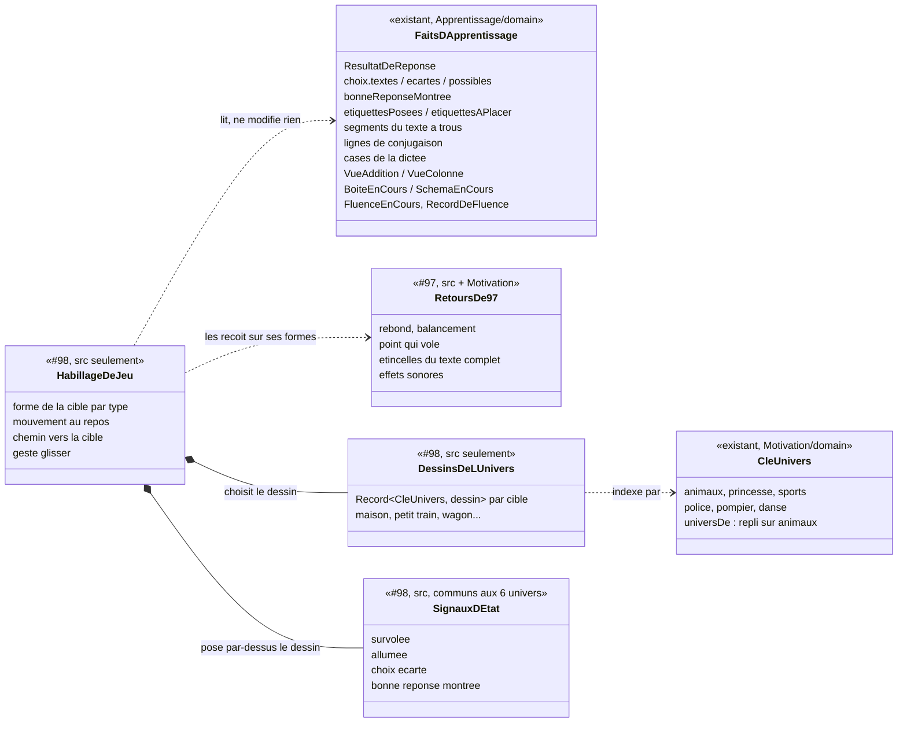

# Modèle du domaine : issue #98, des exercices qui ressemblent à des jeux

Épopée #95, story 3. Dépend de #97 (retours animés et sonores), qui dépend de #96 (refonte visuelle, PR #124).

État : **cadrage repris, à valider de nouveau** (décision 0020). #96 et #97 sont mergées et intégrées dans la branche : le code peut commencer **après** la validation de ce cadrage repris.

Historique :
- 2026-10-28 : cadrage validé par le PO (« 98# reco partout ») : questions 98.1 à 98.24 tranchées selon la reco, découpage 98a à 98e validé (issues #126 à #129 créées par le PO).
- 2026-10-28, plus tard : nouvelles réponses du PO aux 4 questions de l'issue (commentaires du responsable 6478159395 et 6478171371). Elles remplacent la reco là où elles diffèrent :
  - 98.1 : « OK » (reco confirmée) ;
  - **98.2 : « PAR UNIVERS »** (la reco était « par type ») : chaque type d'exercice a un dessin différent dans chacun des 6 univers ;
  - 98.3 : « LES BULLES DOIVENT BOUGER MAIS LEGEREMENT » (reco confirmée) ;
  - 98.10 : « A on garde le chrono » (reco confirmée).
- Ce qui change dans ce cadrage : la section « Habillage par univers », les invariants 14 à 20, la section « Validation des dessins par le PO », le « Découpage révisé » et les questions 98.25 à 98.31. Le reste du modèle ne change pas.

## Contexte

### Aucun contexte nouveau, aucun agrégat nouveau

La story change **seulement l'affichage** des 14 types d'exercices pendant une séance. C'est la promesse de l'issue : « la correction, les erreurs, « Je ne sais pas », l'aide et les étoiles restent celles du domaine ». Le skill `gamification` (section 4, « Exercices plus jeu ») le dit aussi : ces variantes « ne changent que l'affichage ; la règle de correction reste celle du domaine ».

Conséquences :
- **Apprentissage** reste la source de chaque fait montré : réponse juste ou fausse, choix écarté, bonne réponse montrée, placement, trou rempli, forme de conjugaison écrite, chiffre écrit d'une colonne, retenue, score de fluence, record de fluence. Aucune règle de correction ne change. Aucun agrégat (`Seance`, `SeanceDeRevision`, `TestDeDepart`, `RecordDeFluence`) ne gagne d'état.
- **Motivation** garde l'humeur, les paroles et, avec #97, l'effet sonore. #98 n'y ajoute rien.
- **Catalogue pédagogique** ne change pas : le format des leçons (`docs/format-lecons.md`) reste le même, aucun champ « habillage ».
- **Voix** ne change pas.
- Tout se passe dans `src/` : dessins SVG dans le code (décision 0027), animations Motion, gestes. Le domaine dit **ce qui** est arrivé, le front choisit **comment** le montrer (skill, section 3).
- Avec 98.2 = « PAR UNIVERS », le front lit aussi la **clé d'univers** (`CleUnivers`, Motivation) pour choisir le dessin de chaque cible. Il la reçoit déjà : l'écran de séance reçoit l'`Univers` du profil (`EcranDeSeance`, prop `univers`). Aucune relation nouvelle entre contextes : la context map ne change pas.

Il n'y a donc **ni commande, ni événement de domaine, ni erreur métier, ni migration, ni Edge Function, ni donnée d'enfant nouvelle**.

Trois exceptions possibles, chacune soumise au PO (voir « Faits du domaine manquants ») :
1. montrer le record de fluence **pendant** la fluence et marquer le moment où le score le dépasse (question 98.10) ;
2. permettre de **glisser** une étiquette d'un `ordre`, ce qui change l'**Indication du geste**, texte fourni par Apprentissage (question 98.8) ;
3. allumer une case de la dictée **parce que la lettre est juste**, avant la fin du mot : le domaine ne le sait pas, et le dire changerait les erreurs (question 98.7, reco : non).

### Répartition avec #96 et #97

| Ce qui est montré | Propriétaire | #98 |
|---|---|---|
| Couleur principale de l'univers, polices, jetons de design, boutons en relief qui s'enfoncent, transitions entre écrans, paysage et dessin fixe du personnage guide | #96 | Utilise les jetons. Ne touche ni `src/univers/jetons.ts`, ni `src/transitions/`, ni `src/boutons/ressort-des-boutons.ts` |
| Effets sonores (8 sons), rebond d'une réponse juste, balancement d'une réponse fausse, point qui vole vers le récipient, étincelles du texte complet (dernier trou, dernière étiquette d'un `ordre`, et selon 97.6 dernière étiquette de `classer`, dernière personne de `conjugaison`), confettis et étoiles une à une à la fin, compteur qui défile pour un record de fluence, étiquette posée dans la mauvaise maison qui revient avec « réponse fausse », mouvements réduits de ces retours, son « bouton touché » | #97 | **Ne redéfinit aucun de ces retours.** Il les reçoit sur ses nouvelles formes (une bulle, un wagon, un panier rebondissent comme un choix) |
| Animations des personnages guides (danse, badge qui tourne), nouveaux paysages par univers (réponse 96.10) | #106 | Rien. Les dessins de #98 ne reprennent pas le décor du paysage |
| Forme de chaque cible de réponse (bulle, wagon, maison, case, cristal, jauge, parchemin) **dans chacun des 6 univers** (98.2), son mouvement propre au repos, le chemin d'un objet vers sa cible (mot qui rejoint son trou, wagon qui s'accroche, jeton qui tombe, retenue qui saute), le geste glisser au doigt | — | **#98** et ses tranches |

### Recouvrements repérés entre le tableau de l'issue et #97

| Piste de #98 | Ce que #97 fait déjà | Répartition proposée |
|---|---|---|
| `bulles`, `ecoute` : « la bonne éclate en étincelles » | R1 : la réponse juste **rebondit** (1 → 1,15 → 1) avec « réponse juste ». R2 : les étincelles sont réservées au **texte complet** (récompense « moyenne »). Le code fait déjà disparaître la bulle choisie (`data-eclatee` : elle grandit et s'efface) | #97 garde le rebond et le son. #98 dessine la bulle et, **après** le rebond, la fait disparaître en douceur (comportement actuel, redessiné). **Pas d'étincelles pour une simple réponse juste** : elles perdraient leur sens de « j'ai fini l'ensemble » (question 98.5) |
| `dictee` : « le mot complet fait un feu d'artifice » | Un mot dicté juste est une réponse juste (rebond, « réponse juste », point qui vole). La dictée n'est pas un exercice « texte complet » dans #97 | Pas de célébration propre au mot : la récompense resterait disproportionnée (une par mot) et un feu d'artifice évoque des détonations qui peuvent inquiéter un jeune enfant. #98 propose : les cases s'illuminent l'une après l'autre quand le mot est juste (question 98.7) |
| `calcul`, `fluence` : « la fluence devient une course contre soi-même (record) » | R4 : à la **fin** de la fluence, le compteur défile jusqu'au nouveau record et « grande victoire » se fait entendre | #97 garde la fête **de fin**. #98 ne pourrait ajouter que ce qui se voit **pendant** la fluence (le record montré comme une marque à atteindre), sans son ni célébration en cours (question 98.10) |
| `classer` : « glisser dans le mauvais panier la fait revenir doucement, avec l'encouragement » | Scénario « Une étiquette posée dans la mauvaise maison fait entendre « réponse fausse » et revient » ; #18 fait déjà revenir l'étiquette parmi les étiquettes à placer | #97 et #18 gardent le **fait** (elle revient) et le son ; l'encouragement est celui de Motivation (#18). #98 ne possède que le **chemin** du retour : après un glisser, l'étiquette revient en glissant jusqu'à sa place, au lieu de réapparaître d'un coup |
| `ordre` : « des wagons d'un petit train qui avance » | R2 : la dernière étiquette d'un `ordre` fait pleuvoir des étincelles avec « texte complet » | #98 dessine les wagons et le train qui avance d'un wagon à chaque bon placement ; les étincelles de la dernière étiquette restent celles de #97 |
| `addition` : « la retenue saute d'une maison à l'autre » | Rien | #98 seul. Le code montre déjà la retenue qui monte (`data-mouvement="monte"`, aucun avec mouvements réduits) : #98 la redessine en saut |
| `trous`, `conjugaison` : « le mot juste tombe dans le trou et s'illumine » | R1 : le choix juste rebondit ; R2 : étincelles au dernier trou | Le choix juste rebondit (#97), **puis** rejoint son trou et s'y illumine (#98). Les étincelles du dernier trou restent à #97 |
| Mouvements réduits | R6 : pour les retours et célébrations | #98 couvre seulement ses propres mouvements (flottement, chemin d'un objet, train, saut de la retenue, jauge, parchemin) |

## Ce que chaque type d'exercice montre aujourd'hui

Lecture de `src/seance/exercices/` et du domaine. « Fait » : ce que le domaine fournit déjà au front. « Manque » : un fait dont la piste a besoin et que le domaine ne donne pas.

**Remarque transversale** : `ChoixDeLaQuestion` (les « bulles de choix ») sert à 10 types sur 14 : `bulles`, `ecoute`, `lecture`, `trous`, `conjugaison`, les mots cachés de `memoriser`, et le **mode de réponse par choix** de `calcul`, `boite`, `barres` et de l'étape calculer d'`addition` (CP, ou réponse de 20 au plus). Changer la bulle change donc ces 10 écrans (question 98.4).

| Type | Geste actuel | Retour actuel (hors #97) | Piste de l'issue | Fait du domaine | Alternative clavier | Mouvements réduits | Risque 44 px |
|---|---|---|---|---|---|---|---|
| `bulles` | Toucher une bulle de choix | Choix écarté pâle ; bonne réponse montrée qui brille (`data-brille`) ; bulle juste qui grandit et s'efface (`data-eclatee`) | Bulles qui flottent ; la bonne éclate en étincelles | Existe : `ResultatDeReponse`, `choix.textes()` (ordre fixé par le domaine), `ecartes()`, `bonneReponseMontree` | Tab entre les bulles, Entrée ; le focus va déjà au premier choix possible | Bulles immobiles (issue) ; la bulle juste s'efface en fondu | **Élevé** : une cible qui bouge est plus dure à toucher au CP (98.3) |
| `ecoute` | Bouton « Écouter », puis toucher une bulle | Comme `bulles` ; message quand le son manque | Comme `bulles` | Existe | Comme `bulles` | Comme `bulles` | Comme `bulles` |
| `lecture` | « J'ai écouté », puis bulles | Texte entier, mot prononcé surligné (`TexteSurligne`) | Le texte se dévoile ligne après ligne comme un parchemin | Existe : `rangDuMotPrononce` (Voix). Aucun fait « ligne lue » : la ligne se déduit du mot prononcé, à l'affichage | Rien de nouveau : le texte n'est pas une cible | Texte entier tout de suite | Faible ; risque de **lisibilité** : un texte caché ne se relit pas pour répondre (98.12) |
| `memoriser` | « Je suis prêt », puis ordre des vers (étiquettes) et mots cachés (bulles) | Vers lu mis en avant (`data-lu`) | Parchemin (vers après vers) | Existe : `versLu` ; `texteCompleteParLaDerniereReponse` (#97) | Comme `ordre` et `bulles` | Vers tous visibles | Comme `ordre` et `bulles` |
| `classer` | Glisser (HTML5, à la souris dans les scénarios) **ou** toucher l'étiquette puis la maison, ou clavier | Bon placement : l'étiquette reste dans la maison ; mauvais : elle revient ; maison qui brille après « Je ne sais pas » | Glisser dans des paniers ou des coffres qui s'ouvrent | Existe : placement juste ou faux par étiquette (`etiquettesPosees`, `etiquettesAPlacer`), groupe visé par « Je ne sais pas » | Existe : Entrée sur l'étiquette, puis Entrée sur « Poser dans la maison « … » » | La maison s'allume sans s'ouvrir ; l'étiquette revient sans glisser | Moyen : à 360 px les maisons sont sous l'écran (le scénario de #18 fait défiler avant de glisser) |
| `ordre` | Toucher l'étiquette qui vient ensuite (pas de glisser) | La place suivante se remplit (`data-remplie`) | Wagons d'un petit train qui avance | Existe : placement sur la **place suivante** seulement (le domaine n'a pas de place choisie) | Existe : Tab, Entrée | Wagon qui apparaît sans rouler, train immobile | Moyen : la longueur du train à 360 px (6 wagons et plus) |
| `trous` | Toucher un choix (mot ou distracteur) | Le mot s'écrit dans son trou ; trou en cours mis en avant et annoncé | Le mot juste « tombe » dans le trou et s'illumine | Existe : segments du texte à trous, trou en cours | Comme `bulles` | Le mot apparaît dans le trou, en fondu | Comme `bulles` |
| `conjugaison` | Toucher un choix | La forme s'écrit à sa ligne ; personne en cours mise en avant | Comme `trous` | Existe : lignes du tableau de conjugaison | Comme `bulles` | Comme `trous` | Comme `bulles` |
| `dictee` | Clavier de la dictée (lettres du mot ou complet), Effacer, clavier physique | Une case se remplit à chaque frappe ; **au mot complet seulement**, correction : lettres fausses en rouge, début juste gardé | Chaque lettre juste allume une case ; le mot complet fait un feu d'artifice | **Manque** pour « lettre juste » : `QuestionDeDictee.taper` ne corrige qu'au mot complet (`MotAEcrire.corriger`). Existe : case écrite, case montrée, correction du mot | Existe : frappe au clavier physique | Case qui s'allume sans mouvement | Moyen : clavier complet à 360 px (déjà livré par #19) |
| `calcul` | Choix au CP ; clavier de cristaux ensuite (chiffres, Effacer, Valider, clavier physique) | Carte du calcul ; cristaux qui brillent = réponse montrée par « Je ne sais pas » | Les cristaux brillent | Existe : `CalculEnCours`, mode de réponse | Existe | Changement de couleur seulement | Faible (taille déjà fixée) ; risque de **sens** : « briller » veut déjà dire « bonne réponse montrée » (98.9) |
| `fluence` | « C'est parti ! », puis clavier de cristaux | Temps restant, barre de temps, calculs réussis, annonce par paliers de 15 s | Une course contre soi-même (record) | Existe : record lu **avant** le départ (`lireLeRecordDeFluence`), score en cours. **Manque** : « le score dépasse le record » pendant la fluence ; `RecordDeFluence.proposer` ne sert qu'à la fin et modifie le record | Existe | Marque du record immobile | Faible |
| `addition` | Étape poser : glisser un chiffre (HTML5) ou toucher le chiffre puis la maison ; étape calculer : choix ou cristaux, colonne par colonne | Couleurs fixes des colonnes ; colonne qui brille ; chiffre écrit en bas ; retenue qui monte | Les maisons (colonnes) s'allument quand le chiffre est juste ; la retenue saute d'une maison à l'autre | Existe : `VueColonne.chiffreEcrit` (écrit seulement quand il est juste), `retenue`, `colonneEnCours`, placement d'un chiffre juste ou faux | Existe : touche puis maison, au clavier | Maison allumée sans saut ; retenue posée sans saut (déjà `aucun`) | Moyen : 3 colonnes et la place des chiffres à 360 px |
| `boite` | Écouter le déroulé, puis choix ou cristaux | Jetons qui entrent (`nouveau`) ou sortent (`sortant`), boîte fermée puis ouverte | Les jetons tombent avec un rebond | Existe : phrases dites, jetons de chaque phrase, boîte ouverte | Rien de nouveau (les jetons ne sont pas des cibles) | Jetons posés sans chute | Faible |
| `barres` | Écouter l'énoncé et l'explication, puis choix ou cristaux | Barres proportionnelles, « ? » pour la valeur cherchée, réponse qui remplace « ? » | Les barres se remplissent comme une jauge | Existe : forme, tailles, valeur cherchée, `SchemaResolu` | Rien de nouveau | Barres pleines tout de suite | Faible ; risque de **sens** : la jauge ne doit jamais donner la valeur cherchée avant la réponse (invariant 6) |

## Faits du domaine manquants

Le front n'invente jamais une règle. Pour chaque piste, le fait existe-t-il ?

| Piste | Fait nécessaire | Existe ? | Suite |
|---|---|---|---|
| Dictée : « chaque lettre juste allume une case » | La lettre tapée est-elle la bonne, avant la fin du mot ? | **Non.** `taper` rend `undefined` tant que le mot n'est pas complet. Le dire changerait l'exercice : l'enfant verrait sa faute et l'effacerait **avant** qu'elle compte comme une erreur. Moins d'erreurs, donc d'autres étoiles pour les mêmes frappes : l'invariant 1 serait rompu | Question 98.7. Reco : la case s'allume quand une lettre y est écrite (fait existant), puis toutes les cases s'illuminent quand le mot est juste |
| Addition : « la maison s'allume quand le chiffre est juste » | Chiffre de la colonne juste | **Oui** : `chiffreEcrit` n'apparaît qu'après la bonne réponse de la colonne ; à l'étape poser, chaque placement est juste ou faux | Rien à ajouter |
| Classer : « le panier s'ouvre » quand l'étiquette est bien rangée | Placement juste ou faux, par étiquette et par groupe | **Oui** (`etiquettesPosees`, `ResultatDeReponse`) | Rien à ajouter |
| Ordre : « le train avance » | Nombre d'étiquettes posées | **Oui** | Rien. Mais **glisser** une étiquette d'`ordre` change l'Indication du geste (texte d'Apprentissage) : question 98.8 |
| Fluence : « course contre soi-même » | Record connu au départ ; « le score dépasse le record » pendant la fluence | **Record connu : oui** (lu par le front avant le départ). **Dépassement : non**, aucune lecture pure. Comparer `score > record` dans React serait une règle (0 n'est jamais un record, premier record) | Question 98.10. Si oui : une lecture pure sur `RecordDeFluence` (sans changer son état ni `proposer`), testée dans le domaine |
| Texte complet élargi (dernière étiquette de `classer`, etc.) | « La dernière réponse complète l'exercice » | Dépend de **97.6**, possédé par #97 | #98 ne l'ajoute pas |
| Dévoilement du parchemin (`lecture`, `memoriser`) | Ligne ou vers en cours de lecture | **Oui** : mot prononcé (`rangDuMotPrononce`), vers lu (`versLu`) | Rien, mais 98.12 sur ce qu'on cache |

## Termes

| Terme | Statut |
|---|---|
| Exercice, type d'exercice (les 14), Question, Choix, Choix écarté, Bonne réponse montrée, Je ne sais pas, Réponse, Erreur, Nouvelle chance, Étiquette, Placement, Indication du geste, Étiquettes mélangées, Groupe, Texte à trous, Trou, Distracteur, Mot dicté, Caractère déjà écrit, Clavier de cristaux, Mode de réponse, Colonne, Rang, Retenue, Boîte à jetons, Jeton, Schéma en barres, Valeur cherchée, Poésie, Vers, Mot caché, Score de fluence, Record de fluence, Avancement de la séance, Étoile, Texte complet, Univers, Personnage guide, Consigne affichée | Existants, réutilisés tels quels |
| Effet sonore, Exercice complété | Apportés par #97 (à valider dans #97), pas redéfinis ici |
| **Habillage de jeu** | **En conflit** : la ligne **Univers** du glossaire dit déjà « Habillage choisi par l'enfant ». Deux sens pour « habillage ». Proposition : **mot de cadrage seulement**, toujours avec son complément (« habillage de jeu d'un type d'exercice »), jamais dans le domaine. Aucune règle n'y vit. Question 98.14. Avec 98.2 = « PAR UNIVERS », les deux sens se rapprochent : voir « Termes à signaler ». Le front a déjà un type `Habillage` (`src/univers/jetons.ts`, couleur principale de l'univers) : encore un sens de plus, technique |
| **Dessin de l'univers** (mot de cadrage) | Nouveau, pour 98.2 : le dessin d'une cible (maison, petit train…) propre à un univers. Mot de cadrage et de planche, jamais à l'écran ni dans le domaine. Le domaine fournit seulement la **clé d'univers** |
| **Signal d'état** (mot de cadrage) | Nouveau : marque visuelle commune aux 6 univers qui dit l'état d'une cible (survolée, allumée, choix écarté, bonne réponse montrée). Mot de cadrage, hors glossaire |
| **Planche** | Mot du skill `illustration` (image de relecture d'un dessin). Mot d'outillage, hors glossaire |
| **Glisser** (le geste) | **Conflit léger** : **Placement** interdit « glisser-déposer » comme synonyme. Proposition : « glisser » désigne le **geste** (déjà dans l'Indication du geste : « Fais glisser chaque étiquette… ») ; la réponse qu'il produit reste un **Placement**. « glisser-déposer » et « drop » restent interdits dans le code et les scénarios |
| **Panier** | Nouveau **mot d'interface** pour un **Groupe** de `classer`, en concurrence avec « maison » (décision n°24). Question 98.6 |
| **Coffre** | **À éviter** : le skill associe le coffre aux récompenses (révélation de la cabane) et interdit le coffre au contenu tiré au hasard. Un coffre comme cible de réponse brouillerait le sens. Question 98.6 |
| **Wagon**, **petit train** | Nouveaux **mots d'interface** pour les places d'un `ordre`. Pas de terme du domaine : la place reste « la place suivante » du Placement |
| **Maison** (addition) | Déjà le mot d'interface de **Colonne** (décision n°24) ; le code dit déjà `maison-de-la-colonne`. Rien de nouveau |
| **Bulle** | Déjà un mot d'interface (décision n°30) pour un **Choix** |
| **Course contre soi-même** | **Mot de cadrage seulement**, à ne pas mettre dans l'interface ni dans le domaine : « course » suggère des concurrents, et le skill interdit la comparaison sociale. Proposition à l'écran : « Ton record : 12 » ; dans le domaine : **Record de fluence**. Question 98.10 |
| **Marque du record** (à valider) | Seulement si 98.10 = oui : le record de fluence montré **pendant** la fluence, comme une marque à atteindre. Mot d'interface ou terme du domaine : question 98.10 |
| Parchemin, jauge, cristal qui brille, étincelles, case qui s'allume, flotter, chemin vers la cible | **Mots d'interface**, comme « mouvements réduits » (décision n°16) |
| Feu d'artifice | **À ne pas employer** (question 98.7) |

## Modèle

Aucun agrégat, aucun value object nouveau dans le domaine.

Ce que la story ajoute vit dans `src/` et n'est pas un modèle du domaine : pour chaque type, une **forme** (comment dessiner la cible de réponse) qui reçoit les faits existants et ne décide de rien.

Le dessin change avec l'univers. Le **signal d'état**, lui, est le même partout, posé par-dessus le dessin. C'est ce qui garde « Je ne sais pas » reconnaissable dans les 6 univers (invariant 15).

### Si le PO ouvre une des trois exceptions

- **98.10 = oui** (record montré pendant la fluence) : une lecture pure sur `RecordDeFluence`, par exemple « ce score serait-il un record ? », qui ne modifie ni le meilleur score ni les faits, et respecte les règles existantes (0 n'est jamais un record ; sans record connu, le premier score positif en est un). `proposer` ne change pas. Apprentissage, dans `record-de-fluence.ts`.
- **98.8 = oui** (glisser une étiquette d'`ordre`) : `indicationDuGeste("ordre")` et `indicationDuGeste("memoriser")` changent de texte, comme celui de `classer`. Le placement reste « la place suivante » : une étiquette glissée sur le train prend la place suivante, quel que soit le wagon visé. Apprentissage, dans `exercices/indication-du-geste.ts`.
- **98.7 = lettre juste** (contraire à la reco) : ce n'est plus un habillage. Ce serait une nouvelle règle de correction de la dictée, qui change les erreurs et les étoiles. Elle sortirait de #98 pour une story d'Apprentissage à part.

## Habillage par univers (98.2 = « PAR UNIVERS »)

Chaque type d'exercice a un dessin différent dans chacun des 6 univers : Animaux de la forêt (`animaux`), Princesses et fées (`princesse`), Sports (`sports`), Police (`police`), Pompiers (`pompier`), Danse (`danse`). Exemple du PO : des bulles pour Animaux, des ballons pour Sports.

### Ce qui change selon l'univers

- Le **dessin** de chaque cible : la maison de `classer` (fermée, puis porte ouverte et allumée), le petit train et ses wagons d'`ordre`, et, dans les tranches suivantes, la bulle de choix, la maison d'une colonne, la boîte à jetons, les jetons, la jauge, la case de la dictée, la touche du clavier de cristaux, la marque du record, le parchemin.
- Les couleurs du dessin, prises dans la palette de l'univers (`src/univers/palettes.ts`), sauf les exceptions ci-dessous.
- Le **décor** du mouvement au repos (une bulle qui ondule, un ballon qui se balance), dans les mêmes limites d'amplitude et de durée pour tous les univers (invariants 5, 9 et 18).

### Ce qui ne change jamais selon l'univers

| Ce qui reste | Pourquoi |
|---|---|
| Les **gestes** (glisser, toucher puis toucher, clavier), l'**ordre** des choix et des étiquettes, les **règles** de correction, les erreurs, les étoiles | Apprentissage les fixe. La ligne **Univers** du glossaire le dit : « Il ne change ni le contenu ni les règles » |
| Les **textes lus et écrits** : consigne, Indication du geste (« … touche une maison. »), libellés lus (« Maison « on » », « Poser dans la maison « on » »), annonces, mots d'interface (« maison », « petit train », « wagon ») | Ils viennent d'Apprentissage, de #18, #79 et de la décision n°24. Les **voix pré-générées** sont des MP3 communs : un mot propre à un univers demanderait 6 voix de plus par texte |
| Les **signaux d'état** : survolée (98.20), allumée (bien rangée), choix écarté, et surtout **bonne réponse montrée** par « Je ne sais pas » | L'enfant qui change d'univers les reconnaît. Le signal « bonne réponse montrée » doit rester unique (invariant 4) |
| La **zone de toucher** (44 px au moins), la place des cibles à l'écran, le passage à la ligne du train (98.21) | Invariant 7. Le dessin habille la zone, il ne la change pas |
| Les **couleurs des colonnes** de l'addition posée (unités bleue, dizaines rose, centaines verte) | Glossaire, ligne **Colonne** : « mêmes couleurs dans tous les univers » (aussi réponse 96.4). Concerne 98c |
| L'**étiquette** elle-même (le texte qu'on déplace) | Reco de 98.27 : elle porte le texte à lire, en mode dys, avec un contraste fixé |

### D'où vient l'univers

- Le domaine fournit la clé : `CleUnivers` (Motivation, `supabase/functions/_shared/motivation/domain/univers.ts`).
- Le front choisit le dessin dans une table `Record<CleUnivers, …>` (skill `illustration`, section 3), comme `PALETTES` et `DESSINS` de `PersonnageGuide.tsx`. Une table indexée par `CleUnivers` oblige le compilateur à exiger un dessin pour chaque univers : un 7e univers sans dessin ne compile pas.
- **Profil sans univers** : vérifié dans le code de #96. `universDe(cle)` rend `UNIVERS_PAR_DEFAUT`, « Animaux de la forêt », quand la clé est absente ou inconnue, et `Application.tsx` passe `universDe(profil?.univers)` aux écrans de l'enfant. Le scénario de #96 « Un profil enfant sans univers retrouve Noisette et son paysage » le prouve pour le personnage guide. Les dessins de #98 suivent la même règle : **repli sur « animaux »**, sans question à poser.
- **Aucune règle métier nouvelle, aucun changement du domaine.** Le choix d'un dessin selon une clé n'est pas une règle : c'est de l'affichage (skill `gamification`, section 3). Le domaine ne connaît ni maison dessinée ni train.
- **Écrans du parent** : aucun exercice n'y est joué. L'habillage par univers ne les touche pas (réponse 96.13).

### Propositions d'objets pour 98a

Les noms d'objets viennent du PO (skill `illustration`, section 2.1) : je propose, il tranche (98.25 et 98.26).

**Maison de `classer`.** Le mot affiché et lu reste « maison » (décision n°24, voix pré-générées, scénarios de #18, #79 et #97). Chaque univers dessine donc **une maison de cet univers**, qui se lit comme une maison même à 48 px : un toit, une façade, une porte. États dessinés : fermée et éteinte (repos) ; porte ouverte et allumée (bien rangée).

| Univers | Proposition (reco) | Porte ouverte et allumée | Autre idée | À éviter (section 0 et garde-fous) |
|---|---|---|---|---|
| Animaux de la forêt | **Maison dans un tronc d'arbre**, porte ronde, petite fenêtre, toit de feuilles | La porte ronde pivote, lumière chaude à l'intérieur | Maison champignon | Terrier (ne se lit pas comme une maison) |
| Princesses et fées | **Petit château à une tour**, porte en arc, fanion | La porte en arc s'ouvre, l'intérieur s'allume | Maison de fée dans une fleur | Donjon, herse (évoque l'enfermement) |
| Sports | **Petit vestiaire en forme de maison**, façade rayée comme un maillot, fanion sur le toit | La porte s'ouvre, lumière chaude | Maison avec un ballon sur la cheminée | Coupe, podium (classement, skill section 5) ; aucun chiffre ni nom d'équipe |
| Police | **Petit commissariat** : maisonnette bleue, insigne en étoile au-dessus de la porte | La porte s'ouvre, l'intérieur s'allume | Même maisonnette avec une lampe bleue **fixe** sur le toit | Barreaux, grille, cellule, menottes, arme ; lampe qui clignote (alarme, photosensibilité) |
| Pompiers | **Petite caserne** : maison rouge, grande porte de garage arrondie, cloche dorée | La porte de garage se lève, l'intérieur s'allume | Maisonnette rouge avec une échelle posée contre le mur | Flamme, fumée, maison qui brûle, sirène |
| Danse | **Petit opéra en forme de maison**, toit en dôme, porte à rideau | Le rideau s'ouvre comme une porte, l'intérieur s'allume | Kiosque à musique fermé par un rideau | Tenue suggestive sur une affiche, personnage dessiné sur la façade |

**Petit train et wagons d'`ordre`** (et ordre des vers de `memoriser`). Le mot « petit train » et le mot « wagon » sont dans les scénarios de 98a (R4, R5, R6). Deux façons de faire :
- **A (reco) : un train décoré à la manière de l'univers.** La forme reste un train : une tête (locomotive) et des wagons rectangulaires. Seuls la tête et le décor des wagons changent. Raisons : un wagon rectangulaire reçoit un vers sur toute la largeur (98.21) ; le train passe à la ligne de la même façon partout ; les mots « petit train » et « wagon » des scénarios restent justes ; l'enfant reconnaît le même jeu dans les 6 univers.
- **B : un vrai objet différent par univers.** Plus surprenant, mais « petit train » et « wagon » deviennent faux dans 5 univers sur 6, et une forme ronde (chenille) ne reçoit pas un long vers.

| Univers | A, train décoré (reco) | B, autre objet | Remarque |
|---|---|---|---|
| Animaux de la forêt | Petit train en bois, toit de feuilles, glands sur les wagons | Une chenille dont chaque anneau est un wagon | La chenille déforme les vers longs |
| Princesses et fées | Train de conte, locomotive dorée à cheminée en étoile, wagons à volutes | Des carrosses attelés à la suite | Pas de cheval qui tire avec effort |
| Sports | Train aux couleurs de maillots, fanions sur les wagons | Un bus d'équipe et ses remorques | **Aucun numéro** sur les wagons : un chiffre dessiné se confondrait avec un `ordre` de nombres (« De dix en dix ») |
| Police | Train bleu, insigne en étoile sur la locomotive | Un convoi de petites voitures de police | Le convoi évoque une poursuite : à éviter ; pas de gyrophare qui clignote |
| Pompiers | Train rouge, cloche dorée sur la locomotive, petite échelle sur le toit | Un camion de pompiers et ses remorques | Ni flamme ni fumée ; la cheminée de la locomotive ne fume pas, ou fume en petits nuages blancs ronds |
| Danse | Train de manège, wagons ornés de notes de musique et de rubans | Une farandole de chaussons de danse | Aucun personnage dans les wagons |

Partout : **aucun texte, lettre ni chiffre dans le dessin** (skill `illustration`, section 1), le texte de l'étiquette reste celui du domaine.

### Pistes pour les tranches suivantes (sans trancher)

Pour chaque tranche, la liste des cibles à dessiner par univers. Ce sont des pistes à soumettre au PO dans le cadrage de chaque tranche ; rien n'est tranché ici.

| Tranche | Cible à dessiner | Animaux | Princesse | Sports | Police | Pompier | Danse | Attention |
|---|---|---|---|---|---|---|---|---|
| **98b** (#126) | Bulle de choix (sert aux 10 types, 98.4) | Bulle de savon | Bulle magique irisée | Ballon (exemple du PO) | Jeton rond à étoile | Bulle de mousse | Bulle-paillette | La bulle juste **s'efface en douceur** (98.5) : un ballon ne **crève** jamais, aucune détonation. Toutes les bulles d'une question ont la même taille et la même forme (invariant 6). Le texte dedans reste à 4,5:1 sur le dessin (un ballon de foot à motifs gênerait la lecture) |
| **98c** (#127) | Maison d'une colonne de l'addition | Tronc | Tour | Vestiaire | Maisonnette bleue | Caserne | Petit opéra | Mêmes formes que la maison de `classer` de l'univers, mais **couleurs des colonnes communes** (bleue, rose, verte) |
| 98c | Retenue qui saute | Gland | Étoile | Petit ballon | Étoile d'insigne | Goutte d'eau | Note de musique | Le chiffre de la retenue reste du texte, pas dans le dessin |
| 98c | Boîte à jetons | Panier | Boîte à bijoux | Sac de sport | Boîte bleue à insigne | Seau | Boîte à musique | **Jamais un coffre** (98.6, skill section 5), ni rien qui ressemble à une valise d'argent |
| 98c | Jetons | Noisettes | Perles | Petits ballons | Étoiles | Casques | Chaussons | Tous identiques dans une même boîte, faciles à compter d'un coup d'œil |
| 98c | Jauge du schéma en barres | Tige qui pousse | Ruban | Tube de couleur | Barre bleue | Tuyau qui se remplit d'eau | Ruban de danse | La jauge ne monte jamais jusqu'à la valeur cherchée avant la réponse (invariant 6) |
| **98d** (#128) | Case de la dictée | Feuille | Pierre précieuse | Case du tableau de l'entraîneur | Case de carnet | Case de casier | Case de partition | Aucune case ne ressemble à un tableau de scores entre enfants (skill section 5) |
| 98d | Touche du clavier de cristaux | Cristal vert | Cristal rose | Cristal bleu | Cristal argent | Cristal rouge | Cristal violet | **Conflit de mot** : le glossaire dit **Clavier de cristaux**. Si la touche n'est plus un cristal dans un univers, le terme devient faux (à poser dans 98d) |
| 98d | Marque du record de fluence | Drapeau sur une branche | Étoile magique | Fanion | Étoile d'insigne | Cloche | Étoile de scène | **Pas de ligne d'arrivée, de podium ni de coupe** : 98.10 dit « rien ne la présente comme une course » |
| **98e** (#129) | Parchemin | Grande feuille d'arbre | Parchemin royal | Tableau de l'entraîneur | Carnet d'enquête | Carnet de bord de la caserne | Partition | Le texte reste du texte, en mode dys, jamais dans le dessin |

## Invariants

Ces invariants valent pour toutes les stories du découpage. Ce sont des règles d'affichage qui protègent les règles du domaine. Elles se vérifient par des scénarios, pas dans un agrégat.

1. **Mêmes faits, même résultat.** Pour une même suite de réponses, une séance donne les mêmes erreurs, le même avancement de la séance, les mêmes étoiles, le même résultat de la leçon, les mêmes questions ratées et le même record de fluence qu'avant la story. Le serveur revalide la séance terminée sans aucun changement.
2. **Aucune réponse de plus, aucune de moins.** Un geste de l'habillage (approcher, survoler, glisser puis lâcher hors d'une cible, regarder une bulle bouger) ne produit jamais de réponse. Seuls un toucher sur une cible, un lâcher sur une cible ou Entrée en produisent un, exactement comme aujourd'hui. Un glisser lâché hors de toute cible n'est **pas** une réponse fausse : il ne coûte pas d'erreur.
3. **L'ordre des choix et des étiquettes reste celui du domaine** (`choix.textes()`, étiquettes mélangées). L'habillage ne mélange rien et ne tire rien au hasard. Un motif décoratif varié passe par le port de hasard du navigateur.
4. **« Je ne sais pas », l'aide et la bonne réponse montrée restent visibles et reconnaissables dans chaque habillage.** Le signal « bonne réponse montrée » (ce qui brille aujourd'hui) ne sert à rien d'autre. Un objet qui brille pour une autre raison (cristal touché, case écrite) ne doit pas lui ressembler.
5. **Les retours de #97 passent d'abord.** Le rebond, le balancement, le son et le point qui vole partent tout de suite (moins de 300 ms) et ne sont jamais retardés par l'habillage. Le chemin d'un objet vers sa cible tient dans la durée d'un retour (150 à 400 ms). Il ne prolonge jamais l'attente avant l'écran suivant, qui reste fondée sur la parole (#79).
6. **L'habillage ne donne jamais une réponse.** Ni la forme, ni la taille, ni le mouvement d'une cible ne trahit le bon choix : toutes les bulles flottent pareil, et la jauge d'un schéma en barres ne se remplit jamais jusqu'à la valeur cherchée avant la bonne réponse.
7. **Une cible garde 44 px au moins et ne se dérobe pas.** La zone qui reçoit le toucher reste fixe et d'au moins 44 px, même quand le dessin bouge. Rien ne déborde à 360 px de large.
8. **Toujours une alternative au clavier**, sans glisser : Tab pour aller d'une cible à l'autre, Entrée pour répondre, flèches là où une liste s'y prête. Le focus va là où il va aujourd'hui.
9. **Avec mouvements réduits, rien ne bouge de lui-même.** Aucun flottement, aucun chemin animé, aucun train qui roule. L'information reste : l'objet apparaît à sa place, et une couleur avec une forme montre le changement d'état.
10. **La consigne reste au premier plan** (charge cognitive) : rien ne bouge pendant la lecture de la consigne. La consigne affichée (#79), le personnage guide et les cibles ne se cachent pas l'un l'autre. Le mode dys (Andika, syllabes en couleur) s'applique à tout texte d'une cible. Le contraste reste d'au moins 4,5:1 (#96).
11. **Les dessins ne disent rien aux lecteurs d'écran.** Les rôles, les libellés et les annonces d'aujourd'hui restent les mêmes : « Maison « on » », « Mot manquant dans… », « Case 2 : a ». Seul un changement voulu du mot d'interface (98.6) les modifie.
12. **Même habillage partout où le type est joué** : séance, séance de révision, test de départ (98.13).
13. **Contenu (règle absolue de `CLAUDE.md`)** : aucun dessin ni mouvement effrayant ou agressif. Rien n'explose, rien ne se casse, aucune détonation. Une bulle s'efface en douceur, comme une bulle de savon. Les dessins suivent le skill `illustration`, section 0.

Invariants ajoutés par l'habillage par univers (98.2 = « PAR UNIVERS ») :

14. **Changer d'univers ne change que le dessin.** Pour les mêmes réponses, les 6 univers donnent les mêmes gestes, le même ordre des choix et des étiquettes, les mêmes erreurs, le même avancement, les mêmes étoiles. Les textes lus et écrits sont les mêmes : consigne, Indication du geste, libellés lus (« Maison « on » »), annonces, voix pré-générées, mots d'interface (« maison », « petit train », « wagon »).
15. **Les signaux d'état sont communs aux 6 univers.** Survolée, allumée, choix écarté et bonne réponse montrée ont la même apparence et le même attribut dans chaque univers, posés par-dessus le dessin. Le signal « bonne réponse montrée » de « Je ne sais pas » est **identique dans les 6 univers**, et aucun élément d'un dessin d'univers ne lui ressemble (pas d'étoile, de lampe ni d'insigne qui brille de la même façon).
16. **Chaque univers a un dessin pour chaque cible.** Aucune cible ne reste sans dessin dans un univers. Un profil sans univers, ou avec une clé inconnue, voit les dessins d'« Animaux de la forêt », comme son personnage guide et son paysage (`universDe`, #96).
17. **La mise en page ne dépend pas de l'univers.** Même zone de toucher (44 px au moins), même place des cibles, même passage à la ligne du train, même tenue à 360 px dans les 6 univers. Le dessin habille la cible, il ne la déplace ni ne la rétrécit.
18. **Le texte d'une cible se lit pareil dans chaque univers.** Contraste d'au moins 4,5:1 entre le texte et le dessin derrière lui, mode dys appliqué. Aucun texte, aucune lettre, aucun chiffre dans un dessin. Le mouvement au repos a la même amplitude et la même durée dans tous les univers.
19. **Les couleurs des colonnes de l'addition sont communes** aux 6 univers (glossaire, ligne **Colonne**). Seule la forme de la maison d'une colonne peut changer (98c).
20. **Chaque dessin d'univers respecte la règle absolue**, à toutes les tailles (skill `illustration`, section 0). En particulier : **Police**, aucune arme, menotte, barreau, cellule ni arrestation, aucune lampe qui clignote ; **Pompiers**, aucune flamme, fumée noire ni maison qui brûle, aucune sirène ; **Sports**, aucun coup, aucune coupe ni podium qui classe (skill `gamification`, section 5) ; **Princesses et fées** et **Danse**, aucune tenue suggestive ni stéréotype ; **tous**, aucun coffre comme cible, rien qui éclate avec un bruit.

## Événements

Aucun événement de domaine nouveau. L'habillage réagit aux faits existants (`ResultatDeReponse`, placement, trou rempli, chiffre écrit, retenue, phrases dites, `SchemaResolu`, score de fluence) et aux retours de #97.

## Partage avec le front

Tout est déjà dans le navigateur, hors ligne compris : les faits viennent de `@domain/apprentissage`, la clé d'univers de `@domain/motivation` (déjà importée par le front). Les dessins sont des SVG dans le code (décision 0027), donc disponibles hors ligne sans fichier de plus, dans les 6 univers. Si 98.10 ou 98.8 = oui, la lecture ajoutée est exportée par `@domain/apprentissage`.

Poids : 6 dessins par cible au lieu d'un. Le bundle de #96 a pris environ 11 kB gzip pour 5 personnages guides. Si le poids gêne, chaque table de dessins d'univers peut être chargée à part, pour le seul univers du profil (choix de l'implementer, sans effet sur le domaine).

## Données d'enfants

Aucune donnée nouvelle. Rien n'est enregistré ni envoyé, aucun service tiers. Le record de fluence est déjà lu. L'univers du profil est déjà enregistré (#6) et déjà lu par l'écran de séance.

## Emplacement

Domaine : **rien** par défaut. Seulement si le PO ouvre une exception :
- 98.10 = oui : `supabase/functions/_shared/apprentissage/domain/record-de-fluence.ts` (+ `record-de-fluence_test.ts`), export dans `index.ts` ;
- 98.8 = oui : `supabase/functions/_shared/apprentissage/domain/exercices/indication-du-geste.ts` (+ test).

Front (indicatif, pour l'implementer) : `src/seance/exercices/` (formes par type, à côté des composants existants), un geste glisser commun aux étiquettes et aux chiffres de l'addition, dans `src/seance/exercices/`. Les dessins d'univers dans des tables `Record<CleUnivers, …>` (par exemple une table pour la maison, une pour la tête du train et le wagon), et les signaux d'état dans un seul composant commun, hors de ces tables.

Planches à valider : `docs/stories/98/planches/` (voir « Validation des dessins par le PO »).

Le glisser actuel passe par le glisser-déposer HTML5 (`draggable`, `onDrop`), et les scénarios de #18 le font **à la souris** (`dragTo`). Le glisser **au doigt** sur tablette et sur téléphone n'est prouvé par aucun scénario. C'est le premier risque technique de la story socle.

Scénarios : `features/98-*.feature` pour la story socle ; une feature par story suivante.

## Proposition de découpage

Consigne de l'issue : 6 règles au plus par story. La découpe suit les **familles de gestes**, parce que plusieurs types partagent le même composant (bulles de choix, étiquettes, clavier de cristaux). Chaque story dépend de #97. Les numéros des stories suivantes sont à créer par le PO ; je n'en crée aucune.

### 98a : #98 elle-même, socle et étiquettes (`classer`, `ordre`, ordre des vers de `memoriser`)

Pourquoi en premier : elle pose le **geste glisser au doigt**, qui sert aussi à l'addition. Elle pose aussi les **invariants transverses** dans des scénarios réutilisables, et touche des écrans où les faits existent tous.

Règles envisagées :
1. Une séance de chaque type de la famille se termine au doigt sur tablette et au clavier sur ordinateur, avec les mêmes étoiles qu'avant pour les mêmes réponses (invariants 1, 2, 8).
2. Une étiquette se glisse au doigt jusqu'à sa cible. Lâchée hors de toute cible, elle revient à sa place sans coûter d'erreur. Toucher puis toucher et le clavier restent possibles (invariant 2).
3. `classer` : la bonne maison (ou le panier, 98.6) s'ouvre et garde l'étiquette. Une étiquette glissée dans la mauvaise revient en glissant jusqu'à sa place. Le son et l'encouragement restent ceux de #97 et #18.
4. `ordre` et ordre des vers : chaque bon placement accroche un wagon au petit train, qui avance d'un cran. La dernière étiquette garde les étincelles de #97.
5. « Je ne sais pas » montre toujours la bonne maison ou la bonne étiquette, reconnaissable dans le nouveau dessin (invariant 4).
6. Avec mouvements réduits, rien ne glisse ni ne roule. Les cibles gardent 44 px et tiennent à 360 px (invariants 7, 9).

Dépendances : #97 mergée. 98.6 et 98.8 tranchées.

### 98b : bulles de choix (`bulles`, `ecoute`, `lecture` pour ses questions, `trous`, `conjugaison`, mots cachés de `memoriser`)

Règles envisagées :
1. Les choix sont des bulles. Elles flottent doucement **après** la lecture de la consigne, toutes de la même façon, et leur cible reste fixe (invariants 6, 7, 10 ; 98.3).
2. Avec mouvements réduits, aucune bulle ne flotte : les choix sont immobiles (piste de l'issue).
3. Après le rebond de #97, la bulle juste s'efface en douceur. Pas d'étincelles pour une simple réponse juste (98.5).
4. `trous`, `conjugaison`, mots cachés : le mot juste rejoint son trou ou sa ligne, puis s'y illumine. Le dernier trou garde les étincelles de #97.
5. Un choix écarté et la bonne réponse montrée restent reconnaissables sur une bulle (invariant 4).
6. Au clavier, Tab et Entrée répondent comme avant, et les flèches passent d'une bulle à l'autre (98.15).

Dépendances : 98a (scénarios d'invariants). 98.3, 98.4 et 98.5 tranchées. **Attention** : si 98.4 = « toutes les bulles de choix », la story touche aussi le mode par choix de `calcul`, `boite`, `barres` et `addition`.

### 98c : quantités (`addition`, `boite`, `barres`)

Règles envisagées :
1. Étape poser : un chiffre se glisse au doigt dans sa maison (geste de 98a). Toucher puis toucher et le clavier restent possibles.
2. Étape calculer : la maison s'allume quand son chiffre est juste. Ses couleurs restent les mêmes dans tous les univers.
3. La retenue saute d'une maison à la suivante. Avec mouvements réduits, elle apparaît en haut de la maison.
4. Boîte à jetons : les jetons tombent dans la boîte avec un petit rebond. Ceux qui sortent s'en vont en douceur.
5. Schéma en barres : les barres se remplissent comme une jauge jusqu'à leur valeur. La barre de la valeur cherchée garde son « ? » jusqu'à la bonne réponse (invariant 6).
6. Avec mouvements réduits, les jetons sont posés et les barres sont pleines tout de suite.

Dépendances : 98a (geste glisser).

### 98d : claviers (`dictee`, `calcul`, `fluence`)

Règles envisagées :
1. Dictée : une case s'allume quand une lettre y est écrite. Quand le mot est juste, toutes ses cases s'illuminent l'une après l'autre. Les lettres fausses restent montrées comme aujourd'hui, après le mot complet (98.7).
2. Clavier de cristaux : un cristal touché s'illumine brièvement, sans ressembler à la bonne réponse montrée (98.9).
3. Fluence : le record de fluence est montré comme une marque à atteindre pendant la fluence. Sans record, aucune marque (98.10).
4. Fluence : quand le score dépasse le record, la marque change de couleur, sans son ni arrêt. La fête reste celle de la fin (#97 R4) (98.10).
5. Avec mouvements réduits, rien ne bouge. Le temps restant et le score restent annoncés comme aujourd'hui.

Dépendances : 98a. 98.7, 98.9 et 98.10 tranchées. Si 98.10 = oui : lecture pure dans `RecordDeFluence` (TDD dans le domaine).

### 98e : textes qui se dévoilent (`lecture`, `memoriser`)

Règles envisagées :
1. Pendant la lecture du personnage guide, le texte se déroule comme un parchemin, ligne après ligne (ou vers après vers). Ensuite, tout reste visible (98.12).
2. En Muet, sans voix ou avec la voix bloquée, le texte entier est visible tout de suite.
3. Avec mouvements réduits, le texte entier est visible tout de suite.

Dépendances : 98a. 98.12 tranchée. Petite story : elle peut rejoindre 98c ou 98d si le PO préfère moins d'issues.

**Ordre proposé** : 98a → 98b → 98c → 98d → 98e. 98b vient tôt parce que la bulle de choix est l'écran le plus vu. 98d vient tard parce qu'elle a le plus de questions.

Ce découpage a été validé le 2026-10-28 (98.16), **avant** la réponse « PAR UNIVERS ». Il est revu plus bas (« Découpage révisé »).

## Validation des dessins par le PO

Le goût est la décision du PO (décision 0027, point 4 ; skill `illustration`, section 2, étape 6). Pour #96, le PO a validé la planche de chaque personnage guide avant la PR, puis des captures de référence (`docs/stories/96/acceptance.md`, décision 0026). #98 reprend cette méthode, en deux temps et à l'échelle de 6 univers.

### Avant de dessiner : les noms d'objets

Les noms d'objets viennent du PO. Ils sont tranchés **avec le cadrage** (98.25, 98.26, 98.27), pendant la validation ⛔ n°1. On ne dessine pas un objet que le PO n'a pas nommé.

### Premier temps : les planches (⛔ intermédiaire)

1. **Esquisse** de chaque dessin d'univers en SVG pur dans le scratchpad, puis **contrôle** par l'illustrateur avec `node .claude/skills/illustration/rendre.mjs <dessin.svg> <controle.png>` (360, 120 et 48 px, fond clair et sombre) et la grille de la section 4, règle absolue d'abord (section 0). Ces planches de contrôle sont commitées dans `docs/stories/98/planches/controle/`, mais elles ne sont pas demandées au PO.
2. **Planche de validation, une par cible** : une grille SVG, **une ligne par univers** dans un ordre fixe (animaux, princesse, sports, police, pompier, danse), **une colonne par état**. Chaque case est à la **taille réelle** de la cible sur un écran de 360 px. Rendue par `rendre.mjs` à deux largeurs : taille réelle et double, fond clair et fond sombre (`rendre.mjs <grille.svg> <planche.png> <largeur réelle>,<largeur double>`). Une rendue à 48 px d'une grille entière ne se lirait pas : la petite taille est vérifiée par le contrôle du point 1 et par la taille réelle.
   - `classer-maison.png` : repos (fermée, éteinte) · survolée (98.20) · porte ouverte et allumée, avec une étiquette · bonne réponse montrée par « Je ne sais pas » ;
   - `ordre-petit-train.png` : tête du train seule · un wagon accroché avec une étiquette courte (« do ») · trois wagons, dont le passage à la ligne · étiquette qui brille après « Je ne sais pas », à côté du train.
   La dernière colonne montre que le signal « bonne réponse montrée » est le même sur les 6 lignes (invariant 15).
3. Les grilles SVG et les planches PNG sont commitées dans `docs/stories/98/planches/` (commit `docs(#98): planches des dessins d'univers`).
4. Annonce : un commentaire `[Équipe #98] PLANCHES PRÊTES` sur #98, avec les liens vers les PNG sur la branche et, pour chaque univers, l'objet dessiné (rappel de 98.25 et 98.26). Le responsable les porte au PO avec les autres validations.
5. **Réponse du PO, univers par univers et planche par planche**, par exemple : « maison : animaux OK, princesse OK, sports à refaire (toit trop petit), police OK, pompier OK, danse OK ». Un univers « à refaire » repasse seul par les points 1 à 4.
6. **Pendant l'attente**, le code avance : glisser au doigt, états, signaux communs, train qui avance, tables `Record<CleUnivers, …>` remplies avec les esquisses. Seuls les dessins définitifs attendent l'OK. Les scénarios ne lisent jamais un tracé (skill `illustration`, section 3) : un dessin refait ne casse aucun test.

### Second temps : les captures de l'écran réel (avec la PR)

Avant d'ouvrir la PR : une capture de l'écran réel à 360 px (projet `telephone`, mouvements réduits) **dans chacun des 6 univers**, pour `classer` (une maison allumée, une maison qui brille après « Je ne sais pas ») et pour `ordre` (deux wagons accrochés). Elles sont jointes à la PR et regardées par le PO avec le ⛔ du merge. Ce ne sont pas des captures de référence `@visuel` (réponse 96.9) : elles ne font échouer aucun test (98.29).

### Combien de dessins pour 98a

| Ce qui est dessiné | Par univers | Total |
|---|---|---|
| Maison de `classer` : fermée, porte ouverte et allumée | 2 | 12 |
| Tête du train, wagon | 2 | 12 |
| **Dessins d'univers** | **4** | **24** |
| Signaux d'état communs : contour de survol, lumière « allumée », halo « bonne réponse montrée » | — | 3 |
| Planches de validation (cases) | — | 2 planches, 48 cases |
| Captures de l'écran réel | 2 | 12 |

Avec le découpage révisé recommandé (train hors de 98a), 98a garde 12 dessins d'univers, 3 signaux, 1 planche de 24 cases et 6 captures ; la tranche du petit train prend le reste.

## Découpage révisé

### Ce que change le travail par univers

- **Chaque tranche gagne une règle** : « dans chacun des 6 univers, la cible a le dessin de cet univers ; gestes, textes et signaux ne changent pas ». Elle se prouve par un Plan de scénario sur les 6 univers (un `data-univers` sur la cible, jamais un tracé).
- **Chaque tranche gagne une planche à valider** (⛔ intermédiaire) et des captures dans les 6 univers.
- Le travail de dessin est environ 6 fois plus grand. Le travail de code l'est peu : la mécanique est commune, seule une table de dessins grandit.

Limite : 6 règles par story. 98a en a déjà 6 (R1 à R6, `acceptance.md`), 98b 6, 98c 6, 98d 5, 98e 3.

### Reco : sortir le petit train de 98a

| Tranche | Issue | Contenu | Règles | Ce qu'il faut ajouter à l'issue |
|---|---|---|---|---|
| **98a** | #98 | Glisser au doigt, invariants transverses, `classer` et sa maison par univers | 6 : R1 (sans les Plans `ordre` et vers), R2, R3, R5 (`classer` seulement), R6, et **R4 remplacée** par « une maison de l'univers » | Règle « dessin par univers » ; planche `classer-maison.png` à valider ; captures dans les 6 univers ; « `ordre` et ordre des vers : voir la nouvelle tranche » |
| **98a-train** (nouvelle, nom à choisir par le PO) | à créer par le PO | `ordre`, ordre des vers de `memoriser`, petit train par univers | 5 : wagon accroché et train qui avance (ancienne R4) ; mauvaise étiquette qui ne s'accroche pas ; « Je ne sais pas » en `ordre` ; tenue à 360 px et vers en entier (98.21) ; petit train de l'univers | Toute l'issue ; dépend de 98a (scénarios d'invariants) |
| **98b** | #126 | Bulles de choix | 6 : fusionner les règles 1 et 2 (flottement et mouvements réduits), ajouter « bulle de l'univers » | Règle « dessin par univers » ; planche `bulle-de-choix.png` ; rappel : la bulle de l'univers sert aux 10 types (98.4), un ballon ne crève jamais (98.5) |
| **98c** | #127 | Quantités | 6 + 1 = 7 : **trop**. Couper en **98c-addition** (`addition` : glisser le chiffre, maison qui s'allume, retenue qui saute, maison et retenue de l'univers, couleurs des colonnes communes) et **98c-boîte et barres** (jetons, boîte, jauge de l'univers ; jamais un coffre) | Règle « dessin par univers » dans chacune ; 2 ou 3 planches ; rappel de l'invariant 19 |
| **98d** | #128 | Claviers | 5 + 1 = 6 | Règle « dessin par univers » (case, touche, marque du record) ; planche ; question sur le mot **Clavier de cristaux** si la touche n'est plus un cristal ; marque du record sans ligne d'arrivée ni podium (98.10) |
| **98e** | #129 | Parchemin | 3 + 1 = 4 | Règle « dessin par univers » ; planche `parchemin.png`. Ne plus la fondre dans 98c ou 98d : avec 6 dessins, elle n'est plus « petite » |

Ordre : 98a → 98a-train → 98b → 98c-addition → 98c-boîte et barres → 98d → 98e. Raisons : 98a reste le socle du glisser et des invariants, avec moitié moins de dessins à attendre ; le train n'a pas besoin du glisser (98.8 = non) et peut partir dès que 98a a posé ses scénarios.

### Alternative 1 : la mécanique d'abord dans un univers, puis les 5 autres

- 98a fait toute sa mécanique (`classer` et `ordre`) avec les dessins d'« Animaux de la forêt » seulement, et un dessin commun provisoire pour les 5 autres univers.
- Une tranche suivante, « 98a dans les autres univers », ajoute les 5 autres dessins et leur planche.
- Avantage : la mécanique part vite, sans attendre 6 dessins. Inconvénient : un enfant de l'univers Sports voit un temps un dessin provisoire, et le même schéma se répète pour chaque tranche (deux stories par famille de gestes, 10 au lieu de 6).

### Alternative 2 : garder 98a entière, une 7e règle fondue dans R6

- La règle « dessin par univers » est fondue dans R6 (affichage : 44 px, 360 px, mode dys, lecteurs d'écran, univers).
- Avantage : aucune issue de plus. Inconvénient : R6 devient très large, et 98a attend 24 dessins validés avant sa PR.

Dans tous les cas, **je ne modifie aucune issue** : le texte ci-dessus est une proposition pour le PO (98.30).

## Questions tranchées

Toutes tranchées le 2026-10-28 par le PO (« 98# reco partout », issue #64) : la reco de chaque question est retenue, les options restent écrites pour mémoire. **Exception** : le PO a ensuite répondu aux 4 questions de l'issue (commentaires du responsable 6478159395 et 6478171371). 98.2 change (« PAR UNIVERS ») ; 98.1, 98.3 et 98.10 sont confirmées. Les questions 98.18 à 98.24 sont dans `acceptance.md`, tranchées selon la reco.

**98.1 (question 1 de l'issue) Les pistes du tableau te plaisent-elles ? Lesquelles changer ?** *Tranchée le 2026-10-28 : reco, puis confirmée le 2026-10-28 : « OK ».*
Reco : **garder** les bulles, les wagons, les maisons de l'addition, les jetons qui tombent, les barres en jauge et le parchemin. **Changer** trois pistes :
- l'éclat en étincelles de la bonne bulle (98.5) ;
- le feu d'artifice du mot dicté (98.7) ;
- les coffres de `classer` (98.6).

**98.2 (question 2 de l'issue) Un habillage par type, le même dans tous les univers, ou un habillage par univers ?** *Tranchée le 2026-10-28 : « reco », puis **changée le 2026-10-28 : « PAR UNIVERS »** (option B).*
Exemple : des bulles pour « Animaux de la forêt », des ballons pour « Sports ».
**Réponse retenue : option B, habillage par univers.** Chaque type d'exercice a un dessin différent dans chacun des 6 univers, soit environ 6 fois plus de dessins. Les gestes, les textes, les signaux d'état et les couleurs des colonnes de l'addition restent communs (section « Habillage par univers », invariants 14 à 20).
Reco d'origine, écartée (pour mémoire) : **par type, le même dans tous les univers**, coloré par les jetons de l'univers (#96). Les colonnes de l'addition gardent leurs couleurs communes. Raisons :
- un seul dessin par type à valider (skill `illustration`) au lieu de six ;
- l'enfant qui change d'univers retrouve les mêmes gestes ;
- un objet propre à un univers peut se discuter plus tard, univers par univers, avec #106.

Option B : habillage par univers (travail fois 6). Option C : par type, plus un petit motif par univers sur la bulle.

**98.3 (question 3 de l'issue) Des bulles qui bougent sont-elles faciles à toucher au CP ? Faut-il qu'elles s'arrêtent quand le doigt approche ?** *Tranchée le 2026-10-28 : reco, puis confirmée le 2026-10-28 : « LES BULLES DOIVENT BOUGER MAIS LEGEREMENT ».*
Sur une tablette, on ne sait pas qu'un doigt approche : l'écran ne sent que le toucher.
Reco : **mouvement très léger** (le dessin ondule de quelques pixels, lentement), **cible fixe** d'au moins 44 px qui ne bouge pas avec le dessin, **immobile pendant la lecture de la consigne**, et immobile pour de bon dès le premier toucher sur une bulle.
Options : A, bulles immobiles au CP et flottantes à partir du CE1 ; B, bulles immobiles partout (seulement la forme change).

**98.4 Les « bulles qui flottent » valent-elles pour toutes les bulles de choix, ou seulement pour `bulles` et `ecoute` ?** *Tranchée le 2026-10-28 : reco.*
Le même composant sert aux choix de 10 types, dont le mode par choix du calcul, de la boîte, des barres et de l'addition.
Reco : la **forme** de bulle pour tous les choix (cohérence), le **flottement** seulement pour `bulles` et `ecoute`. Ailleurs, l'enfant regarde déjà un texte, un tableau, une boîte ou un schéma : un mouvement de plus détourne l'attention (charge cognitive).
Options : A, flottement partout ; B, rien ne change hors `bulles` et `ecoute`.

**98.5 Après le rebond de #97, la bonne bulle s'efface-t-elle en douceur, sans étincelles ?** *Tranchée le 2026-10-28 : reco.*
Reco : **oui**. #97 réserve les étincelles au texte complet (récompense moyenne). En mettre à chaque bonne bulle les rendrait banales et doublerait le retour d'une même réponse. La bulle juste disparaît déjà aujourd'hui : #98 la redessine en bulle de savon qui s'efface.
Option : de petites étincelles, plus discrètes que celles du texte complet.

**98.6 `classer` : des paniers, des coffres ou des maisons ?** *Tranchée le 2026-10-28 : reco.*
L'interface dit « maison » (décision n°24), et la consigne et l'Indication du geste disent « touche une maison ». Les scénarios de #18 et #97 aussi.
Reco : **garder « maison »**, dessinée en petite maison dont la porte s'ouvre et qui s'allume quand l'étiquette est bien rangée. Raisons :
- aucun mot ni scénario existant ne change ;
- c'est le même mot que les maisons de l'addition ;
- le coffre évoque une récompense (révélation de la cabane), et le skill interdit le coffre au contenu tiré au hasard.

Option A : des paniers. Le mot d'interface change alors partout : consignes par défaut, Indication du geste, libellés lus (« Poser dans le panier « on » »), scénarios de #18 et #97. Option B : des coffres (déconseillé).

**98.7 Dictée : la case s'allume-t-elle quand une lettre y est écrite (sans dire si elle est juste), puis toutes les cases s'illuminent quand le mot est juste, sans feu d'artifice ?** *Tranchée le 2026-10-28 : reco.*
Exemple : « chat ». L'enfant tape « c », « h », « o » : trois cases allumées, aucune n'est jugée. Il tape « t » : le mot est corrigé comme aujourd'hui, une erreur, « o » montré faux.
Reco : **oui**. Allumer la case parce que la lettre est juste montrerait la faute avant la fin du mot. L'enfant l'effacerait sans qu'elle compte : moins d'erreurs et d'autres étoiles pour les mêmes frappes, ce qui rompt la promesse de la story. Le domaine ne le sait d'ailleurs pas aujourd'hui. Un feu d'artifice à chaque mot serait aussi une récompense trop grande pour une seule réponse, et ses détonations peuvent inquiéter un jeune enfant.
Option : juger la lettre à la frappe. Ce serait une nouvelle règle de correction de la dictée, à part de #98, qui change les erreurs.

**98.8 `ordre` : peut-on aussi glisser une étiquette sur le train, en plus de la toucher ?** *Tranchée le 2026-10-28 : reco.*
Reco : **non**, toucher suffit. Le domaine n'a qu'une place possible, la suivante : glisser vers un wagon précis laisserait croire qu'on choisit la place. Le texte « Touche d'abord celle qui vient en premier » reste juste.
Option : oui, l'étiquette glissée sur le train prend la place suivante, et l'Indication du geste de `ordre` et `memoriser` change (texte d'Apprentissage, à fixer).

**98.9 Calcul : les cristaux « brillent » quand on les touche ?** *Tranchée le 2026-10-28 : reco.*
« Briller » montre déjà la bonne réponse après « Je ne sais pas » (cristaux, bulles, maisons, touches de la dictée).
Reco : un cristal touché **s'illumine brièvement, d'une autre façon** que la bonne réponse montrée (éclat court, sans halo qui dure). Le halo qui dure reste réservé à « Je ne sais pas ».
Option : pas d'effet au toucher (le bouton en relief de #96 suffit).

**98.10 (question 4 de l'issue) Fluence : peut-on la présenter comme une course contre son record, compatible avec « pas de chrono imposé » ? Et le record se voit-il pendant la fluence ?** *Tranchée le 2026-10-28 : reco, puis confirmée le 2026-10-28 : « A on garde le chrono ».* On garde le chrono de la fluence ; rien ne la présente comme une course ; le record est montré comme une marque à atteindre. Concerne 98d (#128).
Le chrono est la nature de l'exercice (`duree` dans le format), pas une pénalité : il ne limite pas le temps de jeu et ne retire rien.
Reco : **oui, sous trois conditions** :
- le mot « course » ne s'affiche pas (pas de concurrent, pas de comparaison sociale) ;
- pendant la fluence, le record de fluence de l'enfant se voit comme une marque à atteindre (« Ton record : 12 »), et aucune marque sans record ;
- quand le score dépasse le record, la marque change seulement de couleur, sans son ni célébration : l'enfant calcule encore. La fête reste celle de la fin (#97 R4).

Cela demande une **lecture pure dans `RecordDeFluence`** (le score dépasse-t-il le record ?), pour que React ne refasse pas la règle « 0 n'est jamais un record ».
Options : A, record montré mais pas de changement au dépassement (aucun changement du domaine) ; B, rien de plus pendant la fluence, la course n'est que la fête de fin de #97.

**98.11 Un glisser lâché hors de toute cible : l'étiquette revient-elle sans coûter d'erreur ?** *Tranchée le 2026-10-28 : reco.*
Reco : **oui**. Ce n'est pas une réponse (invariant 2) : pas d'erreur, pas de son de réponse fausse, pas d'encouragement. Seul un lâcher sur une mauvaise maison est une réponse fausse.

**98.12 `lecture`, `memoriser` : le parchemin cache-t-il les lignes pas encore lues ?** *Tranchée le 2026-10-28 : reco.*
Reco : **seulement le temps de la première lecture** par le personnage guide, puis tout reste visible. L'enfant doit pouvoir relire le texte pour répondre aux questions ou pour réciter. En Muet, sans voix ou avec la voix bloquée, tout est visible tout de suite. Un enfant qui lit seul n'attend jamais la voix.
Option : pas de dévoilement, seulement le dessin du parchemin.

**98.13 L'habillage vaut-il aussi en séance de révision et au test de départ ?** *Tranchée le 2026-10-28 : reco.*
Reco : **oui**, ce sont les mêmes questions, avec les mêmes composants. Un enfant ne doit pas réapprendre un geste.

**98.14 « Habillage de jeu » : terme du domaine, ou mot de cadrage ?** *Tranchée le 2026-10-28 : reco.*
La ligne **Univers** dit déjà « Habillage choisi par l'enfant ».
Reco : **mot de cadrage seulement**, toujours avec son complément, jamais dans le code du domaine ni à l'écran. Aucune règle n'y vit. Ajouter au glossaire la note « « habillage » seul désigne l'univers ».
Note du 2026-10-28, après 98.2 = « PAR UNIVERS » : l'habillage de jeu dépend désormais de l'univers, et les deux sens se rapprochent. La reco **tient encore** : l'univers reste ce que l'enfant choisit (Motivation), l'habillage de jeu reste la forme d'une cible, qui lit la clé d'univers ; aucun des deux n'entre dans le domaine d'Apprentissage. Pas de nouvelle question. Pour le dessin propre à un univers, ce cadrage dit « dessin de l'univers ».

**98.15 Au clavier, les flèches passent-elles d'une bulle à l'autre, et d'une maison à l'autre ?** *Tranchée le 2026-10-28 : reco.*
L'issue demande « Tab, Entrée, flèches ». Aujourd'hui, seuls Tab et Entrée marchent.
Reco : **oui pour les bulles de choix et les maisons** (groupe de boutons), en plus de Tab. Les étiquettes à placer gardent Tab.
Option : Tab et Entrée seulement, comme aujourd'hui.

**98.16 Découpage : d'accord pour cinq stories, 98a (#98, socle et étiquettes), puis 98b bulles, 98c quantités, 98d claviers, 98e textes, dans cet ordre ?** *Tranchée le 2026-10-28 : reco (98b à 98e : nouvelles issues créées par le PO).*
Reco : **oui**. 98e peut rejoindre 98c ou 98d si tu préfères moins d'issues. Une story ne commence son code qu'après #97 et 98a.
Note du 2026-10-28 : avec 98.2 = « PAR UNIVERS », ce découpage est revu (« Découpage révisé », question 98.30).

**98.17 Le glisser au doigt doit-il marcher sur l'iPad et l'iPhone autant que sur Android ?** *Tranchée le 2026-10-28 : reco.*
Le glisser actuel ne se prouve qu'à la souris.
Reco : **oui**, sur les deux, prouvé sur le projet `tablette` et le projet `telephone`. Sinon, l'enfant n'a que toucher puis toucher, qui reste toujours possible.

## Questions ouvertes (habillage par univers)

Nouvelles questions, posées après la réponse « PAR UNIVERS » à 98.2. Elles ne reposent aucune question déjà tranchée.

**98.25 Dans `classer`, quelle maison dessine-t-on dans chaque univers ?**
Le mot affiché et lu reste « maison » (consigne, « Poser dans la maison « on » », voix enregistrées) : chaque univers dessine donc une maison de cet univers, avec une porte qui s'ouvre et un intérieur qui s'allume quand l'étiquette est bien rangée.
Reco : **A**
- Animaux de la forêt : maison dans un tronc d'arbre, porte ronde ;
- Princesses et fées : petit château à une tour, porte en arc ;
- Sports : petit vestiaire en forme de maison, façade rayée comme un maillot ;
- Police : petit commissariat, maisonnette bleue avec une étoile d'insigne au-dessus de la porte (sans barreaux) ;
- Pompiers : petite caserne rouge, grande porte de garage qui se lève, cloche dorée (sans flamme) ;
- Danse : petit opéra en forme de maison, porte à rideau.

Options : B, une même petite maison partout, dont seuls le toit et le décor changent (plus simple, moins « univers ») ; C, tu donnes toi-même un objet pour un ou plusieurs univers (il doit se lire comme une maison).

**98.26 Dans `ordre`, le petit train change-t-il d'objet selon l'univers, ou est-ce le même train décoré à la manière de l'univers ?**
Les scénarios disent « le petit train » et « wagon » ; un vers de poésie occupe un wagon sur toute la largeur de l'écran.
Reco : **A, le même train, décoré par univers** : train en bois à toit de feuilles (Animaux), train de conte à cheminée en étoile (Princesses), train aux couleurs de maillots sans numéro (Sports), train bleu avec une étoile d'insigne (Police), train rouge avec une cloche et une petite échelle (Pompiers), train de manège avec des notes de musique (Danse). Les mots « petit train » et « wagon » restent justes, et un long vers tient dans un wagon.
Options : B, un autre objet par univers (chenille, carrosses, bus d'équipe, camion de pompiers et remorques, farandole de chaussons) : « petit train » et « wagon » deviennent faux dans 5 univers, et les scénarios changent ; C, un mélange (dis lesquels).

**98.27 Les étiquettes qu'on déplace (« loup », « do », un vers) changent-elles aussi de dessin selon l'univers ?**
Reco : **non**. Elles portent le texte à lire : même forme dans les 6 univers, couleur de l'univers seulement (jetons de #96), pour garder la lecture et le mode dys pareils partout. L'univers se voit dans les maisons et le train.
Option : oui, un petit motif de l'univers dans un coin de l'étiquette (une feuille, une étoile…), sans toucher au texte.

**98.28 Pour valider les dessins, d'accord pour une planche par cible, avec une ligne par univers et une colonne par état, et une réponse univers par univers ?**
Exemple pour la maison : 6 lignes (animaux, princesse, sports, police, pompier, danse) × 4 colonnes (fermée, survolée, porte ouverte et allumée, « Je ne sais pas »), à la taille réelle sur un téléphone et au double, sur fond clair et sombre. Annoncée par `PLANCHES PRÊTES` sur #98. Tu réponds par exemple « maison : animaux OK, sports à refaire (toit trop petit) ». Le code avance pendant que tu regardes ; seuls les dessins définitifs t'attendent.
Reco : **oui**.
Options : A, d'abord une planche d'un seul univers (Animaux) pour valider le style, puis les 5 autres (deux attentes, moins de dessins à refaire si le style ne plaît pas) ; B, pas de planche, seulement les captures de l'écran réel avec la PR.

**98.29 Les captures de l'écran réel dans les 6 univers (jointes à la PR) deviennent-elles des captures de référence qui font échouer un test si l'écran change ?**
Exemple : 12 captures pour 98a (`classer` et `ordre`, 6 univers).
Reco : **non**, elles sont jointes à la PR pour que tu les regardes, sans test. Une capture de référence par univers et par écran rendrait chaque retouche de dessin coûteuse (réponse 96.9 : captures de référence dans le seul univers Sports).
Option : oui, une capture de référence par univers pour `classer` seulement (6 captures `@visuel`).

**98.30 D'accord pour revoir le découpage ainsi : sortir le petit train de 98a dans une nouvelle tranche, et couper 98c en deux ?**
Avec un dessin par univers, chaque tranche gagne une règle et une planche, et la limite est de 6 règles par story.
Reco : **oui**
- 98a (#98) : glisser au doigt et `classer`, maison par univers ;
- nouvelle tranche : `ordre` et ordre des vers, petit train par univers ;
- 98b (#126) : bulles, en fondant flottement et mouvements réduits en une règle ;
- 98c (#127) coupée en « addition » et « boîte et barres » ;
- 98d (#128) et 98e (#129) gagnent une règle, sans changer de périmètre ; 98e reste à part.
Tu crées la nouvelle issue et tu complètes les issues existantes (texte proposé dans « Découpage révisé »).
Options : A, la mécanique d'abord dans le seul univers Animaux, puis une tranche « les 5 autres univers » pour chaque famille de gestes ; B, garder 98a entière, la règle « dessin par univers » fondue dans la règle sur l'affichage.

**98.31 Si, au moment de la PR, les dessins d'un univers ne sont pas encore validés, la PR attend-elle ?**
Reco : **oui, elle attend les 6 univers**. Sinon, un enfant de cet univers verrait un dessin provisoire ou l'ancien écran.
Option : la PR part avec un dessin commun provisoire pour l'univers en attente, remplacé par une petite PR ensuite.

## Termes à signaler (glossaire)

Rien n'est ajouté au glossaire par ce cadrage (consigne de l'orchestrateur ; pendant une vague, le glossaire ne reçoit que des ajouts). À proposer au PO :

- **Dessin de l'univers** et **signal d'état** (nouveaux, 98.2) : mots de cadrage, hors glossaire. Le premier nomme le dessin d'une cible propre à un univers, le second la marque commune aux 6 univers (survolée, allumée, choix écarté, bonne réponse montrée). Aucun n'entre dans le domaine.
- **Univers** : la ligne dit « Il ne change ni le contenu ni les règles ». Proposition d'ajout (pas de réécriture) en fin de section Motivation : « l'univers change aussi le dessin des cibles d'un exercice (#98), jamais les gestes, les textes ni les signaux d'état ».
- **Habillage** : trois sens à l'œil : l'**Univers** (glossaire), l'« habillage de jeu » (cadrage, 98.14), et le type technique `Habillage` du front (`src/univers/jetons.ts`, couleur principale). La reco de 98.14 tient (voir sa note). Pas de nouvelle question.
- **Clavier de cristaux** (pour 98d) : si la touche n'est plus dessinée en cristal dans un univers, le terme du glossaire devient trompeur. À poser dans le cadrage de 98d (#128), pas ici.
- **Ballon** (pour 98b) : mot d'interface possible pour la bulle de choix dans Sports. « éclater » et « crever » restent à ne pas employer (98.5 : la bulle s'efface en douceur).
- **Petit train**, **wagon** : restent les mots d'interface dans les 6 univers si 98.26 = A.
- **Maison** : reste le mot d'interface de **Groupe** et **Colonne** dans les 6 univers (décision n°24), quel que soit le dessin (98.25).

- **Habillage de jeu** : mot de cadrage, en conflit avec la définition d'**Univers** (« Habillage choisi par l'enfant »). Proposition : note dans **Décisions** : « « habillage » seul désigne l'univers ; « habillage de jeu » est un mot de cadrage, hors domaine » (98.14).
- **Glisser** : geste, déjà dans l'Indication du geste. Préciser à la ligne **Placement** que « glisser » nomme le geste et que la réponse reste un placement. « glisser-déposer » et « drop » restent interdits.
- **Panier** : seulement si 98.6 = A. Il devient le mot d'interface de **Groupe** à la place de « maison » (Décision n°24 à compléter). **Coffre** : à ajouter aux synonymes interdits de **Groupe** si le PO suit 98.6.
- **Wagon**, **petit train**, **parchemin**, **jauge**, **bulle de savon**, **marque à atteindre** : mots d'interface (comme décision n°30).
- **Marque du record (à valider)** : seulement si 98.10 = oui. Terme d'Apprentissage, ou mot d'interface pour « record de fluence montré pendant la fluence ».
- **Course contre soi-même** : mot de cadrage, jamais à l'écran. Proposer « course » comme synonyme interdit de **Fluence** et de **Record de fluence** (comparaison sociale, skill section 5).
- **Feu d'artifice** : à ne pas employer (98.7).
- **Maison** : déjà un mot d'interface pour **Groupe** et **Colonne** (décision n°24). Rien à changer si 98.6 suit la reco.
