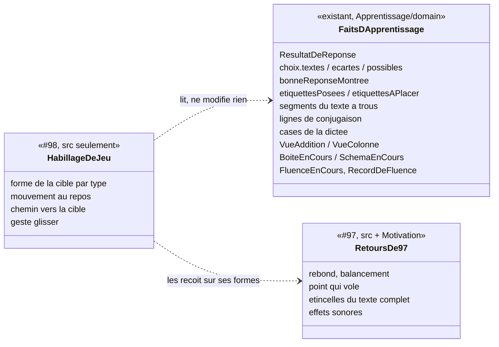

# Modèle du domaine : issue #98, des exercices qui ressemblent à des jeux

Épopée #95, story 3. Dépend de #97 (retours animés et sonores), qui dépend de #96 (refonte visuelle, PR #124).

État : **cadrage seulement** (décision 0020). Aucun code avant le merge de #97. Cadrage validé par le PO le 2026-10-28 : questions 98.1 à 98.17 tranchées selon la reco, découpage 98a à 98e validé.

## Contexte

### Aucun contexte nouveau, aucun agrégat nouveau

La story change **seulement l'affichage** des 14 types d'exercices pendant une séance. C'est la promesse de l'issue : « la correction, les erreurs, « Je ne sais pas », l'aide et les étoiles restent celles du domaine ». Le skill `gamification` (section 4, « Exercices plus jeu ») le dit aussi : ces variantes « ne changent que l'affichage ; la règle de correction reste celle du domaine ».

Conséquences :
- **Apprentissage** reste la source de chaque fait montré : réponse juste ou fausse, choix écarté, bonne réponse montrée, placement, trou rempli, forme de conjugaison écrite, chiffre écrit d'une colonne, retenue, score de fluence, record de fluence. Aucune règle de correction ne change. Aucun agrégat (`Seance`, `SeanceDeRevision`, `TestDeDepart`, `RecordDeFluence`) ne gagne d'état.
- **Motivation** garde l'humeur, les paroles et, avec #97, l'effet sonore. #98 n'y ajoute rien.
- **Catalogue pédagogique** ne change pas : le format des leçons (`docs/format-lecons.md`) reste le même, aucun champ « habillage ».
- **Voix** ne change pas.
- Tout se passe dans `src/` : dessins SVG dans le code (décision 0027), animations Motion, gestes. Le domaine dit **ce qui** est arrivé, le front choisit **comment** le montrer (skill, section 3).

Il n'y a donc **ni commande, ni événement de domaine, ni erreur métier, ni migration, ni Edge Function, ni donnée d'enfant nouvelle**.

Trois exceptions possibles, chacune soumise au PO (voir « Faits du domaine manquants ») :
1. montrer le record de fluence **pendant** la fluence et marquer le moment où le score le dépasse (question 98.10) ;
2. permettre de **glisser** une étiquette d'un `ordre`, ce qui change l'**Indication du geste**, texte fourni par Apprentissage (question 98.8) ;
3. allumer une case de la dictée **parce que la lettre est juste**, avant la fin du mot : le domaine ne le sait pas, et le dire changerait les erreurs (question 98.7, reco : non).

### Répartition avec #96 et #97

| Ce qui est montré | Propriétaire | #98 |
|---|---|---|
| Couleur principale de l'univers, polices, jetons de design, boutons en relief qui s'enfoncent, transitions entre écrans, paysage et dessin fixe du personnage guide | #96 | Utilise les jetons. Ne touche ni `src/univers/jetons.ts`, ni `src/transitions/`, ni `src/boutons/ressort-des-boutons.ts` |
| Effets sonores (8 sons), rebond d'une réponse juste, balancement d'une réponse fausse, point qui vole vers le récipient, étincelles du texte complet (dernier trou, dernière étiquette d'un `ordre`, et selon 97.6 dernière étiquette de `classer`, dernière personne de `conjugaison`), confettis et étoiles une à une à la fin, compteur qui défile pour un record de fluence, étiquette posée dans la mauvaise maison qui revient avec « réponse fausse », mouvements réduits de ces retours, son « bouton touché » | #97 | **Ne redéfinit aucun de ces retours.** Il les reçoit sur ses nouvelles formes (une bulle, un wagon, un panier rebondissent comme un choix) |
| Animations des personnages guides (danse, badge qui tourne) | #106 | Rien |
| Forme de chaque cible de réponse (bulle, panier, wagon, maison, case, cristal, jauge, parchemin), son mouvement propre au repos, le chemin d'un objet vers sa cible (mot qui rejoint son trou, wagon qui s'accroche, jeton qui tombe, retenue qui saute), le geste glisser au doigt | — | **#98** |

### Recouvrements repérés entre le tableau de l'issue et #97

| Piste de #98 | Ce que #97 fait déjà | Répartition proposée |
|---|---|---|
| `bulles`, `ecoute` : « la bonne éclate en étincelles » | R1 : la réponse juste **rebondit** (1 → 1,15 → 1) avec « réponse juste ». R2 : les étincelles sont réservées au **texte complet** (récompense « moyenne »). Le code fait déjà disparaître la bulle choisie (`data-eclatee` : elle grandit et s'efface) | #97 garde le rebond et le son. #98 dessine la bulle et, **après** le rebond, la fait disparaître en douceur (comportement actuel, redessiné). **Pas d'étincelles pour une simple réponse juste** : elles perdraient leur sens de « j'ai fini l'ensemble » (question 98.5) |
| `dictee` : « le mot complet fait un feu d'artifice » | Un mot dicté juste est une réponse juste (rebond, « réponse juste », point qui vole). La dictée n'est pas un exercice « texte complet » dans #97 | Pas de célébration propre au mot : la récompense resterait disproportionnée (une par mot) et un feu d'artifice évoque des détonations qui peuvent inquiéter un jeune enfant. #98 propose : les cases s'illuminent l'une après l'autre quand le mot est juste (question 98.7) |
| `calcul`, `fluence` : « la fluence devient une course contre soi-même (record) » | R4 : à la **fin** de la fluence, le compteur défile jusqu'au nouveau record et « grande victoire » se fait entendre | #97 garde la fête **de fin**. #98 ne pourrait ajouter que ce qui se voit **pendant** la fluence (le record montré comme une marque à atteindre), sans son ni célébration en cours (question 98.10) |
| `classer` : « glisser dans le mauvais panier la fait revenir doucement, avec l'encouragement » | Scénario « Une étiquette posée dans la mauvaise maison fait entendre « réponse fausse » et revient » ; #18 fait déjà revenir l'étiquette parmi les étiquettes à placer | #97 et #18 gardent le **fait** (elle revient) et le son ; l'encouragement est celui de Motivation (#18). #98 ne possède que le **chemin** du retour : après un glisser, l'étiquette revient en glissant jusqu'à sa place, au lieu de réapparaître d'un coup |
| `ordre` : « des wagons d'un petit train qui avance » | R2 : la dernière étiquette d'un `ordre` fait pleuvoir des étincelles avec « texte complet » | #98 dessine les wagons et le train qui avance d'un wagon à chaque bon placement ; les étincelles de la dernière étiquette restent celles de #97 |
| `addition` : « la retenue saute d'une maison à l'autre » | Rien | #98 seul. Le code montre déjà la retenue qui monte (`data-mouvement="monte"`, aucun avec mouvements réduits) : #98 la redessine en saut |
| `trous`, `conjugaison` : « le mot juste tombe dans le trou et s'illumine » | R1 : le choix juste rebondit ; R2 : étincelles au dernier trou | Le choix juste rebondit (#97), **puis** rejoint son trou et s'y illumine (#98). Les étincelles du dernier trou restent à #97 |
| Mouvements réduits | R6 : pour les retours et célébrations | #98 couvre seulement ses propres mouvements (flottement, chemin d'un objet, train, saut de la retenue, jauge, parchemin) |

## Ce que chaque type d'exercice montre aujourd'hui

Lecture de `src/seance/exercices/` et du domaine. « Fait » : ce que le domaine fournit déjà au front. « Manque » : un fait dont la piste a besoin et que le domaine ne donne pas.

**Remarque transversale** : `ChoixDeLaQuestion` (les « bulles de choix ») sert à 10 types sur 14 : `bulles`, `ecoute`, `lecture`, `trous`, `conjugaison`, les mots cachés de `memoriser`, et le **mode de réponse par choix** de `calcul`, `boite`, `barres` et de l'étape calculer d'`addition` (CP, ou réponse de 20 au plus). Changer la bulle change donc ces 10 écrans (question 98.4).

| Type | Geste actuel | Retour actuel (hors #97) | Piste de l'issue | Fait du domaine | Alternative clavier | Mouvements réduits | Risque 44 px |
|---|---|---|---|---|---|---|---|
| `bulles` | Toucher une bulle de choix | Choix écarté pâle ; bonne réponse montrée qui brille (`data-brille`) ; bulle juste qui grandit et s'efface (`data-eclatee`) | Bulles qui flottent ; la bonne éclate en étincelles | Existe : `ResultatDeReponse`, `choix.textes()` (ordre fixé par le domaine), `ecartes()`, `bonneReponseMontree` | Tab entre les bulles, Entrée ; le focus va déjà au premier choix possible | Bulles immobiles (issue) ; la bulle juste s'efface en fondu | **Élevé** : une cible qui bouge est plus dure à toucher au CP (98.3) |
| `ecoute` | Bouton « Écouter », puis toucher une bulle | Comme `bulles` ; message quand le son manque | Comme `bulles` | Existe | Comme `bulles` | Comme `bulles` | Comme `bulles` |
| `lecture` | « J'ai écouté », puis bulles | Texte entier, mot prononcé surligné (`TexteSurligne`) | Le texte se dévoile ligne après ligne comme un parchemin | Existe : `rangDuMotPrononce` (Voix). Aucun fait « ligne lue » : la ligne se déduit du mot prononcé, à l'affichage | Rien de nouveau : le texte n'est pas une cible | Texte entier tout de suite | Faible ; risque de **lisibilité** : un texte caché ne se relit pas pour répondre (98.12) |
| `memoriser` | « Je suis prêt », puis ordre des vers (étiquettes) et mots cachés (bulles) | Vers lu mis en avant (`data-lu`) | Parchemin (vers après vers) | Existe : `versLu` ; `texteCompleteParLaDerniereReponse` (#97) | Comme `ordre` et `bulles` | Vers tous visibles | Comme `ordre` et `bulles` |
| `classer` | Glisser (HTML5, à la souris dans les scénarios) **ou** toucher l'étiquette puis la maison, ou clavier | Bon placement : l'étiquette reste dans la maison ; mauvais : elle revient ; maison qui brille après « Je ne sais pas » | Glisser dans des paniers ou des coffres qui s'ouvrent | Existe : placement juste ou faux par étiquette (`etiquettesPosees`, `etiquettesAPlacer`), groupe visé par « Je ne sais pas » | Existe : Entrée sur l'étiquette, puis Entrée sur « Poser dans la maison « … » » | La maison s'allume sans s'ouvrir ; l'étiquette revient sans glisser | Moyen : à 360 px les maisons sont sous l'écran (le scénario de #18 fait défiler avant de glisser) |
| `ordre` | Toucher l'étiquette qui vient ensuite (pas de glisser) | La place suivante se remplit (`data-remplie`) | Wagons d'un petit train qui avance | Existe : placement sur la **place suivante** seulement (le domaine n'a pas de place choisie) | Existe : Tab, Entrée | Wagon qui apparaît sans rouler, train immobile | Moyen : la longueur du train à 360 px (6 wagons et plus) |
| `trous` | Toucher un choix (mot ou distracteur) | Le mot s'écrit dans son trou ; trou en cours mis en avant et annoncé | Le mot juste « tombe » dans le trou et s'illumine | Existe : segments du texte à trous, trou en cours | Comme `bulles` | Le mot apparaît dans le trou, en fondu | Comme `bulles` |
| `conjugaison` | Toucher un choix | La forme s'écrit à sa ligne ; personne en cours mise en avant | Comme `trous` | Existe : lignes du tableau de conjugaison | Comme `bulles` | Comme `trous` | Comme `bulles` |
| `dictee` | Clavier de la dictée (lettres du mot ou complet), Effacer, clavier physique | Une case se remplit à chaque frappe ; **au mot complet seulement**, correction : lettres fausses en rouge, début juste gardé | Chaque lettre juste allume une case ; le mot complet fait un feu d'artifice | **Manque** pour « lettre juste » : `QuestionDeDictee.taper` ne corrige qu'au mot complet (`MotAEcrire.corriger`). Existe : case écrite, case montrée, correction du mot | Existe : frappe au clavier physique | Case qui s'allume sans mouvement | Moyen : clavier complet à 360 px (déjà livré par #19) |
| `calcul` | Choix au CP ; clavier de cristaux ensuite (chiffres, Effacer, Valider, clavier physique) | Carte du calcul ; cristaux qui brillent = réponse montrée par « Je ne sais pas » | Les cristaux brillent | Existe : `CalculEnCours`, mode de réponse | Existe | Changement de couleur seulement | Faible (taille déjà fixée) ; risque de **sens** : « briller » veut déjà dire « bonne réponse montrée » (98.9) |
| `fluence` | « C'est parti ! », puis clavier de cristaux | Temps restant, barre de temps, calculs réussis, annonce par paliers de 15 s | Une course contre soi-même (record) | Existe : record lu **avant** le départ (`lireLeRecordDeFluence`), score en cours. **Manque** : « le score dépasse le record » pendant la fluence ; `RecordDeFluence.proposer` ne sert qu'à la fin et modifie le record | Existe | Marque du record immobile | Faible |
| `addition` | Étape poser : glisser un chiffre (HTML5) ou toucher le chiffre puis la maison ; étape calculer : choix ou cristaux, colonne par colonne | Couleurs fixes des colonnes ; colonne qui brille ; chiffre écrit en bas ; retenue qui monte | Les maisons (colonnes) s'allument quand le chiffre est juste ; la retenue saute d'une maison à l'autre | Existe : `VueColonne.chiffreEcrit` (écrit seulement quand il est juste), `retenue`, `colonneEnCours`, placement d'un chiffre juste ou faux | Existe : touche puis maison, au clavier | Maison allumée sans saut ; retenue posée sans saut (déjà `aucun`) | Moyen : 3 colonnes et la place des chiffres à 360 px |
| `boite` | Écouter le déroulé, puis choix ou cristaux | Jetons qui entrent (`nouveau`) ou sortent (`sortant`), boîte fermée puis ouverte | Les jetons tombent avec un rebond | Existe : phrases dites, jetons de chaque phrase, boîte ouverte | Rien de nouveau (les jetons ne sont pas des cibles) | Jetons posés sans chute | Faible |
| `barres` | Écouter l'énoncé et l'explication, puis choix ou cristaux | Barres proportionnelles, « ? » pour la valeur cherchée, réponse qui remplace « ? » | Les barres se remplissent comme une jauge | Existe : forme, tailles, valeur cherchée, `SchemaResolu` | Rien de nouveau | Barres pleines tout de suite | Faible ; risque de **sens** : la jauge ne doit jamais donner la valeur cherchée avant la réponse (invariant 6) |

## Faits du domaine manquants

Le front n'invente jamais une règle. Pour chaque piste, le fait existe-t-il ?

| Piste | Fait nécessaire | Existe ? | Suite |
|---|---|---|---|
| Dictée : « chaque lettre juste allume une case » | La lettre tapée est-elle la bonne, avant la fin du mot ? | **Non.** `taper` rend `undefined` tant que le mot n'est pas complet. Le dire changerait l'exercice : l'enfant verrait sa faute et l'effacerait **avant** qu'elle compte comme une erreur. Moins d'erreurs, donc d'autres étoiles pour les mêmes frappes : l'invariant 1 serait rompu | Question 98.7. Reco : la case s'allume quand une lettre y est écrite (fait existant), puis toutes les cases s'illuminent quand le mot est juste |
| Addition : « la maison s'allume quand le chiffre est juste » | Chiffre de la colonne juste | **Oui** : `chiffreEcrit` n'apparaît qu'après la bonne réponse de la colonne ; à l'étape poser, chaque placement est juste ou faux | Rien à ajouter |
| Classer : « le panier s'ouvre » quand l'étiquette est bien rangée | Placement juste ou faux, par étiquette et par groupe | **Oui** (`etiquettesPosees`, `ResultatDeReponse`) | Rien à ajouter |
| Ordre : « le train avance » | Nombre d'étiquettes posées | **Oui** | Rien. Mais **glisser** une étiquette d'`ordre` change l'Indication du geste (texte d'Apprentissage) : question 98.8 |
| Fluence : « course contre soi-même » | Record connu au départ ; « le score dépasse le record » pendant la fluence | **Record connu : oui** (lu par le front avant le départ). **Dépassement : non**, aucune lecture pure. Comparer `score > record` dans React serait une règle (0 n'est jamais un record, premier record) | Question 98.10. Si oui : une lecture pure sur `RecordDeFluence` (sans changer son état ni `proposer`), testée dans le domaine |
| Texte complet élargi (dernière étiquette de `classer`, etc.) | « La dernière réponse complète l'exercice » | Dépend de **97.6**, possédé par #97 | #98 ne l'ajoute pas |
| Dévoilement du parchemin (`lecture`, `memoriser`) | Ligne ou vers en cours de lecture | **Oui** : mot prononcé (`rangDuMotPrononce`), vers lu (`versLu`) | Rien, mais 98.12 sur ce qu'on cache |

## Termes

| Terme | Statut |
|---|---|
| Exercice, type d'exercice (les 14), Question, Choix, Choix écarté, Bonne réponse montrée, Je ne sais pas, Réponse, Erreur, Nouvelle chance, Étiquette, Placement, Indication du geste, Étiquettes mélangées, Groupe, Texte à trous, Trou, Distracteur, Mot dicté, Caractère déjà écrit, Clavier de cristaux, Mode de réponse, Colonne, Rang, Retenue, Boîte à jetons, Jeton, Schéma en barres, Valeur cherchée, Poésie, Vers, Mot caché, Score de fluence, Record de fluence, Avancement de la séance, Étoile, Texte complet, Univers, Personnage guide, Consigne affichée | Existants, réutilisés tels quels |
| Effet sonore, Exercice complété | Apportés par #97 (à valider dans #97), pas redéfinis ici |
| **Habillage de jeu** | **En conflit** : la ligne **Univers** du glossaire dit déjà « Habillage choisi par l'enfant ». Deux sens pour « habillage ». Proposition : **mot de cadrage seulement**, toujours avec son complément (« habillage de jeu d'un type d'exercice »), jamais dans le domaine. Aucune règle n'y vit. Question 98.14 |
| **Glisser** (le geste) | **Conflit léger** : **Placement** interdit « glisser-déposer » comme synonyme. Proposition : « glisser » désigne le **geste** (déjà dans l'Indication du geste : « Fais glisser chaque étiquette… ») ; la réponse qu'il produit reste un **Placement**. « glisser-déposer » et « drop » restent interdits dans le code et les scénarios |
| **Panier** | Nouveau **mot d'interface** pour un **Groupe** de `classer`, en concurrence avec « maison » (décision n°24). Question 98.6 |
| **Coffre** | **À éviter** : le skill associe le coffre aux récompenses (révélation de la cabane) et interdit le coffre au contenu tiré au hasard. Un coffre comme cible de réponse brouillerait le sens. Question 98.6 |
| **Wagon**, **petit train** | Nouveaux **mots d'interface** pour les places d'un `ordre`. Pas de terme du domaine : la place reste « la place suivante » du Placement |
| **Maison** (addition) | Déjà le mot d'interface de **Colonne** (décision n°24) ; le code dit déjà `maison-de-la-colonne`. Rien de nouveau |
| **Bulle** | Déjà un mot d'interface (décision n°30) pour un **Choix** |
| **Course contre soi-même** | **Mot de cadrage seulement**, à ne pas mettre dans l'interface ni dans le domaine : « course » suggère des concurrents, et le skill interdit la comparaison sociale. Proposition à l'écran : « Ton record : 12 » ; dans le domaine : **Record de fluence**. Question 98.10 |
| **Marque du record** (à valider) | Seulement si 98.10 = oui : le record de fluence montré **pendant** la fluence, comme une marque à atteindre. Mot d'interface ou terme du domaine : question 98.10 |
| Parchemin, jauge, cristal qui brille, étincelles, case qui s'allume, flotter, chemin vers la cible | **Mots d'interface**, comme « mouvements réduits » (décision n°16) |
| Feu d'artifice | **À ne pas employer** (question 98.7) |

## Modèle

Aucun agrégat, aucun value object nouveau dans le domaine.

Ce que la story ajoute vit dans `src/` et n'est pas un modèle du domaine : pour chaque type, une **forme** (comment dessiner la cible de réponse) qui reçoit les faits existants et ne décide de rien.

### Si le PO ouvre une des trois exceptions

- **98.10 = oui** (record montré pendant la fluence) : une lecture pure sur `RecordDeFluence`, par exemple « ce score serait-il un record ? », qui ne modifie ni le meilleur score ni les faits, et respecte les règles existantes (0 n'est jamais un record ; sans record connu, le premier score positif en est un). `proposer` ne change pas. Apprentissage, dans `record-de-fluence.ts`.
- **98.8 = oui** (glisser une étiquette d'`ordre`) : `indicationDuGeste("ordre")` et `indicationDuGeste("memoriser")` changent de texte, comme celui de `classer`. Le placement reste « la place suivante » : une étiquette glissée sur le train prend la place suivante, quel que soit le wagon visé. Apprentissage, dans `exercices/indication-du-geste.ts`.
- **98.7 = lettre juste** (contraire à la reco) : ce n'est plus un habillage. Ce serait une nouvelle règle de correction de la dictée, qui change les erreurs et les étoiles. Elle sortirait de #98 pour une story d'Apprentissage à part.

## Invariants

Ces invariants valent pour toutes les stories du découpage. Ce sont des règles d'affichage qui protègent les règles du domaine. Elles se vérifient par des scénarios, pas dans un agrégat.

1. **Mêmes faits, même résultat.** Pour une même suite de réponses, une séance donne les mêmes erreurs, le même avancement de la séance, les mêmes étoiles, le même résultat de la leçon, les mêmes questions ratées et le même record de fluence qu'avant la story. Le serveur revalide la séance terminée sans aucun changement.
2. **Aucune réponse de plus, aucune de moins.** Un geste de l'habillage (approcher, survoler, glisser puis lâcher hors d'une cible, regarder une bulle bouger) ne produit jamais de réponse. Seuls un toucher sur une cible, un lâcher sur une cible ou Entrée en produisent un, exactement comme aujourd'hui. Un glisser lâché hors de toute cible n'est **pas** une réponse fausse : il ne coûte pas d'erreur.
3. **L'ordre des choix et des étiquettes reste celui du domaine** (`choix.textes()`, étiquettes mélangées). L'habillage ne mélange rien et ne tire rien au hasard. Un motif décoratif varié passe par le port de hasard du navigateur.
4. **« Je ne sais pas », l'aide et la bonne réponse montrée restent visibles et reconnaissables dans chaque habillage.** Le signal « bonne réponse montrée » (ce qui brille aujourd'hui) ne sert à rien d'autre. Un objet qui brille pour une autre raison (cristal touché, case écrite) ne doit pas lui ressembler.
5. **Les retours de #97 passent d'abord.** Le rebond, le balancement, le son et le point qui vole partent tout de suite (moins de 300 ms) et ne sont jamais retardés par l'habillage. Le chemin d'un objet vers sa cible tient dans la durée d'un retour (150 à 400 ms). Il ne prolonge jamais l'attente avant l'écran suivant, qui reste fondée sur la parole (#79).
6. **L'habillage ne donne jamais une réponse.** Ni la forme, ni la taille, ni le mouvement d'une cible ne trahit le bon choix : toutes les bulles flottent pareil, et la jauge d'un schéma en barres ne se remplit jamais jusqu'à la valeur cherchée avant la bonne réponse.
7. **Une cible garde 44 px au moins et ne se dérobe pas.** La zone qui reçoit le toucher reste fixe et d'au moins 44 px, même quand le dessin bouge. Rien ne déborde à 360 px de large.
8. **Toujours une alternative au clavier**, sans glisser : Tab pour aller d'une cible à l'autre, Entrée pour répondre, flèches là où une liste s'y prête. Le focus va là où il va aujourd'hui.
9. **Avec mouvements réduits, rien ne bouge de lui-même.** Aucun flottement, aucun chemin animé, aucun train qui roule. L'information reste : l'objet apparaît à sa place, et une couleur avec une forme montre le changement d'état.
10. **La consigne reste au premier plan** (charge cognitive) : rien ne bouge pendant la lecture de la consigne. La consigne affichée (#79), le personnage guide et les cibles ne se cachent pas l'un l'autre. Le mode dys (Andika, syllabes en couleur) s'applique à tout texte d'une cible. Le contraste reste d'au moins 4,5:1 (#96).
11. **Les dessins ne disent rien aux lecteurs d'écran.** Les rôles, les libellés et les annonces d'aujourd'hui restent les mêmes : « Maison « on » », « Mot manquant dans… », « Case 2 : a ». Seul un changement voulu du mot d'interface (98.6) les modifie.
12. **Même habillage partout où le type est joué** : séance, séance de révision, test de départ (98.13).
13. **Contenu (règle absolue de `CLAUDE.md`)** : aucun dessin ni mouvement effrayant ou agressif. Rien n'explose, rien ne se casse, aucune détonation. Une bulle s'efface en douceur, comme une bulle de savon. Les dessins suivent le skill `illustration`, section 0.

## Événements

Aucun événement de domaine nouveau. L'habillage réagit aux faits existants (`ResultatDeReponse`, placement, trou rempli, chiffre écrit, retenue, phrases dites, `SchemaResolu`, score de fluence) et aux retours de #97.

## Partage avec le front

Tout est déjà dans le navigateur, hors ligne compris : les faits viennent de `@domain/apprentissage`. Les dessins sont des SVG dans le code (décision 0027), donc disponibles hors ligne sans fichier de plus. Si 98.10 ou 98.8 = oui, la lecture ajoutée est exportée par `@domain/apprentissage`.

## Données d'enfants

Aucune donnée nouvelle. Rien n'est enregistré ni envoyé, aucun service tiers. Le record de fluence est déjà lu.

## Emplacement

Domaine : **rien** par défaut. Seulement si le PO ouvre une exception :
- 98.10 = oui : `supabase/functions/_shared/apprentissage/domain/record-de-fluence.ts` (+ `record-de-fluence_test.ts`), export dans `index.ts` ;
- 98.8 = oui : `supabase/functions/_shared/apprentissage/domain/exercices/indication-du-geste.ts` (+ test).

Front (indicatif, pour l'implementer) : `src/seance/exercices/` (formes par type, à côté des composants existants), un geste glisser commun aux étiquettes et aux chiffres de l'addition, dans `src/seance/exercices/`.

Le glisser actuel passe par le glisser-déposer HTML5 (`draggable`, `onDrop`), et les scénarios de #18 le font **à la souris** (`dragTo`). Le glisser **au doigt** sur tablette et sur téléphone n'est prouvé par aucun scénario. C'est le premier risque technique de la story socle.

Scénarios : `features/98-*.feature` pour la story socle ; une feature par story suivante.

## Proposition de découpage

Consigne de l'issue : 6 règles au plus par story. La découpe suit les **familles de gestes**, parce que plusieurs types partagent le même composant (bulles de choix, étiquettes, clavier de cristaux). Chaque story dépend de #97. Les numéros des stories suivantes sont à créer par le PO ; je n'en crée aucune.

### 98a : #98 elle-même, socle et étiquettes (`classer`, `ordre`, ordre des vers de `memoriser`)

Pourquoi en premier : elle pose le **geste glisser au doigt**, qui sert aussi à l'addition. Elle pose aussi les **invariants transverses** dans des scénarios réutilisables, et touche des écrans où les faits existent tous.

Règles envisagées :
1. Une séance de chaque type de la famille se termine au doigt sur tablette et au clavier sur ordinateur, avec les mêmes étoiles qu'avant pour les mêmes réponses (invariants 1, 2, 8).
2. Une étiquette se glisse au doigt jusqu'à sa cible. Lâchée hors de toute cible, elle revient à sa place sans coûter d'erreur. Toucher puis toucher et le clavier restent possibles (invariant 2).
3. `classer` : la bonne maison (ou le panier, 98.6) s'ouvre et garde l'étiquette. Une étiquette glissée dans la mauvaise revient en glissant jusqu'à sa place. Le son et l'encouragement restent ceux de #97 et #18.
4. `ordre` et ordre des vers : chaque bon placement accroche un wagon au petit train, qui avance d'un cran. La dernière étiquette garde les étincelles de #97.
5. « Je ne sais pas » montre toujours la bonne maison ou la bonne étiquette, reconnaissable dans le nouveau dessin (invariant 4).
6. Avec mouvements réduits, rien ne glisse ni ne roule. Les cibles gardent 44 px et tiennent à 360 px (invariants 7, 9).

Dépendances : #97 mergée. 98.6 et 98.8 tranchées.

### 98b : bulles de choix (`bulles`, `ecoute`, `lecture` pour ses questions, `trous`, `conjugaison`, mots cachés de `memoriser`)

Règles envisagées :
1. Les choix sont des bulles. Elles flottent doucement **après** la lecture de la consigne, toutes de la même façon, et leur cible reste fixe (invariants 6, 7, 10 ; 98.3).
2. Avec mouvements réduits, aucune bulle ne flotte : les choix sont immobiles (piste de l'issue).
3. Après le rebond de #97, la bulle juste s'efface en douceur. Pas d'étincelles pour une simple réponse juste (98.5).
4. `trous`, `conjugaison`, mots cachés : le mot juste rejoint son trou ou sa ligne, puis s'y illumine. Le dernier trou garde les étincelles de #97.
5. Un choix écarté et la bonne réponse montrée restent reconnaissables sur une bulle (invariant 4).
6. Au clavier, Tab et Entrée répondent comme avant, et les flèches passent d'une bulle à l'autre (98.15).

Dépendances : 98a (scénarios d'invariants). 98.3, 98.4 et 98.5 tranchées. **Attention** : si 98.4 = « toutes les bulles de choix », la story touche aussi le mode par choix de `calcul`, `boite`, `barres` et `addition`.

### 98c : quantités (`addition`, `boite`, `barres`)

Règles envisagées :
1. Étape poser : un chiffre se glisse au doigt dans sa maison (geste de 98a). Toucher puis toucher et le clavier restent possibles.
2. Étape calculer : la maison s'allume quand son chiffre est juste. Ses couleurs restent les mêmes dans tous les univers.
3. La retenue saute d'une maison à la suivante. Avec mouvements réduits, elle apparaît en haut de la maison.
4. Boîte à jetons : les jetons tombent dans la boîte avec un petit rebond. Ceux qui sortent s'en vont en douceur.
5. Schéma en barres : les barres se remplissent comme une jauge jusqu'à leur valeur. La barre de la valeur cherchée garde son « ? » jusqu'à la bonne réponse (invariant 6).
6. Avec mouvements réduits, les jetons sont posés et les barres sont pleines tout de suite.

Dépendances : 98a (geste glisser).

### 98d : claviers (`dictee`, `calcul`, `fluence`)

Règles envisagées :
1. Dictée : une case s'allume quand une lettre y est écrite. Quand le mot est juste, toutes ses cases s'illuminent l'une après l'autre. Les lettres fausses restent montrées comme aujourd'hui, après le mot complet (98.7).
2. Clavier de cristaux : un cristal touché s'illumine brièvement, sans ressembler à la bonne réponse montrée (98.9).
3. Fluence : le record de fluence est montré comme une marque à atteindre pendant la fluence. Sans record, aucune marque (98.10).
4. Fluence : quand le score dépasse le record, la marque change de couleur, sans son ni arrêt. La fête reste celle de la fin (#97 R4) (98.10).
5. Avec mouvements réduits, rien ne bouge. Le temps restant et le score restent annoncés comme aujourd'hui.

Dépendances : 98a. 98.7, 98.9 et 98.10 tranchées. Si 98.10 = oui : lecture pure dans `RecordDeFluence` (TDD dans le domaine).

### 98e : textes qui se dévoilent (`lecture`, `memoriser`)

Règles envisagées :
1. Pendant la lecture du personnage guide, le texte se déroule comme un parchemin, ligne après ligne (ou vers après vers). Ensuite, tout reste visible (98.12).
2. En Muet, sans voix ou avec la voix bloquée, le texte entier est visible tout de suite.
3. Avec mouvements réduits, le texte entier est visible tout de suite.

Dépendances : 98a. 98.12 tranchée. Petite story : elle peut rejoindre 98c ou 98d si le PO préfère moins d'issues.

**Ordre proposé** : 98a → 98b → 98c → 98d → 98e. 98b vient tôt parce que la bulle de choix est l'écran le plus vu. 98d vient tard parce qu'elle a le plus de questions.

## Questions tranchées

Toutes tranchées le 2026-10-28 par le PO (« 98# reco partout », issue #64) : la reco de chaque question est retenue, les options restent écrites pour mémoire.

**98.1 (question 1 de l'issue) Les pistes du tableau te plaisent-elles ? Lesquelles changer ?** *Tranchée le 2026-10-28 : reco.*
Reco : **garder** les bulles, les wagons, les maisons de l'addition, les jetons qui tombent, les barres en jauge et le parchemin. **Changer** trois pistes :
- l'éclat en étincelles de la bonne bulle (98.5) ;
- le feu d'artifice du mot dicté (98.7) ;
- les coffres de `classer` (98.6).

**98.2 (question 2 de l'issue) Un habillage par type, le même dans tous les univers, ou un habillage par univers ?** *Tranchée le 2026-10-28 : reco.*
Exemple : des bulles pour « Animaux de la forêt », des ballons pour « Sports ».
Reco : **par type, le même dans tous les univers**, coloré par les jetons de l'univers (#96). Les colonnes de l'addition gardent leurs couleurs communes. Raisons :
- un seul dessin par type à valider (skill `illustration`) au lieu de six ;
- l'enfant qui change d'univers retrouve les mêmes gestes ;
- un objet propre à un univers peut se discuter plus tard, univers par univers, avec #106.

Option B : habillage par univers (travail fois 6). Option C : par type, plus un petit motif par univers sur la bulle.

**98.3 (question 3 de l'issue) Des bulles qui bougent sont-elles faciles à toucher au CP ? Faut-il qu'elles s'arrêtent quand le doigt approche ?** *Tranchée le 2026-10-28 : reco.*
Sur une tablette, on ne sait pas qu'un doigt approche : l'écran ne sent que le toucher.
Reco : **mouvement très léger** (le dessin ondule de quelques pixels, lentement), **cible fixe** d'au moins 44 px qui ne bouge pas avec le dessin, **immobile pendant la lecture de la consigne**, et immobile pour de bon dès le premier toucher sur une bulle.
Options : A, bulles immobiles au CP et flottantes à partir du CE1 ; B, bulles immobiles partout (seulement la forme change).

**98.4 Les « bulles qui flottent » valent-elles pour toutes les bulles de choix, ou seulement pour `bulles` et `ecoute` ?** *Tranchée le 2026-10-28 : reco.*
Le même composant sert aux choix de 10 types, dont le mode par choix du calcul, de la boîte, des barres et de l'addition.
Reco : la **forme** de bulle pour tous les choix (cohérence), le **flottement** seulement pour `bulles` et `ecoute`. Ailleurs, l'enfant regarde déjà un texte, un tableau, une boîte ou un schéma : un mouvement de plus détourne l'attention (charge cognitive).
Options : A, flottement partout ; B, rien ne change hors `bulles` et `ecoute`.

**98.5 Après le rebond de #97, la bonne bulle s'efface-t-elle en douceur, sans étincelles ?** *Tranchée le 2026-10-28 : reco.*
Reco : **oui**. #97 réserve les étincelles au texte complet (récompense moyenne). En mettre à chaque bonne bulle les rendrait banales et doublerait le retour d'une même réponse. La bulle juste disparaît déjà aujourd'hui : #98 la redessine en bulle de savon qui s'efface.
Option : de petites étincelles, plus discrètes que celles du texte complet.

**98.6 `classer` : des paniers, des coffres ou des maisons ?** *Tranchée le 2026-10-28 : reco.*
L'interface dit « maison » (décision n°24), et la consigne et l'Indication du geste disent « touche une maison ». Les scénarios de #18 et #97 aussi.
Reco : **garder « maison »**, dessinée en petite maison dont la porte s'ouvre et qui s'allume quand l'étiquette est bien rangée. Raisons :
- aucun mot ni scénario existant ne change ;
- c'est le même mot que les maisons de l'addition ;
- le coffre évoque une récompense (révélation de la cabane), et le skill interdit le coffre au contenu tiré au hasard.

Option A : des paniers. Le mot d'interface change alors partout : consignes par défaut, Indication du geste, libellés lus (« Poser dans le panier « on » »), scénarios de #18 et #97. Option B : des coffres (déconseillé).

**98.7 Dictée : la case s'allume-t-elle quand une lettre y est écrite (sans dire si elle est juste), puis toutes les cases s'illuminent quand le mot est juste, sans feu d'artifice ?** *Tranchée le 2026-10-28 : reco.*
Exemple : « chat ». L'enfant tape « c », « h », « o » : trois cases allumées, aucune n'est jugée. Il tape « t » : le mot est corrigé comme aujourd'hui, une erreur, « o » montré faux.
Reco : **oui**. Allumer la case parce que la lettre est juste montrerait la faute avant la fin du mot. L'enfant l'effacerait sans qu'elle compte : moins d'erreurs et d'autres étoiles pour les mêmes frappes, ce qui rompt la promesse de la story. Le domaine ne le sait d'ailleurs pas aujourd'hui. Un feu d'artifice à chaque mot serait aussi une récompense trop grande pour une seule réponse, et ses détonations peuvent inquiéter un jeune enfant.
Option : juger la lettre à la frappe. Ce serait une nouvelle règle de correction de la dictée, à part de #98, qui change les erreurs.

**98.8 `ordre` : peut-on aussi glisser une étiquette sur le train, en plus de la toucher ?** *Tranchée le 2026-10-28 : reco.*
Reco : **non**, toucher suffit. Le domaine n'a qu'une place possible, la suivante : glisser vers un wagon précis laisserait croire qu'on choisit la place. Le texte « Touche d'abord celle qui vient en premier » reste juste.
Option : oui, l'étiquette glissée sur le train prend la place suivante, et l'Indication du geste de `ordre` et `memoriser` change (texte d'Apprentissage, à fixer).

**98.9 Calcul : les cristaux « brillent » quand on les touche ?** *Tranchée le 2026-10-28 : reco.*
« Briller » montre déjà la bonne réponse après « Je ne sais pas » (cristaux, bulles, maisons, touches de la dictée).
Reco : un cristal touché **s'illumine brièvement, d'une autre façon** que la bonne réponse montrée (éclat court, sans halo qui dure). Le halo qui dure reste réservé à « Je ne sais pas ».
Option : pas d'effet au toucher (le bouton en relief de #96 suffit).

**98.10 (question 4 de l'issue) Fluence : peut-on la présenter comme une course contre son record, compatible avec « pas de chrono imposé » ? Et le record se voit-il pendant la fluence ?** *Tranchée le 2026-10-28 : reco.*
Le chrono est la nature de l'exercice (`duree` dans le format), pas une pénalité : il ne limite pas le temps de jeu et ne retire rien.
Reco : **oui, sous trois conditions** :
- le mot « course » ne s'affiche pas (pas de concurrent, pas de comparaison sociale) ;
- pendant la fluence, le record de fluence de l'enfant se voit comme une marque à atteindre (« Ton record : 12 »), et aucune marque sans record ;
- quand le score dépasse le record, la marque change seulement de couleur, sans son ni célébration : l'enfant calcule encore. La fête reste celle de la fin (#97 R4).

Cela demande une **lecture pure dans `RecordDeFluence`** (le score dépasse-t-il le record ?), pour que React ne refasse pas la règle « 0 n'est jamais un record ».
Options : A, record montré mais pas de changement au dépassement (aucun changement du domaine) ; B, rien de plus pendant la fluence, la course n'est que la fête de fin de #97.

**98.11 Un glisser lâché hors de toute cible : l'étiquette revient-elle sans coûter d'erreur ?** *Tranchée le 2026-10-28 : reco.*
Reco : **oui**. Ce n'est pas une réponse (invariant 2) : pas d'erreur, pas de son de réponse fausse, pas d'encouragement. Seul un lâcher sur une mauvaise maison est une réponse fausse.

**98.12 `lecture`, `memoriser` : le parchemin cache-t-il les lignes pas encore lues ?** *Tranchée le 2026-10-28 : reco.*
Reco : **seulement le temps de la première lecture** par le personnage guide, puis tout reste visible. L'enfant doit pouvoir relire le texte pour répondre aux questions ou pour réciter. En Muet, sans voix ou avec la voix bloquée, tout est visible tout de suite. Un enfant qui lit seul n'attend jamais la voix.
Option : pas de dévoilement, seulement le dessin du parchemin.

**98.13 L'habillage vaut-il aussi en séance de révision et au test de départ ?** *Tranchée le 2026-10-28 : reco.*
Reco : **oui**, ce sont les mêmes questions, avec les mêmes composants. Un enfant ne doit pas réapprendre un geste.

**98.14 « Habillage de jeu » : terme du domaine, ou mot de cadrage ?** *Tranchée le 2026-10-28 : reco.*
La ligne **Univers** dit déjà « Habillage choisi par l'enfant ».
Reco : **mot de cadrage seulement**, toujours avec son complément, jamais dans le code du domaine ni à l'écran. Aucune règle n'y vit. Ajouter au glossaire la note « « habillage » seul désigne l'univers ».

**98.15 Au clavier, les flèches passent-elles d'une bulle à l'autre, et d'une maison à l'autre ?** *Tranchée le 2026-10-28 : reco.*
L'issue demande « Tab, Entrée, flèches ». Aujourd'hui, seuls Tab et Entrée marchent.
Reco : **oui pour les bulles de choix et les maisons** (groupe de boutons), en plus de Tab. Les étiquettes à placer gardent Tab.
Option : Tab et Entrée seulement, comme aujourd'hui.

**98.16 Découpage : d'accord pour cinq stories, 98a (#98, socle et étiquettes), puis 98b bulles, 98c quantités, 98d claviers, 98e textes, dans cet ordre ?** *Tranchée le 2026-10-28 : reco (98b à 98e : nouvelles issues créées par le PO).*
Reco : **oui**. 98e peut rejoindre 98c ou 98d si tu préfères moins d'issues. Une story ne commence son code qu'après #97 et 98a.

**98.17 Le glisser au doigt doit-il marcher sur l'iPad et l'iPhone autant que sur Android ?** *Tranchée le 2026-10-28 : reco.*
Le glisser actuel ne se prouve qu'à la souris.
Reco : **oui**, sur les deux, prouvé sur le projet `tablette` et le projet `telephone`. Sinon, l'enfant n'a que toucher puis toucher, qui reste toujours possible.

## Termes à signaler (glossaire)

Rien n'est ajouté au glossaire par ce cadrage (consigne de l'orchestrateur). À proposer au PO :

- **Habillage de jeu** : mot de cadrage, en conflit avec la définition d'**Univers** (« Habillage choisi par l'enfant »). Proposition : note dans **Décisions** : « « habillage » seul désigne l'univers ; « habillage de jeu » est un mot de cadrage, hors domaine » (98.14).
- **Glisser** : geste, déjà dans l'Indication du geste. Préciser à la ligne **Placement** que « glisser » nomme le geste et que la réponse reste un placement. « glisser-déposer » et « drop » restent interdits.
- **Panier** : seulement si 98.6 = A. Il devient le mot d'interface de **Groupe** à la place de « maison » (Décision n°24 à compléter). **Coffre** : à ajouter aux synonymes interdits de **Groupe** si le PO suit 98.6.
- **Wagon**, **petit train**, **parchemin**, **jauge**, **bulle de savon**, **marque à atteindre** : mots d'interface (comme décision n°30).
- **Marque du record (à valider)** : seulement si 98.10 = oui. Terme d'Apprentissage, ou mot d'interface pour « record de fluence montré pendant la fluence ».
- **Course contre soi-même** : mot de cadrage, jamais à l'écran. Proposer « course » comme synonyme interdit de **Fluence** et de **Record de fluence** (comparaison sociale, skill section 5).
- **Feu d'artifice** : à ne pas employer (98.7).
- **Maison** : déjà un mot d'interface pour **Groupe** et **Colonne** (décision n°24). Rien à changer si 98.6 suit la reco.
