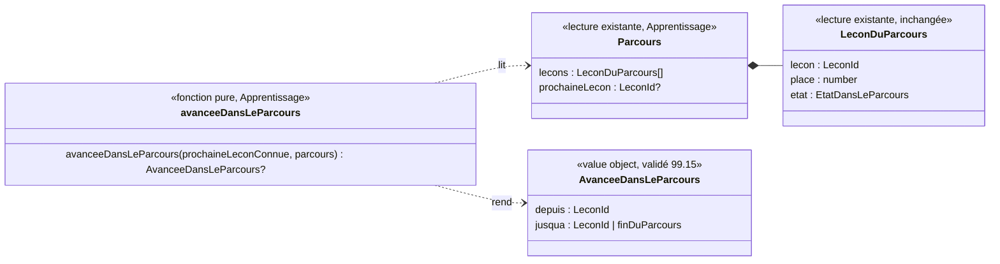

# Modèle du domaine : issue #99, « Mon parcours » devient une carte au trésor

Contexte : **Apprentissage** (le parcours, la prochaine leçon, la place), affiché avec le paysage et le personnage guide de l'univers (**Motivation**, composants livrés par #96 dans `src/univers/`). La story ne change **aucune règle du parcours** : elle dessine ce que `parcoursDeLaMatiere` calcule déjà, **un seul dessin par matière** (réponse 99.25 C). Une seule lecture nouvelle, pure, dans `apprentissage/domain/` : l'**avancée dans le parcours** (de quelle leçon à quelle leçon le personnage guide marche). Aucun agrégat, aucune commande, aucun événement enregistré, aucune migration, aucune Edge Function, aucune donnée d'enfant nouvelle.

État : **cadrage validé**. Toutes les questions #99.1 à #99.32 sont tranchées (voir « Réponses du PO »). Aucune question ouverte.

On dit **dessin du parcours** pour le dessin à l'écran.

## Réponses du PO (2026-10-28)

### Premier lot : #99.1 à #99.22

Réponse mot pour mot : « 99'reco sauf 99.1 b 99.6 b », puis, sur 99.6 b : « Par section du programme » (commentaire « [Questions #99] Réponses du PO » de l'issue #99).

| Question | Réponse | Ce qui change dans le modèle |
|---|---|---|
| 99.1 « Carte », « carte au trésor » | **b** (écart) | « Carte au trésor » devient un **mot d'écran**. Il reste hors du domaine et du glossaire de domaine : **Parcours** dans le code, « dessin du parcours » dans les scénarios ; Décision n°34 inchangée. Texte et place : 99.23 |
| 99.2 « Chemin » | reco | Interdit ; le tracé n'a pas de nom de domaine |
| 99.3 « Étape » | reco | « Leçon 4 » ; « le personnage guide se tient sur la leçon 4 » |
| 99.4 Cadenas | reco | Aucun cadenas ; seule la prochaine leçon brille |
| 99.5 Parcours libre | reco | Non lu |
| 99.6 Plus de 30 leçons | ~~b, « par section du programme »~~ | **Remplacée par 99.25 C** : un seul dessin par matière dans #99 |
| 99.7 Hors du parcours | reco | À part, sous le dessin ; le personnage guide ne s'y tient jamais |
| 99.8 Décor | reco | Paysage de #96, sans décor propre à chaque univers |
| 99.9 Départ de la marche | reco | Prochaine leçon connue relevée au choix du profil puis à chaque ouverture de « Mon parcours » ; jamais enregistrée |
| 99.10 Saut | reco | Marche d'un trait, 2 s au plus |
| 99.11 Leçon réussie plus loin | reco | Pas de marche (N8). **Suivi** : la phrase du skill `gamification` (section 4) contredit N8 et emploie « étape » (voir « Suivis ») |
| 99.12 Matière réussie | reco | Fin du dessin, sans récompense. Le décor d'arrivée (coffre) est **remplacé par 99.31** : un fanion |
| 99.13 à 99.22 | reco | Sans changement de modèle (aucun son ni parole, un seul personnage guide, éclat fixe en mouvements réduits, toucher le personnage guide ne fait rien, marche non bloquante, marche à l'ouverture de l'onglet, marche après le test de départ sans scénario dédié) |
| 99.15 Termes | reco | **Avancée dans le parcours** et **Prochaine leçon connue** validés |

### Second lot : #99.23 à #99.32

Réponse mot pour mot : « 99# reco » (commentaire « [Responsable] Réponse du PO aux questions #99.23 à #99.32 » de l'issue #99). Toutes les recos s'appliquent.

| Question | Réponse | Ce qui change dans le modèle |
|---|---|---|
| 99.23 Texte de « carte au trésor » | **A** | Sous-titre **« Ma carte au trésor »** sous le titre « Mon parcours », en vrai texte (lu par le lecteur d'écran, police du mode dys, lu à voix haute après le titre). Mot d'interface, hors du domaine. Le titre de l'écran et le bouton « Mon parcours » ne changent pas |
| 99.24 Nom du concept | reco | **« Partie du parcours »** est le nom **réservé** au concept, pour #100. Rien n'est implémenté dans #99 |
| 99.25 Découpage | **C** | **Un seul dessin par matière dans #99** ; le découpage sera décidé avec #100. Remplace 99.6 b |
| 99.26 à 99.30 | sans objet | Conditionnelles à A ou B en 99.25 |
| 99.31 Décor d'arrivée | reco | **Un fanion à la couleur de l'univers, sur une petite colline fleurie**, sans étoile ni texte. Remplace le coffre de 99.12 (réponse 98.6 respectée). Aucun objet « trésor » dessiné |
| 99.32 Lien avec #100 | reco | #99 ne prépare pas le défi : aucune place réservée sur le dessin, aucun « chapitre » ni partie dans le domaine |

## Contexte

### Ce qui existe déjà

| Besoin du dessin | D'où il vient | Contexte |
|---|---|---|
| Matières du parcours, une par onglet | `matieresDuParcours(entrees)` | Apprentissage (#25) |
| Leçons du parcours dans l'ordre, avec leur **place** (« Leçon 4 ») et leur état (`reussie` avec étoiles, `reussieAuTestDeDepart`, `prochaine`, `aDecouvrir`) | `parcoursDeLaMatiere(entrees, matiere).lecons` | Apprentissage (#25, #27) |
| La prochaine leçon (au plus une par matière, aucune quand la matière est réussie) | `Parcours.prochaineLecon` | Apprentissage (#25, réponse N8) |
| Compteur « n leçons réussies sur m » | `nombreDeLeconsReussies`, `nombreDeLecons` | Apprentissage (#25) |
| Leçons réussies d'une classe au-dessus, leçons des classes d'avant | `leconsReussiesDesClassesAuDessus`, `leconsDesClassesDAvant` (hors du parcours, sans place) | Apprentissage (#25, #26) |
| Paysage de l'univers, personnage guide dessiné, humeurs | `Paysage`, `PersonnageGuide` (`src/univers/`) | Motivation, affichage (#96) |
| Mouvements réduits, transitions d'écran | `src/transitions/mouvements-reduits.ts`, `transitionVers` | affichage (#96) |

Tout se calcule dans le navigateur, hors ligne compris (`@domain/apprentissage`). `LeconDuParcours` **ne change pas** (pas de champ `section` dans #99).

### Ce que la story ajoute

1. **Le dessin du parcours, un par matière** (affichage, `src/parcours/`) : les leçons placées le long d'un tracé dans le paysage de l'univers. Chaque leçon montre ce que le domaine dit déjà (place, titre, étoiles, ✓, « À toi ! », « À découvrir »). Pour les lecteurs d'écran et au clavier, il reste la **liste ordonnée** des leçons du parcours ; le dessin est décoratif (`aria-hidden`).
2. **Le sous-titre « Ma carte au trésor »** sous « Mon parcours » (réponse 99.23 A).
3. **Le personnage guide se tient sur la prochaine leçon** (lecture de `Parcours.prochaineLecon`).
4. **Le personnage guide marche jusqu'à la nouvelle prochaine leçon** quand elle a avancé.
5. **Le décor d'arrivée** à la fin du dessin : un fanion à la couleur de l'univers sur une petite colline fleurie (réponse 99.31) ; le personnage guide s'y tient quand la matière est réussie.

### Domaine ou affichage

**La marche** : « faut-il marcher, d'où, jusqu'où » dépend de règles du parcours (N8, saut de places, matière réussie, recul sans perte) : c'est `avanceeDansLeParcours`, fonction pure d'Apprentissage, partagée avec le front par `@domain/apprentissage`.

Le **comment** reste de l'affichage, dans `src/parcours/` : tracé, durée et courbe de la marche, défilement, mouvements réduits, habillage de l'univers, sous-titre, décor d'arrivée.

**Prochaine leçon connue** (validé 99.15) : gardée en mémoire le temps de l'utilisation, une par matière et par profil, jamais enregistrée ni envoyée.

### Communication entre contextes

Aucune relation nouvelle :
- Apprentissage → front : `@domain/apprentissage` (existant), avec une fonction de plus.
- Motivation → front : personnage guide et univers (existant). Motivation ne lit pas le parcours et ne le modifie pas.
- Pas d'effet sonore nouveau (réponse 99.13).

La context map ne change pas.

## Termes

| Terme | Statut |
|---|---|
| Parcours, Matière du parcours, Prochaine leçon, Leçon à découvrir, Place, Leçon réussie, Leçon réussie au test de départ, Leçon réussie d'une classe au-dessus, Leçon des classes d'avant, Matière réussie, Personnage guide, Univers, Royaume | existants, réutilisés tels quels |
| **Avancée dans le parcours** | **validé par le PO le 2026-10-28 (99.15)**, Apprentissage |
| **Prochaine leçon connue** | **validé par le PO le 2026-10-28 (99.15)**, Apprentissage |
| **Partie du parcours** | **nom réservé par le PO pour #100 (99.24), le 2026-10-28**. Pas employé dans le code ni les scénarios de #99 |
| « Carte au trésor » | **mot d'écran** (99.1 b, 99.23 A) : sous-titre « Ma carte au trésor » ; jamais dans le domaine ni le code, et dans les scénarios seulement pour vérifier le texte affiché. Décision n°34 inchangée |
| « Chapitre » | **interdit** pour ce concept (synonyme de **Section du programme** et d'**Épisode**) ; le « chapitre » de #100 est défini par #100 (99.32) |
| « Groupe » seul | **interdit** : désigne la maison de l'exercice `classer` (Décision n°24) |
| « Carte », « chemin », « étape » | **interdits** (Décision n°34 ; 99.2, 99.3) |
| « Trésor », « décor d'arrivée », « fanion », « colline fleurie », « tracé », « dessin du parcours », « marche » | **mots d'interface** ou de dessin (99.15, 99.31) |

Synonymes à éviter pour **Avancée dans le parcours** : « progression », « déplacement », « niveau suivant », « étape suivante ».

Conflits de langage de #99 : **tous tranchés** (99.1 à 99.4, 99.24, 99.31).

## Modèle

Pas d'agrégat. Une fonction pure et un value object de lecture, à côté de `parcours.ts`.

- **`AvanceeDansLeParcours`** (value object) : `depuis` (la prochaine leçon connue, devenue réussie) et `jusqua` (la nouvelle prochaine leçon, ou la fin du parcours quand la matière est réussie).
- **`avanceeDansLeParcours(prochaineLeconConnue, parcours)`** : rend l'avancée, ou rien s'il n'y a pas à marcher (invariants 1 à 6).
- **Erreurs métier** : aucune. Un parcours vide n'a pas d'onglet (`matieresDuParcours`).

## Invariants

1. **Une avancée n'a lieu que si la prochaine leçon connue est devenue réussie** (étoiles ou test de départ) et qu'elle est encore une leçon du parcours de la matière. Sinon le personnage guide est posé directement sur la prochaine leçon.
2. **Jamais en arrière** (leçon ajoutée à la bibliothèque avant elle, classe changée).
3. **Une leçon réussie plus loin ne fait pas marcher le personnage guide** (N8, 99.11).
4. **L'avancée va jusqu'à la nouvelle prochaine leçon**, même en sautant des places, en 2 s au plus (99.10).
5. **Matière réussie** : l'avancée va jusqu'à la **fin du parcours**, c'est-à-dire la fin du dessin, près du fanion (99.12, 99.31).
6. **Sans prochaine leçon connue**, pas d'avancée (99.9, 99.16).
7. **Une avancée se montre une seule fois.**
8. **Le dessin ne change aucune règle** : mêmes leçons, mêmes places, mêmes états, même prochaine leçon que la liste ; toutes les leçons s'ouvrent ; les leçons hors du parcours restent à part (99.7) ; la liste pour les lecteurs d'écran et l'ordre du clavier ne changent pas.
9. **Aucune récompense nouvelle** : rien sur le dessin (sous-titre, fanion, colline) ne donne d'étoile, de badge ni d'objet de la cabane, ne s'achète ni ne se tire au hasard (skill `gamification`, section 5). **Aucun coffre** (98.6, 99.31) ; aucune étoile dessinée sur le décor d'arrivée, pour ne pas la confondre avec les étoiles gagnées.
10. **Contenu pour les enfants** (`CLAUDE.md`, règle absolue) : thème « carte au trésor » inoffensif ; ni pirate, ni arme, ni squelette, ni tête de mort, ni piège, ni lieu effrayant ; dessins par le skill `illustration`, section 0.

## Événements

Aucun événement de domaine nouveau, aucune commande. L'avancée est une **lecture**. Les faits qui font avancer la prochaine leçon existent : `SeanceTerminee` (#24), `TestDeDepartTermine` (#27).

## Emplacement

Domaine (TDD, `Deno.test`), exporté par `supabase/functions/_shared/apprentissage/domain/index.ts` :
- `supabase/functions/_shared/apprentissage/domain/avancee-dans-le-parcours.ts` et `avancee-dans-le-parcours_test.ts` : `AvanceeDansLeParcours`, `avanceeDansLeParcours`.

`parcours.ts` ne change pas. Rien dans `application/`, `infrastructure/`, `supabase/migrations/` ni `supabase/functions/<fonction>/`.

Affichage (pour mémoire, précisé par les critères d'acceptance) :
- `src/parcours/` : un dessin par matière, sous-titre « Ma carte au trésor », fanion sur une colline fleurie en fin de dessin ; la liste ordonnée reste pour les lecteurs d'écran et le clavier ; `BoutonDeLecon.tsx`, `EtatDeLaLecon.tsx`, `textes-du-parcours.ts`, `SectionDesClassesDAvant.tsx` réutilisés ;
- `src/Application.tsx` : mémoire de la prochaine leçon connue par matière ;
- réutilisés : `src/univers/Paysage.tsx`, `src/univers/PersonnageGuide.tsx`, `src/transitions/mouvements-reduits.ts`.

Données d'enfants : **rien de nouveau**. Rien n'est enregistré ni envoyé, rien ne part à l'IA.

## Réservé pour #100 (hors du périmètre de #99)

Note pour la story #100 (défi de fin de chapitre), qui décidera du découpage (99.25 C, 99.32). Rien de ceci n'est implémenté dans #99.

**Nom réservé** : **Partie du parcours** (99.24).

**Idée étudiée puis écartée pour #99** : `partiesDuParcours(parcours)` et `partieAOuvrir(parcours)`, avec un champ `section` ajouté à `LeconDuParcours`. Invariants envisagés, à reprendre si #100 garde l'idée : chaque leçon dans une partie et une seule, les parties mises bout à bout redonnent le parcours (ordre et places inchangés) ; leçons consécutives (une section éclatée forme plusieurs parties) ; numérotation dans l'ordre du parcours ; aucune partie vide ; recalculées, jamais enregistrées ; la partie de la prochaine leçon s'ouvre d'abord ; liste et ordre du clavier inchangés.

**Chiffres mesurés** sur `app/bibliotheque.json` (265 leçons, 6 matières, 27 couples matière et classe) et `app/programmes-index.json`, le 2026-10-28 :
- **Par section, toutes ses leçons ensemble** : 223 groupes, dont 197 d'une seule leçon (88 %), de 1 à 5 leçons ; 18 sections non consécutives dans 10 couples (maths CP : « Les quatre opérations » = leçons 1, 2, 10, 26 et 31 ; « Les nombres entiers » = leçons 4, 14, 15 et 30). Réunir ces leçons casserait l'ordre du parcours et N8.
- **Par section, leçons consécutives** : 245 groupes, dont 228 d'une seule leçon (93 %), au plus 3 leçons ; maths CP 25, français CP 20, maths CM1 21 (pour 21 leçons).
- **Par domaine du programme, tous ensemble** : 82 groupes, 19 d'une leçon, jusqu'à 23 leçons ; 27 domaines non consécutifs dans 11 couples.
- **Par domaine du programme, consécutifs** : 118 groupes, 54 d'une leçon, au plus 10 leçons ; maths CP 11 (10, 3, 2, 2, 1, 1, 3, 1, 1, 1, 6), français CP 13.

Lecture : l'ordre des leçons suit une progression en spirale, alors qu'une section couvre souvent une seule leçon par classe. Un découpage par section donnerait un dessin (et un défi) presque à chaque leçon. Une piste pour #100 : un champ du format des leçons posé par le contenu.

## Suivis hors de la story

- **Skill `gamification`** (réponse 99.11) : la phrase « le personnage guide avance d'une étape à chaque leçon réussie » (section 4, « Idées à proposer », ligne « Carte du parcours façon carte au trésor ») contredit la règle N8 et emploie « étape » (interdit, Décision n°34). À corriger par le responsable ou une session dédiée ; ce cadrage ne modifie pas le skill.
- **#100** : reprendre la section « Réservé pour #100 » pour décider du découpage et du nom **Partie du parcours** (99.24, 99.32).
- **Scénarios** : `docs/stories/99/acceptance.md` et `features/99-dessin-du-parcours.feature` sont à aligner par `po-acceptance` (sous-titre « Ma carte au trésor », fanion à la place du coffre, un seul dessin par matière).

## Questions ouvertes

Aucune. Les questions #99.1 à #99.32 sont tranchées (voir « Réponses du PO »).
