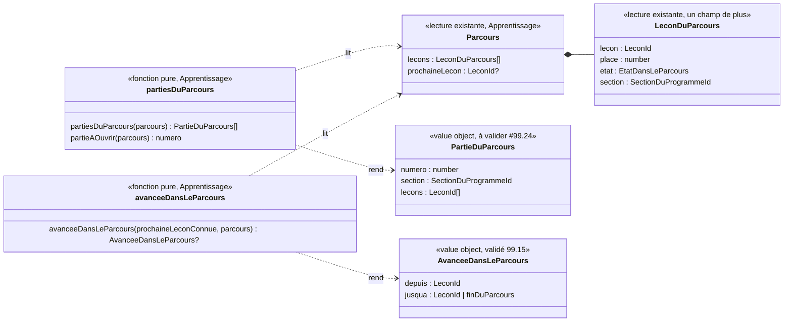

# Modèle du domaine : issue #99, « Mon parcours » devient une carte au trésor

Contexte : **Apprentissage** (le parcours, la prochaine leçon, la place, et désormais le découpage du parcours par section du programme), affiché avec le paysage et le personnage guide de l'univers (**Motivation**, composants livrés par #96 dans `src/univers/`). La story ne change **aucune règle du parcours** : elle dessine ce que `parcoursDeLaMatiere` calcule déjà. Deux lectures nouvelles, pures, dans `apprentissage/domain/` : l'**avancée dans le parcours** (de quelle leçon à quelle leçon le personnage guide marche) et le **découpage du parcours en groupes de leçons d'une même section du programme** (un dessin par groupe, réponse 99.6 b ; nom du concept à choisir, #99.24). Aucun agrégat, aucune commande, aucun événement enregistré, aucune migration, aucune Edge Function, aucune donnée d'enfant nouvelle.

État : **cadrage repris** après les réponses du PO du 2026-10-28 (voir « Réponses du PO »). Reco suivie partout sauf **99.1 b** (« carte au trésor » devient un mot affiché à l'écran) et **99.6 b** (un dessin par groupe de leçons, « par section du programme »). Nouvelles questions : **#99.23 à #99.32**. Les chiffres tirés de la bibliothèque (section « Groupes par section : ce que disent les données ») remettent en cause le découpage par section : c'est la question #99.25, à trancher avant le code.

Dans ce document, en attendant #99.24, le nouveau concept est appelé **partie du parcours** (nom proposé, non validé). On dit toujours **dessin du parcours** pour le dessin à l'écran.

## Réponses du PO (2026-10-28)

Réponse mot pour mot : « 99'reco sauf 99.1 b 99.6 b », puis, sur 99.6 b : « Par section du programme » (commentaire « [Questions #99] Réponses du PO » de l'issue #99).

| Question | Réponse | Ce qui change dans le modèle |
|---|---|---|
| 99.1 « Carte », « carte au trésor » | **b** (écart) | « Carte au trésor » devient un **mot d'écran** (par exemple sous-titre de « Mon parcours »). Il reste hors du domaine et du glossaire de domaine : **Parcours** dans le code, « dessin du parcours » dans les scénarios ; Décision n°34 inchangée (« carte » ne désigne jamais un parcours dans le domaine ni une leçon). Texte et place : #99.23 |
| 99.2 « Chemin » | reco | Interdit ; le tracé n'a pas de nom de domaine |
| 99.3 « Étape » | reco | « Leçon 4 » ; « le personnage guide se tient sur la leçon 4 » |
| 99.4 Cadenas | reco | Aucun cadenas ; seule la prochaine leçon brille |
| 99.5 Parcours libre | reco | Non lu |
| 99.6 Plus de 30 leçons | **b, « par section du programme »** (écart) | **Un dessin par groupe de leçons dès #99**, un groupe = les leçons du parcours d'une matière qui partagent la même `programme.section`. Nouveau concept (nom : #99.24), nouvelle fonction pure, invariants 11 à 18, questions #99.24 à #99.30 et #99.32. Scénarios R1, R3 et R5 à revoir par `po-acceptance` |
| 99.7 Hors du parcours | reco | À part, sous le dernier dessin ; le personnage guide ne s'y tient jamais |
| 99.8 Décor | reco | Paysage de #96, sans décor propre à chaque univers |
| 99.9 Départ de la marche | reco | Prochaine leçon connue relevée au choix du profil puis à chaque ouverture de « Mon parcours » ; jamais enregistrée |
| 99.10 Saut | reco | Marche d'un trait, 2 s au plus ; avec 99.6 b, elle peut passer d'un groupe à l'autre (#99.29) |
| 99.11 Leçon réussie plus loin | reco | Pas de marche (N8). **Suivi** : la phrase du skill `gamification` (section 4, « Idées à proposer » : « le personnage guide avance d'une étape à chaque leçon réussie ») contredit N8 et emploie « étape » : elle est à corriger (hors de cette story de domaine, le skill n'est pas modifié ici) |
| 99.12 Matière réussie | reco | Fin du dessin, qui devient avec 99.6 b la **fin du dernier groupe**. ⚠️ **Conflit** : le décor proposé (« coffre ouvert rempli d'étoiles dessinées ») va contre la réponse 98.6 (« pas de coffre, qui évoque une récompense ») et la section 5 du skill `gamification`. Non tranché : #99.31 |
| 99.13 à 99.22 | reco | Sans changement de modèle (aucun son ni parole, un seul personnage guide, éclat fixe en mouvements réduits, toucher le personnage guide ne fait rien, marche non bloquante, marche à l'ouverture de l'onglet, marche après le test de départ sans scénario dédié) |
| 99.15 Termes | reco | **Avancée dans le parcours** et **Prochaine leçon connue** validés (glossaire mis à jour) |

## Contexte

### Ce qui existe déjà

| Besoin du dessin | D'où il vient | Contexte |
|---|---|---|
| Matières du parcours, une par onglet | `matieresDuParcours(entrees)` | Apprentissage (#25) |
| Leçons du parcours dans l'ordre, avec leur **place** (« Leçon 4 ») et leur état (`reussie` avec étoiles, `reussieAuTestDeDepart`, `prochaine`, `aDecouvrir`) | `parcoursDeLaMatiere(entrees, matiere).lecons` | Apprentissage (#25, #27) |
| La prochaine leçon (au plus une par matière, aucune quand la matière est réussie) | `Parcours.prochaineLecon` | Apprentissage (#25, réponse N8) |
| Section du programme de chaque leçon | `Lecon.programme.section`, **obligatoire** (`lireLecon` refuse une leçon sans section) | Catalogue pédagogique |
| Intitulé et domaine d'une section | `lireSectionDuProgramme` (`app/programmes-index.json`) | Catalogue pédagogique |
| Compteur « n leçons réussies sur m » | `nombreDeLeconsReussies`, `nombreDeLecons` | Apprentissage (#25) |
| Leçons réussies d'une classe au-dessus, leçons des classes d'avant | `leconsReussiesDesClassesAuDessus`, `leconsDesClassesDAvant` (hors du parcours, sans place) | Apprentissage (#25, #26) |
| Paysage de l'univers, personnage guide dessiné, humeurs | `Paysage`, `PersonnageGuide` (`src/univers/`) | Motivation, affichage (#96) |
| Mouvements réduits, transitions d'écran | `src/transitions/mouvements-reduits.ts`, `transitionVers` | affichage (#96) |

Tout se calcule dans le navigateur, hors ligne compris (`@domain/apprentissage`). Aujourd'hui `LeconDuParcours` ne porte pas la section de la leçon : il faut l'y ajouter (voir « Modèle »).

### Ce que la story ajoute

1. **Le dessin du parcours, un par groupe de leçons** (affichage, `src/parcours/`) : chaque groupe a son dessin, ses leçons placées le long d'un tracé dans le paysage de l'univers. Chaque leçon montre ce que le domaine dit déjà (place, titre, étoiles, ✓, « À toi ! », « À découvrir »). Pour les lecteurs d'écran et au clavier, il reste la **liste ordonnée** des leçons du parcours, dans l'ordre du parcours ; les dessins sont décoratifs (`aria-hidden`).
2. **Le mot d'écran « carte au trésor »** (réponse 99.1 b), texte et place à choisir (#99.23).
3. **Le personnage guide se tient sur la prochaine leçon**, dans le dessin de son groupe (lecture de `Parcours.prochaineLecon`).
4. **Le personnage guide marche jusqu'à la nouvelle prochaine leçon** quand elle a avancé, au besoin d'un groupe à l'autre (#99.29).

### Domaine ou affichage

**La marche** (inchangé) : « faut-il marcher, d'où, jusqu'où » dépend de règles du parcours (N8, saut de places, matière réussie, recul sans perte) : c'est `avanceeDansLeParcours`, fonction pure d'Apprentissage.

**Le découpage en groupes** : c'est une **règle** (quelles leçons vont ensemble, dans quel ordre, quel groupe s'ouvre d'abord, que faire d'une section en plusieurs morceaux). Si React la portait, il porterait une règle métier, sans tests unitaires, et le défi de fin de chapitre (#100) ne pourrait pas la réutiliser. Elle va donc dans `apprentissage/domain/`, partagée avec le front par `@domain/apprentissage`, testée par `Deno.test`. Ce n'est pas un agrégat : rien n'est enregistré, le découpage se recalcule à chaque lecture du parcours.

Le **comment** reste de l'affichage, dans `src/parcours/` : tracé, durée et courbe de la marche, passage d'un dessin à l'autre, défilement, mouvements réduits, habillage de l'univers.

**Prochaine leçon connue** (inchangé, validé 99.15) : gardée en mémoire le temps de l'utilisation, une par matière et par profil, jamais enregistrée ni envoyée.

### Groupes par section : ce que disent les données

Calcul fait sur `app/bibliotheque.json` (265 leçons, 6 matières, 27 couples matière et classe) et `app/programmes-index.json`, le 2026-10-28. Toutes les leçons ont une section, et toutes les sections existent dans l'index.

**1. Toutes les leçons d'une même section ensemble** (un groupe par section, quelle que soit la place des leçons) :
- **223 groupes** pour 265 leçons ; **197 groupes d'une seule leçon (88 %)** ; taille de 1 à 5 leçons ;
- 18 sections ont des leçons **non consécutives** dans l'ordre du parcours, dans **10 couples** matière et classe sur 27. Le pire : maths CP, 15 sections dont 6 éclatées ; « Les quatre opérations » tient les leçons 1, 2, 10, 26 et 31 ; « Les nombres entiers » les leçons 4, 14, 15 et 30 ;
- par couple : maths CP 31 leçons → 15 groupes (1 à 5) ; maths CM1 21 leçons → **21 groupes d'une leçon** ; français CP 21 → 17 groupes (1 à 2) ; français CM2 20 → 19 groupes ; histoire et sciences : presque toujours une leçon par section ; anglais CE2 et EMC CE2 : un seul groupe.

**2. Leçons consécutives d'une même section** (on garde l'ordre du parcours ; une section éclatée donne plusieurs groupes) :
- **245 groupes** pour 265 leçons ; **228 groupes d'une seule leçon (93 %)** ; au plus **3 leçons** par groupe ;
- maths CP : 25 groupes ; français CP : 20 ; maths CM1 : 21.

**Pour comparer, un cran au-dessus : le domaine du programme** (« Lecture », « Nombres, calcul et résolution de problèmes »…, champ `domaine` de la section) :
- tous ensemble : 82 groupes, 19 d'une leçon, jusqu'à 23 leçons (maths CP) ; 27 domaines non consécutifs dans 11 couples ;
- consécutifs : 118 groupes, 54 d'une leçon, au plus 10 leçons ; maths CP : 11 groupes (10, 3, 2, 2, 1, 1, 3, 1, 1, 1, 6) ; français CP : 13 groupes.

**Lecture** : l'ordre des leçons suit une progression en spirale (les maths CP reviennent aux opérations, aux nombres et aux problèmes tout au long de l'année), alors qu'une section du programme couvre souvent une seule leçon par classe. Découper par section donne, à 9 sur 10, **un dessin par leçon** : l'enfant changerait de dessin à chaque leçon, et la fin de groupe (et plus tard le défi de fin de chapitre de #100) arriverait presque à chaque leçon. Le PO a choisi en connaissant l'idée, pas ces chiffres : #99.25 les lui soumet sans trancher.

### Communication entre contextes

Aucune relation nouvelle :
- Apprentissage → front : `@domain/apprentissage` (existant), avec deux fonctions de plus.
- Apprentissage lit déjà la `Lecon` du Catalogue (et donc `programme.section`) : rien de nouveau. Si le libellé d'un groupe montre l'intitulé officiel de la section (#99.28, non recommandé), le front le lit dans le Catalogue (`lireSectionDuProgramme`, existant).
- Motivation → front : personnage guide et univers (existant). Motivation ne lit pas le parcours et ne le modifie pas.
- Pas d'effet sonore nouveau (réponse 99.13).

La context map ne change pas.

## Termes

| Terme | Statut |
|---|---|
| Parcours, Matière du parcours, Prochaine leçon, Leçon à découvrir, Place, Leçon réussie, Leçon réussie au test de départ, Leçon réussie d'une classe au-dessus, Leçon des classes d'avant, Matière réussie, Section du programme, Personnage guide, Univers, Royaume | existants, réutilisés tels quels |
| **Avancée dans le parcours** | **validé par le PO le 2026-10-28 (99.15)**, Apprentissage |
| **Prochaine leçon connue** | **validé par le PO le 2026-10-28 (99.15)**, Apprentissage |
| **Partie du parcours** (nom proposé) | **nouveau, à valider (#99)** : suite de leçons consécutives du parcours d'une matière qui ont la même section du programme ; chacune a son dessin. Nom à choisir : #99.24 ; règle de découpage : #99.25 et #99.26. Ajouté en fin de section Apprentissage du glossaire |
| « Carte au trésor » | **mot d'écran** (réponse 99.1 b) : affiché, jamais dans le domaine, le code ni les scénarios (sauf pour vérifier le texte affiché). Décision n°34 inchangée |
| « Chapitre » | **interdit** pour ce concept (synonyme de **Section du programme** et d'**Épisode**). Le « chapitre » de #100 reste à définir par #100 (#99.32) |
| « Groupe » seul | **interdit** : désigne la maison de l'exercice `classer` (Décision n°24) ; « Groupe de leçons » n'est possible qu'avec son complément, comme « Groupe du verbe » (#99.24) |
| « Carte », « chemin », « étape » | **interdits** (Décision n°34 ; 99.2, 99.3) ; « Ligne de la carte » et « section » (Accompagnement) désignent une section du programme dans la carte des compétences du parent : à ne pas réutiliser |
| « Trésor », « décor d'arrivée », « tracé », « dessin du parcours », « marche » | **mots d'interface** ou de dessin (99.15) |

Synonymes à éviter pour **Avancée dans le parcours** : « progression », « déplacement », « niveau suivant », « étape suivante ». Pour **Partie du parcours** : « chapitre », « étape », « groupe » (seul), « section » (seule), « carte », « zone », « monde », « niveau ».

## Modèle

Pas d'agrégat. Deux fonctions pures et deux value objects de lecture, à côté de `parcours.ts`. `LeconDuParcours` reçoit un champ de plus : l'identifiant de la section du programme de la leçon.

- **`LeconDuParcours.section`** : identifiant de la section du programme (`programme.section`), recopié par `parcoursDeLaMatiere`. Changement additif ; les tests qui comparent un `LeconDuParcours` entier sont à ajuster par `test-writer`.
- **`PartieDuParcours`** (value object) : `numero` (1, 2, … dans l'ordre du parcours), `section` (la section commune), `lecons` (identifiants, **au moins une**, consécutives et dans l'ordre du parcours). Règle exacte de découpage : #99.25 et #99.26 ; la variante ci-dessus est la variante recommandée si le PO garde la section (leçons consécutives).
- **`partiesDuParcours(parcours)`** : découpe `parcours.lecons` en parties. **`partieAOuvrir(parcours)`** : la partie qui contient la prochaine leçon ; quand la matière est réussie, la dernière partie. Les noms suivent le nom retenu en #99.24 (par exemple `groupesDeLecons`) ; noms définitifs laissés à `implementer`.
- **`avanceeDansLeParcours`** : **signature et règles inchangées**. Elle compare des leçons, pas des parties ; le front lit dans `partiesDuParcours` les parties traversées entre `depuis` et `jusqua` pour dessiner la marche d'un dessin à l'autre. Si #99.29 demande un comportement qui dépend des parties (par exemple « s'arrêter à la fin de sa partie »), ce serait une règle et elle viendrait dans le domaine.
- **Erreurs métier** : aucune. Un parcours vide n'a aucune partie (il n'y a alors pas d'onglet, `matieresDuParcours`).

## Invariants

Avancée dans le parcours (inchangés, validés par 99.9 à 99.12 et 99.16) :

1. **Une avancée n'a lieu que si la prochaine leçon connue est devenue réussie** (étoiles ou test de départ) et qu'elle est encore une leçon du parcours de la matière. Sinon le personnage guide est posé directement sur la prochaine leçon.
2. **Jamais en arrière** (leçon ajoutée à la bibliothèque avant elle, classe changée).
3. **Une leçon réussie plus loin ne fait pas marcher le personnage guide** (N8, 99.11).
4. **L'avancée va jusqu'à la nouvelle prochaine leçon**, même en sautant des places, en 2 s au plus (99.10).
5. **Matière réussie** : l'avancée va jusqu'à la **fin du parcours**, c'est-à-dire la fin du dessin de la **dernière partie** (99.12 avec 99.6 b). Décor d'arrivée : #99.31.
6. **Sans prochaine leçon connue**, pas d'avancée (99.9, 99.16).
7. **Une avancée se montre une seule fois.**
8. **Le dessin ne change aucune règle** : mêmes leçons, mêmes places, mêmes états, même prochaine leçon que la liste ; toutes les leçons s'ouvrent ; les leçons hors du parcours restent à part (99.7).
9. **Aucune récompense nouvelle** : rien sur les dessins (trésor, décor d'arrivée, fin de partie) ne donne d'étoile, de badge ni d'objet de la cabane, ne s'achète ni ne se tire au hasard (skill `gamification`, section 5). **Aucun coffre** tant que #99.31 n'est pas tranchée (réponse 98.6).
10. **Contenu pour les enfants** (`CLAUDE.md`, règle absolue) : thème « carte au trésor » inoffensif ; ni pirate, ni arme, ni squelette, ni tête de mort, ni piège, ni lieu effrayant ; dessins par le skill `illustration`, section 0.

Parties du parcours (nouveaux, à valider avec #99.24 à #99.30) :

11. **Chaque leçon du parcours est dans une partie et une seule** ; mises bout à bout, les parties redonnent exactement `parcours.lecons`, dans le même ordre. Le découpage ne change ni l'ordre, ni les places (« Leçon 14 » reste la leçon 14), ni la prochaine leçon.
12. **Une partie réunit des leçons qui ont la même section du programme** (réponse 99.6 b). Variante recommandée si la section est gardée (#99.26) : des leçons **consécutives** ; une section dont les leçons ne se suivent pas forme **plusieurs parties**, et deux parties qui se suivent n'ont jamais la même section.
13. **Les parties sont numérotées dans l'ordre du parcours** : la partie 1 contient la leçon 1 ; une partie vient avant une autre si sa première leçon vient avant (avec la variante consécutive, c'est automatique).
14. **Aucune partie vide.** Une matière du parcours a au moins une partie.
15. **Leçon sans section** : impossible. `programme.section` est obligatoire au format (`lireLecon`, `docs/format-lecons.md`) et le build vérifie qu'elle existe ; aucune règle de repli n'est donc modélisée. Les leçons personnelles (#39), qui ont aussi une section, ne sont pas dans le parcours.
16. **La partie qui s'ouvre d'abord est celle de la prochaine leçon** ; quand la matière est réussie, c'est la dernière partie, avec le personnage guide à sa fin.
17. **Les parties se recalculent**, ne s'enregistrent jamais : une leçon ajoutée à la bibliothèque peut couper une partie en deux ou changer les numéros. Le personnage guide ne marche pas pour autant (invariant 2).
18. **La liste pour les lecteurs d'écran et l'ordre du clavier ne changent pas** : Tab passe de leçon en leçon dans l'ordre du parcours, d'une partie à la suivante sans étape de plus (#99.27).

## Événements

Aucun événement de domaine nouveau, aucune commande. L'avancée et le découpage sont des **lectures**. Les faits qui font avancer la prochaine leçon existent : `SeanceTerminee` (#24), `TestDeDepartTermine` (#27).

## Emplacement

Domaine (TDD, `Deno.test`), exporté par `supabase/functions/_shared/apprentissage/domain/index.ts` :
- `supabase/functions/_shared/apprentissage/domain/parcours.ts` : `LeconDuParcours` reçoit `section` ;
- `supabase/functions/_shared/apprentissage/domain/parties-du-parcours.ts` et `parties-du-parcours_test.ts` : `PartieDuParcours`, `partiesDuParcours`, `partieAOuvrir` (noms selon #99.24) ;
- `supabase/functions/_shared/apprentissage/domain/avancee-dans-le-parcours.ts` et `avancee-dans-le-parcours_test.ts` : `AvanceeDansLeParcours`, `avanceeDansLeParcours` (inchangés).

Rien dans `application/`, `infrastructure/`, `supabase/migrations/` ni `supabase/functions/<fonction>/`.

Affichage (pour mémoire, précisé par les critères d'acceptance) :
- `src/parcours/` : un dessin par partie (selon #99.27), le mot d'écran « carte au trésor » (#99.23) ; la liste ordonnée reste pour les lecteurs d'écran et le clavier ; `BoutonDeLecon.tsx`, `EtatDeLaLecon.tsx`, `textes-du-parcours.ts`, `SectionDesClassesDAvant.tsx` réutilisés ;
- `src/Application.tsx` : mémoire de la prochaine leçon connue par matière ;
- réutilisés : `src/univers/Paysage.tsx`, `src/univers/PersonnageGuide.tsx`, `src/transitions/mouvements-reduits.ts`.

Données d'enfants : **rien de nouveau**. Rien n'est enregistré ni envoyé, rien ne part à l'IA.

## Suivis hors de la story

- **Skill `gamification`** (réponse 99.11) : la phrase « le personnage guide avance d'une étape à chaque leçon réussie » (section 4, « Idées à proposer », ligne « Carte du parcours façon carte au trésor ») contredit la règle N8 et emploie « étape » (interdit, Décision n°34). À corriger par le responsable ou une session dédiée ; ce cadrage ne modifie pas le skill.
- **Conflit 99.12 / 98.6** (coffre) : à signaler au PO par le responsable (#99.31).
- **#100, défi de fin de chapitre** : sa question 1 (« qu'est-ce qu'un chapitre ? ») croise le découpage de #99 (#99.32).
- **Scénarios** : R1, R3 et R5 de `docs/stories/99/acceptance.md` sont à revoir par `po-acceptance` (un dessin par partie, marche d'une partie à l'autre, navigation à 360 px, mot d'écran « carte au trésor »).

## Questions ouvertes

Les questions #99.1 à #99.22 sont tranchées (voir « Réponses du PO »). Chaque nouvelle question a une recommandation ; le PO répond par oui / non, par une lettre ou par un exemple.

- **#99.23 Texte et place de « carte au trésor »** (99.1 b). Deux options :
  - **A (reco)** : le titre reste « Mon parcours » ; juste dessous, un sous-titre **« Ma carte au trésor »**, en vrai texte (lu par le lecteur d'écran, police du mode dys), lu à voix haute après le titre : « Mon parcours. Ma carte au trésor. ». 4 mots courts, tient sur une ligne à 360 px, ne dépend pas de l'univers ; le titre de l'écran et le bouton « Mon parcours » ne changent pas, donc aucun scénario existant ne casse.
  - **B** : une banderole dessinée en haut du premier dessin, **« La carte au trésor de Noisette »** (prénom du personnage guide du profil). Plus vivant, mais jusqu'à 34 caractères (« … de Capitaine Sam »), donc deux lignes à 360 px, et un texte par univers à vérifier.
  D'accord pour A ?
- **#99.24 Nom du nouveau concept** (aucun n'est encore au glossaire) :
  - **« Partie du parcours » (reco)** : mot simple, déjà employé par #100 (« plusieurs leçons d'une même partie de mon parcours ») ; à l'écran, « Partie 2 ». Risque faible : « une partie » se dit aussi d'un jeu (« faire une partie ») ; on ne l'emploie qu'avec « du parcours » dans le domaine.
  - « Groupe de leçons » : clair, mais « Groupe » seul désigne la maison de `classer` (Décision n°24) ; il faudrait toujours le complément, comme « Groupe du verbe ».
  - « Tronçon du parcours » : imagé (route), mais difficile à lire au CP et proche de « chemin », interdit.
  « Partie du parcours » vous va-t-il ?
- **#99.25 Découper par section, au vu des chiffres** : avec la section du programme, **88 % des groupes n'ont qu'une leçon** (93 % si l'on garde l'ordre du parcours) ; maths CM1 donnerait 21 dessins pour 21 leçons, maths CP 25 dessins pour 31 leçons. Options :
  - **A** : garder la section (votre réponse), en sachant que presque chaque leçon aura son dessin ;
  - **B** : découper par **domaine du programme** (« Lecture », « Écriture », « Nombres, calcul et résolution de problèmes »…, le niveau au-dessus de la section) : 118 dessins en tout, au plus 10 leçons par dessin, 54 dessins d'une leçon ; maths CP 11 dessins, français CP 13 ;
  - **C (reco)** : pour #99, **un seul dessin par matière** (reco initiale de 99.6), et le découpage décidé avec #100, qui doit de toute façon définir le « chapitre » (par exemple par un nouveau champ du format des leçons, posé leçon par leçon par le contenu). Le modèle des parties ci-dessus reste prêt pour A ou B.
  Lequel choisissez-vous ?
- **#99.26 Section dont les leçons ne se suivent pas** (si A ou B en #99.25) : exemple en maths CP, « Les quatre opérations » a les leçons 1, 2, 10, 26 et 31. *Recommandation* : on garde l'ordre du parcours ; la section forme **plusieurs parties** (1-2, puis 10, puis 26, puis 31), chacune avec son dessin. L'autre choix (réunir les leçons 1, 2, 10, 26 et 31 dans un même dessin) mettrait « Leçon 26 » avant « Leçon 3 », casserait l'ordre de Tab et de la liste, et contredirait la règle N8 (la prochaine leçon est la première non réussie dans l'ordre). D'accord ?
- **#99.27 Les dessins à 360 px** : *Recommandation* **A** : les dessins des parties **les uns sous les autres**, sur la même page qui défile verticalement, chacun avec son libellé (#99.28) ; la page s'ouvre sur la partie de la prochaine leçon ; rien n'est caché, Tab et la liste ne changent pas, aucun bouton nouveau. Option **B** : un seul dessin à la fois, avec deux boutons « Partie précédente » et « Partie suivante » (44 px) ; plus « jeu », mais les leçons des autres parties sont cachées et il faut prévoir l'ordre du clavier entre les parties. A vous va-t-il ?
- **#99.28 Libellé au-dessus de chaque dessin** : *Recommandation* : **« Partie 2 »** (avec le nom retenu en #99.24), court et lisible au CP. Pas l'intitulé officiel de la section : il fait de 7 à 142 caractères (37 en moyenne) et parle à l'adulte (« Identifier les mots de manière de plus en plus aisée ») ; il reste celui de la carte des compétences du parent. D'accord ?
- **#99.29 Marche d'une partie à l'autre** : exemple : prochaine leçon 3, dernière leçon de la partie 2 ; l'enfant la réussit ; la nouvelle prochaine leçon est la leçon 4, dans la partie 3. *Recommandation* : avec A en #99.27, le personnage guide finit le tracé de la partie 2, la page défile, et il reprend au début du tracé de la partie 3 jusqu'à la leçon 4 ; le tout en 2 s au plus (99.10), même s'il traverse plusieurs parties ; avec les mouvements réduits, il est déjà sur la leçon 4. Une seule annonce pour le lecteur d'écran, à l'arrivée. D'accord ?
- **#99.30 Fin d'une partie qui n'est pas la dernière** : *Recommandation* : rien de spécial (ni décor d'arrivée, ni annonce, ni récompense) ; le tracé mène simplement au dessin suivant. Le décor d'arrivée n'est qu'à la fin de la dernière partie, quand la matière est réussie. Un moment fort à chaque fin de partie serait le défi de #100, pas #99. D'accord ?
- **#99.31 Décor d'arrivée sans coffre** (⚠️ conflit) : la reco 99.12 validée (« coffre ouvert rempli d'étoiles dessinées ») va contre la réponse 98.6 (« pas de coffre, qui évoque une récompense ») et la section 5 du skill `gamification` ; de plus, des étoiles dessinées se confondraient avec les étoiles gagnées. *Recommandation* : **un fanion à la couleur de l'univers, planté en haut d'une petite colline fleurie**, sans étoile ni texte, à côté duquel le personnage guide se tient, l'air content ; il ne donne rien. Autre option : un grand arbre en fleurs (le même dans tous les univers). Le mot « trésor » reste alors seulement dans « Ma carte au trésor », sans objet « trésor » dessiné : le trésor, ce sont les leçons réussies. Le fanion vous va-t-il, à la place du coffre ?
- **#99.32 Lien avec le défi de fin de chapitre (#100)** : *Recommandation* : #99 ne prépare pas le défi : aucune place réservée sur les dessins, aucun « chapitre » dans le domaine. #100 décide si son chapitre est la partie du parcours de #99 (avec les chiffres de #99.25 : un défi après presque chaque leçon si la section est gardée) ou un autre découpage ; s'il en change, les dessins de #99 suivront. D'accord ?
