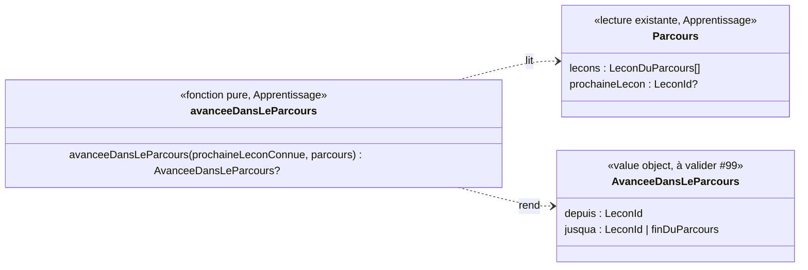

# Modèle du domaine : issue #99, « Mon parcours » devient une carte au trésor

Contexte : **Apprentissage** (le parcours, la prochaine leçon, la place), affiché avec le paysage et le personnage guide de l'univers (**Motivation**, composants livrés par #96 dans `src/univers/`). La story ne change **aucune règle du parcours** : elle dessine ce que `parcoursDeLaMatiere` calcule déjà. Une seule lecture nouvelle, pure, dans `apprentissage/domain/` : l'**avancée dans le parcours** (de quelle leçon à quelle leçon le personnage guide marche). Aucun agrégat, aucune commande, aucun événement enregistré, aucune migration, aucune Edge Function, aucune donnée d'enfant nouvelle.

État : **cadrage**, à valider par le PO (questions #99.1 à #99.15). Le titre de l'issue et ses pistes emploient des mots interdits par le glossaire (« carte », « chemin », « étape », « verrouillée (cadenas) ») : ils sont signalés, pas tranchés (#99.1 à #99.5). Dans ce document, on dit **dessin du parcours** pour le dessin à l'écran, en attendant la réponse du PO.

## Contexte

### Ce qui existe déjà

| Besoin du dessin | D'où il vient | Contexte |
|---|---|---|
| Matières du parcours, une par onglet | `matieresDuParcours(entrees)` | Apprentissage (#25) |
| Leçons du parcours dans l'ordre, avec leur **place** (« Leçon 4 ») et leur état (`reussie` avec étoiles, `reussieAuTestDeDepart`, `prochaine`, `aDecouvrir`) | `parcoursDeLaMatiere(entrees, matiere).lecons` | Apprentissage (#25, #27) |
| La prochaine leçon (au plus une par matière, aucune quand la matière est réussie) | `Parcours.prochaineLecon` | Apprentissage (#25, réponse N8) |
| Compteur « n leçons réussies sur m » | `nombreDeLeconsReussies`, `nombreDeLecons` | Apprentissage (#25) |
| Leçons réussies d'une classe au-dessus, leçons des classes d'avant | `leconsReussiesDesClassesAuDessus`, `leconsDesClassesDAvant` (hors du parcours, jamais la prochaine leçon, sans place) | Apprentissage (#25, #26) |
| Paysage de l'univers, personnage guide dessiné, humeurs | `Paysage`, `PersonnageGuide` (`src/univers/`), palettes et jetons | Motivation, affichage (#96, décision 0033) |
| Mouvements réduits, transitions d'écran | `src/transitions/mouvements-reduits.ts`, `transitionVers` | affichage (#96) |
| Effets sonores | 8 sons fixés par le PO (`docs/sons.md`), choisis par Motivation | Voix, Motivation (#97) |

Tout se calcule dans le navigateur, hors ligne compris (`@domain/apprentissage`). Le réglage **parcours libre** n'est plus lu depuis #25 (réponse N2) : #99 ne le lit pas non plus.

### Ce que la story ajoute

1. **Le dessin du parcours** (affichage seul, `src/parcours/`) : les leçons du parcours placées le long d'un tracé, dans le paysage de l'univers. Chaque leçon montre ce que le domaine dit déjà (place, titre, étoiles, ✓, « À toi ! », « À découvrir »). Pour les lecteurs d'écran et au clavier, il reste la **liste ordonnée** d'aujourd'hui ; le dessin est décoratif (`aria-hidden`).
2. **Le personnage guide se tient sur la prochaine leçon** : simple lecture de `Parcours.prochaineLecon`. Aucune règle nouvelle.
3. **Le personnage guide marche jusqu'à la nouvelle prochaine leçon** quand la prochaine leçon a avancé depuis la dernière fois. C'est le seul point où une décision se prend : **faut-il marcher, d'où, jusqu'où ?** Voir « Domaine ou affichage ».

### Domaine ou affichage : la marche du personnage guide

La décision « il marche de la leçon 3 à la leçon 6 » dépend de règles du parcours :
- la prochaine leçon ne bouge que quand **elle** devient réussie ; une leçon réussie plus loin ne la déplace pas (réponse N8) ;
- elle peut sauter plusieurs places (leçons 4 et 5 déjà réussies, leçons réussies au test de départ) ;
- elle peut disparaître (matière réussie) ;
- elle peut reculer sans que l'enfant ait rien perdu : nouvelle leçon ajoutée à la bibliothèque avant elle, niveau du profil changé par le parent. Ce n'est pas une avancée.

Laisser ces cas à React lui ferait porter une règle (« React ne contient aucune règle métier »), et le front n'a pas de tests unitaires. On les met donc dans une **fonction pure d'Apprentissage**, testée par `Deno.test` et importée par le front : `avanceeDansLeParcours`. Ce n'est pas un agrégat : rien n'est enregistré et il n'y a pas de cycle de vie à protéger.

Le **comment** reste de l'affichage, dans `src/parcours/` : tracé, durée et courbe de la marche, rebond, défilement jusqu'à la prochaine leçon, mouvements réduits (le personnage guide y est déjà), habillage de l'univers.

**Où est mémorisée l'ancienne prochaine leçon ?** C'est la **prochaine leçon connue** d'une matière : l'identifiant de la prochaine leçon au moment où le front l'a vue en dernier (à la dernière ouverture de « Mon parcours » sur cette matière, ou, selon #99.9, quand le profil est choisi). Proposition : elle vit dans la **mémoire de l'utilisation en cours**, comme la matière choisie et les classes d'avant dépliées (`Application.tsx`), une par matière et par profil en cours. Elle n'est ni enregistrée sur l'appareil ni envoyée au serveur : ce n'est pas une donnée nouvelle sur l'enfant. Elle est mise à jour une fois la marche montrée, pour que le personnage guide ne remarche pas au retour suivant. Conséquence : après une fermeture de l'application, il n'y a pas de marche, le personnage guide est déjà sur sa leçon (#99.9).

On compare des **identifiants de leçon**, pas des places : une place peut changer quand la bibliothèque change.

### Communication entre contextes

Aucune relation nouvelle :
- Apprentissage → front : `@domain/apprentissage` (existant), avec une fonction de plus.
- Motivation → front : le personnage guide et l'univers du profil (existant, #6, #96). Motivation ne lit pas le parcours et ne le modifie pas.
- Pas d'effet sonore nouveau : la liste des 8 sons est fermée (#97) ; la marche est silencieuse sauf réponse contraire (#99.13).

## Termes

| Terme | Statut |
|---|---|
| Parcours, Matière du parcours, Prochaine leçon, Leçon à découvrir, Place, Leçon réussie, Leçon réussie au test de départ, Leçon réussie d'une classe au-dessus, Leçon des classes d'avant, Matière réussie, Personnage guide, Univers, Royaume, Humeur du personnage guide | existants, réutilisés tels quels |
| **Avancée dans le parcours** | **nouveau (à valider #99)**, Apprentissage : passage de la prochaine leçon connue d'une matière à une leçon plus loin (ou à la fin du parcours), parce qu'elle est devenue réussie ; le personnage guide la montre en marchant. Ajouté en fin de section Apprentissage du glossaire |
| **Prochaine leçon connue** | **nouveau (à valider #99)**, Apprentissage : la prochaine leçon d'une matière telle que le front l'a vue en dernier pendant l'utilisation en cours ; point de départ de l'avancée. Ajouté en fin de section Apprentissage |
| « Carte », « carte au trésor » | **conflit** : synonyme interdit de **Parcours** (glossaire, ligne Parcours ; Décision n°34) ; « Carte des compétences » existe déjà (Accompagnement, conflit n°10) ; « carte de la question » est un mot d'interface du lot 3 (Décision n°30). Voir #99.1 |
| « Chemin » | **conflit** : synonyme interdit de **Parcours** (ligne Parcours ; Décision n°34). Voir #99.2 |
| « Étape » | **conflit** : synonyme interdit de **Place** (« rang, étape, numéro d'étape ») ; Décisions n°28 et n°34 ; réponse 25.8 (« Étape 1 » devenu « Leçon 1 »). Voir #99.3 |
| « Leçon verrouillée », « cadenas » | **conflit** : terme **abandonné** (Décision n°33, réponse 25.1) : aucun verrou, toutes les leçons du parcours s'ouvrent ; le cadenas a disparu avec #25. Voir #99.4 |
| « Parcours libre » | existant, **sans effet** depuis #25 (réponse N2), encore affiché dans l'espace parent en attendant sa story de Famille. Voir #99.5 |
| « Groupe de leçons », « chapitre » (question 1 de l'issue, défi de fin de chapitre de la story 5) | pas un terme : « chapitre » est interdit (synonyme de **Section du programme** et d'**Épisode**), « Groupe » seul désigne la maison de l'exercice `classer` (Décision n°24). À nommer avec la story 5 si le PO veut des groupes. Voir #99.6 |
| « Trésor », « décor d'arrivée », « tracé », « dessin du parcours », « marche » | **mots d'interface** ou de dessin, pas des termes du domaine (comme « paysage », Décision n°16) |

Synonymes à éviter pour **Avancée dans le parcours** : « progression » (mot d'interface, Décisions n°21 et n°29), « déplacement », « niveau suivant » (« niveau » est la classe), « étape suivante ».

## Modèle

Pas d'agrégat. Une fonction pure et un value object de lecture, à côté de `parcours.ts`.

- **`AvanceeDansLeParcours`** (value object) : `depuis` (la prochaine leçon connue, une leçon du parcours) et `jusqua` (la nouvelle prochaine leçon, ou la fin du parcours quand la matière est réussie). Validité : `jusqua` est **plus loin** que `depuis` dans l'ordre du parcours. Les leçons traversées (celles d'entre les deux) se lisent dans `Parcours.lecons` ; le front en tire les places pour le dessin.
- **`avanceeDansLeParcours(prochaineLeconConnue, parcours)`** : rend une avancée, ou rien. Noms définitifs laissés à `implementer`, en gardant le terme du glossaire.
- Le front garde la **prochaine leçon connue** de chaque matière (voir Contexte) ; ce n'est pas un objet du domaine.
- **Erreurs métier** : aucune. Les cas sans avancée ne sont pas des erreurs (la fonction rend « rien »).

## Invariants

1. **Une avancée n'a lieu que si la prochaine leçon connue est devenue réussie** (étoiles ou réussie au test de départ) et qu'elle est encore une leçon du parcours de la matière. Sinon : aucune avancée, le personnage guide est posé directement sur la prochaine leçon.
2. **Le personnage guide ne marche jamais en arrière.** Si la nouvelle prochaine leçon est avant la prochaine leçon connue (leçon ajoutée à la bibliothèque, niveau changé), il n'y a pas d'avancée.
3. **Une leçon réussie plus loin que la prochaine leçon ne fait pas marcher le personnage guide** (réponse N8 : elle ne déplace pas la prochaine leçon). Exemple : prochaine leçon 3, l'enfant réussit la leçon 7 depuis « Mon parcours » : le personnage guide reste sur la leçon 3, la leçon 7 montre ses étoiles.
4. **L'avancée va jusqu'à la nouvelle prochaine leçon**, même si elle saute des places. Exemple : prochaine leçon 3, leçons 4 et 5 déjà réussies ; l'enfant réussit la 3 : le personnage guide marche de la leçon 3 à la leçon 6.
5. **Quand la matière devient réussie**, l'avancée va de la dernière prochaine leçon connue à la **fin du parcours** (après la dernière leçon) ; ce que le dessin montre là est la question #99.12.
6. **Sans prochaine leçon connue** (première ouverture, application rouverte), pas d'avancée. Le point de départ exact est la question #99.9.
7. **Une avancée se montre une seule fois** : une fois montrée, la nouvelle prochaine leçon devient la prochaine leçon connue (affichage, mais à prouver par un scénario).
8. **Le dessin ne change aucune règle** : mêmes leçons, mêmes places, mêmes états, même prochaine leçon que la liste ; toutes les leçons s'ouvrent ; les leçons des classes d'avant et les leçons réussies d'une classe au-dessus restent hors du parcours, sans place, et le personnage guide ne s'y tient jamais.
9. **Aucune récompense nouvelle** : ce qui orne le dessin (trésor, décor d'arrivée) ne donne ni étoile, ni badge, ni objet de la cabane, et ne s'achète ni ne se tire au hasard (skill `gamification`, section 5). Motivation ne modifie pas le parcours.
10. **Contenu pour les enfants** (`CLAUDE.md`, règle absolue) : le thème « carte au trésor » reste inoffensif. Pas de pirate armé, pas d'arme, pas de squelette ni de tête de mort, pas de piège ni de lieu effrayant ; un trésor est un coffre d'étoiles ou de pierres colorées, une carte dessinée, une boussole. Le dessin passe par le skill `illustration`, section 0.

## Événements

Aucun événement de domaine nouveau, aucune commande. L'avancée n'est pas un fait métier enregistré : c'est une **lecture** comparant deux états du parcours que le front connaît déjà. Les faits qui font avancer la prochaine leçon existent : `SeanceTerminee` (leçon réussie, #24), `TestDeDepartTermine` (leçons réussies au test de départ, #27).

## Emplacement

Domaine (TDD, `Deno.test`), exporté par `supabase/functions/_shared/apprentissage/domain/index.ts` :
- `supabase/functions/_shared/apprentissage/domain/avancee-dans-le-parcours.ts` : `AvanceeDansLeParcours`, `avanceeDansLeParcours` ;
- `supabase/functions/_shared/apprentissage/domain/avancee-dans-le-parcours_test.ts`.

Rien dans `application/`, `infrastructure/`, `supabase/migrations/` ni `supabase/functions/<fonction>/`.

Affichage (`src/`, pour mémoire, à préciser par les critères d'acceptance) :
- `src/parcours/` : dessin du parcours (remplace la liste visible de `LeconsDuParcours` dans `MonParcours.tsx` ; la liste ordonnée reste pour les lecteurs d'écran et le clavier), `BoutonDeLecon.tsx`, `EtatDeLaLecon.tsx`, `textes-du-parcours.ts` réutilisés ; `SectionDesClassesDAvant.tsx` inchangé si #99.7 est suivie ;
- `src/Application.tsx` : mémoire de la prochaine leçon connue par matière, pour l'utilisation en cours ;
- réutilisés sans changement de règle : `src/univers/Paysage.tsx`, `src/univers/PersonnageGuide.tsx` (humeurs), `src/transitions/mouvements-reduits.ts`.

Données d'enfants : **rien de nouveau**. La prochaine leçon connue est calculée et gardée en mémoire le temps de l'utilisation ; rien n'est enregistré ni envoyé, rien ne part à l'IA.

## Questions ouvertes

Chaque question a une recommandation ; le PO répond par oui / non ou par un exemple.

**Langage (conflits avec le glossaire, non tranchés)**

- **#99.1 « Carte », « carte au trésor »** : « carte » est un synonyme interdit de **Parcours** (Décision n°34), et il sert déjà à « Carte des compétences » (Accompagnement) et à « carte de la question » (interface). *Recommandation* : le domaine, le code et les scénarios gardent **Parcours** ; l'écran garde le titre « Mon parcours » ; « carte au trésor » reste le nom de l'idée et de l'issue, jamais un mot d'écran ni de scénario ; les scénarios disent « le dessin du parcours ». D'accord ?
- **#99.2 « Chemin »** : synonyme interdit de **Parcours** (Décision n°34). *Recommandation* : il reste interdit ; le tracé dessiné n'a pas de nom dans le domaine ni à l'écran (« le dessin du parcours » dans les scénarios). D'accord ? Sinon, faut-il l'autoriser comme mot de dessin seulement, ce qui change la Décision n°34 ?
- **#99.3 « Étape »** : synonyme interdit de **Place** (Décisions n°28 et n°34, réponse 25.8). *Recommandation* : chaque leçon du dessin garde son libellé « Leçon 4 » ; les critères de l'issue se réécrivent « le personnage guide se tient sur la leçon 4 », jamais « sur l'étape 4 ». D'accord ?
- **#99.4 « Leçon verrouillée (cadenas) »** : abandonnée par la réponse 25.1 (Décision n°33) : aucun verrou, toutes les leçons s'ouvrent. *Recommandation* : pas de cadenas ; le critère « Une leçon verrouillée montre un cadenas et ne s'ouvre pas » est retiré ; une leçon à découvrir est dessinée ouverte (« À découvrir »), seule la prochaine leçon brille (« À toi ! »). D'accord ?
- **#99.5 « Parcours libre »** : réglage sans effet depuis #25 (réponse N2), encore proposé dans l'espace parent. *Recommandation* : #99 ne le lit pas et n'y touche pas ; son retrait reste à la story de Famille prévue par N2. D'accord ?

**Questions de l'issue**

- **#99.6 (question 1) Beaucoup de leçons** : aujourd'hui, au plus 31 leçons pour une matière et une classe (maths CP), 21 au plus ailleurs. *Recommandation* : un seul dessin par matière, qui défile verticalement et s'ouvre sur la prochaine leçon, comme la liste aujourd'hui ; pas de groupes dans #99. Des groupes de leçons seraient un concept nouveau, à nommer avec la story 5 (défi de fin de chapitre) : « chapitre » est interdit (Section du programme, Épisode) et « Groupe » seul est déjà pris (`classer`). D'accord ?
- **#99.7 (question 2) Leçons hors du parcours** : les leçons réussies d'une classe au-dessus (« Déjà réussies en CE2 ») et les leçons des classes d'avant (bloc dépliable). *Recommandation* : les deux restent à part, sous le dessin, comme aujourd'hui : elles n'ont pas de place, ne sont jamais la prochaine leçon, et le personnage guide ne s'y tient jamais. D'accord ?
- **#99.8 (question 3) Décor qui change le long du dessin** : *Recommandation* : non pour #99 : tout le dessin reprend le paysage de l'univers livré par #96 (mêmes palettes), avec quelques éléments répétés le long du tracé ; des décors propres à chaque univers (forêt, rivière, montagne) demanderaient au moins 6 dessins de plus, validés par le PO, dans une story à part. D'accord ?

**Avancée du personnage guide**

- **#99.9 Point de départ de la marche** : exemple : l'enfant choisit son profil, lance la leçon du jour (leçon 3 de maths) depuis l'accueil, la réussit, puis ouvre « Mon parcours » pour la première fois. Le personnage guide marche-t-il de la leçon 3 à la leçon 4 ? *Recommandation* : oui : la prochaine leçon connue de chaque matière est relevée dès que le profil est choisi, puis à chaque ouverture de « Mon parcours ». Elle n'est gardée que pendant l'utilisation en cours : si l'application est fermée puis rouverte, le personnage guide est déjà sur la leçon 4, sans marcher. D'accord ?
- **#99.10 Marche sur plusieurs leçons** : exemple : après le test de départ, la prochaine leçon passe de la leçon 1 à la leçon 12. *Recommandation* : le personnage guide marche le long du tracé jusqu'à la leçon 12, en une durée qui ne s'allonge pas avec la distance (2 s au plus) ; avec les mouvements réduits, il y est déjà. D'accord ?
- **#99.11 Leçon réussie plus loin** : exemple : prochaine leçon 3, l'enfant réussit la leçon 7. *Recommandation* : le personnage guide ne bouge pas (règle N8 : la prochaine leçon reste la 3) ; la leçon 7 montre ses étoiles. L'idée du skill `gamification` (« il avance d'une étape à chaque leçon réussie ») ne s'applique donc pas. D'accord ?
- **#99.12 Matière réussie** : quand toutes les leçons de la matière sont réussies, il n'y a plus de prochaine leçon. *Recommandation* : le personnage guide marche jusqu'à la fin du dessin et s'y tient, l'air content, à côté d'un décor d'arrivée inoffensif (par exemple un coffre ouvert rempli d'étoiles dessinées) qui ne donne aucune récompense. D'accord ? Sinon, quel décor ?
- **#99.13 Son et parole pendant la marche** : *Recommandation* : aucun effet sonore nouveau (la liste des 8 sons de #97 est fermée) et aucune parole du personnage guide ; une seule annonce pour le lecteur d'écran, à l'arrivée (« Noisette arrive à la leçon 4 »). D'accord ?
- **#99.14 Personnage guide sur l'écran** : aujourd'hui, il est à côté du titre « Mon parcours ». *Recommandation* : un seul personnage guide sur l'écran, sur la prochaine leçon du dessin (ou à la fin si la matière est réussie) ; il quitte le titre. D'accord ?
- **#99.15 Nouveaux termes** : *Recommandation* : ajouter au glossaire **Avancée dans le parcours** et **Prochaine leçon connue** (Apprentissage) ; « trésor », « décor d'arrivée », « tracé » et « dessin du parcours » restent des mots d'interface. D'accord ?
